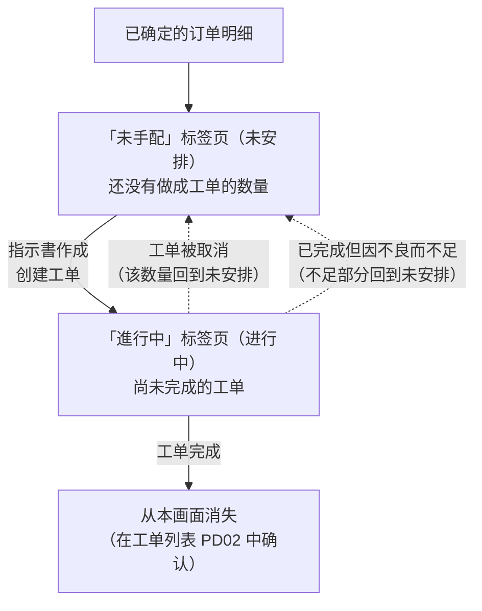

这是把「还没有做工单的订单」和「做了但还没结束的工单」放在一起确认的 **未処理指示書**（未处理工单）应用。操作码是 `PD05`。

> ⚠️ 本应用仍在准备中，正式环境上可能还看不到。找不到时请咨询公司内的负责人。

> 本应用所属的流程……[生产流程](/manual/zh/process/production)

## 本应用能做什么

- 可以用一览的方式查看已确定的订单明细中、工单还没安排够的项目。
- 可以在缺少的数量已经填好的状态下，直接进入[工单](/manual/zh/operations/production/work-order/user)的新建画面。
- 可以确认已经做好、但还没有完成的工单（草稿、待审批、已审批、进行中）。
- 按交货期从近到远决定「今天先给哪个订单做工单」时很方便。

## 本页出现的词语

- **注文明細**（订单明细）… 订单请书中的一行。「这个产品做几根」的接单单位。
- **指示書**（工单）… 「这个产品做几根」的制造指示。
- **手配**（安排）… 给订单明细制作工单。一条明细也可以拆成多张工单。
- **未手配**（未安排）… 接单数量中还没有变成工单的数量，即接单数扣除已安排数量后剩下的部分。

## 如何打开

按主页「生産」（生产）中的 **未処理指示書**（未处理工单）。或者在画面上方的搜索栏输入 `PD05`。查看需要工单的权限。

## 画面说明

画面上有两个标签页。两边都是只显示「还没处理完的东西」的工作队列。

- **未手配**（未安排）… 工单还没配够的订单明细。件数用橙色显示。
- **進行中**（进行中）… 已创建、尚未完成或取消的工单。

可以用上方的搜索栏和「**状態**」（状态）筛选 — 在进行中标签页还可以用「**種別**」（类别）。想清除条件时按「**リセット**」（重置）。

### 未安排标签页

已确定的订单明细中，工单数量还没达到接单数量的项目，按 **交货期从早到晚** 排列。

- **注文明細番号**（订单明细编号）… 点击后打开[订单明细](/manual/zh/operations/sales/order-line/user)的详情。
- **顧客 / 製品**（客户 / 产品）… 是谁下的订单、订的哪种产品。
- **受注数**（接单数）… 订购的数量。
- **手配済**（已安排）… 已经分配给工单的数量合计。已取消的工单（包括中止的工单）不计入。另外，已完成的工单如果因不良而数量不足，缺少的部分会回到未安排（再研磨工单除外）。
- **未手配**（未安排）… 还没有变成工单的数量。用橙色徽章显示。
- **在庫引当**（库存预留）… 已从产品库存预留的数量。这部分可以做成「库存」类型的工单。
- **納期 / 状態**（交货期 / 状态）… 预定交货日和明细的状态（已确定、生产中、部分出货）。

### 进行中标签页

排列尚未完成或取消的工单。点击行会打开[工单](/manual/zh/operations/production/work-order/user)的详情。

- **指示書番号 / 注文明細番号**（工单编号 / 订单明细编号）… 不与订单挂钩的工单会带「**在庫向け**」（面向库存）的徽章。
- **種別**（类别）… 「製造分」（制造）、「在庫分」（库存）或「再研磨」（再研磨）。
- **予定数量 / 承認状態 / 状態**（计划数量 / 审批状态 / 状态）… 计划做几根、审批进行到哪一步、工单处于哪个阶段（草稿、待审批、已审批、进行中）。

已完成的工单不会显示在这个画面上。请在[工单](/manual/zh/operations/production/work-order/user)的一览（`PD02`）中确认。

## 从未安排的订单创建工单

1. 在「**未手配**」（未安排）标签页找到想创建工单的行。
2. 按行右端的「**指示書作成**」（创建工单）。
3. 工单的新建画面会打开。该订单明细已被选中，数量已预先填入 **未安排的数量**。类别 **由该明细的订单类别决定** — 通常为「**製造分**」（制造），需要时可改为「在庫分」（库存）；订单类别为再研磨的明细则固定为「**再研磨**」，无法选择（[类别](/manual/zh/operations/production/work-order/user#field-type)）。
4. 确认内容后保存。之后的步骤请看[工单](/manual/zh/operations/production/work-order/user)的手册。

保存后，「已安排」会相应增加。未安排数量变成 0 的明细会从这个标签页消失。

订单和工单在两个标签页之间的移动如下图所示。

## 常见问题・遇到困难时

**Q. 原来在列表里的订单明细不见了。**
A. 因为接单数量已全部分配给工单（未安排变成了 0）。做好的工单可以在「进行中」标签页或工单一览（`PD02`）中找到。

**Q. 取消（或中止）工单后，订单又回到了未安排标签页。**
A. 这是正确的行为。取消或中止的工单的数量会从「已安排」中扣除，这部分会回到未安排，可以重新安排。

**Q. 未安排标签页显示「指示書待ちの注文明細はありません」（没有等待工单的订单明细）。**
A. 意思是现在没有需要安排工单的订单明细。订单明细在确定后（获得分支编号后）会出现在这里。

**Q. 在哪里能看到已完成的工单？**
A. 这个画面是工作队列，不显示已完成、已取消的工单。请在工单一览（`PD02`）中把状态筛选为「完了」（已完成）。

**Q. 一个订单可以拆成多张工单吗？**
A. 可以。在「指示書作成」（创建工单）中减少数量后保存，剩余的数量会作为未安排继续留在这个列表里。

<!-- permissions:start -->
## 所需权限

使用本画面需要 **工单**（`work_order`）权限。

| 想做的事 | 所需权限 |
| --- | --- |
| 打开画面、查看列表与明细 | 工单 — 查看 |
| 新增・变更・删除 | 工单 — 创建 / 更新 / 删除 |

仅查看有「查看」即可。画面中若有新增、变更或删除的操作，则分别需要对应的权限。

权限通过角色授予。若不足，请与管理员联系。

权限的整体说明请参见「[权限与角色](../../../permissions)」。
<!-- permissions:end -->
