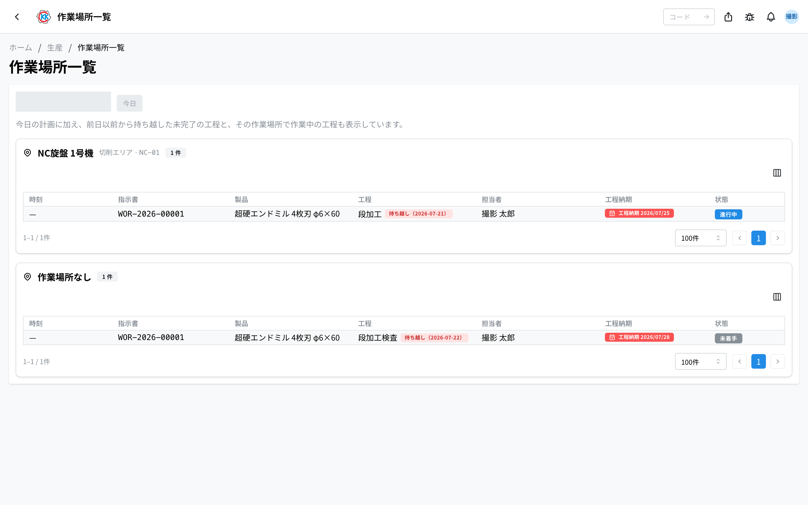
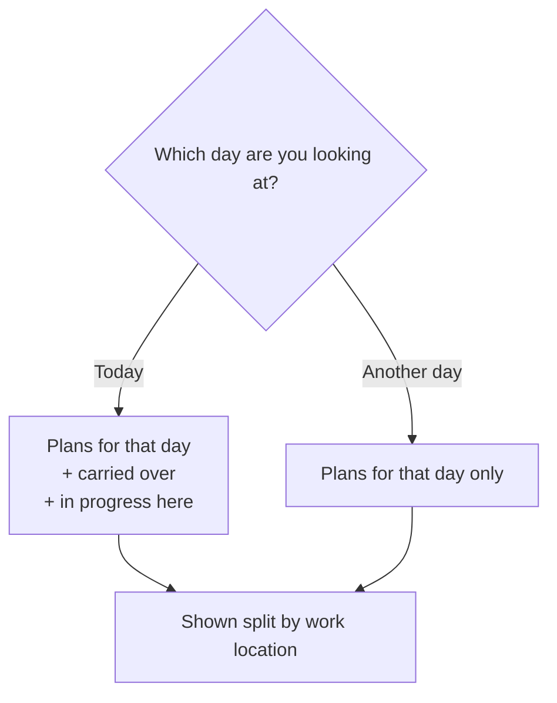

This app lets you check, for a chosen day, **which steps are waiting at which work location (machine)**, across all work locations at once. The operation code is `PD09`.

> ⚠️ This app is still being prepared, so it may not appear on the live system yet. If you cannot find it, please ask the person in charge at your company.

> The flow this app belongs to … [Production flow](/manual/en/process/production)

## What you can do with this app

- You can see today's work plans in a list, split by work location.
- You can also see steps that were not finished by the previous day (**carried over**) and steps being worked on now.
- You can change the date to see plans for a later day, or what was done on a past day.
- Steps past their **step due date** are shown in red.
- Press a row to open the execution screen of that step.

「[作業場所の工程](/manual/en/operations/kiosk/work-location/user)」 (Work location steps) on the shared shop-floor device shows the steps waiting at the **one** machine where the tablet is placed. This app shows the same thing for **all work locations** at once, from an office PC.

## Words used on this page

- **Work location** … a place where steps are done, such as a machine or an area (registered in the [work location](/manual/en/operations/masters/work-location/user) master).
- **Work plan** … the plan of who does the step, when, and at which work location. It is entered per step of a [work order](/manual/en/operations/production/work-order/user).
- **Carried over (持ち越し)** … a step planned for an earlier day that is not finished yet.
- **In progress here (作業中)** … an in-progress step for which actual work was recorded at that work location.
- **Step due date (工程納期)** … the deadline for finishing that step. It is set per step of a work order.

## How to open it

Press **作業場所一覧** (Work location board) under 「生産」 (Production) on the home screen, or type `PD09` in the search box at the top of the screen. You need the work order permission to view it.

## How to read the screen

When you open it, the list for **today** is shown.

There is one box per work location. The box heading shows the **work location name, group name and code**, and the count for that day (「2 件」). Boxes are ordered as in the work location master (group → work location), and work locations with no step are not shown.

The table in each box has these columns.

- **時刻** (time) … the start and end time of the work plan. A plan with no time shows 「—」.
- **指示書** (work order) … the document number of the work order.
- **製品** (product) … the product being made.
- **工程** (step) … the step name. A mark may be added showing why the row is on today's list (see the table below).
- **担当者** (assignee) … the assignee on the work plan. 「—」 if none is set.
- **工程納期** (step due date) … the deadline of the step. A step past its due date and not yet finished is shown in red. 「—」 if none is set.
- **状態** (status) … the status of the step (not started, in progress, completed).

Rows are ordered by the planned start time, earliest first (rows with no time come last). Press a column heading to sort. Press a row to open the execution screen of that step.

### Which steps are shown

| Mark | What kind of step | When it is shown |
|---|---|---|
| (no mark) | A step with a work plan on that day | On any day |
| **持ち越し（date）** (Carried over, red) | A step planned for an earlier day that is not finished yet. The date in brackets is the original planned date | Only when looking at today |
| **作業中** (In progress here, blue) | An in-progress step for which actual work was recorded at that work location | Only when looking at today |

- Steps of **approved and in-progress** work orders are shown (plans for the chosen day also include completed work orders — so that when you look at a past day you can see what was done that day). Draft, pending-approval and cancelled work orders are not shown.
- Steps whose work plan has no work location (outsourced steps, for example) are gathered in the 「**作業場所なし**」 (No work location) box at the bottom.

## Change the date

1. Press the date box at the top left and choose the day you want to see.
2. To go back to today, press 「**今日**」 (Today) to its right.

When you are looking at a day other than today, 「**この日の作業計画を作業場所ごとに表示しています。**」 (work plans for this day are shown by work location) is displayed and only steps with a plan on that day are listed. Carried-over and in-progress-here steps are shown only when you are looking at today.

> 💡 When you change the date, the date is added to the screen URL. Share the URL as it is and the other person can open the list for the same day.

## Open a step

Press a row to open the execution screen of that step (the step execution view of the [work order](/manual/en/operations/production/work-order/user)). Changing the work plan or the step due date, and starting or completing the step, are done on that screen. Nothing can be changed directly from this app.

## Questions and problems

**Q. 「この日の作業計画はありません」 (there are no work plans for this day) is shown.**
A. No step has a work plan on that day (for today, there are no carried-over or in-progress-here steps either). Work plans are entered per step of a work order.

**Q. A step I expected does not appear.**
A. It is one of the following.
- The step has no work plan on that day (the list is driven by the date of the work plan).
- The work order is still a draft or pending approval. It appears once approved.
- The step or the work order has been cancelled.

**Q. The same step appears under two work locations.**
A. Either its work plan is split across two work locations, or actual work was recorded at a work location different from the plan. Press the row and check the step's work plan and actual work.

**Q. Steps are listed under 「作業場所なし」 (No work location).**
A. These are steps whose work plan has no work location. Outsourced steps and steps for which the [process step master](/manual/en/operations/masters/process-step/user) does not require a work location appear here. To set a work location, press the row and correct the work plan.

**Q. The count does not match 「作業場所の工程」 (Work location steps) on the shared device.**
A. The shared device shows only the steps waiting at the tablet's work location (or its group). This app shows all work locations and also shows completed steps for the chosen day. The scope is different.

<!-- permissions:start -->
## Permissions required

Using this screen requires the **Work order** (`work_order`) permission.

| What you want to do | Permission needed |
| --- | --- |
| Open the screen, view lists and details | Work order — View |
| Add, change or delete | Work order — Create / Edit / Delete |

Viewing only needs *View*. Where a screen offers adding, changing or deleting, each of those needs its matching permission.

Permissions come through roles. If something is missing, ask an administrator.

For the whole picture see [Permissions and roles](../../../permissions).
<!-- permissions:end -->
