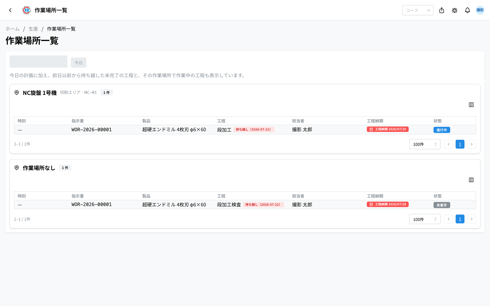
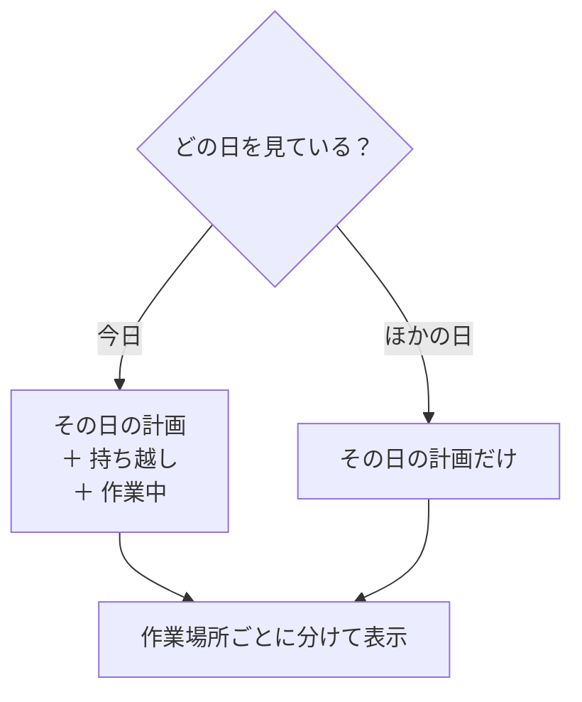

選んだ日に、**どの作業場所（機械）で何の工程が待っているか** を、すべての作業場所ぶんまとめて確認するアプリです。操作コードは `PD09` です。

> このアプリが属するフロー … [生産の流れ](/manual/ja/process/production)

## このアプリでできること

- 今日の作業計画を、作業場所ごとに分けて一覧で確認できます。
- 前の日までに終わらなかった工程（**持ち越し**）と、いま作業している工程も一緒に確認できます。
- 日付を変えて、先の日の計画や、過ぎた日に何をしたかを確認できます。
- **工程納期** を過ぎている工程が赤で分かります。
- 行を押すと、その工程の実行画面を開けます。

現場の共有端末の「[作業場所の工程](/manual/ja/operations/kiosk/work-location/user)」は、タブレットが置かれている **1 か所** の機械に待っている工程を出します。このアプリは、それを **全部の作業場所ぶん**、事務所のパソコンから一度に見る画面です。

## 用語（このページで出てくる言葉）

- **作業場所** … 機械や区画など、工程を行う場所です（[作業場所](/manual/ja/operations/masters/work-location/user)マスタで登録します）。
- **作業計画** … 「誰が・いつ・どの作業場所で」その工程を行うかの予定です。[指示書](/manual/ja/operations/production/work-order/user)の工程ごとに入れます。
- **持ち越し** … 前の日までの計画で、まだ終わっていない工程です。
- **作業中** … その作業場所で実績を記録した、進行中の工程です。
- **工程納期** … その工程をいつまでに終えるかの締切です。指示書の工程ごとに決めます。

## 開き方

ホーム画面の「生産」の中にある **作業場所一覧** を押します。または、画面上の検索欄に `PD09` と入れます。閲覧には指示書の権限が必要です。

## 画面の見かた

開くと、**今日** の一覧が表示されます。

作業場所ごとに 1 つの枠になっていて、枠の見出しに **作業場所の名前・グループ名・コード** と、その日の件数（「2 件」）が出ます。枠は作業場所マスタの並び順（グループ → 作業場所）で並び、工程が 1 件も無い作業場所は出ません。

枠の中の表には次の列があります。

- **時刻** … 作業計画の開始〜終了の時刻です。時刻を決めていない計画は「—」です。
- **指示書** … 指示書の書類番号です。
- **製品** … 作る製品です。
- **工程** … 工程の名前です。その行がなぜ今日の一覧に出ているかの印が付くことがあります（下の表）。
- **担当者** … 作業計画の担当者です。決めていなければ「—」です。
- **工程納期** … その工程の締切です。過ぎていてまだ終わっていない工程は赤で表示されます。決めていなければ「—」です。
- **状態** … 工程の状態（未着手・進行中・完了）です。

行は、計画の開始時刻の早い順に並びます（時刻の無いものは後ろ）。列の見出しを押すと並べ替えられます。行を押すと、その工程の実行画面が開きます。

### どの工程が出るか

| 印 | どんな工程か | いつ出るか |
|---|---|---|
| （印なし） | その日に作業計画が入っている工程 | どの日でも |
| **持ち越し（日付）**（赤） | 前の日までの計画で、まだ終わっていない工程。かっこの中はもとの計画日です | 今日を見ているときだけ |
| **作業中**（青） | その作業場所で実績を記録した、進行中の工程 | 今日を見ているときだけ |

- 出るのは **承認済み・進行中** の指示書の工程です（その日の計画には、完了した指示書の分も出ます — 過ぎた日を見たときに、その日に何をしたかが分かるようにするためです）。下書き・承認依頼中・キャンセルの指示書は出ません。
- 作業計画に作業場所が入っていない工程（外注の工程など）は、いちばん下の「**作業場所なし**」の枠にまとまります。

## 日付を変える

1. 左上の日付の欄を押し、見たい日を選びます。
2. 今日に戻すときは、その右の「**今日**」を押します。

今日以外の日を見ているときは「**この日の作業計画を作業場所ごとに表示しています。**」と出て、その日に計画が入っている工程だけが並びます。持ち越しと作業中の工程は、今日を見ているときだけ出ます。

> 💡 日付を変えると、画面の URL にその日付が入ります。URL をそのまま共有すれば、同じ日の一覧を相手も開けます。

## 工程を開く

行を押すと、その工程の実行画面（[指示書](/manual/ja/operations/production/work-order/user)の工程実行ビュー）が開きます。作業計画の変更や工程納期の変更、工程の開始・完了は、その画面で行います。このアプリから直接は変更できません。

## よくある質問・困ったとき

**Q.「この日の作業計画はありません」と出ます。**
A. その日に作業計画が入っている工程がありません（今日なら、持ち越しも作業中の工程もありません）。作業計画は、指示書の工程ごとに入れます。

**Q. 予定しているはずの工程が出てきません。**
A. 次のどれかに当たります。
- その工程に、その日の作業計画が入っていない（一覧は作業計画の日付で出ます）。
- 指示書がまだ下書き・承認依頼中である。承認されると出ます。
- その工程や指示書がキャンセルされている。

**Q. 同じ工程が 2 つの作業場所に出ています。**
A. 作業計画が 2 つの作業場所に分かれて入っているか、計画とは別の作業場所で実績が記録されています。行を押して、工程の作業計画と作業実績を確認してください。

**Q.「作業場所なし」に工程が並んでいます。**
A. 作業計画に作業場所が入っていない工程です。外注の工程や、[工程マスタ](/manual/ja/operations/masters/process-step/user)で作業場所を求めていない工程はここに出ます。作業場所を決めたいときは、行を押して作業計画を直してください。

**Q. 共有端末の「作業場所の工程」と件数が合いません。**
A. 共有端末は、タブレットの作業場所（またはそのグループ）に待っている工程だけを出します。このアプリは全部の作業場所を出すうえ、選んだ日の完了した工程も出します。見ている範囲が違います。

<!-- permissions:start -->
## 必要な権限

この画面を使うには **指示書**（`work_order`）の権限が要ります。

| したいこと | 必要な権限 |
| --- | --- |
| 画面を開く・一覧や詳細を見る | 指示書 の 閲覧 |
| 追加・変更・削除する | 指示書 の 作成 / 更新 / 削除 |

見るだけなら「閲覧」で足ります。追加・変更・削除の操作がある画面では、その操作にあたる権限がそれぞれ必要です。

権限は役割（ロール）を通して付きます。足りないときは管理者に相談してください。

権限の全体像は「[権限とロール](../../../permissions)」を参照してください。
<!-- permissions:end -->
