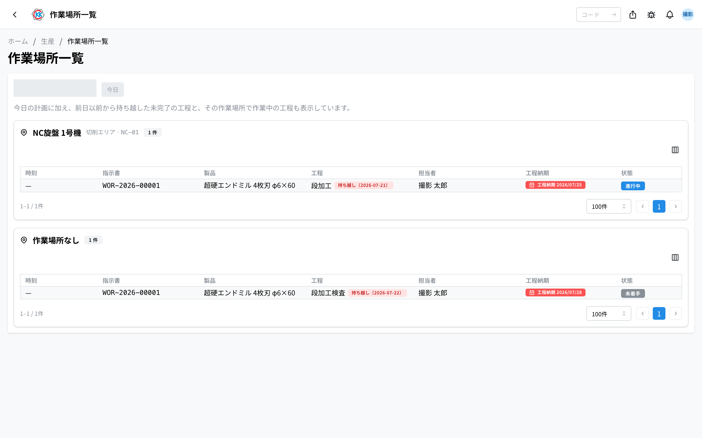
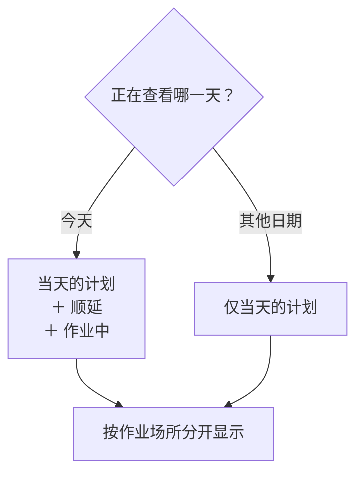

这是用于一次性查看所有作业场所、在所选日期 **哪个作业场所（机器）有哪些工序在等待** 的应用。操作代码是 `PD09`。

> ⚠️ 本应用仍在准备中，正式环境上可能还看不到。找不到时请咨询公司内的负责人。

> 本应用所属的流程 … [生产流程](/manual/zh/process/production)

## 本应用可以做什么

- 可以按作业场所分开，在列表中查看今天的作业计划。
- 可以同时查看到前一天为止没有完成的工序（**顺延**）和正在作业的工序。
- 可以更改日期，查看之后日期的计划，或过去某天做了什么。
- 超过 **工序交期** 的工序以红色显示。
- 点击行，可以打开该工序的执行画面。

现场共用终端的「[作業場所の工程](/manual/zh/operations/kiosk/work-location/user)」（作业场所工序）显示的是平板所在的 **1 处** 机器上等待的工序。本应用则是在办公室的电脑上，一次查看 **全部作业场所** 的同类内容。

## 术语（本页出现的词语）

- **作业场所** … 机器、区域等进行工序的场所（在[作业场所](/manual/zh/operations/masters/work-location/user)主数据中登记）。
- **作业计划** … 「谁・何时・在哪个作业场所」进行该工序的安排。按[工单](/manual/zh/operations/production/work-order/user)的工序分别填写。
- **持ち越し（顺延）** … 计划在之前的日期、但尚未完成的工序。
- **作業中（作业中）** … 在该作业场所记录了实绩的进行中工序。
- **工程納期（工序交期）** … 该工序最迟完成的期限。按工单的工序分别决定。

## 打开方法

在首页的「生産」（生产）中点击 **作業場所一覧**（作业场所一览），或在画面上方的搜索栏中输入 `PD09`。查看需要工单的权限。

## 界面说明

打开后，显示 **今天** 的列表。

每个作业场所是 1 个框，框的标题显示 **作业场所名称・分组名称・代码**，以及当天的条数（「2 件」）。框按作业场所主数据的排列顺序（分组 → 作业场所）排列，没有任何工序的作业场所不显示。

框内的表有以下列。

- **時刻**（时间）… 作业计划的开始〜结束时间。未决定时间的计划显示「—」。
- **指示書**（工单）… 工单的单据编号。
- **製品**（产品）… 要制造的产品。
- **工程**（工序）… 工序的名称。有时会附上标记，说明该行为什么出现在今天的列表中（见下表）。
- **担当者**（负责人）… 作业计划的负责人。未决定时显示「—」。
- **工程納期**（工序交期）… 该工序的期限。已过期且尚未完成的工序以红色显示。未决定时显示「—」。
- **状態**（状态）… 工序的状态（未开始・进行中・已完成）。

行按计划开始时刻从早到晚排列（没有时刻的排在后面）。点击列标题可以排序。点击行，会打开该工序的执行画面。

### 显示哪些工序

| 标记 | 什么样的工序 | 何时显示 |
|---|---|---|
| （无标记） | 当天有作业计划的工序 | 任何日期 |
| **持ち越し（日期）**（顺延，红色） | 计划在之前的日期、但尚未完成的工序。括号内是原来的计划日 | 仅在查看今天时 |
| **作業中**（作业中，蓝色） | 在该作业场所记录了实绩的进行中工序 | 仅在查看今天时 |

- 显示的是 **已批准・进行中** 工单的工序（当天的计划中也包含已完成工单的部分 —— 这样在查看过去的日期时，可以知道那天做了什么）。草稿・审批中・已取消的工单不显示。
- 作业计划中没有作业场所的工序（外协工序等），汇总在最下方的「**作業場所なし**」（无作业场所）框中。

## 更改日期

1. 点击左上角的日期栏，选择要查看的日期。
2. 想回到今天时，点击其右侧的「**今日**」（今天）。

查看今天以外的日期时，会显示「**この日の作業計画を作業場所ごとに表示しています。**」（按作业场所显示这一天的作业计划），只列出当天有计划的工序。顺延和作业中的工序只在查看今天时显示。

> 💡 更改日期后，画面的 URL 中会带上该日期。直接分享 URL，对方就能打开同一天的列表。

## 打开工序

点击行，会打开该工序的执行画面（[工单](/manual/zh/operations/production/work-order/user)的工序执行视图）。更改作业计划、更改工序交期，以及工序的开始・完成，都在那个画面中进行。不能从本应用直接更改。

## 常见问题・遇到困难时

**Q. 显示「この日の作業計画はありません」（这一天没有作业计划）。**
A. 当天没有填写了作业计划的工序（如果是今天，也没有顺延和作业中的工序）。作业计划按工单的工序分别填写。

**Q. 应该已经安排的工序没有出现。**
A. 属于以下情况之一。
- 该工序没有填写当天的作业计划（列表按作业计划的日期显示）。
- 工单仍是草稿或审批中。批准后就会显示。
- 该工序或工单已被取消。

**Q. 同一道工序出现在 2 个作业场所中。**
A. 作业计划分别填在了 2 个作业场所，或者在与计划不同的作业场所记录了实绩。请点击行，确认工序的作业计划和作业实绩。

**Q. 「作業場所なし」（无作业场所）中列着工序。**
A. 这些是作业计划中没有作业场所的工序。外协工序，以及在[工序主数据](/manual/zh/operations/masters/process-step/user)中不要求作业场所的工序会出现在这里。想决定作业场所时，请点击行修改作业计划。

**Q. 与共用终端的「作業場所の工程」（作业场所工序）的条数对不上。**
A. 共用终端只显示平板的作业场所（或其分组）上等待的工序。本应用显示全部作业场所，并且还显示所选日期已完成的工序。查看的范围不同。

<!-- permissions:start -->
## 所需权限

使用本画面需要 **工单**（`work_order`）权限。

| 想做的事 | 所需权限 |
| --- | --- |
| 打开画面、查看列表与明细 | 工单 — 查看 |
| 新增・变更・删除 | 工单 — 创建 / 更新 / 删除 |

仅查看有「查看」即可。画面中若有新增、变更或删除的操作，则分别需要对应的权限。

权限通过角色授予。若不足，请与管理员联系。

权限的整体说明请参见「[权限与角色](../../../permissions)」。
<!-- permissions:end -->
