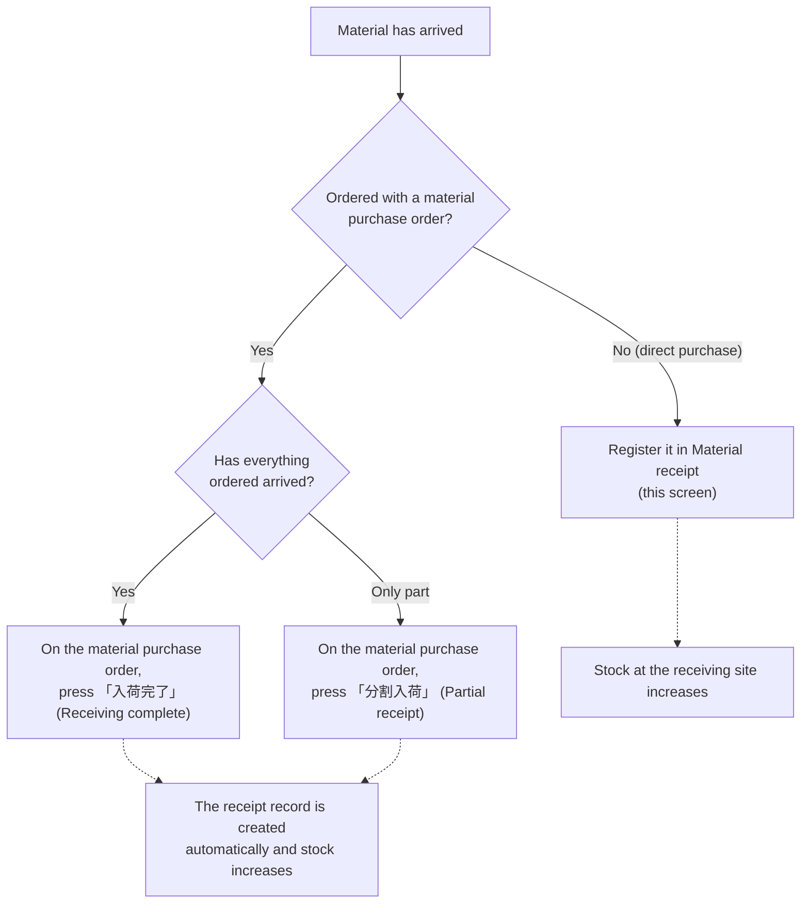
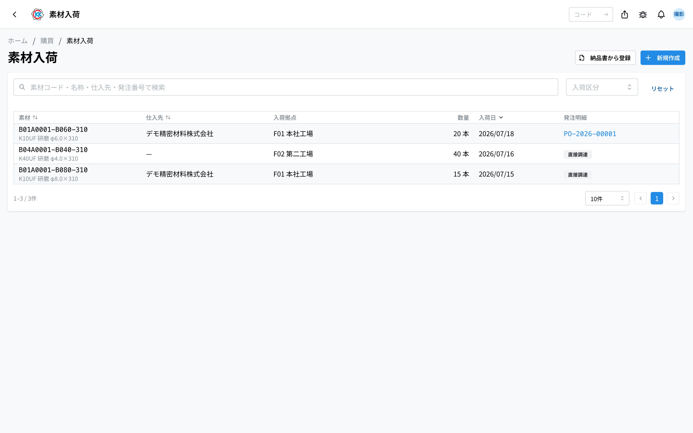
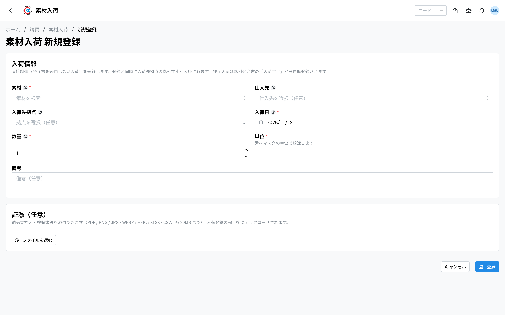
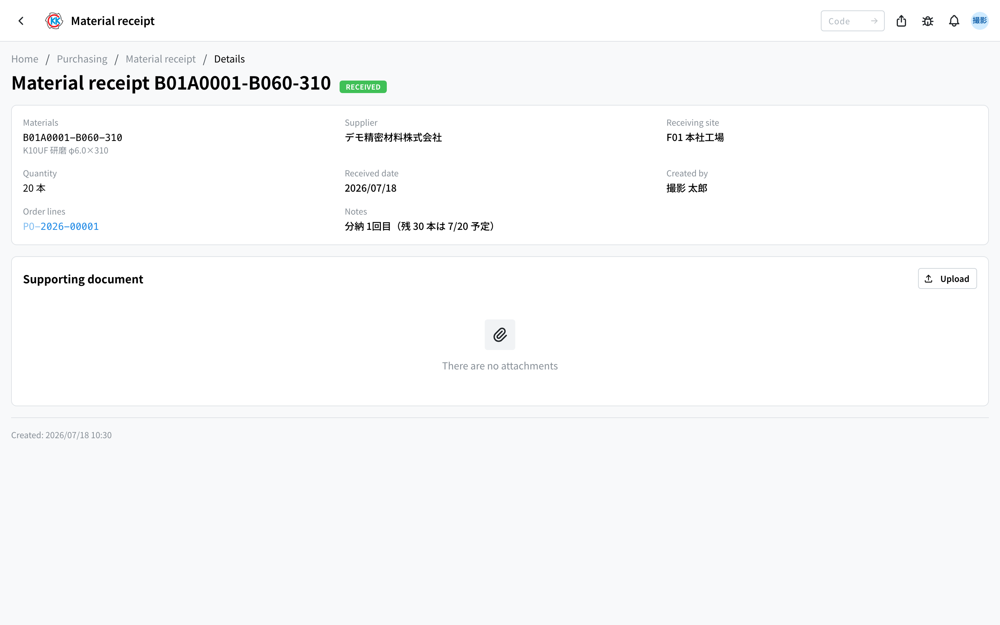
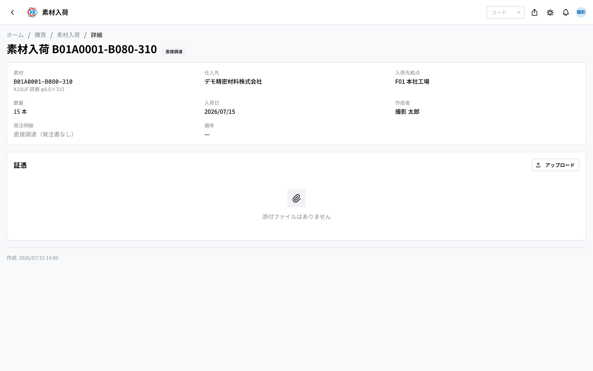

This is the **素材入荷** (material receipt) app, where you record that material has arrived. The operation code is `PU03`.

> ⚠️ This app is still being prepared, so it may not appear on the live system yet. If you cannot find it, please ask the person in charge at your company.

> This app belongs to … [Purchasing flow](/manual/en/process/purchasing)

## What you can do with this app

- You can record that material has arrived. When you do, **the stock at that site goes up by the same amount**.
- You can look back at what arrived, when, where, and how many pieces.
- You can keep copies of delivery notes and inspection reports attached to the arrival record.
- Use it when material bought without a purchase order (material brought in directly, for example) arrives.
- You can **read a supplier's delivery note with AI** and register the delivered materials in one go.

## Words used on this page

- **入荷** (arrival) … material actually arriving.
- **発注入荷** (arrival from an order) … an arrival of material ordered with a [material purchase order](/manual/en/operations/purchasing/purchase-order/user). **It is recorded automatically when you press 「入荷完了」 (Receiving complete) or 「分割入荷」 (Partial receipt) on the purchase order screen.**
- **直接調達** (direct purchase) … an arrival of material bought without a purchase order. **You type it in on this screen.**
- **入荷先拠点** (receiving site) … the site (plant or business location) that receives the material.
- **証憑** (supporting document) … papers you may want to look at later, such as a copy of the delivery note or an inspection report.

## Before you start

- The **material that arrived must be registered in the [material master](/manual/en/operations/masters/material/user)**. You cannot choose a material that is not registered.
- To choose the site whose stock should go up, that **[site](/manual/en/operations/masters/plant/user) must be registered**.
- You need material receipt permission to register arrivals. If the buttons do not appear, please ask the person in charge at your company.

> ⚠️ **This screen is only for material bought without a purchase order (direct purchases).** When material ordered with a purchase order arrives — all of it or only part — do not register it on this screen (「新規作成」 (New) or 「納品書から登録」 (From a delivery note)). Receipts registered here are **not linked to the purchase order**, so the order's remaining quantity does not go down, and pressing 「入荷完了」 (Receiving complete) later **puts the same material into stock a second time**. For ordered material, use the [material purchase order](/manual/en/operations/purchasing/purchase-order/user) screen: 「**入荷完了**」 (Receiving complete) when everything has arrived, or 「**分割入荷**」 (Partial receipt) when only part has. The receipt record is created automatically.

> 💡 When you choose a material and supplier, if a purchase order in 「**発注済**」(Ordered) still has part of the same material outstanding, an orange confirmation appears on screen (PO number, remaining quantity and a link to the purchase order). If it is the ordered material, open the purchase order from the link and record it with 「**分割入荷**」(partial receipt). Only when it really is a separate purchase, tick 「**発注書とは別の購入として登録する**」(register as a purchase separate from the purchase order) and register. It cannot be registered without the tick.

As a diagram, this is where to record an arrival:

## How to read the screen

When you open the app, the arrival records are listed with the newest first.

- **素材** (material) … the material code on top and the material name below.
- **発注明細** (order line) … for material that came from a purchase order, the order number starting with `PO-` appears as a blue link. For material that did not go through a purchase order, a grey 「**直接調達**」 (direct purchase) badge appears.
- Type a material code, a name, a supplier, or an order number into the search box at the top to narrow down the list.
- The 「**入荷区分**」 (arrival type) box on the right lets you show only 「発注入荷」 (arrivals from an order) or only 「直接調達」 (direct purchases).
- Click a row to open the detail screen for that arrival.

## Registering material that arrived (direct purchase)

1. Press 「**新規作成**」 (New) at the top right of the list screen.
2. Click the 「**素材**」 (material) box, search by material code or name, and choose one. You must choose one.
3. Choose the 「**仕入先**」 (supplier). You may leave it blank.
4. Choose the site that received the material in 「**入荷先拠点**」 (receiving site).
5. Check the 「**入荷日**」 (arrival date). It starts with today's date.
6. Enter how many pieces arrived in 「**数量**」 (quantity).
7. Check the 「**単位**」 (unit). It is filled in from the material master when you choose the material, and cannot be changed.
8. To keep a copy of the delivery note with the record, press 「**ファイルを選択**」 (Choose file) under 「**証憑（任意）**」 (supporting document, optional) and choose the file.
9. Finally, press 「**登録**」 (Register).

When you register it, the material stock at the site you chose goes up by that amount, and the detail screen opens.

> ⚠️ If you register with 「入荷先拠点」 (receiving site) left blank, the material does not go into any site's stock — it is treated as stock with no site. This cannot be fixed afterwards, so please always choose the site that received it.

You can attach PDF, PNG, JPG, WEBP, HEIC, XLSX, and CSV files, up to 20MB each.

## Registering from a delivery note (direct purchase)

When the delivery note for material bought without a purchase order arrives, you can read it with AI and register several materials at once.

1. Press 「**納品書から登録**」 (From a delivery note) on the list screen.
2. Choose the delivery note (PDF or image) in the 「**AI で読み取る**」 (Read with AI) panel and press 「**AI で読み取る**」 (Read with AI). Price columns are not read.
3. The supplier and line items that were read are shown. The 「**入荷拠点**」 (Receiving site) and 「**入荷日**」 (Received date) at the top apply to all lines (you can also change them per line). The received date starts as the date read from the delivery note.
4. For lines whose material could not be identified, pick it from the candidates. For lines you do not want to register, choose 「**この行を登録しない**」 (Do not register this line). The unit comes from the material master.
5. Press 「**選択した ◯ 件を登録**」 (Register ◯ selected).

The selected lines are registered **together in one go**. If even one line fails, none of them is registered (you never end up with only half registered). You cannot register while a line still has no material. The delivery note you read is attached automatically to each registered receipt as 「**取込元（原本）**」 (source original). The system remembers the material names you picked, so the next delivery note in the same supplier's format is matched more easily.

> ⚠️ Receipts registered here are not linked to a purchase order either. Record delivery notes for material ordered with a purchase order with 「**分割入荷**」 (Partial receipt) or 「**入荷完了**」 (Receiving complete) on the [material purchase order](/manual/en/operations/purchasing/purchase-order/user), not on this screen.

## Looking at what you recorded

Click a row in the list to open the detail screen for that arrival.

- You can check the material, supplier, receiving site, quantity, arrival date, and notes.
- **発注明細** (order line) … for material that came from a purchase order, a link to the original [material purchase order](/manual/en/operations/purchasing/purchase-order/user) is shown. Click it to check the order.
- For a direct purchase, the screen shows 「**直接調達（発注書なし）**」 (direct purchase — no purchase order).

- You can add or delete files later from the 「証憑」 (supporting documents) box.

## Input fields

Every field on the material receipt screen. The **?** next to a field in the app links straight to its description here.

| Field | Required | What to enter |
|-------|----------|---------------|
| [Material](#field-material) | Required | The material that arrived |
| [Supplier](#field-supplier) | Optional | Who delivered it |
| [Receiving site](#field-plant) | Optional | Where it was received |
| [Received date](#field-received-date) | Required | The day it arrived |
| [Quantity](#field-quantity) | Required | How much actually arrived |
| [Unit](#field-unit) | Required | Pieces, kg and so on |
| [Notes](#field-notes) | Optional | Anything worth recording, such as damage |

### Material [#field-material]

The material that arrived. When recording against a purchase order, its contents are carried over.

### Supplier [#field-supplier]

Who delivered it. This is filled in automatically when recording against a purchase order; choose it here for a direct purchase.

### Receiving site [#field-plant]

The site that actually received it. **Stock increases at this site**, so choose where the goods arrived.

### Received date [#field-received-date]

The day it arrived. **Stock increases as of this date.** Even if you record it later, enter the day it was actually received.

### Quantity [#field-quantity]

How much actually arrived. If a direct purchase arrives in parts, record what arrived and enter the rest as a later receipt. **Partial arrivals of material ordered with a purchase order are recorded with 「分割入荷」 (Partial receipt) on the purchase order, not on this screen.**

### Unit [#field-unit]

Pieces, kg, m and so on. Choosing the material fills in the unit registered in the material master. This box cannot be changed.

### Notes [#field-notes]

Anything worth checking later, such as damage or a count that did not match. Delivery notes and other paperwork can be attached as files on this screen.

## Questions and problems

**Q. Material I ordered has arrived. Do I register it here?**
A. No. Please press 「**入荷完了**」 (Receiving complete) on the [material purchase order](/manual/en/operations/purchasing/purchase-order/user) screen. The arrival record is created from there automatically. If you type it in here as well, the same material goes into stock twice.

**Q. Only part of the material I ordered arrived first.**
A. Do not register it on this screen. Press 「**分割入荷**」 (Partial receipt) on the [material purchase order](/manual/en/operations/purchasing/purchase-order/user) screen and record just the pieces that arrived. You cannot receive more than the ordered quantity, and once every line reaches its ordered quantity the order becomes received automatically. If it is decided that the rest will not come, close the order with 「**未入荷のまま完了**」 (Close without receiving).

**Q. I want to change what I registered.**
A. An arrival record is a fixed record made after the stock has already moved, so it cannot be changed or deleted. There are no 「編集」 (Edit) or 「削除」 (Delete) buttons. Please check the quantity and the site carefully before you register.

**Q. I see 「素材を選択してください」 (Please select a material) and cannot register.**
A. The 「素材」 (material) box is still empty. Click the box, search by material code or name, and choose from the list. Just typing the text does not count as choosing.

**Q. I see 「20MB を超えるファイルは添付できません」 (Files over 20MB cannot be attached).**
A. The file you chose is too big. If it is a photo, take it again at a smaller size, or combine the pages into a PDF and choose that instead.

**Q. I registered it, but the stock at that site has not gone up.**
A. Please open the detail screen and check whether it was registered with 「入荷先拠点」 (receiving site) left blank. If no site was chosen, it is recorded as stock with no site instead of stock at that site.

<!-- permissions:start -->
## Permissions required

Using this screen requires the **Material receipt** (`material_receipt`) permission.

| What you want to do | Permission needed |
| --- | --- |
| Open the screen, view lists and details | Material receipt — View |
| Add, change or delete | Material receipt — Create / Edit / Delete |

Viewing only needs *View*. Where a screen offers adding, changing or deleting, each of those needs its matching permission.

Permissions come through roles. If something is missing, ask an administrator.

For the whole picture see [Permissions and roles](../../../permissions).
<!-- permissions:end -->
