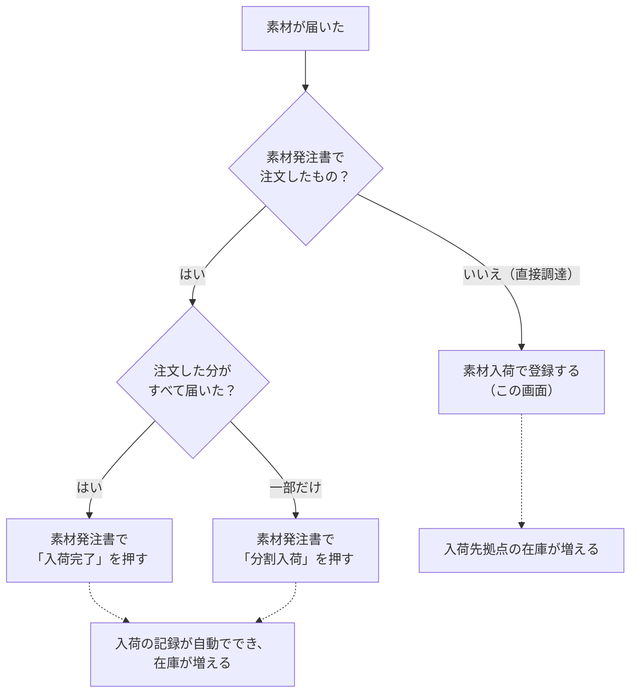
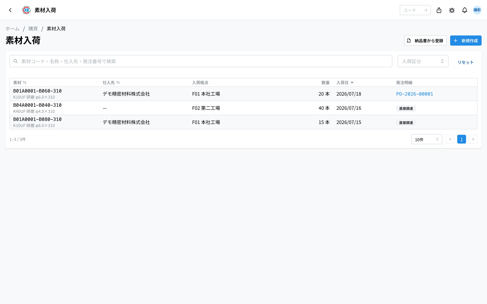
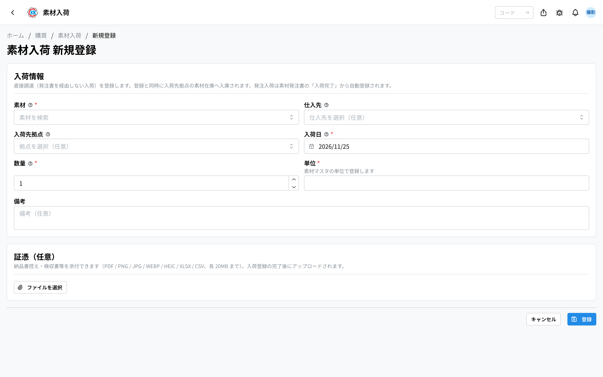
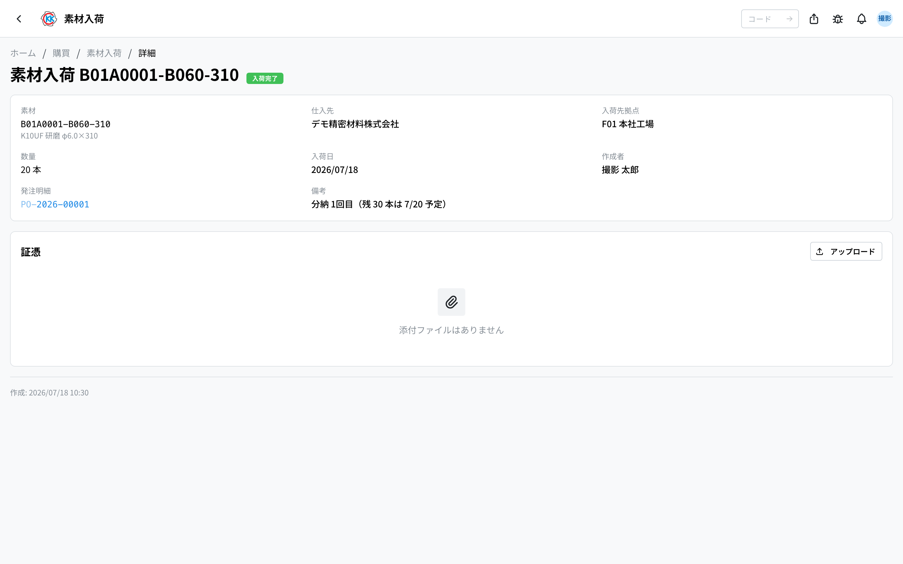
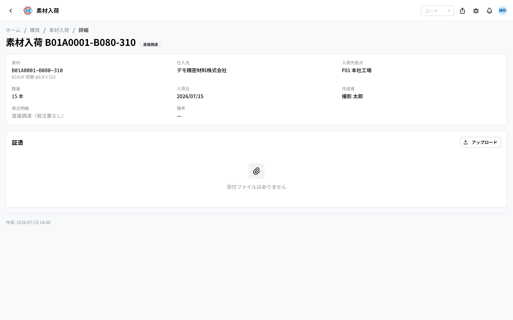

素材が届いたことを記録する **素材入荷** のアプリです。操作コードは `PU03` です。

> ⚠️ このアプリはまだ準備中のため、本番の画面には出ていないことがあります。見当たらないときは、社内の担当者にご確認ください。

> このアプリが属するフロー … [購買の流れ](/manual/ja/process/purchasing)

## このアプリでできること

- 素材が届いたことを記録できます。記録すると、その拠点の **在庫がその分だけ増えます**。
- これまでに届いた素材を、いつ・どこに・何本届いたかで振り返れます。
- 納品書控えや検収書のファイルを、入荷の記録にくっつけて保管できます。
- 発注書を通さずに買った素材（持ち込み分など）が届いたときに使います。
- 仕入先の **納品書を AI で読み取って**、届いた素材をまとめて登録できます。

## 用語（このページで出てくる言葉）

- **入荷（にゅうか）** … 素材が実際に届くことです。
- **発注入荷（はっちゅうにゅうか）** … [素材発注書](/manual/ja/operations/purchasing/purchase-order/user)で注文したものが届いた入荷です。**発注書の画面で「入荷完了」「分割入荷」を押すと自動で記録されます。**
- **直接調達（ちょくせつちょうたつ）** … 発注書を通さずに買った素材の入荷です。**この画面で手入力します。**
- **入荷先拠点（にゅうかさききょてん）** … その素材を受け取る拠点（工場・事業所）のことです。
- **証憑（しょうひょう）** … 納品書控え・検収書など、あとから見返す書類のことです。

## はじめる前に

- 届いた **素材が[素材マスタ](/manual/ja/operations/masters/material/user)に登録されている** 必要があります。登録されていない素材は選べません。
- 在庫を増やしたい拠点を選ぶには、その **[拠点](/manual/ja/operations/masters/plant/user)が登録されている** 必要があります。
- 登録には素材入荷の権限が必要です。ボタンが出ないときは社内の担当者にご確認ください。

> ⚠️ **この画面は、発注書を通さずに買った素材（直接調達）専用です。** 発注書で注文した素材が届いたときは、全部でも一部だけでも、この画面（「新規作成」「納品書から登録」）では登録しないでください。この画面で登録した入荷は**発注書に結び付かない**ため、発注書の残り数量が減らず、あとで「入荷完了」を押すと**同じ素材がもう一度在庫に入ります**。発注した素材は[素材発注書](/manual/ja/operations/purchasing/purchase-order/user)の画面で、全部届いたら「**入荷完了**」、一部だけなら「**分割入荷**」を押してください。入荷の記録は自動でできます。

どの画面で記録するかを図にすると、次のとおりです。

## 画面の見かた

アプリを開くと、これまでの入荷の記録が新しい順に並びます。

- **素材** … 上が素材コード、下が素材の名前です。
- **発注明細** … 発注書から届いたものは `PO-` で始まる発注番号が青いリンクで出ます。発注書を通さないものは灰色の「**直接調達**」バッジが出ます。
- 上の検索欄に素材コード・名前・仕入先・発注番号を入れると、探している記録を絞り込めます。
- 右の「**入荷区分**」で「発注入荷」だけ、「直接調達」だけを表示できます。
- 行をクリックすると、その入荷の詳しい画面が開きます。

## 届いた素材を登録する（直接調達）

1. 一覧画面の右上にある「**新規作成**」を押します。
2. 「**素材**」の欄をクリックし、素材コードや名前で検索して選びます（必ず選んでください）。
3. 「**仕入先**」を選びます（空欄のままでもかまいません）。
4. 「**入荷先拠点**」で、素材を受け取った拠点を選びます。
5. 「**入荷日**」を確認します（はじめは今日の日付が入っています）。
6. 「**数量**」に届いた本数を入れます。
7. 「**単位**」を確認します（はじめは「本」が入っています）。
8. 納品書控えなどを一緒に保管したいときは、「**証憑（任意）**」の「**ファイルを選択**」を押してファイルを選びます。
9. 最後に「**登録**」を押します。

登録すると、選んだ拠点の素材在庫がその分だけ増え、詳しい画面が開きます。

> ⚠️ 「入荷先拠点」を空欄のまま登録すると、どの拠点の在庫にも入らず「拠点なし」の在庫として扱われます。あとから直せないので、受け取った拠点を必ず選んでください。

添付できるファイルは PDF / PNG / JPG / WEBP / HEIC / XLSX / CSV で、1 つあたり 20MB までです。

## 納品書から登録する（直接調達）

発注書を通さずに買った素材の納品書が届いたときは、納品書を AI で読み取って、複数の素材をまとめて登録できます。

1. 一覧画面の「**納品書から登録**」を押します。
2. 「**AI で読み取る**」の枠で納品書（PDF または画像）を選び、「**AI で読み取る**」を押します。金額欄は読み取りません。
3. 読み取った仕入先と明細が表示されます。「**入荷先拠点**」と「**入荷日**」は全行に反映されます（行ごとにも直せます）。
4. 素材が特定できなかった行は、候補から選び直します。登録しない行は「**この行を登録しない**」を選びます。単位は素材マスタの単位で固定です。
5. 「**選択した ◯ 件を登録**」を押します。

選んだ行は**まとめて 1 回で**登録されます。途中で 1 行でも失敗したら、どの行も登録されません（半分だけ登録された状態にはなりません）。素材が特定できていない行が残っていると登録できません。選び直した素材の名前はシステムが覚えるので、同じ仕入先の同じ書式の納品書は次から自動で当たりやすくなります。

> ⚠️ ここで登録する入荷も、発注書には結び付きません。発注書で注文した素材の納品書は、この画面ではなく[素材発注書](/manual/ja/operations/purchasing/purchase-order/user)の「**分割入荷**」または「**入荷完了**」で記録してください。

## 記録した内容を見る

一覧で行をクリックすると、その入荷の詳しい画面が開きます。

- 素材・仕入先・入荷先拠点・数量・入荷日・備考を確認できます。
- **発注明細** … 発注書から届いたものは、元の[素材発注書](/manual/ja/operations/purchasing/purchase-order/user)へのリンクが出ます。クリックすると発注の内容を確認できます。
- 直接調達のときは「**直接調達（発注書なし）**」と表示されます。

- **証憑** の枠から、あとからファイルを追加したり削除したりできます。

## 入力項目

素材入荷の画面で入力する項目の一覧です。アプリの入力欄の横にある「?」からも、その項目の説明へ直接来られます。

| 項目 | 必須 | 何を入れるか |
|------|------|-------------|
| [素材](#field-material) | 必須 | 届いた素材 |
| [仕入先](#field-supplier) | 任意 | 届けてくれた会社 |
| [入荷先拠点](#field-plant) | 任意 | 受け取った拠点 |
| [入荷日](#field-received-date) | 必須 | 受け取った日 |
| [数量](#field-quantity) | 必須 | 実際に届いた数 |
| [単位](#field-unit) | 必須 | 本・kg など |
| [備考](#field-notes) | 任意 | 補足（キズ・員数違いなど） |

### 素材 [#field-material]

届いた素材を選びます。発注書から入荷を記録する場合は、発注の内容が引き継がれています。

### 仕入先 [#field-supplier]

届けてくれた会社です。発注書からの入荷では自動で入ります。発注書を通さずに直接仕入れた場合は、ここで選びます。

### 入荷先拠点 [#field-plant]

実際に受け取った拠点です。**この拠点の在庫が増えます**ので、荷物が着いた場所を選んでください。

### 入荷日 [#field-received-date]

受け取った日です。**この日付で在庫が増えます。** 後日まとめて記録する場合も、実際に受け取った日を入れてください。

### 数量 [#field-quantity]

実際に届いた数です。直接調達で分けて届く場合は、届いた分だけを記録し、残りは次の入荷として記録してください。**発注書で注文した素材の分割入荷は、この画面ではなく発注書の「分割入荷」で記録します。**

### 単位 [#field-unit]

本・kg・m など、数え方の単位です。素材を選ぶと既定の単位が入ります。

### 備考 [#field-notes]

補足です。キズがあった・員数が違ったなど、後から確認したくなることを書いておきます。納品書などの控えは、この画面からファイルとして添付できます。

## よくある質問・困ったとき

**Q. 発注した素材が届きました。ここで登録しますか？**
A. いいえ。[素材発注書](/manual/ja/operations/purchasing/purchase-order/user)の画面で「**入荷完了**」を押してください。入荷の記録はそこから自動で作られます。この画面で手入力すると、同じ素材を二重に在庫へ入れてしまいます。

**Q. 発注した素材が一部だけ先に届きました。**
A. この画面では登録しないでください。[素材発注書](/manual/ja/operations/purchasing/purchase-order/user)の画面で「**分割入荷**」を押し、届いた本数だけを記録します。発注数を超える数量は入荷できず、すべての明細が発注数に達すると自動で入荷完了になります。残りが届かないと決まったら、発注書の「**未入荷のまま完了**」で締め切ります。

**Q. 登録した内容を直したいです。**
A. 入荷の記録は在庫を動かしたあとの確定した記録なので、直したり消したりはできません。「編集」「削除」のボタンもありません。登録する前に、数量と拠点をよく確認してください。

**Q.「素材を選択してください」と出て登録できません。**
A. 「素材」の欄が空のままです。欄をクリックして素材コードや名前で検索し、候補から選んでください。手で打ち込むだけでは選んだことになりません。

**Q.「20MB を超えるファイルは添付できません」と出ます。**
A. 選んだファイルが大きすぎます。写真であれば小さいサイズで撮り直すか、PDF にまとめてから選び直してください。

**Q. 登録したのに、その拠点の在庫が増えていません。**
A. 「入荷先拠点」が空欄のまま登録されていないか、詳しい画面で確認してください。拠点を選んでいないと、その拠点の在庫ではなく「拠点なし」の在庫として記録されます。

<!-- permissions:start -->
## 必要な権限

この画面を使うには **素材入荷**（`material_receipt`）の権限が要ります。

| したいこと | 必要な権限 |
| --- | --- |
| 画面を開く・一覧や詳細を見る | 素材入荷 の 閲覧 |
| 追加・変更・削除する | 素材入荷 の 作成 / 更新 / 削除 |

見るだけなら「閲覧」で足ります。追加・変更・削除の操作がある画面では、その操作にあたる権限がそれぞれ必要です。

権限は役割（ロール）を通して付きます。足りないときは管理者に相談してください。

権限の全体像は「[権限とロール](../../../permissions)」を参照してください。
<!-- permissions:end -->
