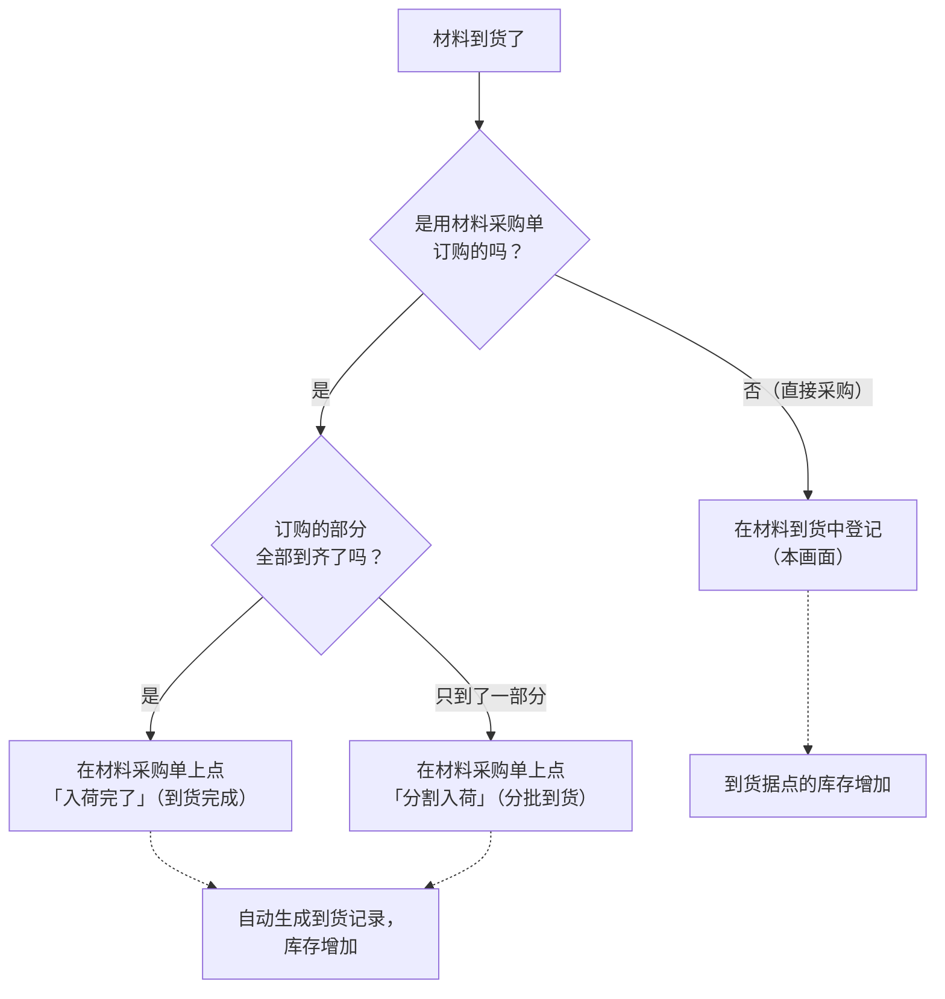
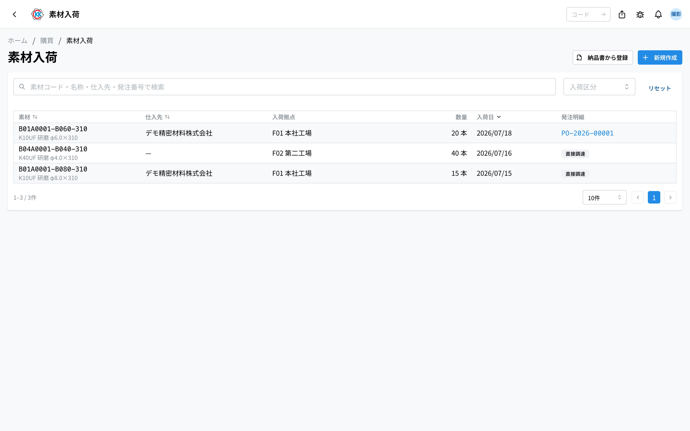
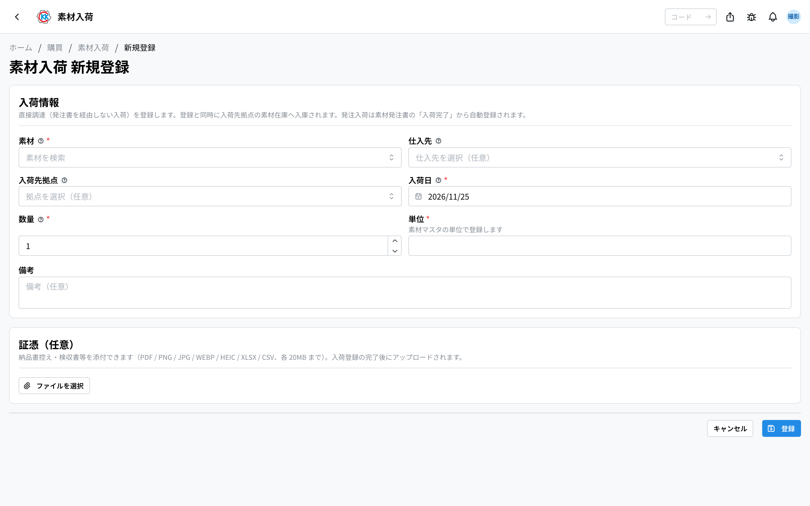
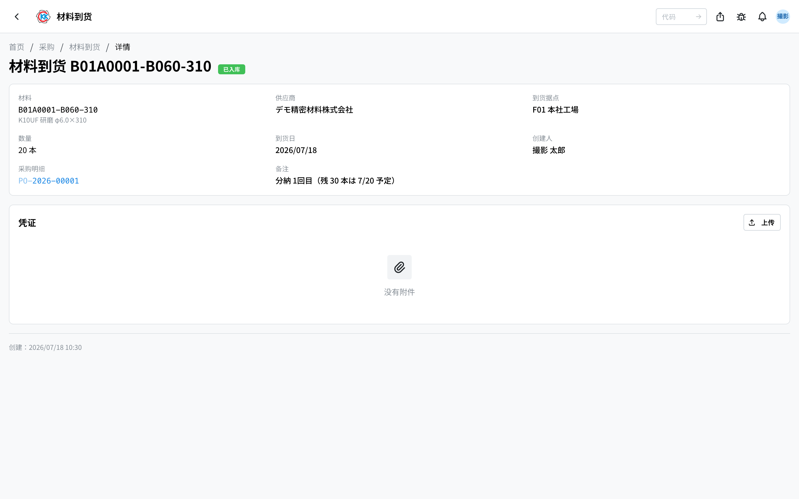
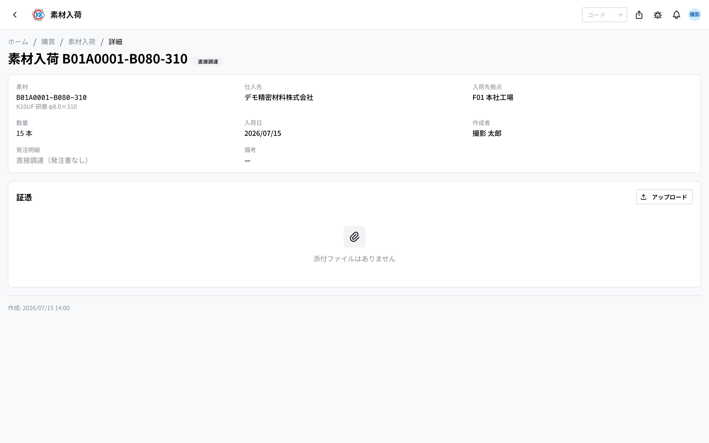

这是用来记录材料已经送到的 **素材入荷**（材料到货）应用。操作码是 `PU03`。

> ⚠️ 本应用仍在准备中，正式环境上可能还看不到。找不到时请咨询公司内的负责人。

> 本应用所属的流程……[采购流程](/manual/zh/process/purchasing)

## 本应用能做什么

- 可以记录材料已经送到。登记之后，该据点的 **库存会相应增加**。
- 可以回顾至今送到的材料是什么时候、送到哪里、送了几根。
- 可以把送货单存根、验收单等文件附在到货记录上保存。
- 当没有经过采购单购买的材料（例如自带带入的材料）送到时使用。
- 可以 **用 AI 读取供应商的送货单**，批量登记送到的材料。

## 本页出现的词语

- **入荷**（到货）… 材料实际送达。
- **発注入荷**（订购到货）… 通过[材料采购单](/manual/zh/operations/purchasing/purchase-order/user)订购的材料送达。**在采购单画面点击「入荷完了」（到货完成）或「分割入荷」（分批到货）后会自动记录。**
- **直接調達**（直接采购）… 没有经过采购单购买的材料的到货。**在本画面手动输入。**
- **入荷先拠点**（收货据点）… 接收这批材料的据点（工厂・营业所）。
- **証憑**（凭证）… 送货单存根、验收单等日后需要查阅的文件。

## 开始之前

- 送到的 **材料必须已登记在[材料主数据](/manual/zh/operations/masters/material/user)中**。未登记的材料无法选择。
- 要选择增加库存的据点，该 **[据点](/manual/zh/operations/masters/plant/user)必须已登记**。
- 登记需要材料到货权限。看不到按钮时请咨询公司内的负责人。

> ⚠️ **本画面仅用于不经采购单购买的材料（直接采购）。** 通过采购单订购的材料送到时，无论全部还是部分，都不要在本画面（「新規作成」（新建）、「納品書から登録」（从送货单登记））登记。在本画面登记的到货 **不会关联到采购单**，因此采购单的剩余数量不会减少，之后再点击「入荷完了」（到货完成）时，**同样的材料会再次入库**。订购的材料请在[材料采购单](/manual/zh/operations/purchasing/purchase-order/user)画面上，全部送到时点击「**入荷完了**」（到货完成），只送到一部分时点击「**分割入荷**」（分批到货）。到货记录会自动生成。

> 💡 选择材料和供应商时，如果存在同一材料「**発注済**」（已下单）且尚未全部到货的采购单，画面上会显示橙色的确认（采购单号、剩余数量、采购单链接）。如果是已订购的材料，请通过链接打开采购单，用「**分割入荷**」（分批到货）登记。只有确实是另一笔采购时，才勾选「**発注書とは別の購入として登録する**」（作为与采购单不同的另一笔采购登记）后登记。不勾选则无法登记。

在哪个画面登记，用图表示如下。

## 画面的看法

打开应用后，到货记录会按由新到旧排列。

- **素材**（材料）… 上面是材料编码，下面是材料名称。
- **発注明細**（订购明细）… 来自采购单的到货，会以蓝色链接显示以 `PO-` 开头的订购编号。没有经过采购单的，会显示灰色的「**直接調達**」（直接采购）徽章。
- 在上方搜索框输入材料编码、名称、供应商、订购编号，可以筛选出要找的记录。
- 用右侧的「**入荷区分**」（到货区分）可以只显示「発注入荷」（订购到货）或只显示「直接調達」（直接采购）。
- 点击某一行，会打开该到货的详情画面。

## 登记送到的材料（直接采购）

1. 点击列表画面右上角的「**新規作成**」（新建）。
2. 点击「**素材**」（材料）栏，用材料编码或名称搜索并选择（必须选择）。
3. 选择「**仕入先**」（供应商）（留空也可以）。
4. 在「**入荷先拠点**」（收货据点）中选择实际接收材料的据点。
5. 确认「**入荷日**」（到货日）（初始为今天的日期）。
6. 在「**数量**」（数量）中输入送到的根数。
7. 确认「**単位**」（单位）（初始为「本」＝根）。
8. 想把送货单存根等一起保存时，点击「**証憑（任意）**」（凭证，可选）中的「**ファイルを選択**」（选择文件）并选择文件。
9. 最后点击「**登録**」（登记）。

登记后，所选据点的材料库存会相应增加，并打开详情画面。

> ⚠️ 如果把「入荷先拠点」（收货据点）留空登记，材料不会进入任何据点的库存，而会被当作「无据点」的库存。事后无法修改，因此请务必选择实际接收的据点。

可以添加的文件为 PDF / PNG / JPG / WEBP / HEIC / XLSX / CSV，每个最大 20MB。

## 从送货单登记（直接采购）

不经采购单购买的材料的送货单到了时，可以用 AI 读取送货单，一次登记多种材料。

1. 点击列表画面上的「**納品書から登録**」（从送货单登记）。
2. 在「**AI で読み取る**」（AI 读取）栏中选择送货单（PDF 或图片），点击「**AI で読み取る**」（AI 读取）。不读取金额栏。
3. 会显示读取到的供应商和明细。「**入荷先拠点**」（收货据点）和「**入荷日**」（到货日）会应用于所有行（也可以按行修改）。
4. 未能确定材料的行，请从候选中重新选择。不登记的行请选择「**この行を登録しない**」（不登记此行）。单位以材料主数据的单位为准。
5. 点击「**選択した ◯ 件を登録**」（登记已选的 ◯ 条）。

所选的行会 **一次性一起** 登记。只要有 1 行失败，所有行都不会登记（不会出现只登记了一半的状态）。还有未确定材料的行时无法登记。重新选择的材料名称会被系统记住，下次同一供应商同样格式的送货单更容易自动匹配。

> ⚠️ 在这里登记的到货同样不会关联到采购单。通过采购单订购的材料的送货单，请不要在本画面登记，而是在[材料采购单](/manual/zh/operations/purchasing/purchase-order/user)上用「**分割入荷**」（分批到货）或「**入荷完了**」（到货完成）登记。

## 查看已登记的内容

在列表中点击某一行，会打开该到货的详情画面。

- 可以确认材料、供应商、收货据点、数量、到货日、备注。
- **発注明細**（订购明细）… 来自采购单的到货，会显示指向原[材料采购单](/manual/zh/operations/purchasing/purchase-order/user)的链接。点击即可确认订购内容。
- 直接采购时会显示「**直接調達（発注書なし）**」（直接采购——无采购单）。

- 可以从「証憑」（凭证）框中事后追加或删除文件。

## 输入项

材料到货画面的输入项一览。应用中输入栏旁边的 **?** 也可直接跳转到对应说明。

| 项目 | 必填 | 填什么 |
|------|------|--------|
| [材料](#field-material) | 必填 | 送达的材料 |
| [供应商](#field-supplier) | 选填 | 送货的公司 |
| [到货据点](#field-plant) | 选填 | 接收的据点 |
| [到货日](#field-received-date) | 必填 | 收到的日期 |
| [数量](#field-quantity) | 必填 | 实际送达的数量 |
| [单位](#field-unit) | 必填 | 支・kg 等 |
| [备注](#field-notes) | 选填 | 补充（划伤・数量不符等） |

### 材料 [#field-material]

送达的材料。若从采购单登记到货，会沿用采购的内容。

### 供应商 [#field-supplier]

送货的公司。从采购单登记时会自动带入；未经采购单直接采购时，请在此选择。

### 到货据点 [#field-plant]

实际接收的据点。**该据点的库存会增加**，请选择货物送达的地点。

### 到货日 [#field-received-date]

收到的日期。**库存按此日期增加。** 即使事后统一登记，也请填写实际收到的日期。

### 数量 [#field-quantity]

实际送达的数量。直接采购分批送达时，仅登记已送达的部分，其余作为下一次到货登记。**通过采购单订购的材料分批到货，不在本画面登记，而是在采购单上用「分割入荷」（分批到货）登记。**

### 单位 [#field-unit]

支・kg・m 等计数单位。选择材料后会带入默认单位。

### 备注 [#field-notes]

补充说明。例如有划伤、数量不符等日后需要确认的事项。送货单等凭证可在本画面以文件形式附加。

## 常见问题・遇到困难时

**Q. 订购的材料送到了，要在这里登记吗？**
A. 不用。请在[材料采购单](/manual/zh/operations/purchasing/purchase-order/user)画面上点击「**入荷完了**」（到货完成），到货记录会由此自动生成。如果在本画面再手动输入，同一批材料会被重复入库。

**Q. 订购的材料只先送到了一部分。**
A. 请不要在本画面登记。在[材料采购单](/manual/zh/operations/purchasing/purchase-order/user)画面上点击「**分割入荷**」（分批到货），只登记实际送到的根数。不能接收超过订货数的数量，所有明细达到订货数后会自动变为到货完成。确定剩余部分不会送来时，请用采购单的「**未入荷のまま完了**」（未到货直接完成）结束。

**Q. 想修改已登记的内容。**
A. 到货记录是库存已经变动之后确定下来的记录，无法修改或删除，也没有「編集」（编辑）「削除」（删除）按钮。请在登记前仔细确认数量和据点。

**Q. 出现「素材を選択してください」（请选择材料）而无法登记。**
A. 「素材」（材料）栏是空的。请点击该栏，用材料编码或名称搜索，并从候选中选择。只是手动输入文字并不算已选择。

**Q. 出现「20MB を超えるファイルは添付できません」（无法添加超过 20MB 的文件）。**
A. 所选文件太大。如果是照片，请用较小的尺寸重拍，或整理成 PDF 后重新选择。

**Q. 已经登记了，但该据点的库存没有增加。**
A. 请在详情画面确认是否把「入荷先拠点」（收货据点）留空登记了。没有选择据点时，会被记录为「无据点」的库存，而不是该据点的库存。

<!-- permissions:start -->
## 所需权限

使用本画面需要 **材料到货**（`material_receipt`）权限。

| 想做的事 | 所需权限 |
| --- | --- |
| 打开画面、查看列表与明细 | 材料到货 — 查看 |
| 新增・变更・删除 | 材料到货 — 创建 / 更新 / 删除 |

仅查看有「查看」即可。画面中若有新增、变更或删除的操作，则分别需要对应的权限。

权限通过角色授予。若不足，请与管理员联系。

权限的整体说明请参见「[权限与角色](../../../permissions)」。
<!-- permissions:end -->
