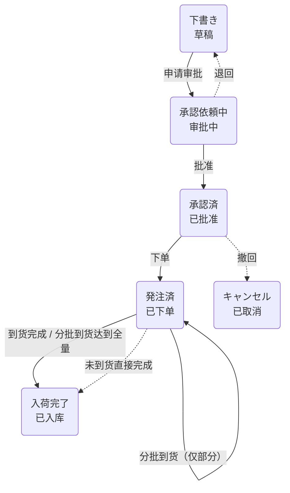
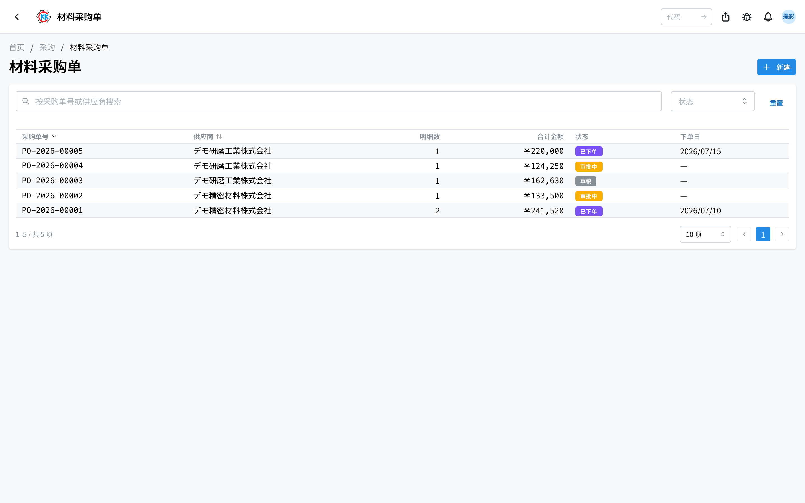
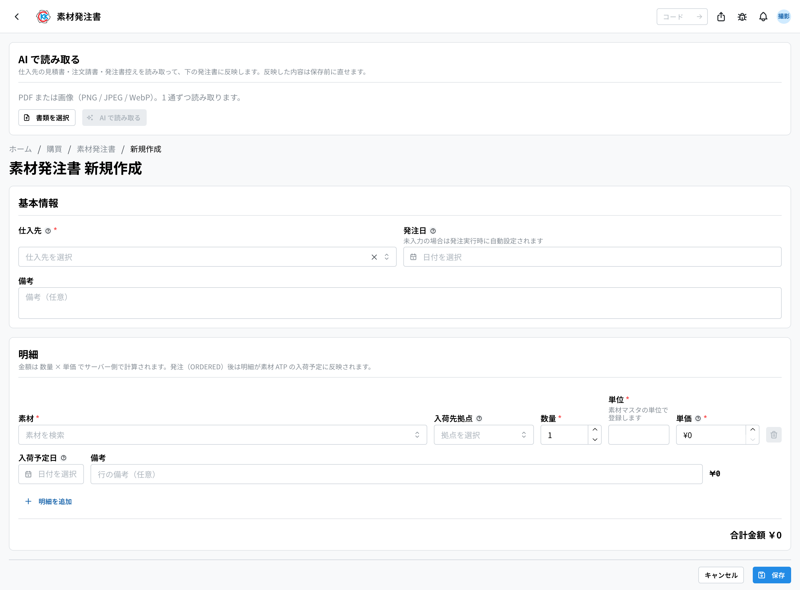
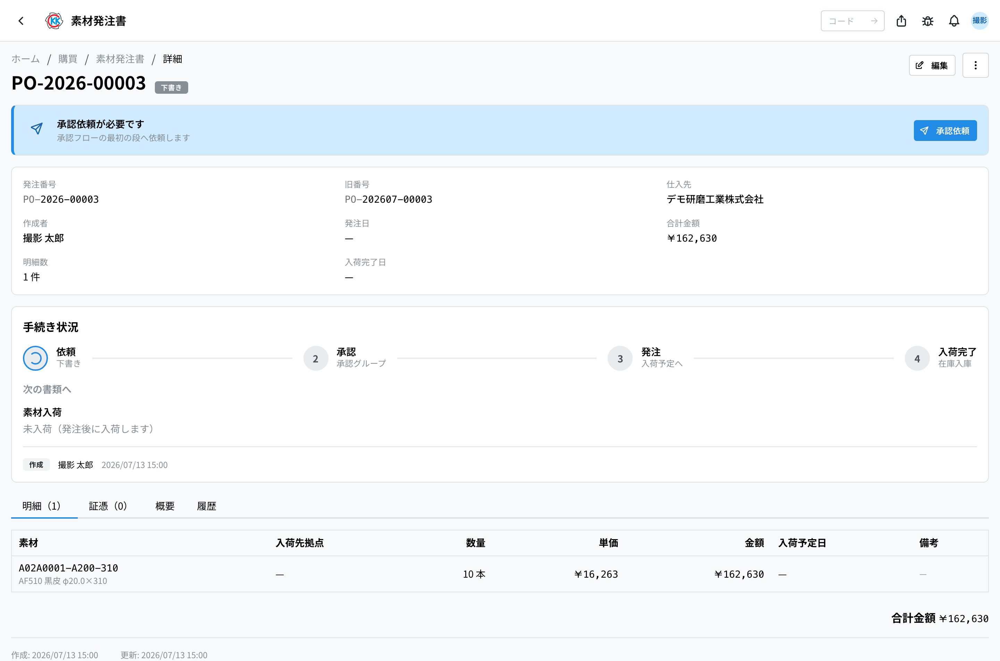
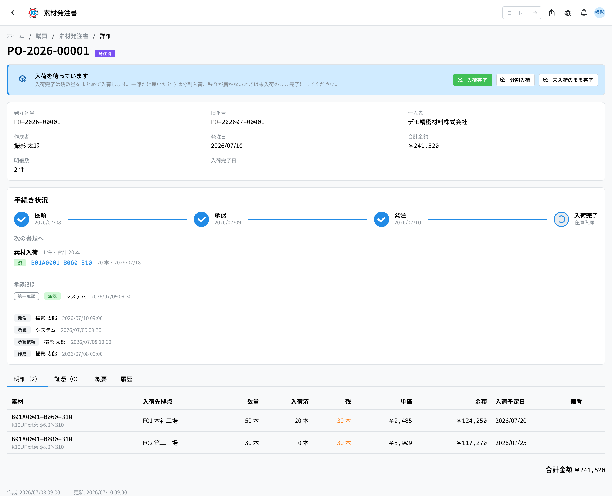
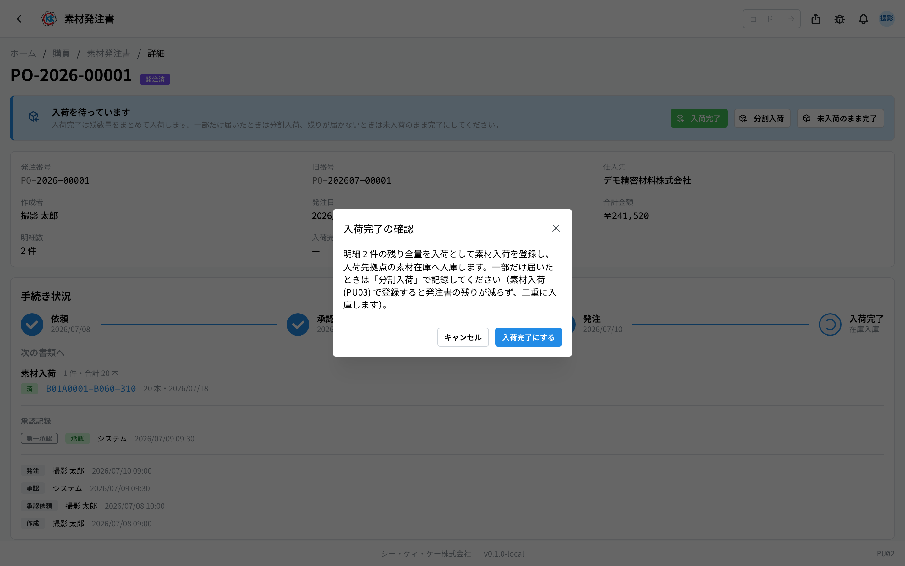
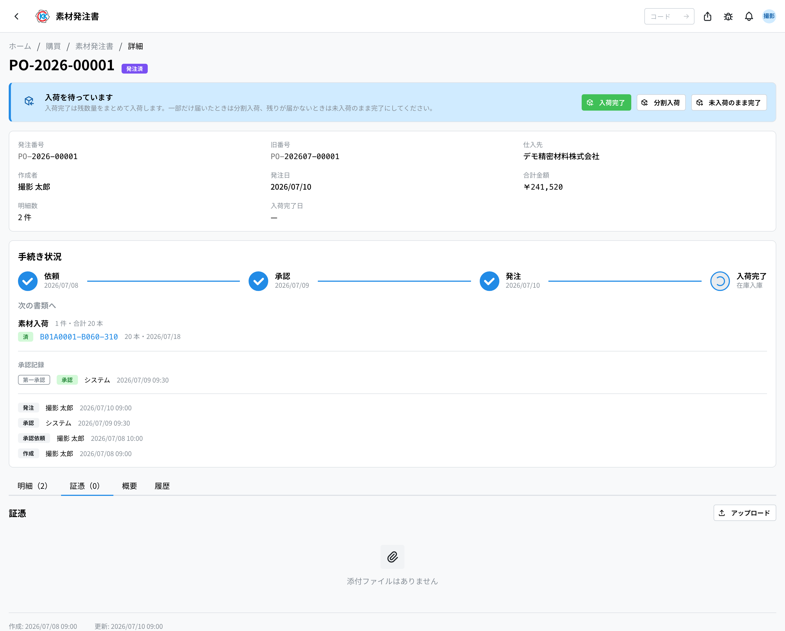

这是用来向供应商订购材料，制作 **素材発注書**（材料采购单）的应用。操作码是 `PU02`。

> ⚠️ 本应用仍在准备中，正式环境上可能还看不到。找不到时请咨询公司内的负责人。

> 本应用所属的流程……[采购流程](/manual/zh/process/purchasing)

## 本应用能做什么

- 可以填写向哪家供应商、订购哪种材料、几根、单价多少。
- 获得上级的 **承認**（审批）后才能下单。
- 下单后，该材料会在[库存画面](/manual/zh/operations/inventory/inventory-management/user)上显示为「预计到货」。
- 材料送到后，只要在采购单画面上登记到货，就会 **自动入库**。分批送到时，可以用「**分割入荷**」（分批到货）只登记送到的部分。
- 可以用 **AI 读取** 供应商的报价单或订单确认书，自动填写采购单。
- 可以把订单存根、送货单存根等文件附在采购单上保存。

## 本页出现的词语

- **明細**（明细）… 采购单中的一行。写明「哪种材料、几根、单价多少」。
- **仕入先**（供应商）… 购买材料的对方公司。
- **入荷先拠点**（收货据点）… 接收这批材料的据点（工厂・营业所）。
- **入荷予定日**（预计到货日）… 「预计这一天送到」的日期。
- **入荷**（到货）… 材料实际送达。
- **証憑**（凭证）… 订单存根、送货单存根等日后需要查阅的文件。

## 开始之前

- 想订购的 **材料必须已登记在[材料主数据](/manual/zh/operations/masters/material/user)中**。
- **供应商必须已登记在[业务伙伴主数据](/manual/zh/operations/masters/business-partner/user)中**。未登记的公司无法选择。
- 创建、编辑、下单都需要采购权限。看不到按钮时请咨询公司内的负责人。

## 订购推进的顺序

材料采购单按以下顺序推进。当前处在哪一步，可以通过画面上带颜色的徽章来判断。

1. **下書き**（草稿）… 只是你创建好的状态。只有这时才能修改。
2. **承認依頼中**（审批中）… 等待上级答复。
3. **承認済**（已审批）… 已获同意。可以向供应商下单。
4. **発注済**（已下单）… 已向供应商订购。等待材料送达。
5. **入荷完了**（到货完成）… 材料已送到并入库（确定剩余部分不会到货而结束的采购单也会进入此状态）。

在下单之前，可以中途撤回并变成「**キャンセル**」（取消）。

## 画面的看法

打开应用后，会显示至今创建过的材料采购单列表。

- **発注番号**（订购编号）… 以 `PO-` 开头的编号。由系统自动编号。
- **状態**（状态）… 用带颜色的徽章表示当前情况。灰色是「下書き」（草稿），黄色是「承認依頼中」（审批中），蓝色是「承認済」（已审批），紫色是「発注済」（已下单），绿色是「入荷完了」（到货完成），红色是「キャンセル」（取消）。
- 在上方搜索框输入订购编号或供应商名称，可以筛选出要找的采购单。
- 用右侧的「**状態**」（状态）可以只显示例如已下单的采购单。
- 处理 2 家以上本公司法人单据的人，会在订购编号旁看到法人代码的小徽章（例如 `TSP`）（[发行公司徽章](/manual/zh/operations/masters/own-company/user#company-badge)）。
- 点击某一行，会打开该采购单的详情画面。

## 创建材料采购单

有三种创建方式。

### 方式 1：从头创建

1. 点击列表画面右上角的「**新規作成**」（新建）。
2. 选择「**仕入先**」（供应商）（必须选择）。
3. 输入「**発注日**」（订购日）（留空也可以）。
4. 点击明细的「**素材**」（材料）栏，用材料编码或名称搜索并选择。
5. 在「**入荷先拠点**」（收货据点）中选择接收的据点（留空也没关系）。
6. 输入「**数量**」（数量）。选择材料后，「**単位**」（单位）会自动带入材料主数据的单位，无法修改。
7. 在「**単価**」（单价）中输入每根的价格。
8. 在「**入荷予定日**」（预计到货日）中输入预计送达的日期（留空也可以）。
9. 要追加材料时，点击「**明細を追加**」（添加明细），重复第 4 到第 8 步。
10. 最后点击「**保存**」（保存）。

金额（数量 × 单价）和合计金额会随着输入自动显示，不需要计算器。

> 💡 如果把「発注日」（订购日）留空，之后点击「発注」（下单）的那一天会自动成为订购日。

### 方式 2：从采购申请转换

如果[采购申请](/manual/zh/operations/purchasing/purchase-request/user)已获审批，可以在其画面上通过「**発注書へ変換**」（转换为采购单）创建。材料、数量、据点会直接沿用，但 **单价仍为 0 日元**。请在草稿状态下从「編集」（编辑）中填入单价。

### 方式 3：用 AI 读取供应商的单据

手头有供应商的报价单、订单确认书或采购单存根时，使用新建画面上方的「**AI で読み取る**」（AI 读取）栏，可以减少输入工作。

1. 点击「**新規作成**」（新建），在「**AI で読み取る**」（AI 读取）栏中选择单据（PDF 或图片）。每次读取一份。
2. 点击「**AI で読み取る**」（AI 读取）。读取可能需要 1 分钟左右。
3. 会显示读取到的供应商、订货日和明细（材料、数量、单位、单价、预计到货日）。未能确定材料的行，请从候选中重新选择。
4. 点击「**フォームに反映**」（填入表单），内容会填入下方采购单的输入栏。
5. 确认并修改内容后，点击「**保存**」（保存）。

仅读取不会保存任何内容。保存后，读取的单据会以「**取込元（原本）**」（导入来源原件）的名称自动附加到采购单的「**証憑**」（凭证）标签页。重新选择的材料名称会被系统记住，下次同一供应商同样格式的单据更容易自动匹配。

## 提交审批

1. 打开采购单的画面。
2. 点击画面上方「**承認依頼が必要です**」（需要提交审批）卡片中的「**承認依頼**」（提交审批）。

状态会变成「**承認依頼中**」（审批中），申请会送到审批人那里。同一份申请也会出现在[未处理列表](/manual/zh/operations/general/my-tasks/user)（`CM01`）画面上。

> ⚠️ 审批的级数由[审批设置](/manual/zh/operations/masters/approval-setting/user)（`MS0B`）决定。如果材料采购单的审批流程中一级也没有，就无法提交审批（会显示「审批流程尚未设置」之类的提示）。请联系管理员设置审批。

> 💡 如果在审批设置中把材料采购单的「使用审批」关闭了，点击「**承認依頼**」（提交审批）后会立即变成「**承認済**」（已审批）（会显示「**承認なしで承認済にしました**」（已不经审批设为已审批））。之后可以直接下单。

## 审批・退回（审批人的操作）

只有审批人才会看到以下按钮。

- 内容没问题时点击「**承認**」（批准）。状态会变成「承認済」（已审批）。
- 需要修改时点击「**差し戻し**」（退回），填写「**差し戻し理由**」（退回理由）后点击「**差し戻す**」（退回）。

被退回的采购单会回到「**下書き**」（草稿）。创建人修改内容后可以再次点击「承認依頼」（提交审批）。

## 向供应商下单

1. 打开状态为「承認済」（已审批）的采购单画面。
2. 点击「**発注**」（下单）。
3. 会弹出「発注の確認」（下单确认）的小窗口，点击「**発注する**」（下单）。

状态会变成「**発注済**」（已下单）。从这时起，订购的材料会在[库存画面](/manual/zh/operations/inventory/inventory-management/user)上显示为「预计到货」。

## 材料送到后的记录

订购材料的到货 **务必在这份采购单的画面上登记**。「発注済」（已下单）的采购单上，按送达方式有 3 个按钮。

| 按钮 | 使用时机 | 会发生什么 |
|------|------|------|
| **入荷完了**（到货完成） | 剩余部分全部送到 | 一次性接收未到货的数量，设为到货完成 |
| **分割入荷**（分批到货） | 只送到一部分 | 按明细只接收本次送到的数量。所有明细达到订货数后自动变为到货完成 |
| **未入荷のまま完了**（未到货直接完成） | 剩余部分不会再送来（供应商缺货等） | 不做到货，直接设为到货完成。必须填写理由 |

> ⚠️ 不要在[材料到货](/manual/zh/operations/purchasing/material-receipt/user)（`PU03`）的「新規作成」（新建）或「納品書から登録」（从送货单登记）中登记已下单材料的到货。在那里登记的到货 **不会关联到采购单**，因此采购单的剩余数量不会减少，之后再点击「入荷完了」（到货完成）时，**同样的材料会再次入库**。材料到货画面仅用于不经采购单购买的材料（直接采购）。

### 全部送到时（到货完成）

1. 打开状态为「発注済」（已下单）的采购单画面。
2. 点击「**入荷完了**」（到货完成）。

3. 会弹出「入荷完了の確認」（到货完成确认）的小窗口。
4. 确认内容后点击「**入荷完了にする**」（设为到货完成）。

尚未到货的剩余数量会被一并视为「已送到」，并计入收货据点的材料库存。同时还会自动生成[材料到货](/manual/zh/operations/purchasing/material-receipt/user)记录，并通知申请人和创建人。

> ⚠️ 只送到一部分时，请不要使用这个操作。「入荷完了」（到货完成）会把剩余的全部一次性处理掉。请使用下面的「**分割入荷**」（分批到货）。

### 只送到一部分时（分批到货）

1. 打开状态为「発注済」（已下单）的采购单画面。
2. 点击「**分割入荷**」（分批到货）。
3. 按明细输入本次送到的数量。为 0 的明细不做到货。
4. 确定后，只有输入的数量计入收货据点的材料库存，同时自动生成与采购单关联的[材料到货](/manual/zh/operations/purchasing/material-receipt/user)记录。

可以分多次登记。所有明细都达到订货数时，采购单会自动变为「**入荷完了**」（到货完成）。**不能接收超过订货数的数量**（按明细拒绝）。

### 剩余部分不会送来时（未到货直接完成）

因供应商缺货等原因，确定剩余数量不会再送来时使用。

1. 打开状态为「発注済」（已下单）的采购单画面。
2. 点击「**未入荷のまま完了**」（未到货直接完成）。
3. 填写「**締め切る理由**」（结束理由，必填）后确定。

采购单会变为「**入荷完了**」（到货完成），但未到货的部分 **不会入库**，也会从预计到货中移除。之前已送到的部分保持不变。此操作无法撤销。

进入「発注済」（已下单）之后，明细上会显示至今送到的根数，例如「**入荷済 20**」（已到货 20）。

## 把文件附上保存

可以把订单存根、送货单存根和采购单一起保存。

1. 打开采购单画面的「**証憑**」（凭证）标签页。
2. 点击「**アップロード**」（上传）并选择文件。
3. 会出现「証憑のアップロード」（上传凭证）画面，需要时可在「**ラベル（任意）**」（标签，可选）中填写「订单存根」等说明。
4. 点击「**アップロード**」（上传）。

审批之前无法添加附件。审批前打开时会显示「**証憑の添付は承認後（承認済・発注済・入荷完了）に可能になります**」（凭证需在审批后——已审批、已下单、到货完成——才能添加）。

## 确认内容

采购单画面有 4 个标签页。

- **明細**（明细）… 材料、数量、单价、金额的一览。下方显示合计金额。
- **証憑**（凭证）… 已附加文件的一览。
- **概要**（概要）… 备注。
- **履歴**（历史）… 何时由谁做了修改的记录。

由采购申请转换而来的采购单，上方会显示「**変換元（購買依頼）**」（转换来源——采购申请）以及指向原申请编号的链接。

## 输入项

材料采购单画面的输入项一览。应用中输入栏旁边的 **?** 也可直接跳转到对应说明。

| 项目 | 必填 | 填什么 |
|------|------|--------|
| [供应商](#field-supplier) | 必填 | 向谁采购 |
| [采购日期](#field-order-date) | 选填 | 下单的日期 |
| [备注](#field-notes) | 选填 | 对整份采购单的补充 |
| [材料](#field-material) | 必填 | 采购的材料 |
| [到货据点](#field-plant) | 选填 | 接收的据点 |
| [数量](#field-quantity) | 必填 | 采购的数量 |
| [单位](#field-unit) | 必填 | 支・kg 等 |
| [单价](#field-unit-price) | 必填 | 每单位的价格 |
| [预计到货日](#field-expected-date) | 选填 | 预计送达的日期 |
| [明细备注](#field-item-notes) | 选填 | 仅针对该材料的补充 |

### 供应商 [#field-supplier]

采购材料的对象。列表中没有时，请在[业务伙伴主数据](/manual/zh/operations/masters/business-partner/user)中登记。

### 采购日期 [#field-order-date]

下单的日期。留空也没关系 — 未填写时，会自动填入点击「発注」（下单）的那一天。

### 备注 [#field-notes]

对整份采购单的补充。只与某一材料相关的内容，请写在明细的备注中。

### 材料 [#field-material]

采购的材料。若由采购申请生成采购单，则会沿用申请的内容。

### 到货据点 [#field-plant]

接收该材料的据点。**登记到货后，该据点的库存会增加。** 还没定下来时留空也没关系。

### 数量 [#field-quantity]

采购的数量。**到货时也可以分批登记**（分多次送达的情况）。

### 单位 [#field-unit]

支・kg・m 等计数单位。选择材料后，会自动带入材料主数据中登记的单位。此栏无法修改。

### 单价 [#field-unit-price]

每单位的价格。**此金额会作为试算中材料费的参考价格**，请填写实际的交易价格。

### 预计到货日 [#field-expected-date]

该材料预计送达的日期。填写与供应商约定的日期。

### 明细备注 [#field-item-notes]

仅针对该材料的补充。针对整份采购单的补充说明请写在上方的备注中。

## 常见问题・遇到困难时

**Q. 看不到「編集」（编辑）按钮。**
A. 只有「下書き」（草稿）时才能修改。提交审批之后就无法修改。强行操作会显示「**下書きの素材発注書のみ編集できます**」（仅草稿状态的材料采购单可以编辑）。需要修改时，请让审批人退回。

**Q. 看不到「承認」（批准）「差し戻し」（退回）按钮。**
A. 只有属于该级别审批组的人（或其代理人）才能审批。按钮位置会显示「**◯◯ のメンバーのみ承認・差し戻しできます**」（仅该组成员可以批准或退回）。

**Q. 出现「仕入先を選択してください」（请选择供应商）而无法保存。**
A. 供应商栏是空的。请点击「仕入先」（供应商）栏，从列表中选择公司。

**Q. 想取消已下单的采购单。**
A. 「発注済」（已下单）和「入荷完了」（到货完成）无法取消。只有下单之前（草稿、审批中、已审批）才能取消。强行操作会显示「**発注前の素材発注書のみキャンセルできます**」（仅下单前的材料采购单可以取消）。

**Q. 材料分批送到了。**
A. 请在这份采购单的画面上点击「**分割入荷**」（分批到货），只登记送到的部分。所有明细达到订货数后会自动变为到货完成。不要在[材料到货](/manual/zh/operations/purchasing/material-receipt/user)画面登记——那样不会关联到采购单，之后材料会被重复入库。

**Q. 剩余的材料不会送来了。**
A. 请点击「**未入荷のまま完了**」（未到货直接完成），填写理由后结束。未到货的部分不会入库，也会从预计到货中移除。如果点击「入荷完了」（到货完成），连没送到的部分也会入库。

**Q. 提示「审批流程尚未设置」，无法提交审批。**
A. 材料采购单的审批流程中一级也没有。请让管理员在[审批设置](/manual/zh/operations/masters/approval-setting/user)（`MS0B`）中创建审批级。

**Q. 出现「未入荷の明細がありません」（没有未到货的明细）。**
A. 表示全部数量都已被视为送达。这份采购单上已经没有要做的事了。

**Q. 出现「明細（…）の単位が素材マスタの単位（…）と一致しません」（明细的单位与材料主数据的单位不一致），无法保存。**
A. 这是由采购申请转换来的采购单中，申请时选择的单位与材料主数据的单位不同。请删除该行，再用「**明細を追加**」（添加明细）重新加入同一材料。材料主数据的单位会重新带入。

<!-- permissions:start -->
## 所需权限

使用本画面需要 **材料采购・采购申请**（`purchase_order`）权限。

| 想做的事 | 所需权限 |
| --- | --- |
| 打开画面、查看列表与明细 | 材料采购・采购申请 — 查看 |
| 新增・变更・删除 | 材料采购・采购申请 — 创建 / 更新 / 删除 |

仅查看有「查看」即可。画面中若有新增、变更或删除的操作，则分别需要对应的权限。

权限通过角色授予。若不足，请与管理员联系。

权限的整体说明请参见「[权限与角色](../../../permissions)」。
<!-- permissions:end -->
