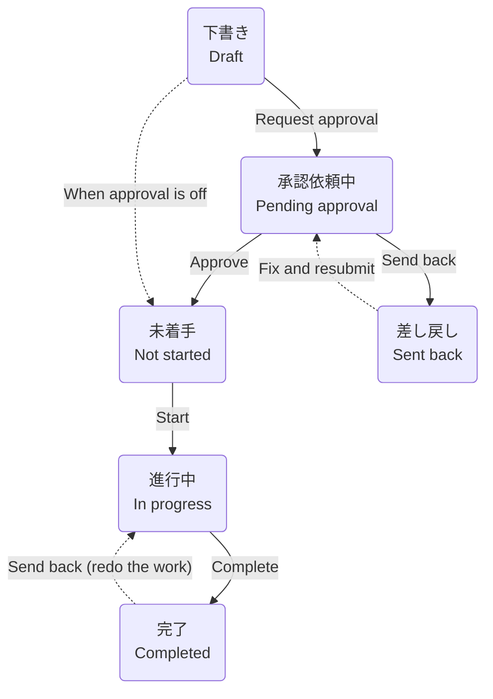
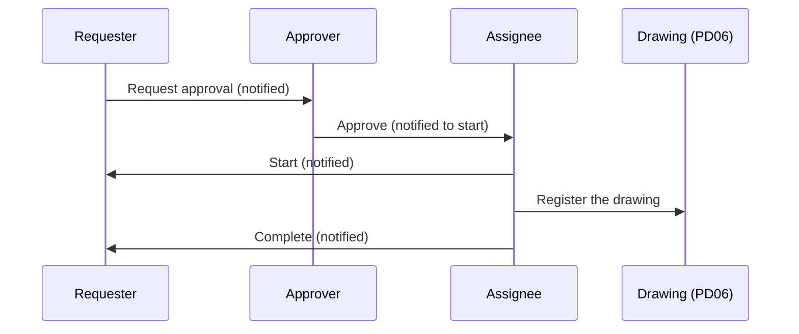
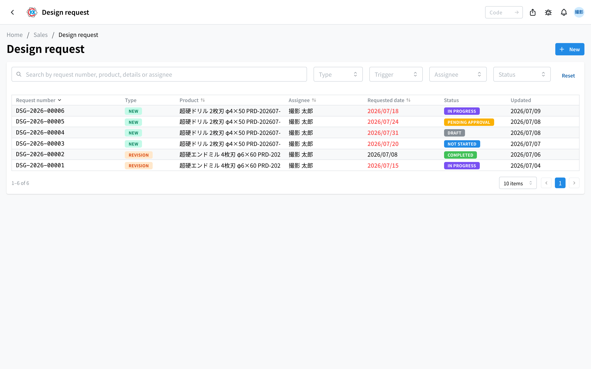
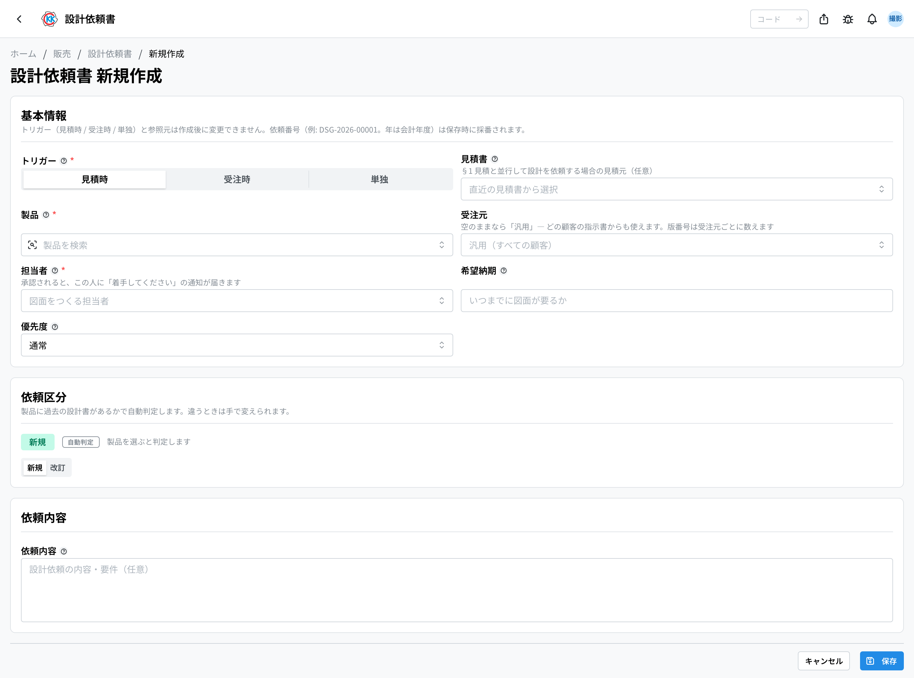
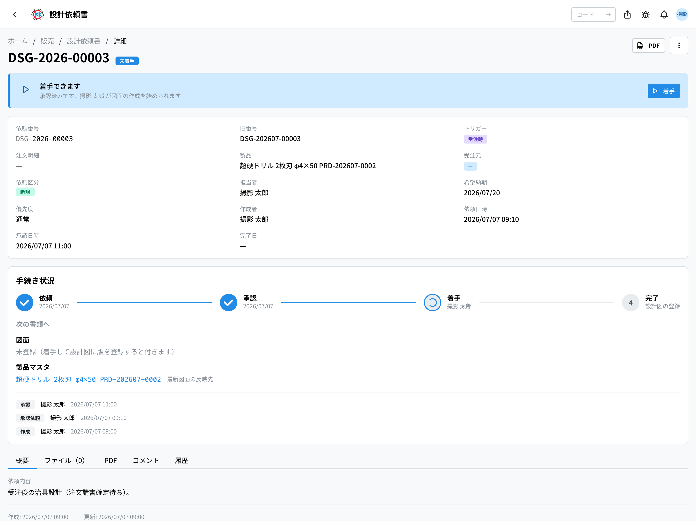
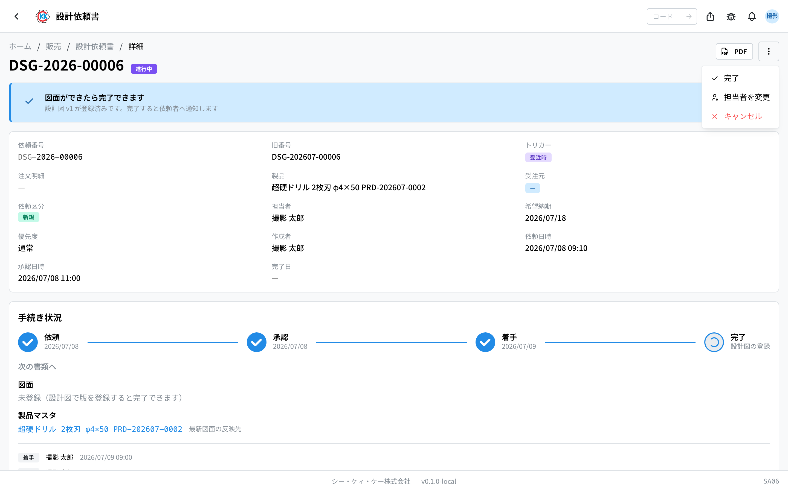
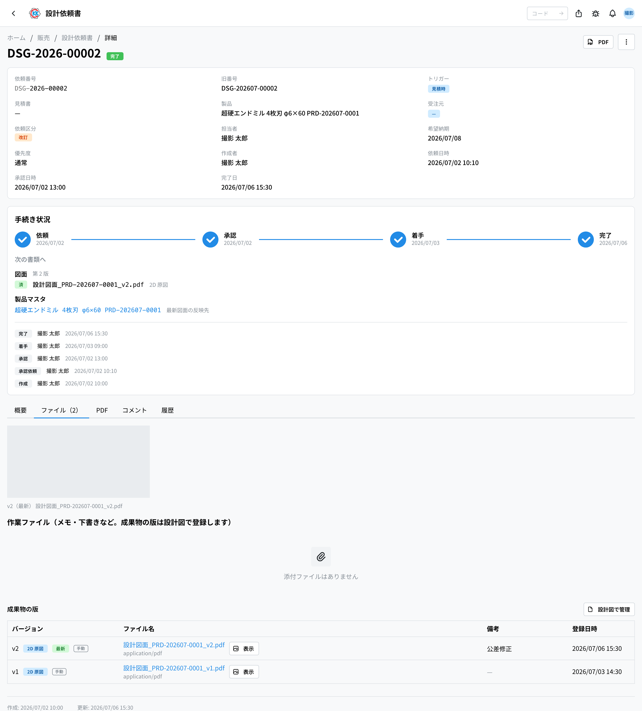
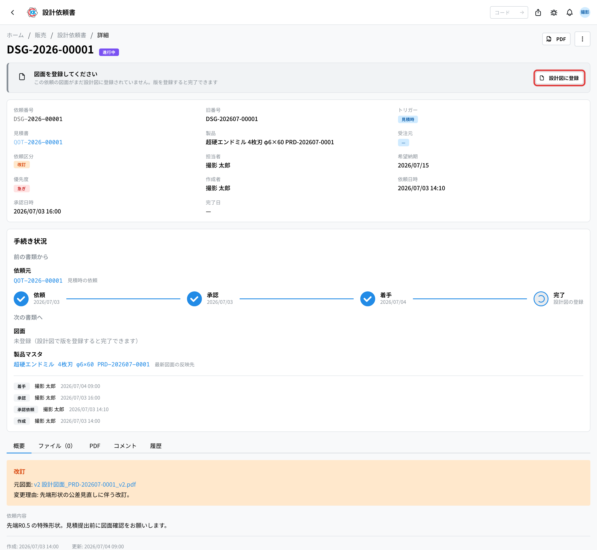
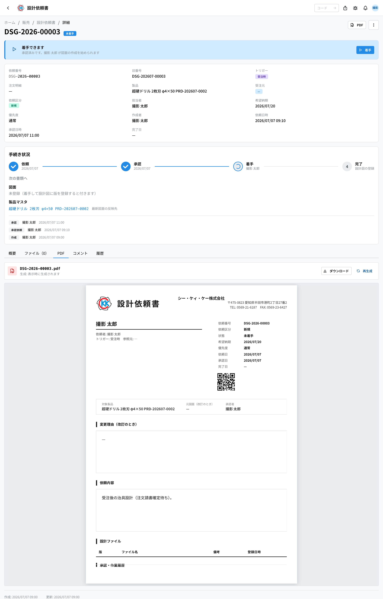

An app for asking the design department to make a drawing, and for **keeping each version** of the finished drawing file. The operation code is `SA06`.

> ⚠️ This app is still in trial release. The screens and the steps may change later.

> This app belongs to … [Sales flow](/manual/en/process/sales)

## What you can do with this app

- You can write what you want designed and register it as a request.
- You can raise one **with the source document already linked** from the [quote](/manual/en/operations/sales/quote/user), an order line, or the [product master](/manual/en/operations/masters/product/user).
- You can record whether the request came at quotation time, after the order, or **on its own with neither**.
- You can **name the person who will make the drawing**. They get a notification.
- **New or revision is decided automatically** — 改訂 (revision) if the product already has a past design, 新規 (new) if it does not.
- You can set a **希望納期 (requested date)** and a **優先度 (priority)**, then sort and spot late requests in the list.
- You can require **approval before the design starts**. The approval steps are set in [Approval settings](/manual/en/operations/masters/approval-setting/user). Approval can also be switched off.
- The finished drawing is registered in [Drawing](/manual/en/operations/production/design-file/user). **The versions (v1, v2) are held by Drawing**; this app holds the request and its progress.
- An approved request can be **printed as a PDF document** to hand to manufacturing on paper.
- The newest drawing on the [product master](/manual/en/operations/masters/product/user) is replaced when that version is **confirmed** in [Drawing](/manual/en/operations/production/design-file/user) — not when the request is completed.

Use this when a customer asks about a special shape and a drawing is needed.

## The order a request goes through

- Right after you make it, it is **下書き (draft)**. Only while it is draft or **差し戻し (sent back)** can you change the contents freely with「**編集**」(edit).
- Pressing「承認依頼」(request approval) makes it **承認依頼中 (pending approval)** and notifies the approvers. When「承認を使う」(use approval) is off for design requests in [Approval settings](/manual/en/operations/masters/approval-setting/user), it skips pending approval and goes straight to **未着手 (not started)**.
- Once approved it becomes **未着手 (not started — approved, waiting to begin)**, and **the assignee is notified to start**.
- The assignee presses「着手」(start) for **進行中 (in progress)**, registers the drawing in [Drawing](/manual/en/operations/production/design-file/user) and presses「完了」(complete) for **完了 (completed)**.

Who does what, in order:

## Words used on this page

- **トリガー (trigger)** … what starts the design request. You choose **見積時 (at quote)**, **受注時 (at order)** or **単独 (standalone)**.
- **見積時 (at quote)** … when the drawing is made alongside the work, before the quote goes out.
- **受注時 (at order)** … when the drawing is made after the order is decided.
- **単独 (standalone)** … tied to neither a quote nor an order line. Use it when **no paperwork exists yet** — exploring a new product, an early enquiry from a customer, an internal improvement.
- **担当者 (assignee)** … the manufacturing person who makes the drawing. They are notified once the request is approved.
- **依頼区分 (request kind)** … either **新規 (new)** or **改訂 (revision)**. Decided automatically when you pick a product.
- **元図面 (base drawing)** … on a revision, which version is being redrawn from.
- **変更理由 (change reason)** … on a revision, why it is being redrawn.
- **依頼内容 (request details)** … the text field where you write what you want designed.
- **バージョン（版）(version)** … a number that goes up each time the drawing is made again. It goes v1, v2, and the newest one is marked「最新」(latest). **Every file registered at once in [Drawing](/manual/en/operations/production/design-file/user) shares the same version.**
- **2D 原図 / 3D 原図 (2D / 3D master drawing)** … the drawing files that machining is based on (2D: 図脳 SXF, DXF and the like; 3D: STEP and the like). The product master's newest drawing points at the 2D master drawing.
- **プレビュー (preview)** … a file for checking the shape on screen (STL and the like). You can rotate it.
- **参考資料 (reference material)** … the other files of the same version — part drawings, dimension tables.
- **下書き (draft) / 承認依頼中 (pending approval) / 未着手 (not started) / 進行中 (in progress) / 完了 (completed) / 差し戻し (sent back) / キャンセル (cancelled)** … where the request stands now.

## Before you start

- **Approval settings must have steps registered for 設計依頼書 (design request).** Without them, pressing「承認依頼」(request approval) shows a message. Ask an administrator (if requests should not go through approval, the administrator switches「承認を使う」(use approval) off).
- **Register the [product](/manual/en/operations/masters/product/user) the drawing is for first — it is required.** Even a brand-new product can be registered with **just a name and a unit**. Without a product, new-versus-revision cannot be decided.
- If you register it as 見積時 (at quote), having the [quote](/manual/en/operations/sales/quote/user) first lets you link the request to it.
- If you register it as 受注時 (at order), having the 注文明細 (order line) first lets you link the request to it. Order lines are made by「注文確定」(order confirmation) in [Order acceptance](/manual/en/operations/sales/order-acceptance/user).
- To complete a request, **at least one drawing for that request must be registered in [Drawing](/manual/en/operations/production/design-file/user)**. The registration form opens in one click from the request screen.

## Reading the screen

When you open the app, the requests so far are shown as a list.

- **依頼番号 (request number)** … a number starting with `DSG-` (for example `DSG-2026-00001`). It is added automatically when you save.
- **区分 (kind)** … 「新規」(new) or「改訂」(revision), shown as a badge.
- **製品 (product)** … the product the drawing is for.
- **担当者 (assignee)** … the person who makes the drawing.
- **希望納期 (requested date)** … when the drawing is needed by. On a request that is not completed yet, the date turns red once it has passed.
- **状態 (status)** … a colored badge shows where it stands now. Gray is「下書き」(draft), yellow is「承認依頼中」(pending approval), blue is「未着手」(not started), violet is「進行中」(in progress), green is「完了」(completed), red is「差し戻し」(sent back) and「キャンセル」(cancelled).
- **更新日 (updated)** … the date it was last changed.
- Type a request number, a product name, a word from the request details, or an assignee in the search box at the top to narrow down the list. You can also narrow it down with「区分」(kind),「トリガー」(trigger),「担当者」(assignee) and「状態」(status) on the right.
- On a smartphone, the list also shows the **trigger** —「見積時」(at quote),「受注時」(at order) or「単独」(standalone) — as a badge.
- Click a row to open the detail screen for that request.

## Asking for a design

1. Press「**新規作成**」(New) at the top right of the list screen.
2. In「**トリガー**」(trigger), press「**見積時**」(at quote),「**受注時**」(at order) or「**単独**」(standalone) to choose it.
3. If you chose 見積時, choose the quote it is based on in the「**見積書**」(quote) field. You can also leave it empty.
4. If you chose 受注時, search for and choose the order line it is based on in the「**注文明細**」(order line) field. You can also leave it empty. If you chose 単独, no reference field appears.
5. Choose the product in the「**製品**」(product) field — required. Picking it flips「**依頼区分**」(request kind) below to 新規 (new) or 改訂 (revision) automatically.
6. Choose who will make the drawing in the「**担当者**」(assignee) field.
7. Set「**希望納期**」(requested date) and「**優先度**」(priority) if you need them.
8. When the kind is 改訂 (revision), fill in「**元図面**」(base drawing — leave empty for the newest version) and「**変更理由**」(change reason, required).
9. Write what you want designed in「**依頼内容**」(request details). You can save it empty, but writing it is recommended.
10. Press「**保存**」(save).

When you save, a request number is added and the detail screen opens. At this point it is still a **下書き (draft)**.

> ⚠️ The「トリガー」(trigger), and the quote or order line you chose there, **cannot be changed afterwards**. If you made a mistake, make a new request.

### How new versus revision is decided

「**依頼区分**」(request kind) is decided automatically from **whether the product you chose already has a past design version**. The reason is shown on screen too — for example「この製品には v2 まであります → 改訂」(this product has versions up to v2 → revision).

If the call is wrong you can **switch it by hand** right there; it then shows as 手動指定 (set manually). Press「**自動判定に戻す**」(back to automatic) to undo.

The kind is **stored as it was when the request was made**. If another request is completed first later on, this request's kind does not move — otherwise, where approval steps are split by kind, the request would no longer match what was approved.

If you came from a quote or an order line with「**設計依頼を起票**」(raise a design request), the trigger and the reference are already filled in. The trigger cannot be switched in that case, because switching it would quietly break the link back to where you came from.

## Where to raise one from

「新規作成」(New) on the list works, but raising it from these places **opens the form with the reference already filled in**, so there is nothing to link up afterwards.

| From | What gets filled in |
|------|---------------------|
| [Quote](/manual/en/operations/sales/quote/user) →「…」→「設計依頼を起票」 | Trigger = 見積時 (at quote) + that quote |
| Order line →「…」→「設計依頼を起票」 | Trigger = 受注時 (at order) + that order line |
| [Product master](/manual/en/operations/masters/product/user) →「…」→「設計依頼を起票」 | That product |
| 「設計依頼を起票」 next to「価格表なし」(no price list) on a quote line | That product |

The last one is the way out when **a new product has no price to resolve**. There usually is no price list because there is no drawing yet — so you can ask for the drawing right there.

> Coming from a route that carries a product (product master, or "no price list") opens the form with the required 製品 (product) already filled in. Coming from a quote or an order line, just pick the product — new versus revision is decided the moment you do.

A request you raised is reachable back from the「関連」(related) tab of the source document —「設計」(design) on an order line.

## Requesting approval

1. Open a draft request and a card saying「**承認依頼が必要です**」(approval request needed) appears at the top.
2. Press「**承認依頼**」(request approval).
3. The status changes to「**承認依頼中**」(pending approval) and the approvers are notified.

When「**承認を使う**」(use approval) is off for design requests in [Approval settings](/manual/en/operations/masters/approval-setting/user), pressing「承認依頼」makes it「**未着手**」(not started) right away (the message「承認なしで承認済にしました」— approved without approval — appears).

People with approval rights see a「**承認してください**」(please approve) card in the same place, with「**承認**」(approve) and「**差し戻し**」(send back) buttons.

- **承認 (approve)** moves it to the next step. Once the last step passes it becomes「**未着手**」(not started) and the assignee is notified.
- **差し戻し (send back)** asks for a reason. After you send it back the status becomes「**差し戻し**」(sent back). The requester sees a「**差し戻されました**」(sent back) card; they fix it with「**編集**」(edit) and press「**再承認依頼**」(request approval again).

How many approval steps there are, and who approves, is decided in [Approval settings](/manual/en/operations/masters/approval-setting/user).

## Moving the request along

Once approval passes, the status is「**未着手**」(not started).

1. When the design work starts, press「**着手**」(start) on the「**着手できます**」(ready to start) card at the top of the screen.
2. The status changes to「**進行中**」(in progress) and the requester is notified.

While it is 未着手 (not started) or 進行中 (in progress), you can change the **担当者 (assignee)** with「**…**」→「**担当者を変更**」(change assignee). The new assignee is notified. The 依頼内容 (request details) and the product are what was approved, so they cannot be changed at this stage — cancel and make a new request if the content itself changes.

## Attaching working files

1. Open the「**ファイル**」(files) tab on the request screen.
2. Press「**アップロード**」(upload) to the right of「**作業ファイル**」(working files).
3. Choose the file (any file type is accepted, including CAD and 3D model files; up to 20MB each).
4. If you like, write a note in「**ラベル（任意）**」(label, optional).
5. Press「**アップロード**」(upload).

What goes here is **working files** — notes and drafts. The finished drawing (including CAD and 3D model files) is registered in [Drawing](/manual/en/operations/production/design-file/user) instead (see below). The「**成果物の版**」(deliverable versions) section on the same tab lists the versions registered in Drawing from this request.「**設計図で管理**」(managed in Drawing) opens that product's Drawing screen.

You can only attach files **between approval and completion** (未着手 and 進行中).

## Registering the drawing and completing

**The finished drawing is registered in [Drawing](/manual/en/operations/production/design-file/user) (PD06).** A design request is the *asking*; the drawing itself belongs to Drawing. Keeping one place to write is what keeps version numbering consistent across screens.

1. Press「**設計図に登録**」(register in Drawing) on the「**図面を登録してください**」(please register the drawing) card at the top of the request. The form opens with **the product and ordering customer fixed to this request**.
2. Choose the files by role — 2D master drawing, 3D master drawing, preview, reference material (all optional).
3. Press「**下書きを保存**」(save draft).
4. You return to the request. The card at the top now reads「**図面ができたら完了できます**」(you can complete once the drawing is ready).
5. Press「**完了**」(complete).
6. On the「**完了の確認**」(confirm completion) screen, press「**完了する**」(complete).

**A request cannot be completed with no deliverable.** Otherwise completing it would only advance a status, and the person who raised it could not see what was produced.

How versions are counted (one registration = one version; versions are per product and ordering customer) is covered on the [Drawing](/manual/en/operations/production/design-file/user) page.

The completion date is recorded, and the requester is notified — as is the sales rep on the quote, if it was raised at quote time. Completing the request does not switch the product's newest drawing. It switches when the version is **confirmed** in [Drawing](/manual/en/operations/production/design-file/user) (a draft version is not used by work orders or the product master).

In the request's「手続き状況」(Progress) panel, under「次の書類へ」(To), pressing the product name under「**製品マスタ**」(product master) opens that product's [product master](/manual/en/operations/masters/product/user) (where the newest drawing is applied). To go to the Drawing screen, use「**設計図で管理**」(manage in Drawing) on the「ファイル」(Files) tab.

If a correction is needed after it is completed, press「**差し戻し（作業）**」(send back — work) from「**…**」, then press「**差し戻す**」(send back). The status returns to 進行中 (in progress), the completion date is cleared, and the assignee is notified. This kind of send-back is **redoing the work**, so the approval does not have to be taken again.

## Discussing in comments

The **コメント** (comments) tab on a request holds the back-and-forth about it. Review of a drawing goes back and forth, so this is a **thread** of posts (newest first) rather than a single shared memo that gets overwritten.

- Text can carry **bold, italic, bullet lists, headings and links**.
- You can **edit or delete only your own** posts.
- Posts you are done with can be **archived** — they fold away rather than disappear, and open again on click.
- **Comments are internal.** They never appear on the printed document.

Write what you want designed in the 依頼内容 (request details) field. Comments are for the conversation that follows.

## Printing the document

After approval (未着手, 進行中 or 完了) the「**PDF**」tab on the request screen shows the design request as a printable document. The「**PDF**」button at the top right opens it too.

The document carries the request number, **kind (new/revision)**, status, assignee, **requested date**, priority, trigger and reference, the target product, **the base drawing and change reason** on a revision, the **request details**, the list of drawing file versions, and the approval and work history. It is an internal document meant to be handed to manufacturing on paper — do not send it outside the company.

While the contents can still change (未着手, 進行中) it is rebuilt fresh each time you open it. Once the request is completed nothing moves any more, so the stored copy is shown as is.

> You cannot open the PDF before approval (下書き, 承認依頼中, 差し戻し). Only what was approved goes on paper.

## Cancelling a request

If the request itself is no longer needed, do the following. The assignee and the requester are notified. If it was pending approval, it also disappears from the approval queue.

1. Press「**キャンセル**」(cancel) from「**…**」.
2. Write the「**キャンセル理由**」(reason for cancelling) — required.
3. Press「**キャンセルする**」(cancel document).

A completed request cannot be cancelled. Send it back to 進行中 (in progress) first with「差し戻し（作業）」(send back — work).

## Input fields

Every field on the design request screen. The **?** next to a field in the app links straight to its description here.

| Field | Required | What to enter |
|-------|----------|---------------|
| [Trigger](#field-trigger) | Required | Raised at quote time, after the order, or standalone |
| [Quote](#field-quote) | Conditional | The quote it relates to, when raised at quote time |
| [Order line](#field-order-line) | Conditional | The order line it relates to, when raised after the order |
| [Product](#field-product) | Required | The product the drawing is for |
| [Ordering customer](#field-customer-bp) | Optional | Which customer's series the version belongs to |
| [Assignee](#field-assignee) | Required | The manufacturing person who makes the drawing |
| [Requested date](#field-desired-at) | Optional | When the drawing is needed by |
| [Priority](#field-priority) | Required | Normal or high |
| [Base drawing](#field-base-design-file) | Conditional | The version a revision is redrawn from |
| [Change reason](#field-change-reason) | Conditional | Why a revision is being redrawn |
| [Request details](#field-description) | Optional | What needs to be designed |

### Trigger [#field-trigger]

Whether the request is **for a quote**, **for a confirmed order**, or **standalone (neither)**. Choosing 見積時 or 受注時 decides whether you then link a quote or an order line. Choosing 単独 shows no reference field — use it for a request raised before any paperwork exists, such as exploring a new product or an early customer enquiry.

### Quote [#field-quote]

Chosen when the trigger is quote time. Recording which quote the design is for makes the history easy to follow later.

### Order line [#field-order-line]

Chosen when the trigger is after the order, recording which order the design is for.

### Product [#field-product]

The product the drawing is for. **Required.** Whether this product already has a past design decides new versus revision. A brand-new product can be registered in the product master with just a name and a unit, so register it first and then raise the request.

### Ordering customer [#field-customer-bp]

Decides which customer's series the finished version lands on. When the request was raised from a quote or an order line, that document's customer is filled in already.

Left empty, the version is **generic** and is used by any customer that has no drawing of its own for that product. New-versus-revision is judged **within that series only** — if customer A has drawings but customer B does not, the request is **new** as far as B is concerned.

### Assignee [#field-assignee]

The manufacturing person who makes the drawing. Once the request is approved they are notified to start. You can still change them afterwards from「…」.

### Requested date [#field-desired-at]

When the drawing is needed by. It can be left empty, but filling it in lets you sort the list and see at a glance which requests are past their date.

### Priority [#field-priority]

**通常 (normal)** or **急ぎ (high)**. When a requested date is set that is usually the better guide, so priority is for "the date is not close, but please start on this one first".

### Base drawing [#field-base-design-file]

On a revision, **which version is being redrawn from**. Leave it empty to use the newest version at the time the kind was decided. If another revision is completed first while this request is open, that is recorded in the history on completion.

### Change reason [#field-change-reason]

On a revision, **why it is being redrawn**. It is a separate field from the request details, and it is what makes the difference between versions traceable later.

### Request details [#field-description]

What needs to be designed. **The manufacturing side works from this text alone**, so be specific: dimensions, shape, any existing item to work from, and anything to watch out for.

You can save the request and request approval with it empty, but then nobody can tell what is being asked for — so fill it in whenever you can.

## Questions and problems

**Q. It says「設計依頼書の承認フローが未設定です」(no approval flow is set for design requests) and I cannot request approval.**
A. Approval settings has no steps for 設計依頼書 yet. Ask an administrator to add them in Approval settings (MS0B). If requests should not go through approval, the administrator switches「承認を使う」(use approval) off.

**Q. It says「この依頼の図面が設計図に登録されていません。先に設計図で版を登録してください」(no drawing has been registered for this request — register a version in Drawing first) and I cannot complete it.**
A. No version made from this request exists in [Drawing](/manual/en/operations/production/design-file/user) yet. Working files uploaded on the「**ファイル**」(files) tab do not count. Register a version with「**設計図に登録**」(register in Drawing) on the request screen, then press「完了」(complete) again (a draft version is enough to complete).

**Q. It says 改訂 (revision) but this should be new.**
A. That product still has a past design version. If that does not match reality, switch the kind to 新規 (new) by hand — it will then show as 手動指定 (set manually).

**Q. Can I raise a request without choosing a product?**
A. No. The product is what decides new versus revision. A product that is not in the master yet can be registered with just a name and a unit.

**Q. Can I start before it is approved?**
A. No. You can start only after approval passes and it becomes 未着手 (not started).

**Q. I want to change the request details after approval.**
A. That is the content that was approved, so it cannot be changed. If the content itself changes, cancel and make a new request. Only the assignee can be changed, from「…」→「担当者を変更」(change assignee).

**Q. I cannot edit a completed request.**
A. The rule is that a completed request cannot have files added either. To change it, first use「**差し戻し（作業）**」(send back — work) to return it to 進行中 (in progress).

**Q. There seem to be two「差し戻し」(send back) — what is the difference?**
A. The one while pending approval is **an approver sending it back**: the status becomes 差し戻し (sent back) and you fix it and send it again. The「差し戻し（作業）」after completion is **redrawing the drawing**: the status returns to 進行中 (in progress) and the approval is not taken again.

**Q. I cannot change the trigger or the quote field.**
A. The trigger, and the quote or order line chosen there, cannot be changed after the request is made. If you made a mistake, make a new request and cancel the wrong one.

**Q. Do I always have to choose a quote or an order line?**
A. Both are optional. You can pick 見積時 or 受注時 and leave the reference empty — but if there is nothing to link to at all, choosing **単独 (standalone)** for the trigger says so far more clearly.

**Q. Can I ask for a drawing before any quote or order exists?**
A. Yes — choose **単独 (standalone)** for the trigger. It is meant for exploring a new product or an early customer enquiry. You cannot re-link it to a quote or an order line afterwards, so make a new request if that becomes necessary.

**Q. I want to replace the file after completing.**
A. Use「差し戻し（作業）」(send back — work) to return it to 進行中 (in progress), register a new version with「**設計図に登録**」(register in Drawing), then press「完了」(complete) again. The old version stays, and the new version is added (replacing a working file on the「ファイル」tab does not change the version).

<!-- permissions:start -->
## Permissions required

Using this screen requires the **Design request** (`design_request`) permission.

| What you want to do | Permission needed |
| --- | --- |
| Open the screen, view lists and details | Design request — View |
| Add, change or delete | Design request — Create / Edit / Delete |

Viewing only needs *View*. Where a screen offers adding, changing or deleting, each of those needs its matching permission.

Permissions come through roles. If something is missing, ask an administrator.

For the whole picture see [Permissions and roles](../../../permissions).
<!-- permissions:end -->
