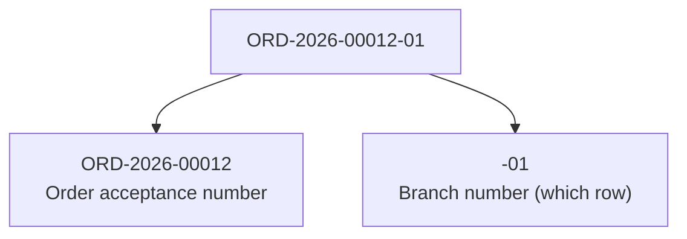
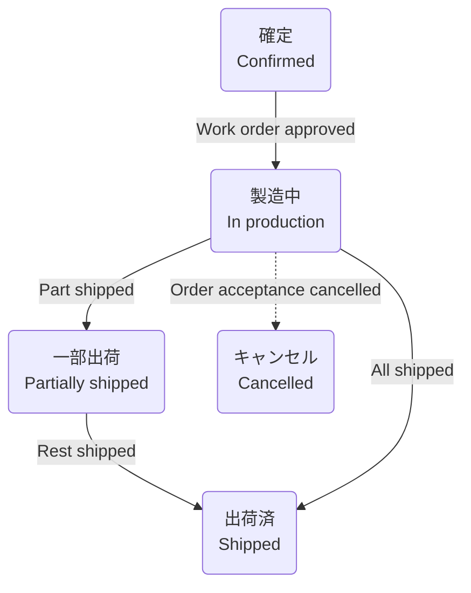

When an order acceptance is confirmed, each of its detail rows becomes an **order line**. This app lists those order lines across all order acceptances so you can follow **how far stock reservation, production and shipping have progressed**. The operation code is `SA05`.

> ⚠️ This app is still in preview. Screens and steps may change.

> This app belongs to … [Sales flow](/manual/en/process/sales)

## What you can do here

- See confirmed order lines from every order acceptance in **one list**.
- Check production, shipping and reservation progress for each line.
- Check available stock and **reserve** it for the order.
- When an order is withdrawn, request cancellation of the **whole order acceptance** (individual lines cannot be cancelled on their own).

**You cannot create or edit order lines here.** Both are done on the [order acceptance](/manual/en/operations/sales/order-acceptance/user) screen. See [When you need to change something](#when-you-need-to-change-something) below for why.

## Terms used on this page

- **Order acceptance** — one order received from a customer.
- **Order line** — a single detail row of an order acceptance. That one row ("which product, how many") is what production and shipping work from.
- **Confirmation** — the step that finalises an approved order acceptance and assigns numbers to its lines.
- **Branch number** — the trailing `-01` in `ORD-2026-00012-01`. It says which row of the order acceptance this is.
- **Reservation** — setting stock aside for this order so another order cannot take it.
- **Lot number** — the serial number of a production batch (e.g. `#9001`). It is assigned automatically when a work order is created (it is separate from the work order's document number `WOR-…`).
- **Marking number** — the serial number laser-marked on the products (e.g. `A200000-001`). It is assigned automatically to each order line when the order is confirmed.

## Reading the number

An order line number is the order acceptance number plus a branch number.

Lines from the same order acceptance share the first part and differ only in the branch. A three-row order produces `-01`, `-02` and `-03`.

**Rows with the same product are never merged.** If the customer's order lists a product on two separate rows, you get two order lines. Splitting one row into two is not possible either. **One row on the order = one order line**, always.

## Reading the screen

Opening the app shows a list of confirmed order lines.

- **Order line number** — the `ORD-…-NN` number described above.
- **Customer** — carried over from the order acceptance.
- **Product / Quantity / Unit price / Amount** — the contents of the order.
- **Delivery date** — the date promised to the customer.
- **Status** — a coloured badge showing where the line is.

Lines that have not been confirmed do not appear here, because they have no number yet. To see those, open the [order acceptance](/manual/en/operations/sales/order-acceptance/user).

### What the statuses mean

| Status | Meaning |
| --- | --- |
| Confirmed | The order is final and ready to move into production and shipping. |
| In production | A work order has been approved and the factory has started. |
| Partially shipped | Some, but not all, of the ordered quantity has shipped. |
| Shipped | The full ordered quantity has shipped. |
| Cancelled | The line has been withdrawn. |

The status moves as follows.

## What the detail screen offers

Select a row to open its detail screen.

### Moving on to the next task

A "**Next step**" card appears at the top of the screen. While unallocated pieces remain it points to **creating a work order**; once allocation is done and unshipped pieces remain it points to **creating a delivery order**. Pressing the button on the card opens the [work order](/manual/en/operations/production/work-order/user) or [delivery order](/manual/en/operations/shipping/delivery-order/user) creation screen with this order line already selected.

The three-dot "**…**" menu at the top right also always lists "**Create work order**" and "**Create delivery order**". Actions you cannot use right now are grayed out, with the reason shown (for example "available once the order acceptance is deployed").

### Check the marking number [#marking-number]

"**Marking number**" is shown near the top of the detail screen. It is the number laser-marked on the products, and one is assigned automatically to each order line **when the order acceptance is confirmed**. You cannot enter it yourself or change it later.

- The number is based on `A` followed by a six-digit serial number (starting at `A200000`). It is a separate sequence from lot numbers and order line numbers, and does not reset when the month or fiscal year changes.
- Both forms are always shown. Which one to mark is decided on the shop floor.
  - "**Per piece**" — the range to use when marking a different number on each piece. For a quantity of 150 it shows `A200000-001 – A200000-150` (for 1,000 pieces or more, the suffix gets as many digits as the quantity needs).
  - "**Per line**" — the number to use when marking the same number on every piece of that line (`A200000`).
- "**Not numbered (numbered when the order is confirmed)**" is shown for an order line that has no number yet.
- The same number also appears on the screen and strip print of the [work order](/manual/en/operations/production/work-order/user#marking-number) allocated to this order line, and on the step screens of the shared shop-floor device.
- When this order line is made by **several work orders**, each work order gets a **split number** and its head becomes `A2000001`, `A2000002`, … (the suffix counts from `001` inside the split). Below the marking number, 「**分けて作った指示書（分割ごとの番号）**」 (work orders made separately) lists each split's range with its work order and quantity. The work order tab also has a marking number column per work order (see [splitting a work order](/manual/en/operations/production/work-order/user#marking-split)).

### Check the delivery destination

Ship-to, delivery method, end user, assigned plant and shipping work location are shown read-only, holding that line's own values. To change them, edit the line in the [order acceptance](/manual/en/operations/sales/order-acceptance/user)'s item editor — they are per-line fields because some orders ship different lines to different destinations.

### Check and reserve stock

Press **Stock check** to look at stock for the product and **reserve whatever is available**.

- Reserved quantity can no longer be taken by another order.
- Anything missing is shown as a shortage. Cover it by creating a [work order](/manual/en/operations/production/work-order/user).
- Stock check is only available **before production starts**. Once it has, quantities are managed on the work order instead.

### Follow production

The Work orders tab lists the work orders allocated to this line. **One order line can have any number of work orders** — split between stock and manufacture, part made first and the rest added later, and so on. The other way round, **several order lines of the same product can be combined into one work order (one lot)**. The allocation quantity is how many pieces are made for this line; the planned quantity is how many the whole work order makes (it can be higher, allowing spares for defects).

### Follow shipping

The Shipping tab lists the delivery orders that include this line. The quantity shown is **only this line's share**. One delivery order can carry several order lines, so it may differ from the delivery order's total.

As shipping progresses the status moves automatically to Partially shipped and then Shipped. **You cannot ship more than the ordered quantity.** An attempt to do so is stopped, and the screen names the order line that would be exceeded.

### When you need to cancel

A single order line cannot be cancelled by itself. When an order is withdrawn, open the **parent order acceptance** and request cancellation from the three-dot menu ("**Request cancellation**", reason required). If the approval flow "Order acceptance cancellation" has steps, it goes through approval; on final approval the following happens automatically:

- Every order line is **cancelled**.
- All reserved stock is **released**.
- Unfinished work orders are **cancelled along with it** (completed ones are left alone). However, **a work order that also makes pieces for other order lines (a combined lot) is not cancelled** and is left as it is.

If even one line has already shipped, cancellation cannot be requested.

## When you need to change something

**After confirmation, an order line cannot be changed** — not the quantity, not the price, not the product. An order line records what was agreed with the customer, so allowing later edits would mean losing the figures that production and invoicing were based on.

While the order acceptance is still a draft, you can edit the rows freely on the [order acceptance](/manual/en/operations/sales/order-acceptance/user) screen. Think of confirmation as the step where you decide **"this will not change any more."**

If the contents change after confirmation, talk to the person responsible.

## Troubleshooting

**A line is missing from the list**

It may not be confirmed yet. Open the [order acceptance](/manual/en/operations/sales/order-acceptance/user) and check that its status is 確定済 (Confirmed). If approval and confirmation have not happened, do those first.

**Stock check is not available**

Production has already started on that line. Check quantities on the [work order](/manual/en/operations/production/work-order/user) instead.

**Shipping says the ordered quantity would be exceeded**

The quantity already shipped for that line plus this shipment is more than the ordered quantity. Reduce the shipment, or check that the right order line was selected.

**The app is not in my launcher**

It needs the same permission as order acceptances (`order_acceptance`). Contact an administrator.

## Related screens

- [Order acceptance](/manual/en/operations/sales/order-acceptance/user) — where order lines are created and edited
- [Work order](/manual/en/operations/production/work-order/user) — production
- [Delivery order](/manual/en/operations/shipping/delivery-order/user) — shipping
- [Inventory](/manual/en/operations/inventory/inventory-management/user) — stock and reservations

<!-- permissions:start -->
## Permissions required

Using this screen requires the **Order acceptance** (`order_acceptance`) permission.

| What you want to do | Permission needed |
| --- | --- |
| Open the screen, view lists and details | Order acceptance — View |
| Add, change or delete | Order acceptance — Create / Edit / Delete |

Viewing only needs *View*. Where a screen offers adding, changing or deleting, each of those needs its matching permission.

Permissions come through roles. If something is missing, ask an administrator.

For the whole picture see [Permissions and roles](../../../permissions).
<!-- permissions:end -->
