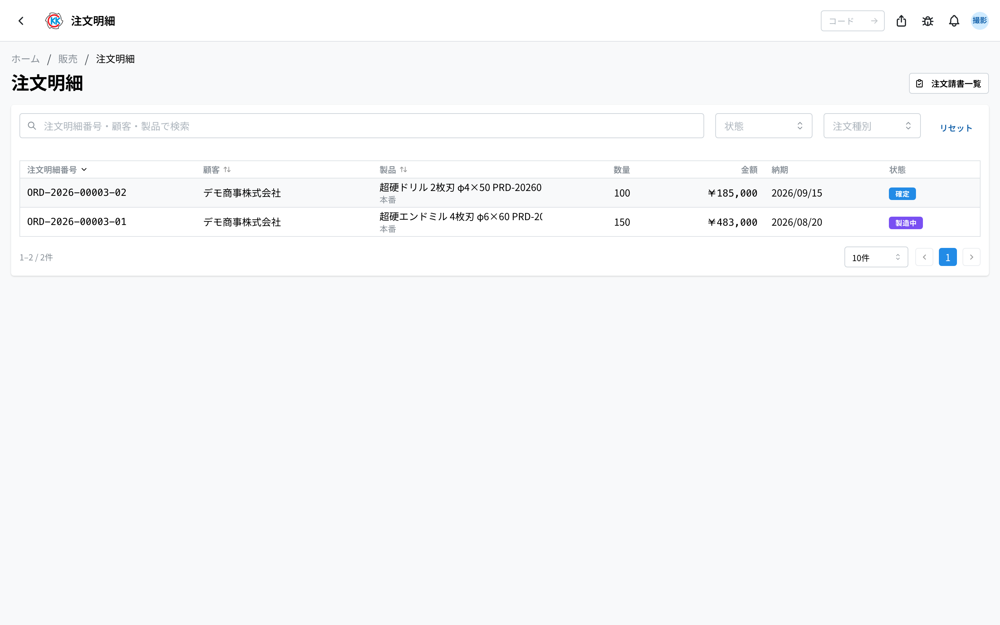
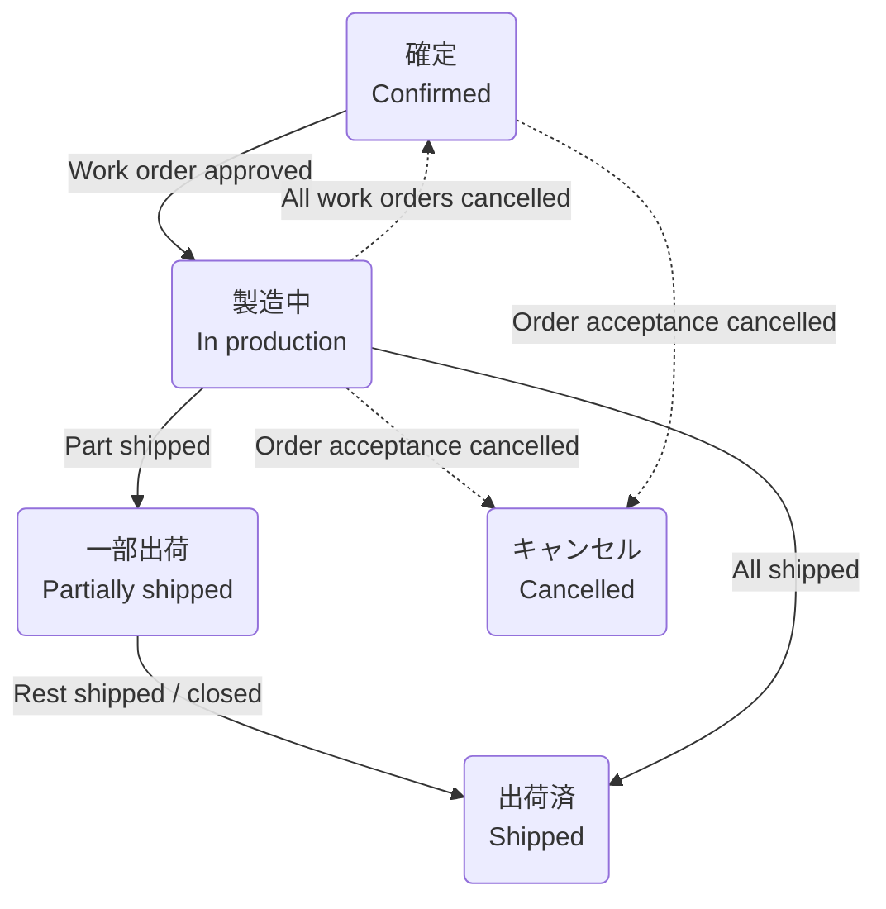
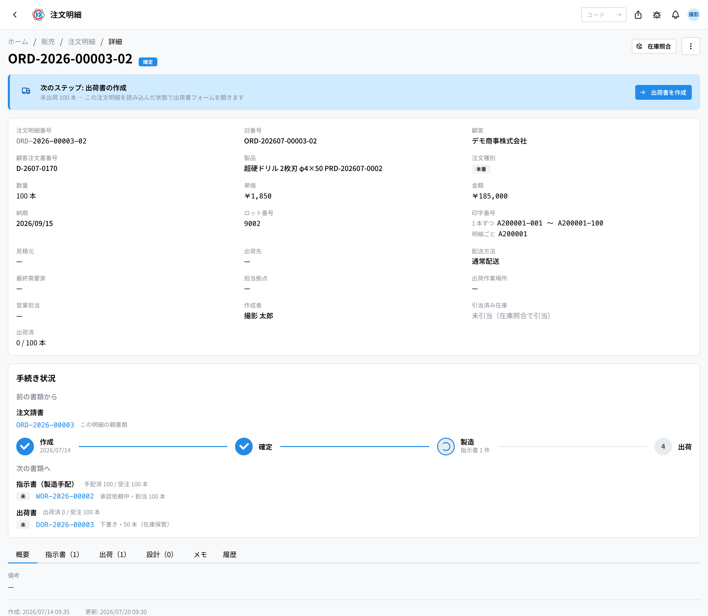

When an order acceptance is confirmed, each of its detail rows becomes an **order line**. This app lists those order lines across all order acceptances so you can follow **how far stock reservation, production and shipping have progressed**. The operation code is `SA05`.

> ⚠️ This app is still in preview. Screens and steps may change.

> This app belongs to … [Sales flow](/manual/en/process/sales)

## What you can do here

- See confirmed order lines from every order acceptance in **one list**.
- Check production, shipping and reservation progress for each line.
- Check available stock and **reserve** it for the order.
- Move on from the line to creating a work order or delivery order, or **raising a design request**.
- When an order is withdrawn, request cancellation of the **whole order acceptance** (individual lines cannot be cancelled on their own).

**You cannot create or edit order lines here.** Both are done on the [order acceptance](/manual/en/operations/sales/order-acceptance/user) screen. See [When you need to change something](#when-you-need-to-change-something) below for why.

## Terms used on this page

- **Order acceptance** — one order received from a customer.
- **Order line** — a single detail row of an order acceptance. That one row ("which product, how many") is what production and shipping work from.
- **Order confirmation** — the step that finalises an approved order acceptance and assigns numbers to its lines.
- **Line branch no.** — the trailing `-01` in `ORD-2026-00012-01`. It says which row of the order acceptance this is.
- **Reservation** — setting stock aside for this order so another order cannot take it.
- **Lot number** — the serial number of a production batch (e.g. `#9001`). It is assigned automatically when a work order is created (it is separate from the work order's document number `WOR-…`).
- **Marking number** — the serial number laser-marked on the products (e.g. `A200000-001`). It is assigned automatically to each order line when the order is confirmed.

## Reading the number

An order line number is the order acceptance number plus a line branch no.

Lines from the same order acceptance share the first part and differ only in the branch. A three-row order produces `-01`, `-02` and `-03`.

**Rows with the same product are never merged.** If the customer's order lists a product on two separate rows, you get two order lines. Splitting one row into two is not possible either. **One row on the order = one order line**, always.

## Reading the screen

Opening the app shows a list of confirmed order lines.

- **注文明細番号 (Order line number)** — the `ORD-…-NN` number described above.
- **顧客 (Customer)** — carried over from the order acceptance.
- **製品 (Product)** — the product ordered. The **注文種別 (order type** — production, test, sample and so on) is shown in small text below it.
- **数量 / 金額 (Quantity / Amount)** — how many pieces, and the amount.
- **納期 (Delivery date)** — the date promised to the customer.
- **状態 (Status)** — a coloured badge showing where the line is.

Type an order line number, customer or product in the search box at the top to narrow the list. You can also filter with「**状態**」(Status) and「**注文種別**」(Order type) on the right. The「**注文請書一覧**」(order acceptances) button at the top right takes you to the [order acceptance](/manual/en/operations/sales/order-acceptance/user) list.

Lines that have not been confirmed do not appear here, because they have no number yet. To see those, open the [order acceptance](/manual/en/operations/sales/order-acceptance/user).

### What the statuses mean

| Status | Meaning |
| --- | --- |
| 確定 (Confirmed) | The order is final and ready to move into production and shipping. |
| 製造中 (In production) | A work order has been approved and the factory has started. |
| 一部出荷 (Partially shipped) | Some, but not all, of the ordered quantity has shipped. |
| 出荷済 (Shipped) | Shipping is finished. This happens when the full ordered quantity has shipped, and also when 「この出荷で注文明細を締める」(close the order lines with this shipment) was chosen on a delivery order. |
| キャンセル (Cancelled) | The line has been withdrawn. |

The status moves as follows.

If an approved work order is cancelled and this order line has no live work order left, the status goes back from 製造中 (In production) to 確定 (Confirmed).

## What the detail screen offers

Select a row to open its detail screen.

At the top you see the order line number, customer (and branch), customer order ref., product, order type, quantity, unit price, amount, delivery date, lot number, marking number, source quote, delivery destination, sales rep, created by, reserved stock and shipped quantity. Below that,「**手続き状況**」(Progress) shows how far it has got through create → confirm → manufacture → ship, and links to the source order acceptance and quote, and to this line's work orders and delivery orders.

At the bottom are the tabs「**概要**」(Overview — notes),「**指示書**」(Work orders),「**出荷**」(Shipping),「**設計**」(Design),「**メモ**」(Memo) and「**履歴**」(History).

- Until a work order is created, the lot number reads「**未採番（指示書作成時に採番）**」(not numbered — numbered when the work order is created).
- On a [regrind](/manual/en/operations/sales/order-acceptance/user#field-order-type) order line,「**再研磨品目**」(regrind item) is shown instead of the product, with「**研ぎ直す工具**」(tool to regrind) below it.
- While a work order is pending approval, a「**承認依頼中ロック**」(locked while pending approval) notice appears. Until the approval is finished, you cannot create work orders or delivery orders from this line.

### Moving on to the next task

A card appears at the top of the screen. While unallocated pieces remain it says「**次のステップ: 指示書の作成**」(next step: create a work order); once allocation is done and unshipped pieces remain it says「**次のステップ: 出荷書の作成**」(next step: create a delivery order). Pressing「**指示書を作成**」(Create work order) or「**出荷書を作成**」(Create delivery order) on the card opens the [work order](/manual/en/operations/production/work-order/user) or [delivery order](/manual/en/operations/shipping/delivery-order/user) creation screen with this order line already selected.

The three-dot "**…**" menu at the top right always lists「**指示書を作成**」(Create work order),「**出荷書を作成**」(Create delivery order) and「**設計依頼を起票**」(Raise a design request). Actions you cannot use right now are grayed out, with the reason shown (for example「注文請書の確定後に作成できます」— available once the order acceptance is confirmed).「設計依頼を起票」opens the [design request](/manual/en/operations/sales/design-request/user) form with this order line filled in.

### Check the marking number [#marking-number]

"**Marking number**" is shown near the top of the detail screen. It is the number laser-marked on the products, and one is assigned automatically to each order line **when the order acceptance is confirmed**. You cannot enter it yourself or change it later.

- The number is based on `A` followed by a six-digit serial number (starting at `A200000`). It is a separate sequence from lot numbers and order line numbers, and does not reset when the month or fiscal year changes.
- Both forms are always shown. Which one to mark is decided on the shop floor.
  - 「**1 本ずつ**」(Per piece) — the range to use when marking a different number on each piece. For a quantity of 150 it shows `A200000-001 – A200000-150` (for 1,000 pieces or more, the suffix gets as many digits as the quantity needs).
  - 「**明細ごと**」(Per line) — the number to use when marking the same number on every piece of that line (`A200000`).
- 「**未採番（注文確定時に採番）**」(not numbered — numbered at order confirmation) is shown for an order line that has no number yet.
- The same number also appears on the screen and strip print of the [work order](/manual/en/operations/production/work-order/user#marking-number) allocated to this order line, and on the step screens of the shared shop-floor device.
- When this order line is made by **several work orders**, each work order gets a **split number** and its head becomes `A2000001`, `A2000002`, … (the suffix counts from `001` inside the split). Below the marking number, 「**分けて作った指示書（分割ごとの番号）**」 (work orders made separately) lists each split's range with its work order and quantity. The work order tab also has a marking number column per work order (see [splitting a work order](/manual/en/operations/production/work-order/user#marking-split)).

### Check the delivery destination

Ship-to, delivery method, end user, assigned site and shipping work location are shown read-only, holding that line's own values. To change them, edit the line in the [order acceptance](/manual/en/operations/sales/order-acceptance/user)'s item editor — they are per-line fields because some orders ship different lines to different destinations.

### Check and reserve stock

1. Press「**在庫照合**」(Stock check) at the top right.
2. On the「**在庫照合結果**」(stock check result) screen, check「**引当**」(allocated this time),「**不足**」(short) and「**照合時の利用可能数**」(available at check time).
3. If something is short, press「**製造分の指示書（N 本）**」(work order for manufacture, N pcs) on the screen to create a [work order](/manual/en/operations/production/work-order/user) for the missing pieces. The pieces allocated from stock can be turned into a work order with「**在庫分の指示書（N 本）**」(work order from stock, N pcs).

- Reserved quantity can no longer be taken by another order. It is shown as「**引当済み在庫**」(reserved stock) on the detail screen.
- The「**在庫照合**」button only appears on lines whose status is **確定 (Confirmed)** — before production starts. Once it has, quantities are managed on the work order instead.
- It does not appear on regrind lines. Those orders take in the customer's own tools to regrind, so our own stock is not used.

### Follow production

The「指示書」(Work orders) tab lists the work orders allocated to this line. **One order line can have any number of work orders** — split between stock and manufacture, part made first and the rest added later, and so on. The other way round, **several order lines of the same product can be combined into one work order (one lot)**. 「割当数量」(allocated quantity) is how many pieces are made for this line;「予定数量」(planned quantity) is how many the whole work order makes (it can be higher, allowing spares for defects).

### Follow shipping

The「出荷」(Shipping) tab lists the delivery orders that include this line. The quantity shown is **only this line's share**. One delivery order can carry several order lines, so it may differ from the delivery order's total.

As shipping progresses the status moves automatically to 一部出荷 (Partially shipped) and then 出荷済 (Shipped). **Normally you cannot ship more than the ordered quantity.** An attempt to do so is stopped, and the screen names the order line that would be exceeded. Only when a work order allows shipping with a quantity variance, and the business partner's tolerance covers it, can you ship a quantity different from the order (see [the delivery order's quantity variance](/manual/en/operations/shipping/delivery-order/user#shipping-with-a-delivery-quantity-variance)).

### See design requests

The「設計」(Design) tab lists the [design requests](/manual/en/operations/sales/design-request/user) raised from this order line. You can raise a new one from here too.

### When you need to cancel

A single order line cannot be cancelled by itself. When an order is withdrawn, open the **parent order acceptance** and request cancellation from the three-dot menu (「**キャンセル依頼**」— request cancellation). If the approval flow "Order acceptance cancellation" has steps, it goes through approval; on final approval the following happens automatically:

- Every order line is **cancelled**.
- All reserved stock is **released**.
- Unfinished work orders are **cancelled along with it** (completed ones are left alone). However, **a work order that also makes pieces for other order lines (a combined lot) is not cancelled** and is left as it is.

If even one line is 出荷済 (Shipped), cancellation cannot be requested.

## When you need to change something

**After confirmation, an order line cannot be changed** — not the quantity, not the price, not the product. An order line records what was agreed with the customer, so allowing later edits would mean losing the figures that production and invoicing were based on.

While the order acceptance is still a draft, you can edit the rows freely on the [order acceptance](/manual/en/operations/sales/order-acceptance/user) screen. Think of confirmation as the step where you decide **"this will not change any more."**

If the contents change after confirmation, talk to the person responsible.

## Troubleshooting

**A line is missing from the list**

It may not be confirmed yet. Open the [order acceptance](/manual/en/operations/sales/order-acceptance/user) and check that its status is 確定 (Confirmed). If approval and confirmation have not happened, do those first.

**The「在庫照合」(Stock check) button is not shown**

It is not shown on lines where production has already started, nor on regrind lines. If production has started, check quantities on the [work order](/manual/en/operations/production/work-order/user) instead.

**Shipping says「… の受注数量 … を超える出荷になります」(the shipment would exceed the ordered quantity)**

The quantity already shipped for that line plus this shipment is more than the ordered quantity. Reduce the shipment, or check that the right order line was selected.

**「指示書を作成」(Create work order) is grayed out**

The reason is shown under the grayed-out item.「受注数量まで手配済みです」(everything ordered has been planned) means work orders for the full ordered quantity already exist.「承認依頼中のためロックされています」(locked while approval is pending) means you should wait until the work order's approval is finished.

**The app is not in my launcher**

It needs the same permission as order acceptances (`order_acceptance`). Contact an administrator.

## Related screens

- [Order acceptance](/manual/en/operations/sales/order-acceptance/user) — where order lines are created and edited
- [Work order](/manual/en/operations/production/work-order/user) — production
- [Delivery order](/manual/en/operations/shipping/delivery-order/user) — shipping
- [Design request](/manual/en/operations/sales/design-request/user) — asking for a drawing
- [Inventory](/manual/en/operations/inventory/inventory-management/user) — stock and reservations

<!-- permissions:start -->
## Permissions required

Using this screen requires the **Order acceptance** (`order_acceptance`) permission.

| What you want to do | Permission needed |
| --- | --- |
| Open the screen, view lists and details | Order acceptance — View |
| Add, change or delete | Order acceptance — Create / Edit / Delete |

Viewing only needs *View*. Where a screen offers adding, changing or deleting, each of those needs its matching permission.

Permissions come through roles. If something is missing, ask an administrator.

For the whole picture see [Permissions and roles](../../../permissions).
<!-- permissions:end -->
