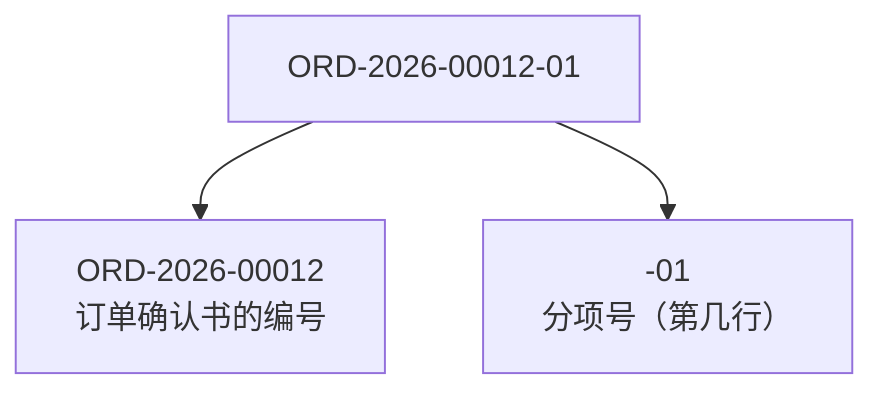
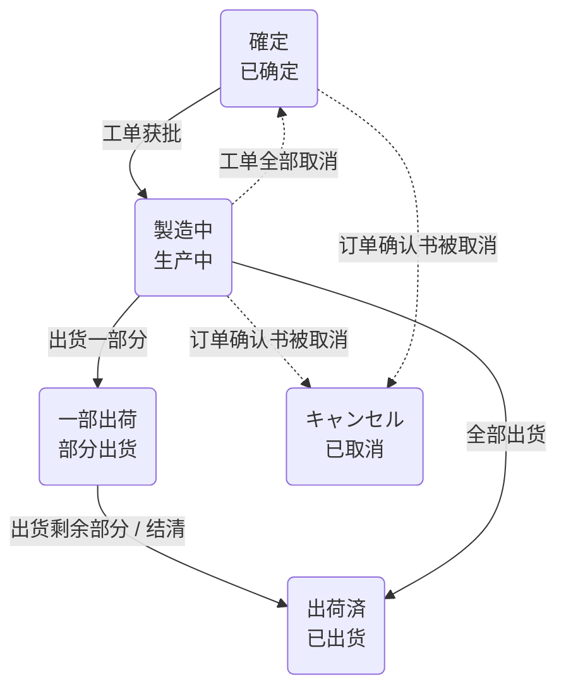

订单确认书确定后，其中的每一行明细都会变成一条 **订单明细**。本应用把这些订单明细跨订单确认书汇总到一起，用来跟踪 **库存预留、生产和发货进行到哪一步**。操作代码是 `SA05`。

> ⚠️ 本应用仍在试用阶段，画面和步骤今后可能会变。

> 本应用所属的流程……[销售流程](/manual/zh/process/sales)

## 本应用能做什么

- 把所有订单确认书中已确定的订单明细 **汇总在一个列表** 中查看。
- 逐条确认工单、发货和预留的进度。
- 查询可用库存并进行 **预留**。
- 可以从该订单明细进入创建工单、出货单，或 **发起设计委托**。
- 订单被取消时，**按订单确认书整单申请取消**（不能单独取消某一条明细）。

**本应用不能新建或修改订单明细。** 新建和修改都在 [订单确认书](/manual/zh/operations/sales/order-acceptance/user) 画面进行。原因请看下面的「[需要修改内容时](#需要修改内容时)」。

## 本页用到的术语

- **订单确认书** … 从客户处接到的一笔订单的记录。
- **订单明细** … 订单确认书中的一行明细。「哪个产品、多少支」这一行，就是生产和发货的依据。
- **订单确定** … 把已批准的订单确认书确定下来、给明细编号的操作。
- **分项号** … `ORD-2026-00012-01` 末尾的 `-01`。表示这是订单确认书中的第几行。
- **预留** … 为这笔订单把库存留出来，防止被其他订单占用。
- **批次号** … 生产单位的流水号（例如 `#9001`）。创建工单时自动编号（与工单的单据编号 `WOR-…` 是不同的编号）。
- **打标编号** … 用激光刻在产品上的流水号（例如 `A200000-001`）。订单确定时，按订单明细的每一行自动分配。

## 编号的读法

订单明细的编号 = 订单确认书的编号 + 分项号。

同一张订单确认书生成的明细，前半部分相同，只有分项号不同。三行的订单会得到 `-01`、`-02`、`-03`。

**相同产品分成两行时也不会合并。** 客户订单上分成两行，订单明细就保持两条。反过来，也不能把一行拆成两条。**订单的一行 = 一条订单明细**，这一点始终不变。

## 画面的看法

打开应用后，会显示已确定的订单明细列表。

- **订单明细编号** … 上面说明的 `ORD-…-NN` 编号。
- **客户** … 从订单确认书继承而来。
- **产品** … 订购的产品。下方会用小字显示 **订单类别**（量产・试制・样品等区分）。
- **数量 / 金额** … 订购的支数和金额。
- **交期** … 与客户约定的日期。
- **状态** … 用彩色徽章显示当前进度。

在上方搜索框输入订单明细编号、客户或产品的文字，即可缩小范围。也可以用右侧的「**状态**」「**订单类别**」筛选。点击右上角的「**订单确认书列表**」，可以跳到[订单确认书](/manual/zh/operations/sales/order-acceptance/user)的列表。

尚未确定的明细不会出现在这里，因为还没有编号。要查看这些明细，请打开 [订单确认书](/manual/zh/operations/sales/order-acceptance/user)。

### 状态的含义

| 状态 | 含义 |
| --- | --- |
| 已确定 | 订单已确定，接下来进入生产和发货。 |
| 生产中 | 工单已批准，工厂已开始生产。 |
| 部分出货 | 订购数量中只发出了一部分。 |
| 已出货 | 出货已结束。除了订购数量全部发出之外，在出货单上选择了「この出荷で注文明細を締める」（以本次出货结清订单明细）时也会进到这一步。 |
| 已取消 | 已作废的订单明细。 |

状态按以下方式变化。

已批准的工单被取消后，如果该订单明细已没有任何有效的工单，状态会从「生产中」回到「已确定」。

## 详情画面能做什么

在列表中选择一行，即可打开该订单明细的详情。

画面上方会列出订单明细编号・客户（分公司）・客户订单号・产品・订单类别・数量・单价・金额・交期・批次号・打标编号・报价来源・送达地点・销售负责人・创建人・已分配库存・已出货的支数。下面的「**办理状态**」显示 创建 → 确定 → 制造 → 出货 进行到了哪一步，并可追溯到来源的订单确认书・报价单，以及该明细的工单・出货单。

画面下方有「**概要**」（备注）「**工单**」「**出货**」「**设计**」「**备忘**」「**历史**」标签页。

- 在创建工单之前，批次号显示为「**未编号（创建工单时编号）**」。
- [再研磨](/manual/zh/operations/sales/order-acceptance/user#field-order-type)的订单明细会显示「**再研磨服务**」代替「产品」，下方还有「**要研磨的刀具**」。
- 工单审批中时，会显示「**审批中锁定**」的提示。在审批结束之前，不能从该订单明细创建工单或出货单。

### 进入下一项作业

画面上方会出现卡片。只要还剩未安排生产的数量，就显示「**下一步：创建工单**」；生产安排完毕、还剩未出货的数量时，则显示「**下一步：创建出货单**」。点击卡片上的「**创建工单**」「**创建出货单**」，会在已选中该订单明细的状态下打开[工单](/manual/zh/operations/production/work-order/user)或[出货单](/manual/zh/operations/shipping/delivery-order/user)的创建画面。

右上角的「**…**」（三个点的按钮）中始终排列着「**创建工单**」「**创建出货单**」「**发起设计委托**」。当前不能执行的操作会呈灰色，并显示原因（例如「订单确认书确定后方可创建」）。点击「发起设计委托」，会在已填入该订单明细的状态下打开[设计委托单](/manual/zh/operations/sales/design-request/user)的创建画面。

### 确认打标编号 [#marking-number]

详情画面的上方显示「**打标编号**」。这是用激光刻在产品上的编号，在 **确定订单确认书时**，按订单明细的每一行自动分配 1 个。不能自己输入，也不能事后更改。

- 编号以 `A` 加 6 位流水号（从 `A200000` 开始）为基础。它与批次号、订单明细编号是不同的流水号，月份或年度更替时也不会重置。
- 画面上两种形式都会显示。用哪一种刻由现场决定。
  - 「**逐支**」… 每支产品刻不同编号时使用的范围。数量为 150 支时显示 `A200000-001 〜 A200000-150`（数量在 1000 支以上时，分项号的位数会按数量增加）。
  - 「**按明细**」… 该明细的所有产品刻同一个编号时使用的编号（`A200000`）。
- 显示「**未编号（订单确定时编号）**」的，是尚未分配编号的订单明细。
- 同一编号也会出现在分配给该订单明细的[工单](/manual/zh/operations/production/work-order/user#marking-number)的画面・标签条打印，以及现场共用终端的工序画面上。
- 将该订单明细 **分成几张工单** 制作时，每张工单会获得 **分割号**，开头变为 `A2000001`・`A2000002` ……（分项号在分割内从 `001` 开始）。打标编号栏下方会以「**分开制作的工单（各分割的编号）**」列出各分割的范围、工单和支数。工单标签页的列表中也有每张工单的打标编号列（详见[工单的分割](/manual/zh/operations/production/work-order/user#marking-split)）。

### 查看送达地点

出货对象・配送方式・最终用户・负责据点・出货作业场所会以只读方式显示该明细自己的值。要修改这些值，请到[订单确认书](/manual/zh/operations/sales/order-acceptance/user)的明细编辑器中操作 —— 由于有些订单在同一份单据中行与行的送达地点并不相同，这些都是按明细设置的项目。

### 查询库存并预留

1. 点击右上角的「**库存核对**」。
2. 在「**库存核对结果**」画面确认「**已分配**」（本次留出的支数）・「**不足**」・「**核对时的可用数**」。
3. 有不足时，点击画面上的「**制造部分工单（N 支）**」，为不足的支数创建[工单](/manual/zh/operations/production/work-order/user)。从库存分配到的部分，可以用「**库存部分工单（N 支）**」做成工单。

- 预留的部分不会被其他订单占用。详情画面的「**已分配库存**」会显示支数。
- 只有状态为 **已确定**（进入生产中之前）的订单明细才会出现「**库存核对**」按钮。生产开始后，数量由工单一侧管理。
- 再研磨的订单明细不会出现该按钮。这类订单是代客户保管刀具后重新研磨，不使用本公司的库存。

### 查看生产进度

「工单」标签页会列出分配给该订单明细的工单。**一条订单明细可以创建任意多张工单**（分为库存分和生产分、先只做一部分之后再补做剩余等）。反过来，**同一产品的多条订单明细也可以合并到 1 张工单（1 个批次）来制造**。「分配数量」是为该明细制造的支数，「计划数量」是那张工单整体制造的支数（可能因不良备用量而更多）。

### 查看出货进度

「出货」标签页会列出包含该订单明细的出货单。这里显示的数量 **只是该订单明细的部分**。因为一张出货单可以同时装载多条订单明细，所以可能与出货单的合计数量不同。

随着出货推进，状态会自动变为「部分出货」→「已出货」。**通常不能发出超过订购数量的货。** 一旦超出，出货操作会被中止，并显示是哪条订单明细超出了。只有在工单中许可了「可按数量差异出货」、并且在业务伙伴的允许范围之内时，才能以与订购数量不同的支数出货（详见[出货单的交货数量差异](/manual/zh/operations/shipping/delivery-order/user#以交货数量差异出货)）。

### 查看设计委托

「设计」标签页会列出从该订单明细发起的[设计委托单](/manual/zh/operations/sales/design-request/user)。也可以从这里新建。

### 需要取消时

订单明细不能单独取消。订单被取消时，请打开**上级的订单确认书**，从右上角的三点菜单选择「**キャンセル依頼**」（取消申请）。若审批流程「订单确认书取消」设定了级别，则需经过审批；最终批准后会自动执行以下处理：

- 所有订单明细都会变为**已取消**。
- 已预留的库存 **全部释放**。
- 尚未完成的工单会 **连带取消**（已完成的保持不变）。不过，**同时为其他订单明细生产的工单（合并批次）不会被取消**，会保持原样。

只要有一条明细的状态是「已出货」，就无法提出取消申请。

## 需要修改内容时

**确定之后的订单明细，数量、单价、产品都不能更改。** 订单明细记录的是「与客户约定的内容」，如果事后可以改写，生产和开票所依据的数字就无从查证了。

在尚未确定（订单确认书仍为草稿）期间，可以在 [订单确认书](/manual/zh/operations/sales/order-acceptance/user) 的明细中随意修改。请把确定理解为 **决定「不再修改」的操作**。

如果确定后内容发生了变化，请与负责人商量。

## 遇到问题时

**列表里找不到**

可能尚未确定。请打开 [订单确认书](/manual/zh/operations/sales/order-acceptance/user)，确认状态是否为「已确定」。如果审批和确定还没做，请先完成这些步骤。

**没有出现「库存核对」按钮**

已经开始生产的订单明细和再研磨的订单明细不会出现该按钮。已经开始生产时，请到 [工单](/manual/zh/operations/production/work-order/user) 一侧确认数量。

**出货时提示「这将导致 … 的出货量超过订购数量 …」**

该订单明细已出货的数量加上本次数量，超过了订购数量。请减少出货单的数量，或确认所选的订单明细是否正确。

**「创建工单」呈灰色无法点击**

灰色项目下方会显示原因。「已安排至接单数量」表示订购数量的工单已经齐全。「审批中，已锁定」表示请等工单的审批结束。

**启动器里没有这个应用**

需要与订单确认书相同的权限（`order_acceptance`）。看不到时请联系管理员。

## 相关画面

- [订单确认书](/manual/zh/operations/sales/order-acceptance/user) — 新建和修改订单明细的画面
- [工单](/manual/zh/operations/production/work-order/user) — 推进生产的画面
- [出货单](/manual/zh/operations/shipping/delivery-order/user) — 出货的画面
- [设计委托单](/manual/zh/operations/sales/design-request/user) — 委托制作图纸的画面
- [库存管理](/manual/zh/operations/inventory/inventory-management/user) — 库存与预留的状况

<!-- permissions:start -->
## 所需权限

使用本画面需要 **订单确认书・订单明细**（`order_acceptance`）权限。

| 想做的事 | 所需权限 |
| --- | --- |
| 打开画面、查看列表与明细 | 订单确认书・订单明细 — 查看 |
| 新增・变更・删除 | 订单确认书・订单明细 — 创建 / 更新 / 删除 |

仅查看有「查看」即可。画面中若有新增、变更或删除的操作，则分别需要对应的权限。

权限通过角色授予。若不足，请与管理员联系。

权限的整体说明请参见「[权限与角色](../../../permissions)」。
<!-- permissions:end -->
