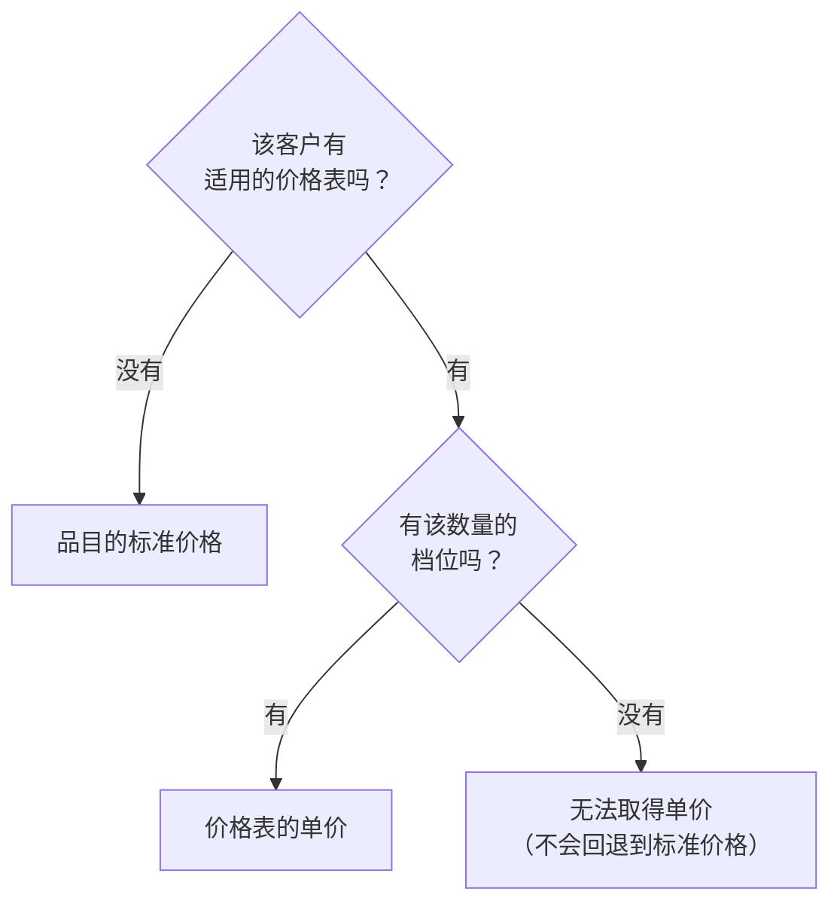
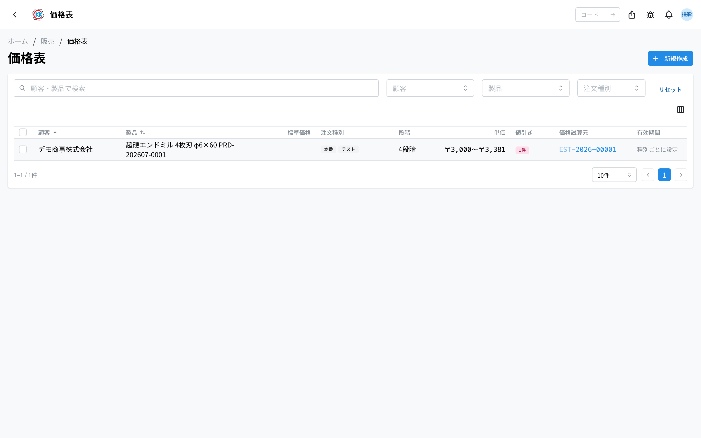
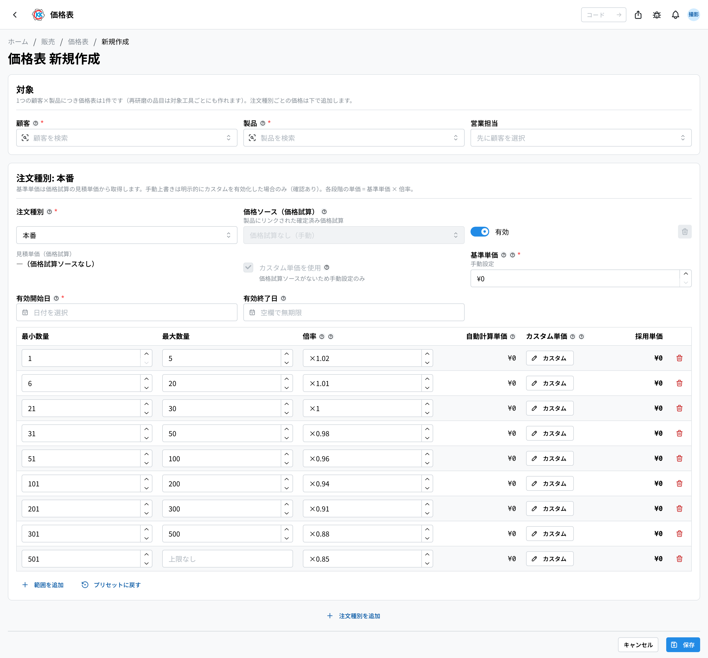
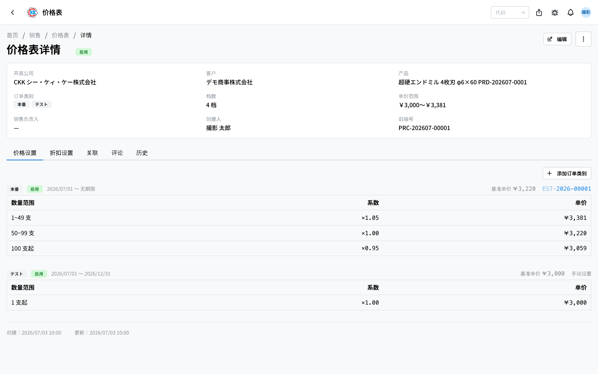
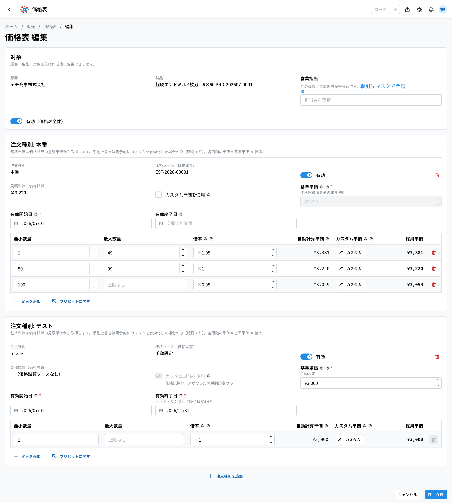
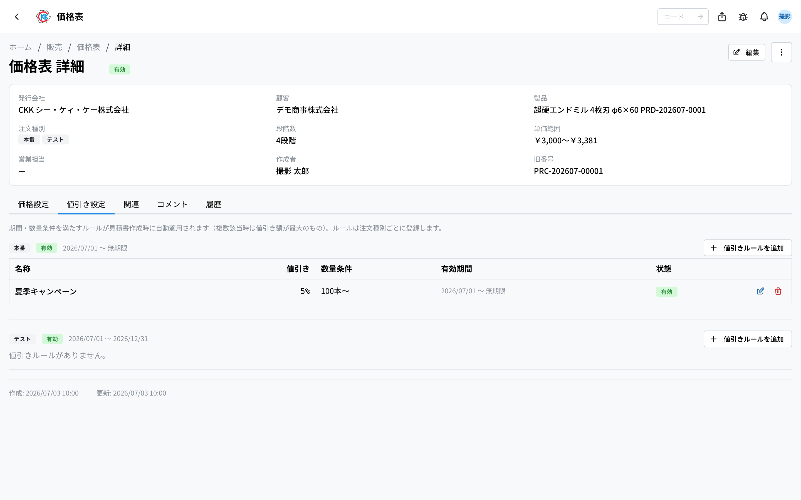
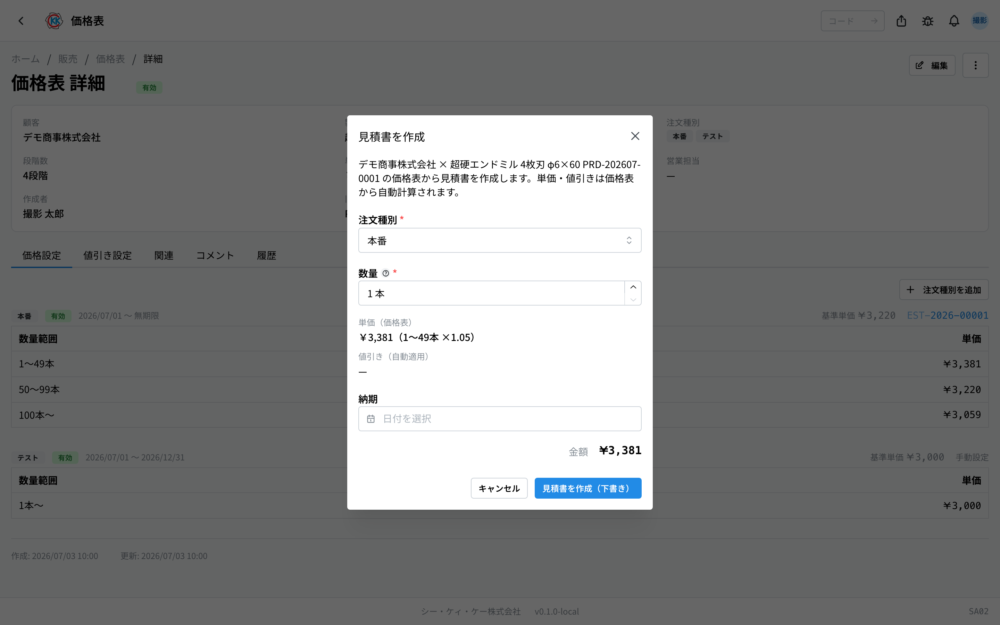

按客户登记「这个[产品](/manual/zh/operations/masters/product/user)多少钱」的台账。操作码是 `SA02`。

> 本应用所属的流程……[销售流程](/manual/zh/process/sales)

## 本应用能做什么

- 可以按[客户](/manual/zh/operations/masters/business-partner/user)登记每个产品的售价。
- 登记之后，[报价单](/manual/zh/operations/sales/quote/user)的金额会 **自动带入**（在报价单画面不需要手动输入金额）。
- 在[订单确认书](/manual/zh/operations/sales/order-acceptance/user)中，客户订单上的单价会与这里的价格 **自动比对**，不一致时会提示。
- 可以设定「**买得越多，每支越便宜**」这种按数量的价格。
- 可以登记限期的活动折扣。
- 可以直接从这张价格表制作报价单。

和客户谈好价格后登记在这里，之后只要改这里，报价单的金额也会跟着变。

## 本页出现的词

- **「価格表」（价格表）** … 「开具公司 × 1 位客户 × 1 个产品」为 1 条。在同一公司内，同样的组合只能建 1 条。
- **「注文種別」（订单类型）** … **本番（正式）/ テスト（测试）/ サンプル（样品）/ その他（其他）** 的区分。同一个产品，各区分可以定不同价格。
- **「基準単価」（基准单价）** … 该订单类型的基本价格。通常从[价格试算](/manual/zh/operations/sales/trial-estimate/user)的结果带入。
- **「段階（数量段階）」（阶梯·数量阶梯）** … 按数量划分的区间，例如「1〜49 支是这个价，50〜99 支是这个价」。
- **「倍率」（倍率）** … 基准单价要乘以多少的数字。小于 1 就会变便宜。
- **「値引きルール」（折扣规则）** … 事先定好期间和支数的条件后，制作报价单时会自动扣除的折扣。

## 产品和再研磨在同一画面上定价

销售的东西有 2 种，**两者都在本价格表中按客户持有价格**，并未分成不同的应用。

| 销售物 | 品目登记位置 | 使用的订单类别 |
|---|---|---|
| **产品** | [产品](/manual/zh/operations/masters/product/user)（MS04） | 量产 / 试制 / 样品 / 其他 |
| **再研磨**（研磨这项服务） | [再研磨服务](/manual/zh/operations/masters/regrind-item/user)（MS0H） | 再研磨 |

一览中，再研磨的行会带有「**再研磨**」标签。刀具的名称与「研磨这项服务」的名称很相似，因此让行显示属于哪一种。「产品」筛选中也会出现再研磨服务。

> 💡 **组合是固定的。** 再研磨服务只能设定「再研磨」的价格，产品则不能设定「再研磨」的价格。因为销售的东西不同，弄错时保存会提示。

> ⚠️ **从客户处接收的刀具本身（他社产品）不设定价格。** 只是接收、研磨后返还，并非销售。本画面的品目选项中也不会出现。

### 标准价格无法在此修改

再研磨服务持有与客户无关的**标准价格**。本画面**仅供查看**，修改请在[再研磨服务](/manual/zh/operations/masters/regrind-item/user)（MS0H）中进行 — 为的是不让价格有两个所有者。详情画面可直接跳转。

价格按 2 段确定：

1. 品目的**标准价格**
2. 该客户的**价格表** — 存在时以此为准

**仅在「没有适用的价格表」时才回退**（未创建 / 无效 / 超出有效期）。⚠️ 生效中的价格表缺少该数量档位时**不会**回退 — 那会掩盖设置上的漏洞，因此单价保持无法取得的状态。请修正档位。

用图表示如下。

### 按刀具设定价格 [#tool-specific-price]

有些客户**因研磨的刀具不同而价格不同**。此时在再研磨服务的价格表中填写 **[适用刀具](#field-target-tool)**，按刀具分别创建价格表。同一客户 × 再研磨服务可以有 1 份不限刀具的价格表，以及任意多份按刀具的价格表。

报价单和订单确认书的再研磨明细都带有「要研磨的刀具」，单价按以下顺序查找（两种单据顺序相同）：

1. 该刀具的价格表
2. 不限刀具的价格表
3. 品目的标准价格

刀具的价格表无效、待审批或不在有效期内时，进入下一步。⚠️ 缺少数量档位时不会进入下一步（理由同上）。

> 💡 **同一刀具在报价单和订单确认书上的单价相同。** 来自按刀具价格表的单价会有标记——报价单在单价下方显示「対象工具の価格表」（适用刀具的价格表），订单确认书显示徽章「価格表（対象工具）¥…」（价格表（适用刀具））——可与不限刀具的单价区分。

## 开始之前

- 需要先登记好对象[客户](/manual/zh/operations/masters/business-partner/user)和[产品](/manual/zh/operations/masters/product/user)。
- 如果有作为价格来源的[价格试算](/manual/zh/operations/sales/trial-estimate/user)会很方便。在价格试算中指定产品并设为「確定」（确定）后，在这个画面就能选到，金额也会自动带入。
- 没有价格试算时，也可以手动输入价格来登记。

## 界面怎么看

打开应用后，会以列表显示已登记的价格表。1 行就是「客户 × 产品」1 条。

- **「顧客」（客户）** … 客户名称。有 2 个以上公司时，名称旁会显示开具公司标记。
- **「製品」（产品）** … 产品名称。再研磨的行带有「再研磨」徽章，有适用刀具时会在下方显示「対象工具: …」（适用刀具）。
- **「標準価格」（标准价格）** … 品目的定价（仅限再研磨服务等持有标准价格的品目）。
- **「注文種別」（订单类型）** … 该价格表中登记的区分会以徽章排列显示。
- **「段階」（阶梯）** … 数量区间有几个。
- **「単価」（单价）** … 从最便宜到最贵的价格范围。
- **「値引き」（折扣）** … 粉色徽章上的数字，是可用折扣规则的条数。
- **「価格試算元」（价格试算来源）** … 价格是从哪份价格试算带入的。「手動」（手动）表示是手动输入的。
- **「状態」（状态）** … 用「有効」（有效）「無効」（无效）表示能否使用。审批未完成时，还会显示「承認依頼中」（审批中）或「差し戻し」（已退回）徽章。
- **「他社との差分」（与其他公司的差异）** … 只有 2 个以上公司时才显示的列（见[按公司分别管理的价格表](#per-company)）。
- 可以用列表上方的栏位按客户、产品、订单类型筛选，或用「顧客・製品で検索」（按客户·产品搜索）查找。
- 点击某一行会打开详细画面。

## 制作价格表

1. 点击列表画面右上角的「**新規作成**」（新建）。
2. 点击「**顧客**」（客户）栏，选择客户。
3. 点击「**製品**」（产品）栏，选择产品。
4. 确认「**営業担当**」（销售负责人）。选择客户后，会自动填入该客户的主负责人。
5. 在「**注文種別**」（订单类型）里选择区分（一开始是「本番」正式）。再研磨服务请选择「再研磨」。
6. 点击「**価格ソース（価格試算）**」（价格来源·价格试算）栏，选择作为价格来源的价格试算。选好后「**基準単価**」（基准单价）里会自动带入金额。
7. 选择「**有効開始日**」（生效开始日）。
8. テスト（测试）和サンプル（样品）时，还必须选择「**有効終了日**」（生效结束日）。
9. 在数量表里输入「**最小数量**」（最小数量）、「**最大数量**」（最大数量）、「**倍率**」（倍率）。
10. 想增加区间时，点击「**範囲を追加**」（添加范围）。新增订单类别时，数量区间一开始就是[数量阶梯](/manual/zh/operations/sales/trial-estimate/settings)（管理员维护的“多少支起、乘以多少系数”表）的内容。点击「**プリセットに戻す**」（恢复预设）可把该订单类别的区间恢复为这张表的状态（手动添加的范围和自定义单价会丢失）。
11. 要登记其他区分的价格时，点击「**注文種別を追加**」（添加订单类型），并重复第 5 〜 10 步。
12. 点击「**保存**」（保存）。

输入倍率后，「**自動計算単価**」（自动计算单价）和「**採用単価**」（采用单价）会当场显示金额，可以边确认边输入。

> 💡 数量区间可以这样设定：「1〜49 支倍率 1.05，50〜99 支 1.00，100 支以上 0.95」。也就是买得越多每支越便宜的定价方式。

> ⚠️ 出现「この製品にリンクされた確定済みの価格試算はありません」（没有关联到该产品的已确定价格试算）时，表示该产品的价格试算还没有确定。想使用价格试算时，请先在[价格试算](/manual/zh/operations/sales/trial-estimate/user)中指定产品并确定。不使用价格试算时，请勾选「**カスタム単価を使用**」（使用自定义单价），手动输入基准单价。

## 查看登记的内容

价格表画面有 5 个标签页（有审批记录时会增加「**承認**」（审批）标签页，共 6 个）。

- **「価格設定」（价格设置）** … 各订单类型的基准单价、有效期间、按数量的单价一览。点击「**注文種別を追加**」（添加订单类型）会打开编辑画面。
- **「値引き設定」（折扣设置）** … 折扣规则一览。
- **「関連」（关联）** … 价格是从哪份价格试算带入的，以及由这张价格表做出的报价单一览。
- **「承認」（审批）** … 自定义价格的审批记录（仅在有记录时显示）。
- **「コメント」（评论）** … 可以就这张价格表发帖交流的讨论串。
- **「履歴」（历史）** … 什么时候、谁做了修改的记录。

数量表里带橙色「**手動**」（手动）徽章的行，使用的不是按倍率计算的价格，而是手动输入的价格。

## 修改价格

1. 点击价格表画面右上角的「**編集**」（编辑）。
2. 修改需要改的地方（基准单价、有效期间、数量阶梯）。
3. 点击「**保存**」（保存）。

- **客户和产品在建立之后不能更改。** 需要别的组合时，请重新建立一条。
- 已保存的订单类型，以及作为其价格来源的价格试算，也不能更改。
- 关闭某个订单类型的「**有効**」（有效），即可只停用该订单类型的价格。点击垃圾桶图标可删除该订单类型（保存时生效）。
- 要停用整份价格表时，关闭「**有効（価格表全体）**」（有效·整份价格表）。这个开关只在编辑画面中。
- 想让某个数量区间用特别的价格时，请点击该行的「**カスタム**」（自定义）并输入金额。会出现确认画面，点击「**カスタム設定する**」（进行自定义设置）。要恢复自动计算时，点击「**自動に戻す**」（恢复自动）。

## 自定义价格需要审批

在审批设置（MS0B）的「**独自値の追加承認**」（自定义值追加审批）中设置了价格表的审批级时，含有**未从价格试算继承的价格**的价格表在保存后会自动提交审批申请。

- 自定义价格是指：未使用价格试算的基准单价、相对价格试算的试算单价修改过的基准单价、数量档的「自定义」单价（仅启用的订单类别）。
- **批准前，该价格表不会用于报价单和订单确认书的定价。** 画面顶部会显示「审批中」卡片，审批人可在此批准或退回。
- 未改变自定义价格而再次保存（例如只修改了销售负责人）时，不会重新审批。修改价格后会重新审批。
- 被退回后，修改并再次保存，或按卡片上的「**再承認依頼**」（重新申请审批）。

## 按公司分别管理的价格表 [#per-company]

价格表按**开具公司（本公司法人）分别**管理。同一客户、同一产品，每个公司可以各建 1 条。

- 报价单、订单确认书和出货的价格**只来自该单据开具公司的价格表**，不会使用其他公司的价格。
- 开具公司在新建画面的「**発行会社**」（开具公司）中选择（只有所属据点跨 2 个以上公司的人才会显示）。建好后不能更改。

### 从其他公司的价格表复制

在新建画面选择客户和产品时，如果其他公司已有同一组合的价格表，会显示「**他社の価格表があります**」（其他公司已有此价格表）。

1. 点击「**〇〇 の価格表からコピー**」（从 〇〇 的价格表复制）。
2. 订单类别、基准单价、有效期和数量档会被填入。折扣规则会在保存时一起创建。
3. 确认内容后点击「**保存**」。编号由本公司重新编号。

如有自定义价格，与普通新建时一样需要审批。

### 与其他公司保持一致

如果其他公司有同一客户、产品的价格表，价格表画面会显示「**他社の価格表**」（其他公司的价格表）栏。

- 内容相同时显示「**〇〇 と同じ**」（与 〇〇 相同），不同时显示「**〇〇 と差分あり**」（与 〇〇 有差异）。比较的是各订单类别的基准单价、有效期、状态、数量档和折扣规则（不比较编号和创建日期）。
- 点击「**差分を見る**」（查看差异）可在表中查看不同之处。
- 点击「**〇〇 の内容で同期**」（按 〇〇 的内容同步）会把本价格表的内容改为与该公司的价格表相同。仅本价格表有的订单类别将被删除。如有自定义价格，仍需审批。

在列表中，有其他公司价格表的行会显示「**同じ**」（相同）或「**差分あり**」（有差异）。有 2 个以上公司时，可以按开具公司筛选。价格表属于哪家公司，可以看客户名称旁的法人编号标记（例 `TSP`）（[开具公司标记](/manual/zh/operations/masters/own-company/user#company-badge)）。

## 登记折扣规则

1. 在价格表画面打开「**値引き設定**」（折扣设置）标签页。
2. 点击要加折扣的订单类型右侧的「**値引きルールを追加**」（添加折扣规则）。
3. 在「**名称**」（名称）里输入以后能看懂的名字（例如：夏季活动）。
4. 在「**値引き種別**」（折扣类型）里选择「**率（%）**」（比率 %）或「**金額（¥/本）**」（金额 ¥/支）。
5. 输入折扣的数字。
6. 用「**数量下限**」（数量下限）、「**数量上限**」（数量上限）决定几支以上适用（上限留空表示没有限制）。
7. 选择「**有効開始日**」（生效开始日）。结束日留空表示无期限。
8. 点击「**追加**」（添加）。

登记好的折扣，只要符合条件（期间和支数），制作报价单时就会自动扣除。符合条件的规则有多条时，会采用折扣额最大的那条。

要修改规则请点铅笔图标，要删除请点垃圾桶图标。

## 从这张价格表制作报价单

1. 点击价格表画面右上角的「**…**」（三个点的按钮）。
2. 选择「**見積書を作成**」（创建报价单）。
3. 输入「**注文種別**」（订单类型）和「**数量**」（数量）。单价和折扣会自动显示。
4. 需要时填写「**納期**」（交期）。
5. 点击「**見積書を作成（下書き）**」（创建报价单·草稿）。

会打开已填好内容的[报价单](/manual/zh/operations/sales/quote/user)创建画面。在列表某一行的「**…**」中也能做同样的操作。从带有适用刀具的价格表打开时，明细的「研ぎ直す工具」（要研磨的刀具）中也会填入该刀具。

## 其他操作

在价格表画面右上角的「**…**」中，还可以做以下操作。

- **「有効期間を変更」（更改有效期间）** … 选择 1 个订单类型，价格不变，只把期间换成新的期间。在列表行的「**…**」中名为「**有効期間を変えて複製**」（更改有效期间并复制），但操作相同（不会新增价格表）。
- **「別の顧客・製品へコピー」（复制到其他客户·产品）** … 把同样的价格设置复制给别的客户或产品（与价格试算的关联会断开，视为手动输入）。
- **「削除」（删除）** … 删除该价格表。无法撤销。由这张价格表做出的报价单将无法再自动填入单价。

在列表中，也可以用各行左侧的复选框选中多条，然后使用「**有効化**」（启用）、「**無効化**」（停用）、「**一括削除**」（批量删除）。

## 输入项

价格表画面的输入项一览。应用中输入栏旁边的 **?** 也可直接跳转到对应说明。

| 项目 | 必填 | 填什么 |
|------|------|--------|
| [客户](#field-customer) | 必填 | 为谁定价 |
| [产品](#field-product) | 必填 | 为哪个产品定价 |
| [适用刀具](#field-target-tool) | 选填 | 再研磨价格所限定的刀具（仅再研磨服务） |
| [有效（整份价格表）](#field-active) | — | 是否启用该价格表 |
| [订单类别](#field-order-type) | 必填 | 正式・测试等区分 |
| [价格来源（价格试算）](#field-estimate) | 选填 | 基准单价的来源价格试算 |
| [基准单价](#field-base-price) | 必填 | 数量阶梯的计算基础 |
| [生效开始日](#field-valid-from) | 必填 | 该价格开始适用的日期 |
| [生效结束日](#field-valid-until) | 选填 | 该价格结束适用的日期 |
| [倍率](#field-multiplier) | 必填 | 各数量阶梯的系数 |
| [自定义单价](#field-custom-price) | 选填 | 手动指定某一阶梯的单价 |

### 客户 [#field-customer]

为谁定价。**客户与产品的组合构成 1 份价格表**，创建后无法更改；若选错请重新创建。

### 产品 [#field-product]

为哪个产品定价。与客户相同，创建后无法更改。

### 适用刀具 [#field-target-tool]

**仅在选择再研磨服务时**显示。当此再研磨价格只适用于研磨某一刀具时选择；留空则为**不限刀具**的价格表。与客户、产品相同，创建后无法更改。查找顺序见[按刀具设定价格](#tool-specific-price)。

### 有效（整份价格表）[#field-active]

是否使用这份价格表（只在编辑画面中显示）。**设为无效后，报价单和订单确认书将无法从这份价格表取得单价**（会显示「价格表已停用」）。不再使用的价格表请设为无效。

### 订单类别 [#field-order-type]

正式・测试・样品・其他的区分。**即使客户与产品相同，也可按类别持有不同价格。** 样品的做法是把单价设为 0 来使用（不会自动变成 0）。

### 价格来源（价格试算）[#field-estimate]

基准单价的来源价格试算。**只能选择已确定的价格试算。** 原价试算（只计算成本的价格试算）不能选择。 选择后会将该价格试算的报价单价填入基准单价，并将价格试算锁定为「已登记到价格表」，以免过去的价格事后变动。若想手动输入，可不选择。

### 基准单价 [#field-base-price]

数量阶梯的计算基础。各阶梯的单价由该单价乘以倍率决定。

### 生效开始日 [#field-valid-from]

该价格开始适用的日期。**报价单或订单确认书的保存日早于这一天时，不使用该价格**（会显示「不在价格表有效期内」）。折扣规则另按其自身的期间生效或停止。

### 生效结束日 [#field-valid-until]

该价格结束适用的日期。**过了这一天，报价单和订单确认书将不再使用该价格**（会显示「不在价格表有效期内」）。留空则无期限。**测试・样品的价格必须设定结束日**，留空无法保存。

### 倍率 [#field-multiplier]

各数量区间的系数。希望买得越多单价越低时，填入小于 1 的值。

### 自定义单价 [#field-custom-price]

需要手动指定某一阶梯的单价时使用。填入后优先于倍率计算。

## 常见问题与困扰

**Q. 出现「同一の顧客・製品・対象工具の価格表が既に存在します。既存の価格表を編集してください。」（相同客户·产品·适用刀具的价格表已存在，请编辑现有价格表）。**
A. 该客户与该产品的价格表已经有了。请不要新建，打开现有价格表，从「編集」（编辑）里添加订单类型或价格。在新建画面里如果重复，也会显示红色提示和指向现有价格表的链接。

**Q. 客户和产品栏是灰色的，选不了。**
A. 已建立的价格表规定不能更改客户和产品。需要别的组合时，请从列表重新建立。

**Q. 保存时出现「テスト・サンプルは有効終了日が必須です」（测试·样品必须填写生效结束日）。**
A. テスト（测试）和サンプル（样品）的价格必须有到什么时候为止的结束日。请选好「有効終了日」（生效结束日）后再保存。

**Q. 基准单价栏里输不了数字。**
A. 从价格试算带入价格时，规定基准单价要沿用价格试算的金额。想改成别的金额时，请勾选「**カスタム単価を使用**」（使用自定义单价）（会出现确认画面）。

**Q. 在「見積書を作成」（创建报价单）画面上出现「この数量に該当する価格段階がありません」（没有对应该数量的价格阶梯）。**
A. 价格表里没有包含所输入支数的数量区间。请从「編集」（编辑）添加包含该支数的阶梯（把最上面阶梯的「最大数量」（最大数量）留空，就表示没有上限）。

**Q. 改了价格表，但之前做的报价单金额没有变。**
A. 报价单的机制是保留制作当时的金额。想换成新金额时，请打开那份[报价单](/manual/zh/operations/sales/quote/user)，做「編集」（编辑）→「保存」（保存），就会重新带入当下价格表的金额。

<!-- permissions:start -->
## 所需权限

使用本画面需要 **价格表**（`price_list`）权限。

| 想做的事 | 所需权限 |
| --- | --- |
| 打开画面、查看列表与明细 | 价格表 — 查看 |
| 新增・变更・删除 | 价格表 — 创建 / 更新 / 删除 |

仅查看有「查看」即可。画面中若有新增、变更或删除的操作，则分别需要对应的权限。

权限通过角色授予。若不足，请与管理员联系。

权限的整体说明请参见「[权限与角色](../../../permissions)」。
<!-- permissions:end -->
