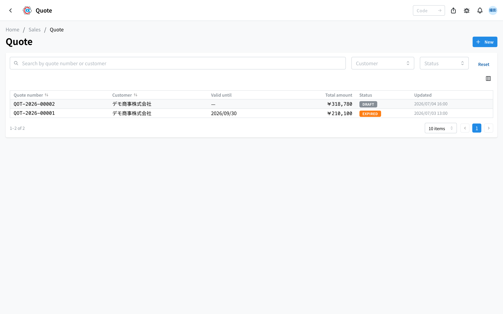
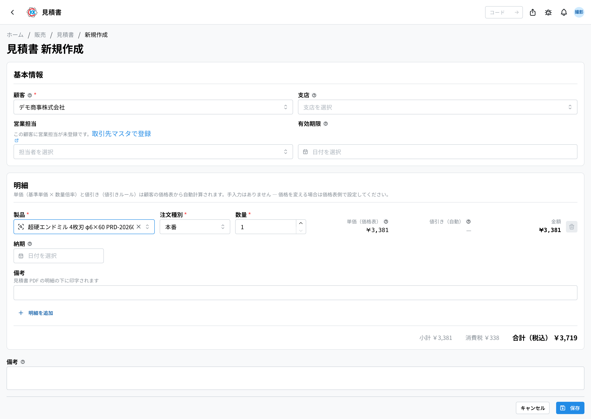
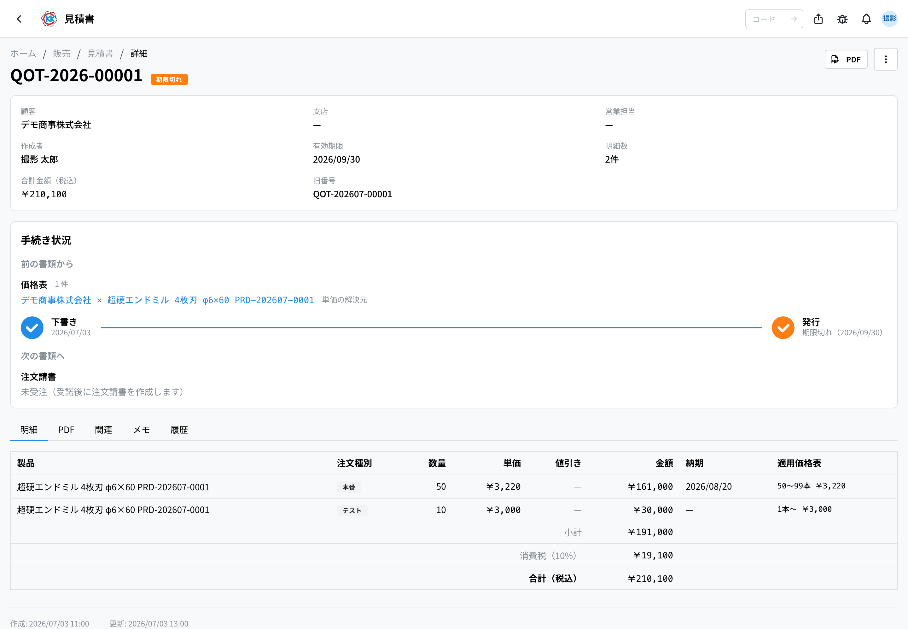
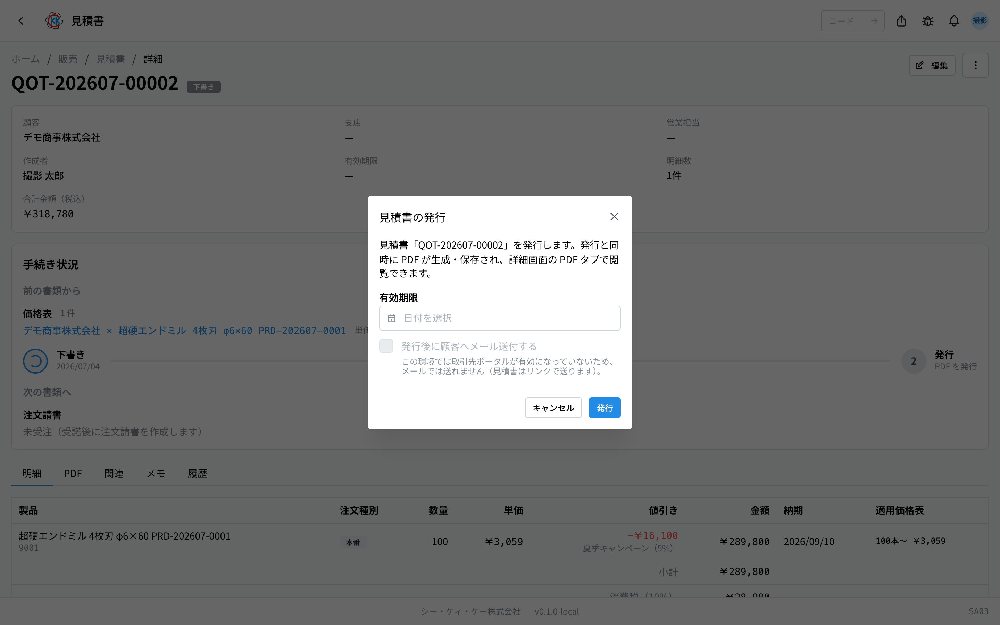
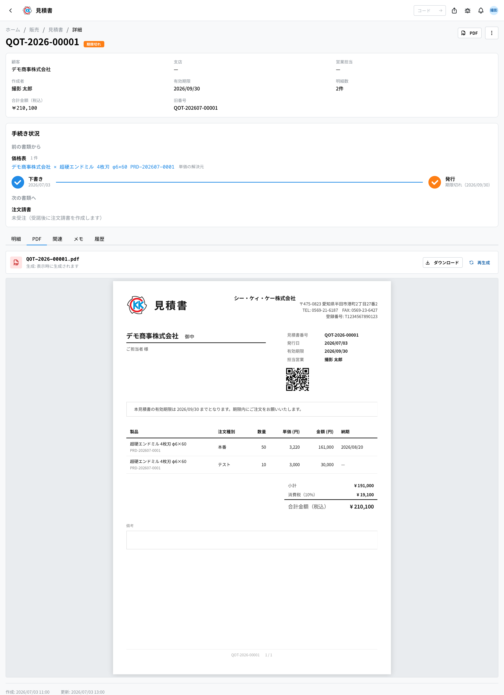
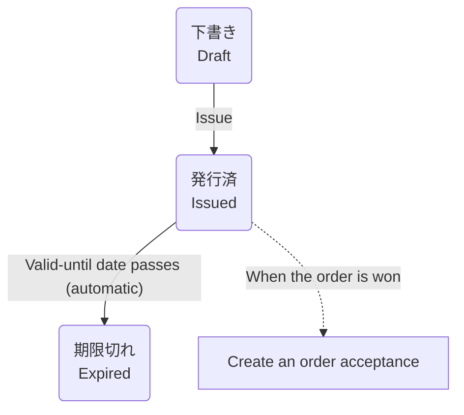

This app makes the **見積書 (quote)** you send to a customer, and issues it as a PDF. The operation code is `SA03`.

> This app belongs to … [Sales flow](/manual/en/process/sales)

## What you can do with this app

- You can make the quote you send to a customer.
- Just pick the product and the number of pieces, and **the amount is calculated for you** (no calculator needed).
- You can turn the finished quote into a **PDF**, then print it or send it by email.
- You can record where the quote stands now — for example "still being considered" or "we got the order".
- If a new quote is almost the same as an old one, you can **copy** it instead of typing it again.

## Words used on this page

- **Line item**「明細」… one row inside the quote. It says which product and how many pieces.
- **Order type**「注文種別」… the class of the order, such as 本番 (production), テスト (test), or サンプル (sample). The same product can have a different price for each class.
- **Price list**「価格表」… a register where the price of each product is stored per customer. The amounts on a quote come from here automatically.
- **下書き (draft) / 発行済 (issued)** … 下書き means the quote is still inside your company only. 発行済 means it is ready to give to the customer.

## Before you start

To make a quote, **the [price list](/manual/en/operations/sales/price-list/user) for that customer and that product must already be registered**. Without a price list the amount cannot be calculated, so the quote cannot be saved.

If there is no price list yet, first work out the unit price in [Price Estimate](/manual/en/operations/sales/trial-estimate/user), then register it in the [price list](/manual/en/operations/sales/price-list/user).

## Reading the screen

When you open the app, you see a list of the quotes made so far.

- **見積番号 (quote number)** … a number starting with `QOT-`. The system adds it for you. People who handle documents of two or more [own companies](/manual/en/operations/masters/own-company/user) see the issuing company's code (for example `TSP`) as a small badge next to the number ([Issuing company badge](/manual/en/operations/masters/own-company/user#company-badge)). Typing a company code in the search box narrows the list to that company's quotes.
- **状態 (status)** … a colored badge shows where the quote stands. Gray is 「下書き」(draft), blue is 「発行済」(issued), orange is 「期限切れ」(expired — issued and past its valid-until date).
- Type a quote number or a customer name in the search box at the top to narrow down the list.
- Click a row to open the detail screen for that quote.

## Making a quote

1. Press「**新規作成**」(New) at the top right of the list screen.
2. Click the「**顧客**」(customer) field and choose the customer.
3. If the customer has branches, also choose「**支店**」(branch). If there are none, just leave it.
4. Check「**営業担当**」(sales rep). Choosing the customer fills in their primary rep automatically — change it if needed.
5. Enter the date this quote is valid until in「**有効期限**」(valid until). While the quote is a draft you can leave it empty and still save, but **it is required when you issue**.
6. On the line item row, choose「**製品**」(product),「**注文種別**」(order type) and「**数量**」(quantity).
   - On a row whose order type is「**再研磨**」(regrind), choose a「**再研磨品目**」(regrind item) instead of a product, then choose the customer's tool in「**研ぎ直す工具**」(tool to regrind) below it (required; other makers' products can be chosen too). The regrind price can differ by tool ([Tool to regrind](#field-tool)).
7. As you enter them, **the unit price, discount and amount appear automatically**. You do not need to correct the amount by hand.
8. If a delivery date is fixed for the product, also enter「**納期**」(delivery date).
9. If there is something to tell the customer about that line, write it in the line's「**備考**」(notes) — as many lines as you like. It is printed right under that line on the quote PDF.
10. To add another row, press「**明細を追加**」(add line item).
11. Finally press「**保存**」(save).

Once saved, the quote is registered as 「下書き」(draft) and the detail screen opens.

> 💡 **Some people also see a「発行会社」(issuing company) field.** For people whose assigned sites span two or more [own companies](/manual/en/operations/masters/own-company/user), 「**発行会社**」 appears after「支店」(branch). Choose which company issues this quote. Unit prices come from that company's price lists, so **changing the issuing company re-resolves the unit prices**. The issuing company cannot be changed after the quote is created (it is not on the edit screen).

> 💡 Amounts come automatically from the price list for that customer. To change a price, do not change it here — change the [price list](/manual/en/operations/sales/price-list/user) instead.

> ⚠️ A line whose unit price cannot be found in the price list cannot be saved. There are four reasons:
>
> - **No price list** … there is no price list yet for that customer, product and order type. Register the price list first.
> - **Price list disabled** … the price list (or its setting for that order type) is disabled.
> - **Outside the valid period** … today is not within the price list's valid period.
> - **No quantity tier** … no quantity tier matches the quantity entered. Review the quantity or add a tier to the price list.
>
> For regrind items only, the item's **standard price** is used in the first three cases (no price list / disabled / outside the valid period). With "no quantity tier" it does not fall back to the standard price.

> 💡 **A regrind unit price is looked up in the order "this tool → any tool → standard price"** (the same order as on order acceptances). If a price list targets the chosen tool ([Target tool](/manual/en/operations/sales/price-list/user#field-target-tool)) its price is used; otherwise the price list for any tool, and failing that the regrind item's standard price. When the price comes from the tool's price list,「**対象工具の価格表**」(target tool price list) appears under the unit price. Choosing a different tool looks the price up again.

## Checking the contents

The screen of a saved quote has five tabs.

- **明細 (line items)** … the list of products, pieces and amounts. The subtotal, consumption tax and total are shown below.
- **PDF** … after issuing, you can view or download the PDF here.
- **関連 (related)** … you can check which price list and which price estimate the amounts came from.
- **メモ (memo)** … you can leave internal notes about this quote.
- **履歴 (history)** … the record of who changed what, and when.

## Issuing (making it ready for the customer)

1. Press「**…**」(the three-dot button) at the top right of the quote screen.
2. Choose「**発行**」(issue).
3. A small window called「見積書の発行」(issue quote) appears. Enter the **有効期限 (valid until)** date. **It is required and must be today or later** (you cannot issue with it empty or in the past).
4. Press「**発行**」(issue).

After issuing, the status changes to「**発行済**」(issued) and **the PDF is made for you automatically**.

The PDF carries these notes per line.

- **Discount note** … a line with a discount has「**※ discount name: -¥amount**」printed right under it (for example「※ 夏季キャンペーン（5%）: -¥16,100」). The unit price column is before the discount and the amount column is after it, so the note shows the customer where the difference comes from. A discount with no name is printed as "Discount".
- **Line notes** … what you wrote in the line's「備考」(notes) is printed under the discount note, keeping the line breaks.
- A line with neither gets nothing added. The wording of the notes follows the customer's **document language**.

Open the PDF tab to view the finished quote, or download it and print it. After issuing, you can also save it from「**PDFをダウンロード**」(download PDF) in the「**…**」menu at the top right.

## Notifying the customer by email

If you tick「**発行後に顧客へメール送付する**」(email the customer after issuing) on the issue screen, an email is sent to the customer once the quote is issued and its PDF is saved.

- **The PDF is not attached.** The email contains a **link** to the quote. When the link is opened, a **verification code** is sent to that email address; after entering it, the customer can see the quote and its PDF. Even if the email is forwarded or reaches the wrong person, it cannot be opened without access to the recipient's mailbox.
- **The link expires at the end of the quote's valid-until date.** Once the quote has expired, the link no longer opens.
- **The recipient** is chosen automatically: branch first, then head office; the primary contact, then other contacts, then the company email address. The recipient is shown under the checkbox on the issue screen — check it before issuing.
- The email is written in the customer's **document language** (business partner master). Replies go to the **sales rep**.
- Who it was sent to is recorded on the「**履歴**」(History) tab. Sent links can be checked and revoked in the document-link list of the [Partner portal](/manual/en/operations/system/portal/user) (`SY0H`).

To send it later (if you did not, or could not, send it when issuing), choose「**メールで送付**」(Send by email) from the「**…**」menu at the top right (issued quotes within their valid period only).

> ⚠️ It cannot be sent in these cases; the checkbox is cleared and the reason is shown:
> - No email address is registered for the customer (including branches and contacts) → register one in the [business partner master](/manual/en/operations/masters/business-partner/user).
> - The partner portal is not enabled in this environment, or email sending is not set up → ask your administrator. Until then, download the PDF and send it yourself.

## Recording what happens after issuing

**There is nothing to record on the quote itself.** A quote has only two states: 「下書き」(draft) and 「発行済」(issued).

- **Whether you won the order** … when you create an [order acceptance](/manual/en/operations/sales/order-acceptance/user) and pick this quote, the order acceptance appears under 「**手続き状況**」(progress) → 「**次の書類へ**」(to). The existence of that order acceptance *is* the record, so nothing needs to be marked on the quote.
- **If the customer declines** … do nothing. No order acceptance is created, and the quote turns 「期限切れ」(expired) once its valid-until date passes.
- **When the date passes** … this is not something you set. An issued quote past its valid-until date shows as 「**期限切れ**」(expired) from that day on.

> 💡 **An issued quote cannot be edited.** To change it, duplicate it and make a new one (see "Making a similar quote" below). A quote already in the customer's hands must not change underneath them.

## Making a similar quote

When a new quote is almost the same as an old one, you can copy it instead of typing it again.

1. Open the quote you want to copy.
2. From「**…**」at the top right, press「**複製**」(duplicate).
3. A draft with the same contents is created. Change only what you need and save.

A new quote number is added automatically. On regrind lines **the tool to regrind is carried over too**, and the unit price is looked up again from the price list for that tool.

## Input fields

Every field on the quote screen. The **?** next to a field in the app links straight to its description here.

| Field | Required | What to enter |
|-------|----------|---------------|
| [Customer](#field-customer) | Required | The customer the quote is for |
| [Branch](#field-customer-branch) | Optional | The branch it is addressed to, if any |
| [Issuing company](#field-issuing-company) | Conditional | The own company that issues this quote (shown only to people who can choose) |
| [Sales rep](#field-sales-rep) | Optional | Your company's sales rep for this quote |
| [Valid until](#field-valid-until) | Required to issue | Last day the quote is valid |
| [Status](#field-status) | — | Where the quote stands now |
| [Product](#field-product) | Required | The product being quoted |
| [Order type](#field-order-type) | Required | Production, test, sample or other |
| [Tool to regrind](#field-tool) | Required on regrind rows | The customer's tool that is held and reground |
| [Quantity](#field-quantity) | Required | Number of pieces |
| [Unit price (price list)](#field-unit-price) | Automatic | Filled in from the price list |
| [Discount (automatic)](#field-discount) | Automatic | Result of the price list's discount rules |
| [Delivery date](#field-delivery-date) | Optional | Planned delivery date for that line |
| [Line notes](#field-item-notes) | Optional | Notes about that line (printed under the line on the PDF) |
| [Notes](#field-notes) | Optional | Notes about the whole quote (printed in the notes block of the PDF) |

### Customer [#field-customer]

The customer the quote is for. **The unit price comes from this customer's price list**, so choose it first. Changing the customer means the prices on lines you have already entered are resolved again.

### Branch [#field-customer-branch]

The branch the quote is addressed to. If no branch is registered for that customer you cannot choose one — leaving it empty is fine.

### Issuing company [#field-issuing-company]

The [own company](/manual/en/operations/masters/own-company/user) that issues this quote. The field is shown **only to people whose assigned sites span two or more companies**; people who belong to one company do not see it (that company is filled in automatically). The quote number is taken from the sequence of the company chosen here, and that company is printed in the issuer block of the PDF. It cannot be changed after the quote is created.

### Sales rep [#field-sales-rep]

Your company's sales person in charge of this quote. Choosing the customer fills in that customer's primary rep automatically. If needed, you can pick someone else from the people registered as that customer's reps.

### Valid until [#field-valid-until]

The last day this quote is valid. **An issued quote past this date shows as 「期限切れ」(expired) automatically**, in the list and on the detail screen — nobody has to act. While the quote is a draft it may be left empty, but **when you issue it is required and must be today or later**.

### Status [#field-status]

Where the quote stands now. **It is not a field you choose.** A new quote starts as a draft and becomes issued when you press **Issue**. Only those two are stored; 「期限切れ」(expired) is derived from the valid-until date.

### Product [#field-product]

The product being quoted. Choosing it fills in the unit price that matches the customer, order type and quantity. **If the product is not in the price list, no price is filled in and a warning appears.**

### Order type [#field-order-type]

Production, test, sample or other. **The price differs by type even for the same product**, so choose the one that matches the real order. (For samples, the practice is to set the unit price to zero in the price list.)

### Tool to regrind [#field-tool]

Shown only on rows whose order type is「**再研磨**」(regrind). Choose **the customer's own tool that is held and reground** (your own products and other makers' products can both be chosen). It is required on regrind rows. What is sold is the regrinding service (the regrind item); this field points at the physical thing that is worked on.

The unit price is taken from a price list that targets this tool if there is one, otherwise from the price list for any tool, and failing that from the regrind item's standard price. This is the same order as on order acceptance lines, so **the same tool gets the same unit price on the quote and on the order acceptance**. The chosen tool is also shown on the quote detail screen (under the item name) and on the PDF (under the item name and code, as "Tool to regrind: …").

> 💡 When you make an order acceptance from a quote, choosing the quote in the order acceptance's「見積書」(quote) field links the two documents, but **the lines are not copied**. Choose the tool to regrind again on the order acceptance's regrind lines.

### Quantity [#field-quantity]

The number of pieces. Where the price list sets prices by quantity range, the unit price changes with the quantity you enter.

### Unit price (price list) [#field-unit-price]

Filled in automatically from the price list. **It cannot be typed in.** To change the amount, adjust the base price or the quantity settings on the price list instead.

### Discount (automatic) [#field-discount]

The amount deducted automatically when a discount rule on the price list applies. This cannot be typed in either.

### Delivery date [#field-delivery-date]

The planned delivery date for that line. It can be set per line, and left empty if not yet decided.

### Line notes [#field-item-notes]

Notes per line. You can write as many lines as you like. **They are printed right under that line on the quote PDF** (the customer sees them). Write internal-only notes on the 「メモ」(memo) tab.

### Notes [#field-notes]

Notes about the whole quote. **They are printed in the 「備考」(notes) block of the quote PDF** (the customer sees them). Write internal-only notes on the 「メモ」(memo) tab, not here.

## Questions and problems

**Q. I cannot type a number into the amount field.**
A. Amounts cannot be typed in by hand on a quote. They come automatically from the [price list](/manual/en/operations/sales/price-list/user) for that customer. To change a price, change the price list.

**Q. It says「該当する価格表がありません」(no matching price list) and I cannot save.**
A. The price list for that customer and that product is not registered yet. First work out the unit price in [Price Estimate](/manual/en/operations/sales/trial-estimate/user), register it in the [price list](/manual/en/operations/sales/price-list/user), and try again.

**Q. I changed the customer and the amount changed.**
A. That is normal. Prices are decided per customer, so when you change the customer, the amounts are calculated again with that customer's price list.

**Q. What happens to a quote once its valid-until date passes?**
A. It shows as 「**期限切れ**」(expired) from that day on. Nothing to do — expiry is worked out from the date every time it is displayed, so it becomes correct the moment the deadline passes. **You cannot raise a design request from an expired quote** (「**設計依頼を起票**」(raise a design request) in the「…」menu is disabled).

**Q. I increased the quantity and the unit price went down.**
A. That is normal. If the price list is set so that a larger order makes each piece cheaper, the unit price changes with the quantity.

**Q. I issued a quote by mistake.**
A. There is no way to undo an issue, and **an issued quote cannot be edited either**. Use 「複製」(duplicate) from the「…」menu at the top right to make a corrected quote and send that one instead. The wrong one turns 「期限切れ」(expired) once its valid-until date passes. A note in 備考 (notes) helps whoever reads it later.

**Q. There is no「編集」(edit) button on an issued quote.**
A. That is intended. A quote already sent to the customer must not change underneath them. Duplicate it and make a new one.

<!-- permissions:start -->
## Permissions required

Using this screen requires the **Quote** (`quote`) permission.

| What you want to do | Permission needed |
| --- | --- |
| Open the screen, view lists and details | Quote — View |
| Add, change or delete | Quote — Create / Edit / Delete |

Viewing only needs *View*. Where a screen offers adding, changing or deleting, each of those needs its matching permission.

Permissions come through roles. If something is missing, ask an administrator.

For the whole picture see [Permissions and roles](../../../permissions).
<!-- permissions:end -->
