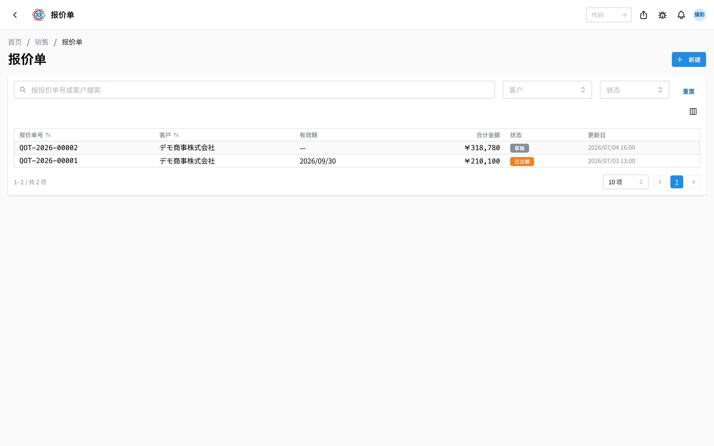
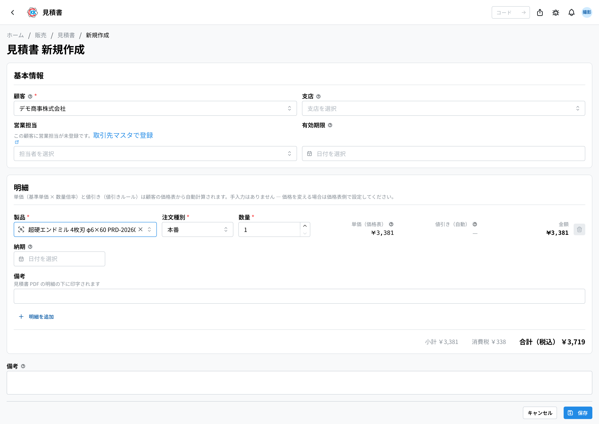
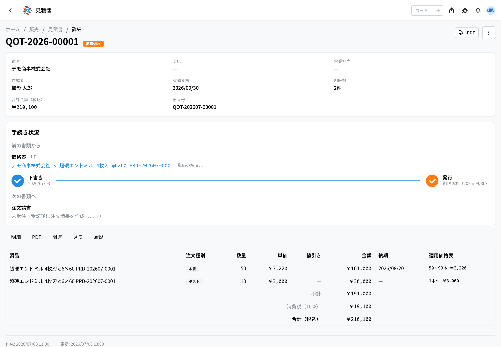
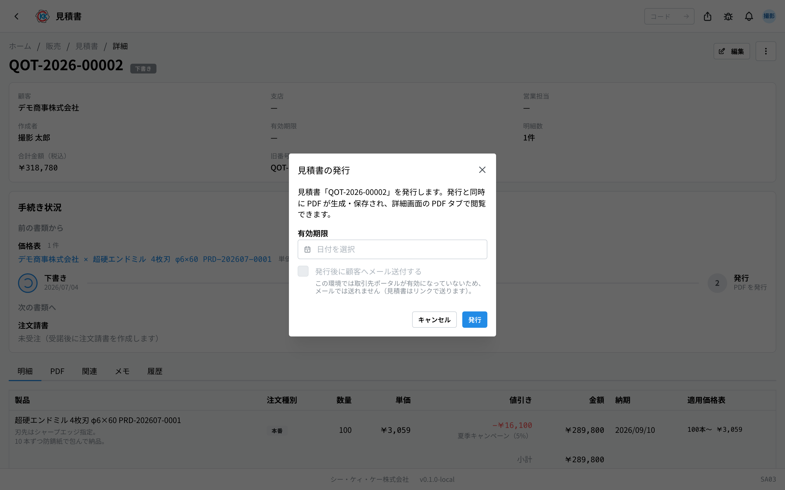
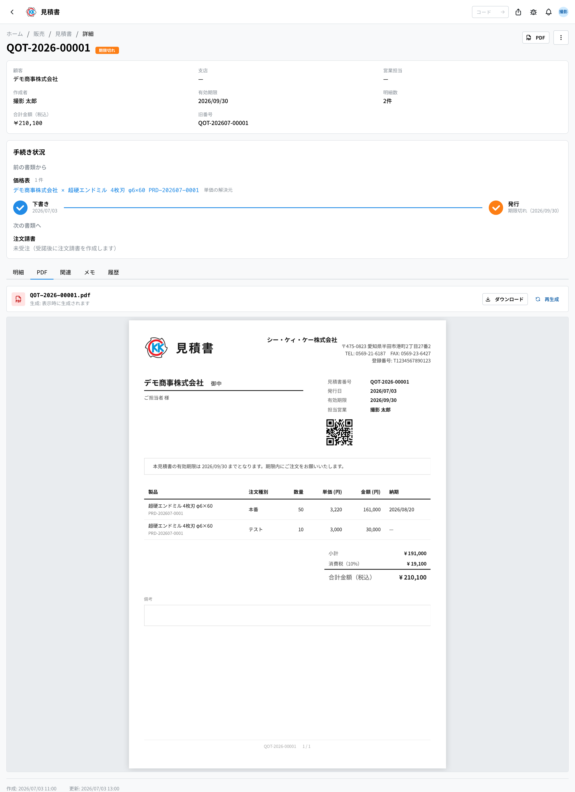
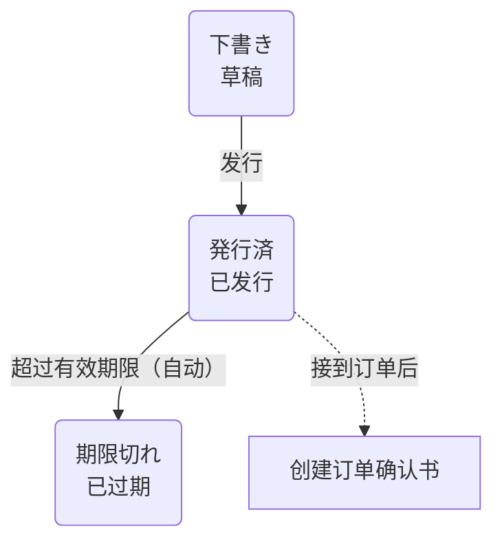

用来制作提交给客户的 **「見積書」（报价单）**，并生成 PDF 发行的应用。操作码是 `SA03`。

> 本应用所属的流程……[销售流程](/manual/zh/process/sales)

## 本应用能做什么

- 可以制作提交给客户的报价单。
- 只要选好产品和数量，**金额就会自动算出来**（不用按计算器）。
- 可以把做好的报价单变成 **PDF**，打印或用邮件发送。
- 可以记录报价单目前的情况，例如「客户还在考虑」「已经接到订单」。
- 内容差不多的报价单可以 **复制**，不用重新做一份。

## 本页出现的词

- **「明細」（明细）** … 报价单里的一行。写的是「哪个产品、几支」。
- **「注文種別」（订单类别）** … 本番（量产）、テスト（试制）、サンプル（样品）等区分。同一个产品，区分不同，金额也可能不同。
- **「価格表」（价格表）** … 事先按客户登记好每个产品价格的台账。报价单的金额就是从这里自动带出来的。
- **「下書き」（草稿）/「発行済」（已发行）** … 草稿表示还只在公司内部；已发行表示可以交给客户了。

## 开始之前

要做报价单，**必须先登记好该客户与该产品的[价格表](/manual/zh/operations/sales/price-list/user)**。没有价格表就算不出金额，也就无法保存。

如果还没有价格表，请先用[价格试算](/manual/zh/operations/sales/trial-estimate/user)算出单价，再登记到[价格表](/manual/zh/operations/sales/price-list/user)里。

## 界面怎么看

打开应用后，会显示已经做过的报价单列表。

- **「見積番号」（报价单编号）** … 以 `QOT-` 开头的编号，由系统自动编上。处理 2 个以上[本公司法人](/manual/zh/operations/masters/own-company/user)单据的人，会在编号旁看到开具公司编号的小标记（例 `TSP`）（[开具公司标记](/manual/zh/operations/masters/own-company/user#company-badge)）。在搜索框输入法人编号，可以只显示该公司的报价单。
- **「状態」（状态）** … 用彩色徽章显示目前的情况。灰色是「下書き」（草稿），蓝色是「発行済」（已发行），橙色是「期限切れ」（已过期 — 已发行且超过有效期限）。
- 列表中显示「**見積番号**」（报价单号）、「**顧客**」（客户）、「**有効期限**」（有效期）、「**合計金額**」（合计金额）、「**状態**」（状态）和「**更新日**」（更新日）。
- 在上方的搜索框（「見積番号・顧客で検索」，按报价单号・客户搜索）里输入报价单编号或客户名称，可以缩小范围找到想要的报价单。也可以用旧系统的编号（旧编号）查找。
- 用「**顧客**」（客户）和「**状態**」（状态）栏，可以按客户或状态筛选。也可以选「期限切れ」（已过期）。按「**リセット**」（重置）即可清除筛选。
- 点击某一行，就会打开该报价单的详细画面。

## 制作报价单

1. 点击列表画面右上角的「**新規作成**」（新建）。
2. 点击「**顧客**」（客户）栏，选择客户。
3. 客户有分店时，也选择「**支店**」（分店）。没有分店就保持原样即可。
4. 确认「**営業担当**」（销售负责人）。选择客户后会自动填入主负责人，需要时可重新选择。
5. 在「**有効期限**」（有效期限）里填写本报价的有效日期（草稿阶段留空也可以保存，但**发行时必填**）。
6. 在明细行里选择「**製品**」（产品）、「**注文種別**」（订单类型）、「**数量**」（数量）。
   - 订单类别为「**再研磨**」的行，选择「**再研磨品目**」（再研磨服务）代替产品，并在其下方出现的「**研ぎ直す工具**」（要研磨的刀具）中选择从客户处寄存的刀具（必填，也可以选其他厂商的产品）。再研磨的价格可能因刀具而不同（[要研磨的刀具](#field-tool)）。
7. 输入后，**单价、折扣、金额会自动显示**。金额不需要手动修改。
8. 如果该产品有固定交期，也填写「**納期**」（交期）。
9. 关于该明细有想告诉客户的内容时，写在明细的「**備考**」（备注）中（可以写多行）。它会印在报价单 PDF 中该明细的正下方。
10. 想增加行时，点击「**明細を追加**」（添加明细）。
11. 最后点击「**保存**」（保存）。

保存后会以「下書き」（草稿）登记，并打开详细画面。

> 💡 **有些人还会看到「発行会社」（开具公司）栏。** 所属据点跨 2 个以上[本公司法人](/manual/zh/operations/masters/own-company/user)的人，画面上「支店」（分店）之后会出现「**発行会社**」。请选择这份报价单由哪家公司开具。单价取自该公司的价格表，所以 **更改开具公司后单价也会重新带入**。开具公司在创建后不能更改（编辑画面中不显示）。

> 💡 金额会自动从该客户的价格表带出来。想改价格时，不要在这个画面改，请改[价格表](/manual/zh/operations/sales/price-list/user)那边。

> ⚠️ 无法从价格表确定单价的行，单价栏会以橙色显示原因，这样无法保存。原因有以下 5 种：
>
> - 「**価格表なし**」（无价格表） … 该客户、该产品、该订单类别还没有价格表。请先登记价格表。
> - 「**価格表が無効**」（价格表已停用） … 价格表（或该订单类别的设置）已停用。
> - 「**価格表の有効期間外**」（不在价格表有效期内） … 今天不在价格表的有效期内。
> - 「**価格表が承認待ち**」（价格表待审批） … 价格表的价格正在等待审批（[自定价格的审批](/manual/zh/operations/sales/price-list/user)）。批准后即可使用。
> - 「**数量段階なし**」（无数量档） … 没有与所填数量相符的数量档。请重新确认数量，或在价格表中添加数量档。
>
> 除「无数量档」以外，原因下方还会显示「**設計依頼を起票**」（发起设计委托）链接。如果是还没有图纸的新产品，可以从这里创建[设计委托单](/manual/zh/operations/sales/design-request/user)。
>
> 仅再研磨品目在「无数量档」以外的 4 种情况下使用品目的**标准价格**。「无数量档」时不会改用标准价格。

> 💡 **再研磨的单价按「该刀具 → 不限刀具 → 标准价格」的顺序决定**（与订单确认书相同的顺序）。若有以所选刀具为[适用刀具](/manual/zh/operations/sales/price-list/user#field-target-tool)的价格表则用其单价，否则用不限刀具的价格表，再没有则用再研磨服务的标准价格。单价来自该刀具的价格表时，单价下方会显示「**対象工具の価格表**」（适用刀具的价格表）。重新选择刀具后单价也会重新查找。

## 确认内容

保存后的报价单画面有 5 个标签页。

- **「明細」（明细）** … 产品、数量、金额的一览。下方会显示小计、消费税、合计。
- **PDF** … 发行之后可以在这里查看或下载 PDF。
- **「関連」（关联）** … 可以确认金额是从哪张价格表、哪份价格试算带出来的。由这份报价单创建的设计委托单和订单确认书也会列在这里。
- **「メモ」（备忘）** … 可以留下关于这份报价单的公司内部备忘。
- **「履歴」（历史）** … 什么时候、谁做了修改的记录。

## 发行（做成可以交给客户的状态）

1. 点击报价单画面右上角的「**…**」（三个点的按钮）。
2. 选择「**発行**」（发行）。
3. 会弹出名为「見積書の発行」（发行报价单）的小窗口，填写 **「有効期限」（有效期限）**。**有效期限为必填，且须为今天或之后的日期**（留空或过去的日期无法发行）。
4. 点击「**発行**」（发行）。

发行后状态会变成「**発行済**」（已发行），并且 **会自动生成 PDF**。

PDF 中每条明细会带有以下说明。

- **折扣说明** … 有折扣的明细，会在该行正下方印上「**※ 折扣名称：-¥金额**」（例「※ 夏季キャンペーン（5%）: -¥16,100」）。单价栏是折扣前、金额栏是折扣后，所以用它向客户说明差额的来源。没有名称的折扣印为「折扣」。
- **明细的备注** … 写在明细「備考」（备注）中的内容，印在折扣说明的下方，换行也原样保留。
- 两者都没有的明细不会增加任何内容。说明的文字按客户的 **单据语言** 显示。

如果开具公司的[本公司法人](/manual/zh/operations/masters/own-company/user)登记了标志（logo），PDF 的标题处会印上该标志。

打开 PDF 标签页，可以查看做好的报价单，也可以下载后打印。发行之后，也可以从右上角「**…**」菜单的「**PDFをダウンロード**」（下载 PDF）保存。

> 💡 发行时如果显示「発行しました（PDF 生成に失敗）」（已发行，PDF 生成失败），请在 PDF 标签页按「**再生成**」（重新生成）重新制作。

## 通过邮件通知客户

在发行画面勾选「**発行後に顧客へメール送付する**」（发行后用邮件发送给客户）后，发行并保存 PDF 之后会向客户发送邮件。

- **邮件不附带 PDF。** 邮件中只有打开报价单的 **链接**。打开链接后，会向该邮件地址发送 **验证码**，输入验证码后即可查看报价单和 PDF。即使邮件被转发或误发，没有收件人邮箱的人也无法打开。
- **链接的有效期至报价单有效期限当天结束。** 报价单过期后链接即无法打开。
- **收件人** 会自动选择：先分公司后总公司，依次为主要联系人 → 其他联系人 → 公司邮件地址。发行画面的勾选框下方会显示「发送对象」，请确认后再发行。
- 邮件按客户的 **单据语言**（业务伙伴主数据）撰写。客户回复会发送给 **销售负责人**。
- 发送给了谁会记录在「**履歴**」（历史）标签中。已发送的链接可在 [客户门户](/manual/zh/operations/system/portal/user)（`SY0H`）列表下方的「**書類リンク**」（单据链接）中查看或作废。如果报价单明细画面显示「**ポータル共有**」（门户共享）标签页，也可以在那里查看或作废。

之后再发送时（发行时没有发送或发送失败），从右上角「**…**」选择「**メールで送付**」（邮件发送）（仅限已发行且在有效期内的报价单）。

> ⚠️ 以下情况无法发送，勾选会被取消并显示原因：
> - 客户（含分公司与联系人）未登记邮件地址 → 请在[业务伙伴主数据](/manual/zh/operations/masters/business-partner/user)中登记。
> - 本环境未启用客户门户，或未设置邮件发送通道 → 请咨询管理员。在此期间请下载 PDF 手动发送。

## 发行之后的记录

**报价单本身没有需要记录的操作。** 状态只有「下書き」（草稿）和「発行済」（已发行）两种。

- **是否接到订单** … 制作[订单确认书](/manual/zh/operations/sales/order-acceptance/user)时指定这份报价单，该订单确认书就会出现在报价单的「**手続き状況**」（办理状态）→「**次の書類へ**」（后续单据）里。有订单确认书本身就是「已接单」的记录，报价单这边不需要另做标记。
- **被谢绝时** … 不做任何操作。不会产生订单确认书，超过有效期限后自动变为「期限切れ」（已过期）。
- **过了期限时** … 不是手动修改的项目。已发行且超过有效期限的报价单，从当天起自动显示为「**期限切れ**」（已过期）。

> 💡 **已发行的报价单无法编辑。** 需要修改时请复制后重做（见下面的「制作内容相似的报价单」）。已经交到客户手上的报价单如果还能改写，就会和对方手上的纸面不一致。

## 制作内容相似的报价单

要提交的内容和以前做的报价单差不多时，不用重做，复制即可。

1. 打开作为复制来源的报价单。
2. 从右上角的「**…**」中点击「**複製**」（复制）。
3. 会生成内容相同的草稿，只改需要改的地方再保存。

报价单编号会自动编上新的号码。再研磨的明细**也会沿用要研磨的刀具**，单价会按该刀具重新从价格表查找。

## 输入项

报价单画面的输入项一览。应用中输入栏旁边的 **?** 也可直接跳转到对应说明。

| 项目 | 必填 | 填什么 |
|------|------|--------|
| [客户](#field-customer) | 必填 | 出具报价单的客户 |
| [分店](#field-customer-branch) | 选填 | 收件的分店（已登记时） |
| [开具公司](#field-issuing-company) | 条件必填 | 开具这份报价单的本公司法人（只对可以选择的人显示） |
| [销售负责人](#field-sales-rep) | 选填 | 这份报价的本公司销售负责人 |
| [有效期限](#field-valid-until) | 发行时必填 | 报价有效的最后一天 |
| [状态](#field-status) | — | 报价单当前的处理状态 |
| [产品](#field-product) | 必填 | 报价的产品（再研磨的行为「再研磨品目」） |
| [订单类别](#field-order-type) | 必填 | 量产・试制等区分 |
| [要研磨的刀具](#field-tool) | 再研磨的行必填 | 从客户处寄存并研磨的刀具 |
| [数量](#field-quantity) | 必填 | 数量（支） |
| [单价（价格表）](#field-unit-price) | 自动 | 从价格表带入的单价 |
| [折扣（自动）](#field-discount) | 自动 | 价格表折扣规则的结果 |
| [交期](#field-delivery-date) | 选填 | 各明细的预定交货日 |
| [明细的备注](#field-item-notes) | 选填 | 关于该明细的补充说明（印在 PDF 的明细下方） |
| [备注](#field-notes) | 选填 | 关于整张报价单的补充说明（印在 PDF 的备注栏） |

### 客户 [#field-customer]

出具报价单的客户。**单价来自该客户的价格表**，因此请先选择客户。更改客户后，已输入明细的单价会重新解析。

### 分店 [#field-customer-branch]

收件的分店。若该客户没有登记分店则无法选择，留空即可。

### 开具公司 [#field-issuing-company]

开具这份报价单的[本公司法人](/manual/zh/operations/masters/own-company/user)。该栏 **只对所属据点跨 2 个以上法人的人** 显示，只属于 1 家的人看不到（系统自动填入该法人）。报价单编号取自这里所选公司的流水号，PDF 的开具方栏也印这家公司。创建后不能更改。

### 销售负责人 [#field-sales-rep]

负责这份报价的本公司销售。选择客户后，会自动填入该客户的主负责人。需要时，可以从登记为该客户负责人的人当中重新选择。

### 有效期限 [#field-valid-until]

本报价有效的最后一天。**已发行且超过该日期的报价单，在列表和详情画面都会自动显示为「期限切れ」（已过期）**，无需任何人操作。草稿阶段可以留空，但**发行时必填，且须为今天或之后的日期**。

### 状态 [#field-status]

报价单当前的处理状态，**不是可选择的栏位**。新建时从「草稿」开始，点击「发行」后变为「已发行」。只有这两种会被保存，「已过期」是根据有效期限自动显示的。

### 产品 [#field-product]

报价的产品。选择后会按客户・订单类别・数量的组合，从价格表自动带入单价。**若产品不在价格表中，则不会带入单价并显示警告。**

### 订单类别 [#field-order-type]

量产・试制・样品・再研磨・其他的区分。**即使是同一产品，价格也会因类别而异**，请按实际订单选择（样品的做法是在价格表中把单价设为 0 来使用）。

### 要研磨的刀具 [#field-tool]

仅在订单类别为「**再研磨**」的行出现，选择**从客户处寄存并研磨的刀具本身**（本公司产品、其他厂商的产品都可以选）。再研磨的行必填。销售的是再研磨这项服务（再研磨服务），本栏指向的是实际加工的实物。

单价的决定顺序：若有以该刀具为适用刀具的价格表则用其单价，否则用不限刀具的价格表，再没有则用再研磨服务的标准价格。与订单确认书明细的顺序相同，因此**同一刀具在报价单和订单确认书上的单价相同**。所选刀具也会显示在报价单详情界面（品名下方）和 PDF（品名・编号下方的「要研磨的刀具：…」）上。

> 💡 从报价单制作订单确认书时，在订单确认书的「見積書」（报价单）栏选择报价单可以把两份单据关联起来，但**明细不会被复制**。请在订单确认书的再研磨明细中重新选择要研磨的刀具。

### 数量 [#field-quantity]

输入数量。若价格表按数量区间设定了单价，单价会随输入的数量变化。

### 单价（价格表）[#field-unit-price]

从价格表自动带入的单价。**无法手动输入。** 需要更改金额时，请在价格表侧调整基准单价或数量设定。

### 折扣（自动）[#field-discount]

命中价格表折扣规则时自动扣减的金额。同样无法手动输入。

### 交期 [#field-delivery-date]

该明细预定交货给客户的日期。可按明细分别指定，未确定时可留空。

### 明细的备注 [#field-item-notes]

各明细的补充说明。可以写多行。**印在报价单 PDF 中该明细的正下方**（客户会看到）。仅限内部的备忘请写在「メモ」（备忘）标签页中。

### 备注 [#field-notes]

关于整张报价单的补充说明。**印在报价单 PDF 的「備考」（备注）栏中**（客户会看到）。仅限内部的备忘请写在「メモ」（备忘）标签页中，不要写在这里。

## 常见问题与困扰

**Q. 金额栏里没办法自己输入数字。**
A. 报价单上不能手动输入金额。金额会自动从该客户的[价格表](/manual/zh/operations/sales/price-list/user)带出来。想改价格请改价格表。

**Q. 出现「該当する価格表がありません」（没有对应的价格表），无法保存。**
A. 该客户与该产品的价格表还没有登记。请先用[价格试算](/manual/zh/operations/sales/trial-estimate/user)算出单价，登记到[价格表](/manual/zh/operations/sales/price-list/user)之后再试一次。

**Q. 重新选了客户之后，金额变了。**
A. 这是正常的。金额是按客户决定的，所以换了客户就会用那位客户的价格表重新计算。

**Q. 过了有效期限的报价单会怎样？**
A. 从当天起自动显示为「**期限切れ**」（已过期），不需要任何操作（每次显示时都根据日期判断，所以一过期限就是正确的）。**已过期的报价单无法发起设计委托**（「…」菜单中的「**設計依頼を起票**」（发起设计委托）不可点击）。

**Q. 数量增加后单价变低了。**
A. 这是正常的。如果价格表设定为「订得越多每支越便宜」，单价就会随数量变化。

**Q. 不小心发行了。**
A. 没有取消发行的操作，**已发行的报价单也无法编辑**。请从右上角「…」菜单的「複製」（复制）做一份内容正确的报价单交给客户。做错的那份超过有效期限后会变为「期限切れ」（已过期）。在「備考」（备注）里写明情况，方便之后看到的人理解。

**Q. 已发行的报价单上没有「編集」（编辑）按钮。**
A. 这是规定。已经交给客户的报价单如果还能改写，就会和对方手上的纸面不一致。需要修改时请复制后重做。

<!-- permissions:start -->
## 所需权限

使用本画面需要 **报价单**（`quote`）权限。

| 想做的事 | 所需权限 |
| --- | --- |
| 打开画面、查看列表与明细 | 报价单 — 查看 |
| 新增・变更・删除 | 报价单 — 创建 / 更新 / 删除 |

仅查看有「查看」即可。画面中若有新增、变更或删除的操作，则分别需要对应的权限。

权限通过角色授予。若不足，请与管理员联系。

权限的整体说明请参见「[权限与角色](../../../permissions)」。
<!-- permissions:end -->
