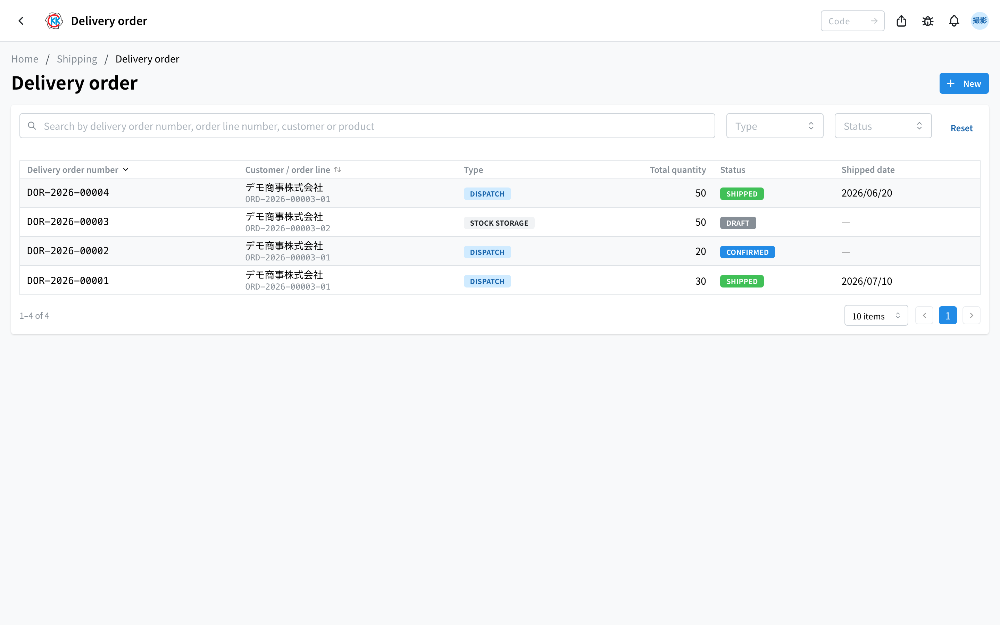
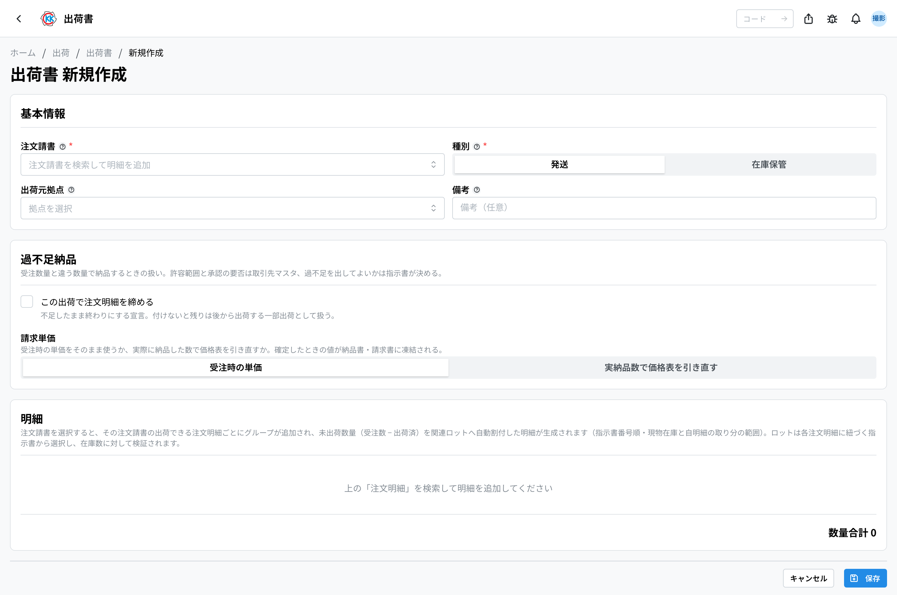
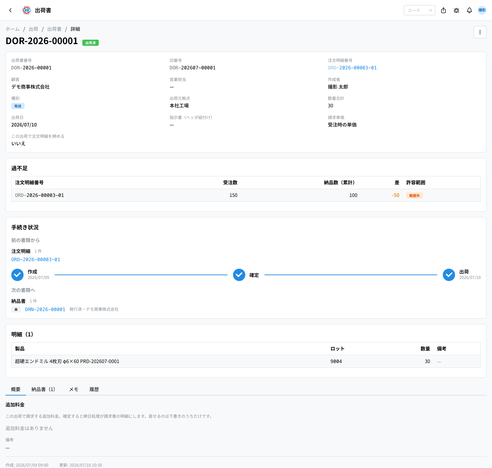
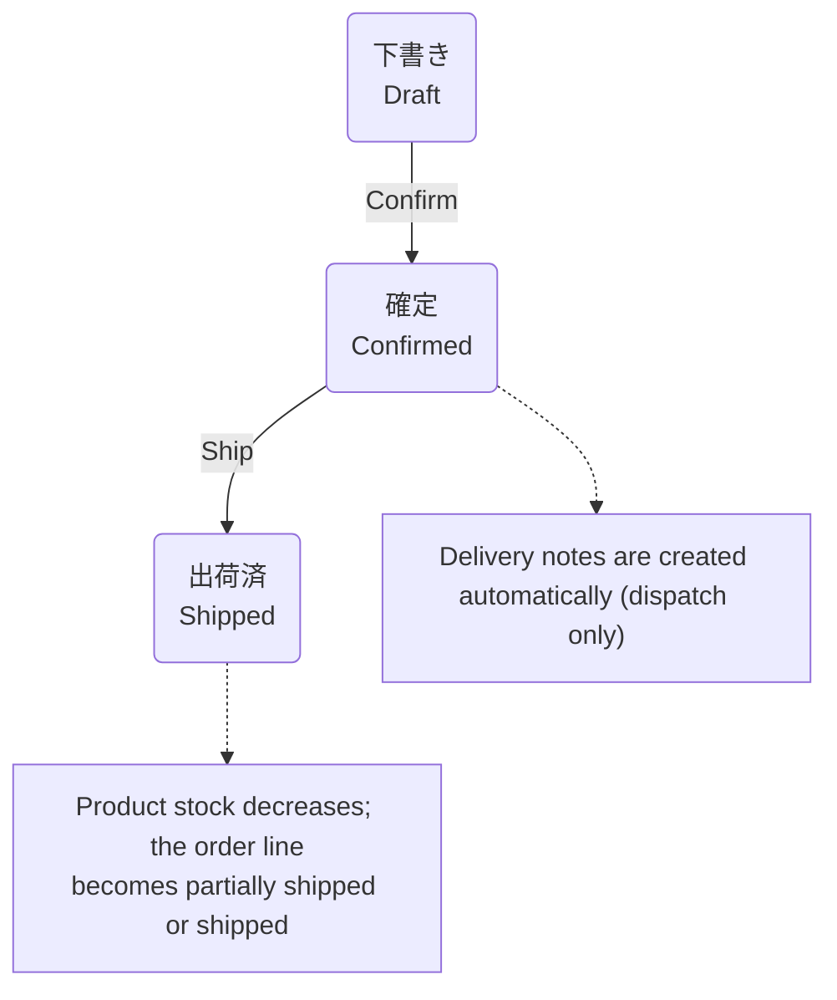
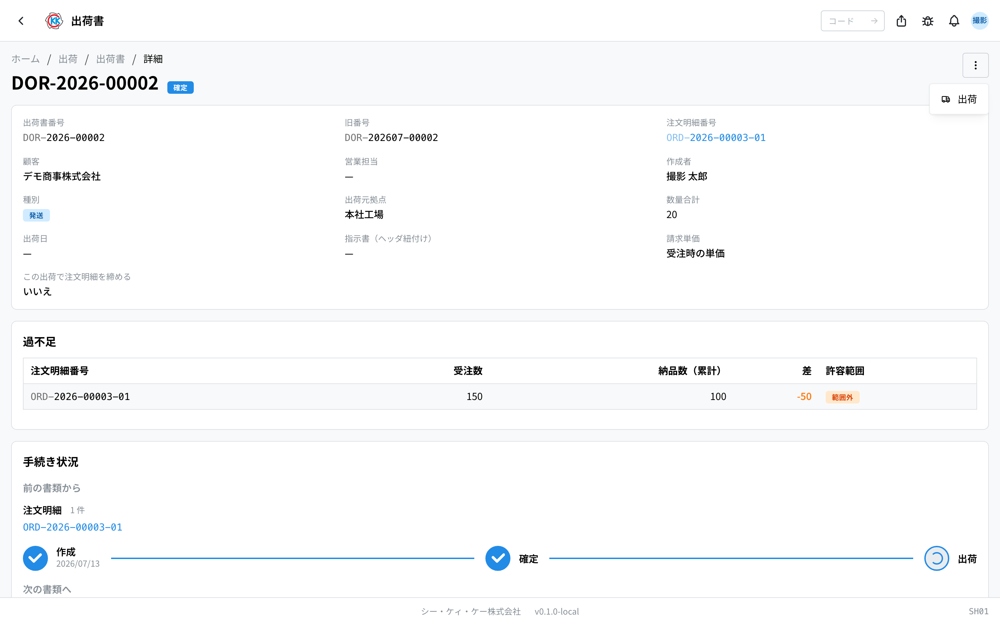
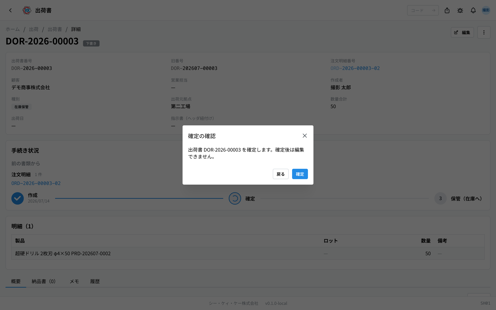
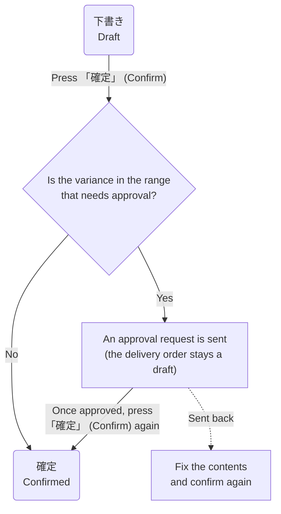
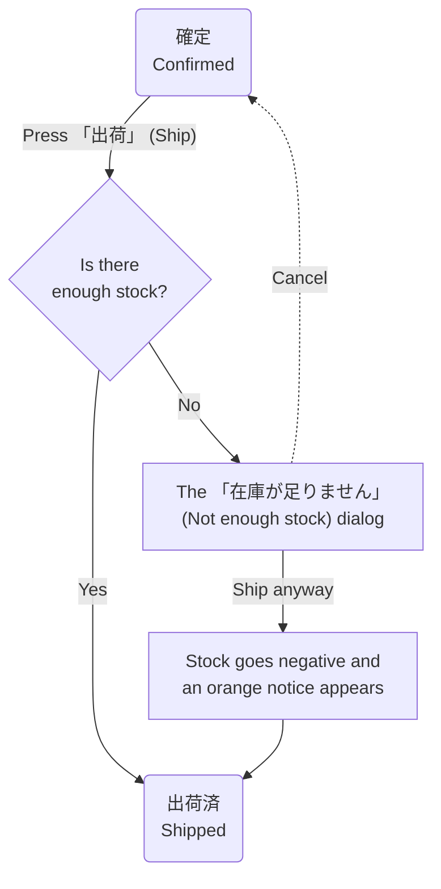
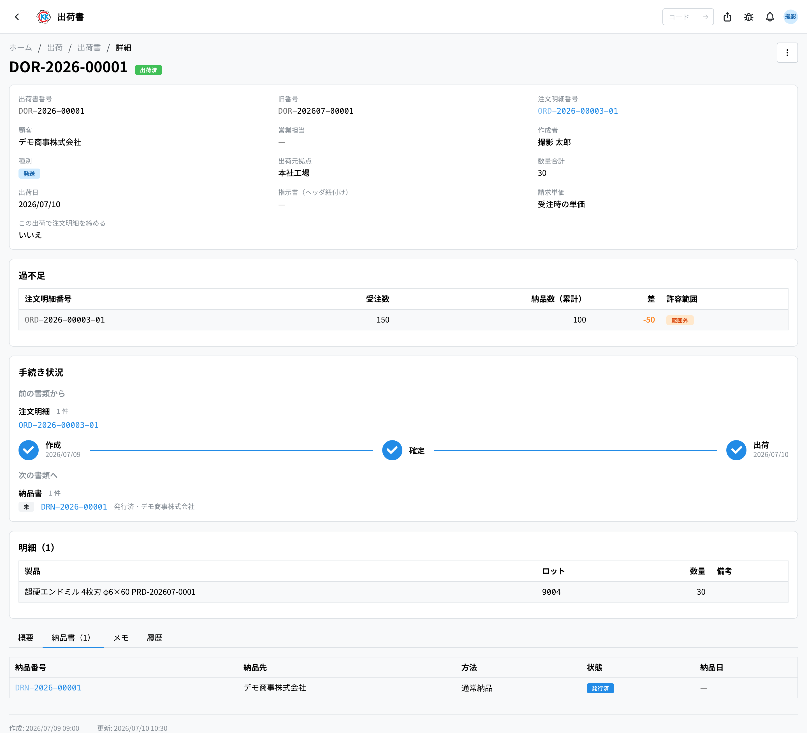

This app creates a **delivery order** (出荷書) — a document that records **what you sent and how many** when finished products go out to a customer. The operation code is `SH01`.

> ⚠️ This app is still being prepared. Screens and steps may change before it is fully released.

> This app belongs to … [Shipping flow](/manual/en/process/shipping)

## What you can do with this app

- Make a delivery order that lists the products and the number of pieces you are sending.
- Just pick an order acceptance, and **the not-yet-shipped quantities are filled in for you** (no need to type them again).
- When you record a shipment, **the stock goes down automatically**.
- **Confirming** a delivery order **automatically creates** the [delivery note](/manual/en/operations/shipping/delivery-note/user) — you never make one by hand.
- Also record items you keep in-house instead of sending (for example, spare pieces you made).
- When goods come back after shipping, you can put them back into stock.
- You can ship even when stock is short (a notice appears, but it does not stop you).

The delivery order is an important document — it is the source used later when an [invoice](/manual/en/operations/billing/invoice/user) is made.

## Words used on this page

- **注文請書 (order acceptance)** … The document that records "which customer, which product, how many pieces, by when". You pick this when you make a delivery order.
- **注文明細 (order line)** … One order row inside the order acceptance. The delivery order lines are grouped by it.
- **指示書 (work order)** … The document that tells the factory "please make this many of this product". You ship the pieces from work orders that are finished.
- **Lot** … The number given to a batch of products made together. The work order number becomes the lot number.
- **発送 / 在庫保管 (Dispatch / Keep in stock)** … "発送" means the pieces you send to the customer. "在庫保管" means the pieces you keep in-house instead of sending.
- **明細 (line)** … One row inside the delivery order. It says "which product, how many pieces".
- **過不足納品 (Delivery quantity variance)** … Shipping a quantity that does not exactly match what was ordered. It is only possible when the [work order](/manual/en/operations/production/work-order/user)'s permission and the [business partner](/manual/en/operations/masters/business-partner/user)'s tolerance both allow it.

## Before you start

- The **注文請書 (order acceptance)** for what you want to ship must already be confirmed (expanded into order lines).
- Check that the products are finished (the [work order](/manual/en/operations/production/work-order/user) is complete). Finished work orders are what gets filled into the lines for you.
- You need shipping permission to make a delivery order or to ship. If you cannot use it, please ask your administrator.

## How to read the screen

When you open the app, you see a list of the delivery orders made so far.

- **出荷書番号 (Delivery order number)** … A number that starts with `DOR-`. The system adds it for you.
- **種別 (Type)** … A blue 「発送」 (Dispatch) means pieces sent to the customer. A grey 「在庫保管」 (Keep in stock) means pieces kept in-house.
- **状態 (Status)** … Grey is 「下書き」 (Draft), blue is 「確定」 (Confirmed), green is 「出荷済」 (Shipped).
- In the search box at the top you can type a delivery order number, a order line number, or a customer name to narrow the list. This box is for **finding delivery orders you have already made**; it is a different box from the one for picking a order line when you make a new delivery order.
- The list shows **delivery orders sent from the site you belong to**.
- If you handle documents of two or more of our companies, a small badge with the company code (for example `TSP`) appears next to the delivery order number ([company badge](/manual/en/operations/masters/own-company/user#company-badge)).
- Click a row to open the detail screen for that delivery order.

## Making a delivery order

You can start a delivery order from four places. They all open the same form.

| Where you start | What is filled in |
|---|---|
| 「**新規作成**」 (New) on the delivery order list | Nothing — you pick the order acceptance yourself |
| 「**出荷書を作成**」 on an [order acceptance](/manual/en/operations/sales/order-acceptance/user) | Every shippable line of that acceptance |
| 「**出荷書を作成**」 on an [order line](/manual/en/operations/sales/order-line/user) or [pending shipment](/manual/en/operations/shipping/pending-shipment/user) | That one order line |
| 「**出荷書を作成**」 on a [work order](/manual/en/operations/production/work-order/user) | The work order's order lines. **If the same order acceptance has other shippable lines, you are asked whether to ship them together** |

**Except when you start from the list, the 「注文請書」 (order acceptance) box is filled in too** — it holds the parent acceptance of the lines that were added.

1. Press 「**新規作成**」 (New) at the top right of the list screen.
2. Click the 「**注文請書**」 (Order acceptance) box and pick the order acceptance you want to ship. Inside this box you search by the **customer name, product name, or the customer's order number**.
3. For every shippable order line of that acceptance, **the not-yet-shipped quantity is filled in for you**. The source of the quantity is the **finished output of the connected work orders** (the pieces made for that line), allocated to the lots in number order within the physical stock — never more than what is still needed.
4. In 「**種別**」 (Type), choose 「**発送**」 (Dispatch) or 「**在庫保管**」 (Keep in stock). Normally you leave it as 「発送」.
5. In 「**出荷元拠点**」 (Shipping site), choose where you are sending from.
6. When 「種別」 (Type) is 「**発送**」 (Dispatch), a 「**過不足納品**」 (Delivery quantity variance) area also appears. Here you set 「この出荷で注文明細を締める」 (Close the order lines with this shipment) and 「請求単価」 (Billing unit price). You can normally leave both at their defaults — see "[Shipping with a delivery quantity variance](#shipping-with-a-delivery-quantity-variance)" below for details.
7. Change the 「**数量**」 (Quantity) on each line to the number of pieces you are really sending. Normally **you cannot enter more than the order remainder (ordered − already placed on delivery orders)** — a red warning appears and saving is blocked. The only exception is a lot whose [work order](/manual/en/operations/production/work-order/user) has been allowed to ship with a variance — then you can go past the order remainder, up to the [business partner](/manual/en/operations/masters/business-partner/user)'s tolerance.
8. To add a row, press 「**行を追加**」 (Add row). To remove a row, press the trash-can mark at the right of the row.
9. Press 「**保存**」 (Save). If the shipment falls short of the order remainder, or the finished pieces do not cover it, a **「一部出荷の確認」 (partial shipment confirmation)** dialog appears. If the quantity is outside the tolerance, the same dialog also warns that approval may be requested when you confirm. Check it and press 「**一部出荷として保存**」 (save as partial shipment) to save (the rest can go on a later delivery order).

After you save, it is registered as a 「**下書き**」 (Draft) and the detail screen opens.

> 💡 When you pick an order acceptance, each order line group shows its contents (number, customer, product, ship-to, whether it is direct to the end user, **ordered pieces, shipped pieces, finished pieces**). "Finished" is the share of the connected work orders' output allocated to this line. Please check that it is correct before going on.

> ⚠️ The order line cannot be changed after you save. If you picked the wrong one, cancel that delivery order and make a new one.

> ⚠️ **The order remainder is not counted from 「出荷済」 (Shipped) alone.** A delivery order left as a draft,
> and one that is confirmed and waiting to ship, both use up their quantity from the moment the line is put on them.
> If you try to make a second delivery order for the same order line and get "exceeds the remainder", first check
> **whether a delivery order that has not gone out yet is holding the remainder** (you can see them in [pending shipments](/manual/en/operations/shipping/pending-shipment/user)).
> Cancel delivery orders you will not use while they are still drafts.

## Checking the contents

At the top you see the delivery order number, order line number, customer, sales rep, type, shipping site, total quantity, shipping date, and work order. When the type is 「発送」 (Dispatch), 「請求単価」 (Billing unit price) and 「この出荷で注文明細を締める」 (Close the order lines with this shipment) are also shown.

- **数量合計 (Total quantity)** … The total number of pieces sent on this delivery order. When it differs from the ordered quantity, the 「過不足」 (Variance) table shows the difference ([Shipping with a delivery quantity variance](#shipping-with-a-delivery-quantity-variance)).
- The 「明細」 (Lines) area below shows the product, lot, quantity, and notes.
- The tabs are **概要** (Overview: additional charges and notes), **納品書** (Delivery notes: the delivery notes made from this delivery order), **メモ** (Memo: a shared internal memo), and **履歴** (History: who changed what and when). An **承認** (Approval) tab also appears only when there are approval records.

## Adding charges such as shipping

When you want to bill the customer for something besides the product, such as shipping, add an **additional charge** to the delivery order. After the delivery order is confirmed, billing closing turns the charge into a line on the [invoice](/manual/en/operations/billing/invoice/user).

1. On a 「下書き」 (Draft) delivery order, open the 「**概要**」 (Overview) tab.
2. Press 「**編集**」 (Edit) on the 「**追加料金**」 (Additional charges) panel.
3. Press 「**料金を追加**」 (Add charge).
4. Choose the 「**料金項目**」 (Charge item). Items are registered in the [charge item master](/manual/en/operations/masters/charge-item/user).
5. If needed, enter a note (such as "○○ Transport, cash on delivery"), the quantity, and the unit price. For items whose amount is fixed in the charge item master, you cannot change the unit price.
6. Press 「**保存**」 (Save).

If the [work order](/manual/en/operations/production/work-order/user) of a lot on the lines has planned additional charges, they are copied when the delivery order is made (「**指示書 #◯ から複写**」 (copied from work order #◯) is shown). However many lines carry lots of the same work order, they are copied only once.

> ⚠️ You can change additional charges only while the delivery order is 「下書き」 (Draft). After confirming, they cannot be changed.

## The three stages before shipping

A delivery order moves through three stages: 「下書き」 (Draft) → 「確定」 (Confirmed) → 「出荷済」 (Shipped). You do this from the 「**…**」 button (the three dots) at the top right of the screen.

### 1. Fixing the contents (Confirm)

1. On the delivery order screen, press 「**…**」 at the top right.
2. Choose 「**確定**」 (Confirm).
3. A small window called 「確定の確認」 (Confirm check) appears. Read it and press 「**確定**」 (Confirm).

Once confirmed, **you can no longer edit it**. A dispatch delivery order **automatically gets its delivery note(s)** at confirmation — direct-to-end-user creates **two**: one without prices (for the end user) and one with prices (for the customer). Stock-storage delivery orders don't get one.

The check window lists **the recipient of each delivery note about to be created, and whether it carries prices**. Read it before you confirm.

### 2. When you have really sent it (Ship)

1. Press 「**…**」 at the top right.
2. Choose 「**出荷**」 (Ship).
3. 「出荷の確認」 (Ship check) appears. Press 「**出荷する**」 (Ship).

When you ship, today's date is recorded as the **出荷日 (shipping date)** and the status becomes 「**出荷済**」 (Shipped). At the same time, the [product stock](/manual/en/operations/inventory/inventory-management/user) goes down by the pieces you sent, and the order line changes by itself to "一部出荷" (Partly shipped) or "出荷済" (Shipped).

### If you made a mistake (Cancel)

Only while it is a 「下書き」 (Draft) can you remove it, using 「**キャンセル**」 (Cancel) in the 「**…**」 menu at the top right. After it is confirmed, it cannot be removed.

> ⚠️ **Check the contents once more before you confirm.** A confirmed delivery order cannot be removed,
> not even before it ships. If you confirm a delivery order that cannot be shipped (for example, one whose
> order remainder has already been used up by another delivery order), it stays there, unable to be shipped
> or cancelled. If that happens, ask your administrator.

## Shipping with a delivery quantity variance

Depending on how many pieces actually got made, you sometimes want to ship a quantity that does not exactly match the ordered quantity. This is called a **過不足納品 (delivery quantity variance)**. Whether it is possible is decided by two things together:

1. **Permission on the work order side** … the [work order](/manual/en/operations/production/work-order/user) that made the lot must be marked as allowed to ship with a variance.
2. **Tolerance on the business partner side** … the [business partner](/manual/en/operations/masters/business-partner/user)'s customer information must set how far that customer will accept a difference.

Either one alone is not enough. Without the work order's permission, no matter how far the business partner's setting is relaxed, you can only ship exactly the ordered quantity.

### 「この出荷で注文明細を締める」 and 「請求単価」

When you set 「**種別**」 (Type) to 「**発送**」 (Dispatch) on the new or edit delivery order form, a 「**過不足納品**」 (Delivery quantity variance) area appears.

- **この出荷で注文明細を締める** (Close the order lines with this shipment) … A declaration that "delivery ends here". Leave it unticked and the order remainder is treated as a partial shipment you can send later on a different delivery order. Tick it, and the order line advances all the way to 「**出荷済**」 (Shipped) even though it is short. **If you ship more than the ordered quantity, the order line becomes 「出荷済」 regardless of this checkbox** (there is no remainder left to send).
- **請求単価** (Billing unit price) … Choose 「**受注時の単価**」 (Order unit price — the default; the price agreed at order time, unchanged) or 「**実納品数で価格表を引き直す**」 (Re-resolve from the [price list](/manual/en/operations/sales/price-list/user) using the quantity actually delivered — falling back to the order unit price if the price list can't resolve one). Whichever you choose is **frozen into the [delivery note](/manual/en/operations/shipping/delivery-note/user) and invoice the moment you confirm the delivery order** — editing the price list afterward never changes an already-confirmed document.

### Confirming can require approval

If the variance falls inside the range that the business partner's settings mark as needing approval, pressing 「**確定**」 (Confirm) **does not confirm it on the spot — it sends an approval request instead**. In that case the button on the confirmation dialog changes from 「確定」 (Confirm) to 「**承認依頼**」 (Request approval).

1. On the delivery order screen, choose 「**…**」 → 「**確定**」 (Confirm).
2. The dialog that appears shows the variance details. Press 「**承認依頼**」 (Request approval) to send the request. **The delivery order stays a 「下書き」 (Draft).**
3. Once it is approved, press 「**…**」 → 「**確定**」 (Confirm) again — this time it confirms normally.

If you can approve it, a green 「**承認**」 (Approve) card appears at the top of the screen, where you can approve or send it back on the spot. If you cannot, a gray 「**承認依頼中**」 (Pending approval) card appears instead. A rejection turns the card red — 「**差し戻されました**」 (Sent back) — so fix the contents and confirm again.

> 💡 Whether approval is needed comes from the business partner's settings (set separately for **inside** and **outside** the tolerance). **In an environment where no approval flow has been set up at all, or when "use approval" is turned off for delivery orders in [approval settings](/manual/en/operations/masters/approval-setting/user), no approval is requested and it confirms straight away.**

### Checking it on the detail screen

If any line was shipped with a quantity that differs from the order, a 「**過不足**」 (Quantity variance) table appears on the delivery order detail screen. For each order line it shows the ordered quantity, the delivered quantity (the running total), the variance, and whether it is inside or outside the tolerance.

## Keeping pieces in-house instead of sending (Keep in stock)

When you keep pieces in-house instead of sending them to the customer — for example spare pieces you made — choose 「**在庫保管**」 (Keep in stock) in 「**種別**」 (Type).

- When you ship with 「在庫保管」, the products are **added** to the stock at the storing site.
- They are not billed. The status of the order line does not change either.

When you choose 「在庫保管」 in Type, an explanation appears on the screen.

## When there is not enough stock

When you press Ship, the stock is counted first. If there is enough, the shipment goes through as usual.
**If there is not enough, nothing is shipped yet and a 「在庫が足りません」 (Not enough stock) dialog appears.**

It shows three things.

- A list of the **items, lots and shortage quantities** that are short
- 「**在庫を見る**」 (View stock) on each row … opens [Stock requirements](/manual/en/operations/inventory/stock-requirements/user) (ST03) in another tab, where you can check whether that item is due to come in.
- 「**このまま出荷する**」 (Ship anyway) and 「**キャンセル**」 (Cancel)

Pressing 「キャンセル」 (Cancel) **changes nothing** (the delivery order stays confirmed).

### If you ship anyway

**The shipment goes through.** The goods have already left; refusing only the record would leave a mismatch
that nobody can see later — "shipped, but not in the ledger".

Two things then happen.

1. An **orange notice** appears (「在庫が足りないまま出荷しました（品目 …: 不足 N）」 — shipped while stock was short).
   It stays until you close it yourself.
2. The stock of that item goes **negative**. In [Stock overview](/manual/en/operations/inventory/stock-overview/user) it is shown as a red number.

A negative number is a sign that the ledger and the actual goods do not match. There are two ways to fix it.

- Count the actual pieces again and correct the number … [Stock take](/manual/en/operations/inventory/stock-takes/user)
- Record a receipt that was forgotten … [Manual stock movement](/manual/en/operations/inventory/goods-movement/user)

> 💡 A notice also appears when you create or edit a delivery order and the chosen lot does not have
> enough stock. Saving is not stopped there either.

It is also left on the document. In the lines of the [stock movement](/manual/en/operations/inventory/inventory-movements/user), the note on the row for the missing quantity reads 「**在庫不足のまま出庫**」 (issued while stock was short).

> 💡 **A line where you did not choose a lot may be taken from any lot.**
> It is allocated from the oldest lot first (in the order it entered stock). A line with a lot chosen is
> allocated from that lot only.

## When goods are returned

When a customer sends goods back after shipping, record it from that delivery order. This action appears **only on shipped 「発送」 (Dispatch) delivery orders**.

1. Open the delivery order detail.
2. Choose 「**返品を記録**」 (Record return) from the action menu at the top right.
3. Enter the 「**返品数**」 (Return quantity) for each row. You cannot enter more than was shipped.
4. Write the reason if needed.
5. Press 「**返品を記録する**」 (Record return).

The returned pieces go back to **the same lot at the site they were shipped from**. They are treated as having no shelf yet (unassigned), so once you decide where to put them, move them with [Manual stock movement](/manual/en/operations/inventory/goods-movement/user).

> ⚠️ **A return does not change the delivery order's status, the billing, or the order line.** The fact that the goods went out is not undone by a return. If the billing needs correcting, handle it separately, following the accounting procedure.

After you record a return, a 「**返品**」 (Returned) column appears in the lines table so you can see how many pieces came back. The record itself is kept in the [stock movement](/manual/en/operations/inventory/inventory-movements/user) (reason 「返品」 — Sales return).

## How the delivery note is made

You never make a delivery note by hand. A dispatch delivery order gets one **automatically as soon as it is confirmed**.

- Normal delivery: **one** priced delivery note.
- Direct to end user: **two** — one without prices (to the end user) and one with prices (to the customer). **Be careful never to hand the priced one to the end user** (the [delivery note](/manual/en/operations/shipping/delivery-note/user) screen warns you before you open or print it).
- Stock-storage delivery orders don't get a delivery note.

The 「**納品書**」 (Delivery notes) tab on the delivery order screen lists the delivery notes made from this delivery order (delivery number, delivery destination, method, status, delivery date).

## Input fields

Every field on the delivery order screen. The **?** next to a field in the app links straight to its description here.

| Field | Required | What to enter |
|-------|----------|---------------|
| [Order acceptance](#field-order-line) | Required | Which order this shipment is for |
| [Type](#field-type) | Required | Dispatch, or stock storage |
| [Shipping site](#field-plant) | Required | Which site it leaves from |
| [Notes](#field-notes) | Optional | Notes for the whole delivery order |
| [Product](#field-product) | Required | The product going out |
| [Lot (stock)](#field-lot) | Required | Which production run it comes from |
| [Quantity](#field-quantity) | Required | How many pieces go out |
| [Close the order lines with this shipment](#field-closes-order-lines) | Optional | Declares that a shortage is final |
| [Billing unit price](#field-billing-price-mode) | Optional | Use the order unit price, or re-resolve from the price list |

### Order acceptance [#field-order-line]

Which order this shipment is for, picked as an order acceptance. Choosing it fills in the shippable lines of that acceptance for you. The quantities come from the **finished output of the connected work orders**, within the physical stock and the order remainder.

Multiple order acceptances can be combined into one delivery order only when they share **the same customer, the same ship-to and the same delivery method (normal / direct to user)**. Trying to add one that differs shows the reason on the spot.

This box shows **the order acceptance the lines on the form belong to**. Whichever screen you started from — an order line, a work order or an order acceptance — the parent acceptance of those lines is already in the box, so you do not have to pick it again.

A box can only hold one value, so **only when you have combined two or more acceptances** do all the numbers appear below it under 「**対象の注文請書**」 (covered order acceptances). To take an acceptance off, delete the rows of its lines with the bin icon at the right of each row — there is no way to empty the box itself.

### Type [#field-type]

The kind of shipment. **Only dispatch goes on to a delivery note and billing.**

- **Dispatch** — going to the customer; continues to the delivery note and billing
- **Stock storage** — spare production kept in-house; **does not continue to billing**

### Shipping site [#field-plant]

Which site it leaves from. This field records, on the documents and in the records, where the shipment went out from — so choose the site the goods physically leave. When the type is 「在庫保管」 (Keep in stock), **the pieces are kept as this site's stock**. Note that the stock that falls on a 「発送」 (Dispatch) is not the site's but that of the lot chosen on each line.

### Notes [#field-notes]

Notes about the delivery order as a whole. Notes about one line go in that line's own notes.

### Product [#field-product]

The product going out. Picking an order acceptance fills it in from that order's products. You can also click the field and search all products to choose a different one.

### Lot (stock) [#field-lot]

Which production run (lot) it comes from. **The lot number is the same as the work order number**, which is how you can trace later which production run went to which customer. You can choose from the lots of the completed work orders made for that order line that still have stock left.

### Quantity [#field-quantity]

How many pieces go out. It cannot exceed the lot's stock, nor the **order remainder (ordered − already placed on delivery orders)**. Saving with less than the order remainder brings up the partial-shipment confirmation. To ship in parts, create separate delivery orders. You can go past the order remainder, up to the business partner's tolerance, only when the work order side has allowed the lot to ship with a variance — see "[Shipping with a delivery quantity variance](#shipping-with-a-delivery-quantity-variance)".

### Close the order lines with this shipment [#field-closes-order-lines]

Only appears when the type is Dispatch. A declaration that "delivery ends here". See "[Shipping with a delivery quantity variance](#shipping-with-a-delivery-quantity-variance)" for details.

### Billing unit price [#field-billing-price-mode]

Only appears when the type is Dispatch. Whether to keep the order unit price, or re-resolve it from the price list using the quantity actually delivered. See "[Shipping with a delivery quantity variance](#shipping-with-a-delivery-quantity-variance)" for details.

## Questions and problems

**Q. I recorded a return, but the invoice amount did not change.**
A. That is how it works. A return only puts stock back; it does not touch the billing.

**Q. In the 「注文請書」 (Order acceptance) box on the new delivery order screen, I search but the order acceptance I want to ship does not appear.**
A. In this box, type the **customer name, product name, or the customer's order number**. If it still does not appear, that order acceptance may not be deployed (confirmed) yet, or its lines may all be 「出荷済」 (Shipped) or cancelled.

**Q. I picked an order acceptance, but hardly any quantities were filled in.**
A. Quantities are filled from the connected work orders' finished output (within physical stock), so a line with no completed work order yet gets a single row with only the quantity (you can tell by 「完成 0」 in the group header). Either make the delivery order again after the products are finished, or pick the lot yourself. Lines already shipped up to the ordered quantity are skipped.

**Q. I get 「受注数を超えています」 (exceeds the ordered quantity) and cannot save.**
A. You are trying to send more pieces than were ordered on the same order line (the group header shows a red 「受注残 N を超えています」). Lower the quantity on this delivery order, or check what has already been shipped.

**Q. A notice says 「在庫が足りないまま出荷しました」 (shipped while stock was short).**
A. The shipment **went through**. More pieces went out than the ledger held, so the stock of that item is now negative. To correct it by counting again use [Stock take](/manual/en/operations/inventory/stock-takes/user); to record a receipt that was forgotten use [Manual stock movement](/manual/en/operations/inventory/goods-movement/user).

**Q. Can I make a second delivery order for the same order line?**
A. Yes (shipping in parts is normal). But **you cannot enter more than the ordered quantity in total**. Even while the first one is still a 「下書き」 (Draft) or 「確定」 (Confirmed), its quantity is already taken off the remainder.

**Q. I made a mistake and want to fix it, but 「編集」 (Edit) does not appear.**
A. You can only edit while it is a 「下書き」 (Draft). After it is confirmed it cannot be fixed, so leave that delivery order as it is and make a new one with the correct contents.

**Q. I shipped, but the order line does not become 「出荷済」 (Shipped).**
A. Check whether the type is 「在庫保管」 (Keep in stock). That type is a record of pieces kept in-house, so the order line status does not change. Also, if you sent only part of the ordered pieces, it becomes 「一部出荷」 (Partly shipped).

**Q. The quantity I want to ship does not match the ordered quantity. Can I ship it with a variance anyway?**
A. Only when the [work order](/manual/en/operations/production/work-order/user) side has allowed shipping with a variance, and the [business partner](/manual/en/operations/masters/business-partner/user)'s settings allow that difference. If either one is missing, you can only ship exactly the ordered quantity.

**Q. I pressed 「確定」 (Confirm), but the status is still 「下書き」 (Draft).**
A. If the variance falls inside the range the business partner's settings mark as needing approval, an approval request is sent instead of confirming. Follow the on-screen guidance and wait for approval, then press 「確定」 (Confirm) again once it is approved.

**Q. Can I change the amount after shipping and confirming?**
A. No. The amount decided by whichever 「請求単価」 (Billing unit price) you chose at confirmation is used as-is on the delivery note and invoice. If you made a mistake, cancel the delivery order (only possible while it is a Draft) or create a new one with the correct contents.

<!-- permissions:start -->
## Permissions required

Using this screen requires the **Delivery order** (`delivery_order`) permission.

| What you want to do | Permission needed |
| --- | --- |
| Open the screen, view lists and details | Delivery order — View |
| Add, change or delete | Delivery order — Create / Edit / Delete |

Viewing only needs *View*. Where a screen offers adding, changing or deleting, each of those needs its matching permission.

Permissions come through roles. If something is missing, ask an administrator.

For the whole picture see [Permissions and roles](../../../permissions).
<!-- permissions:end -->
