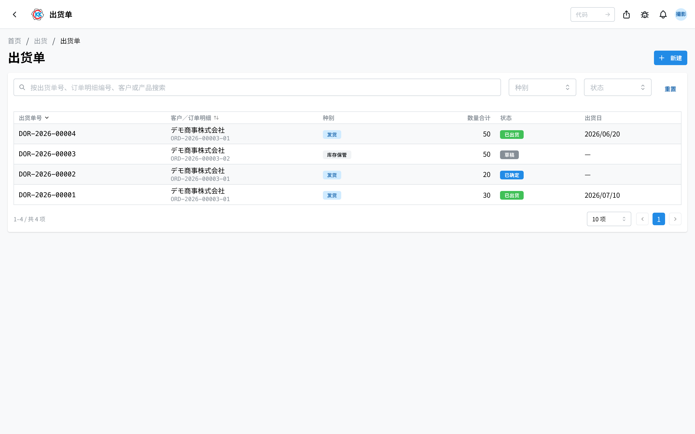
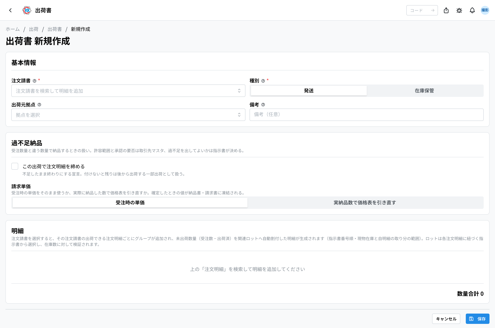
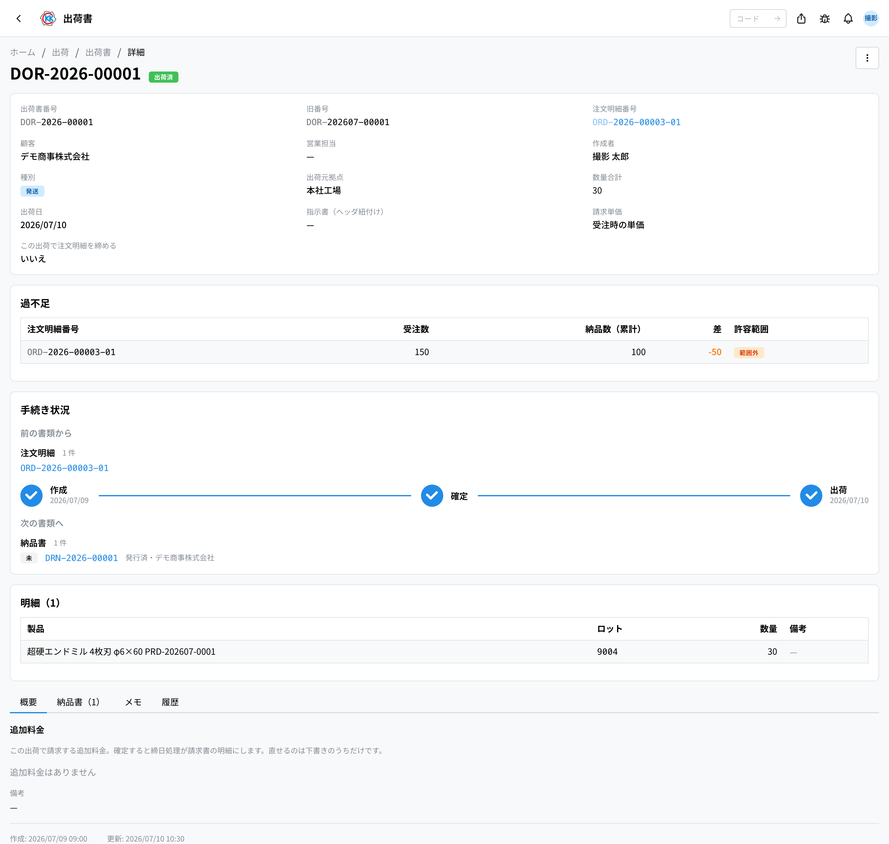
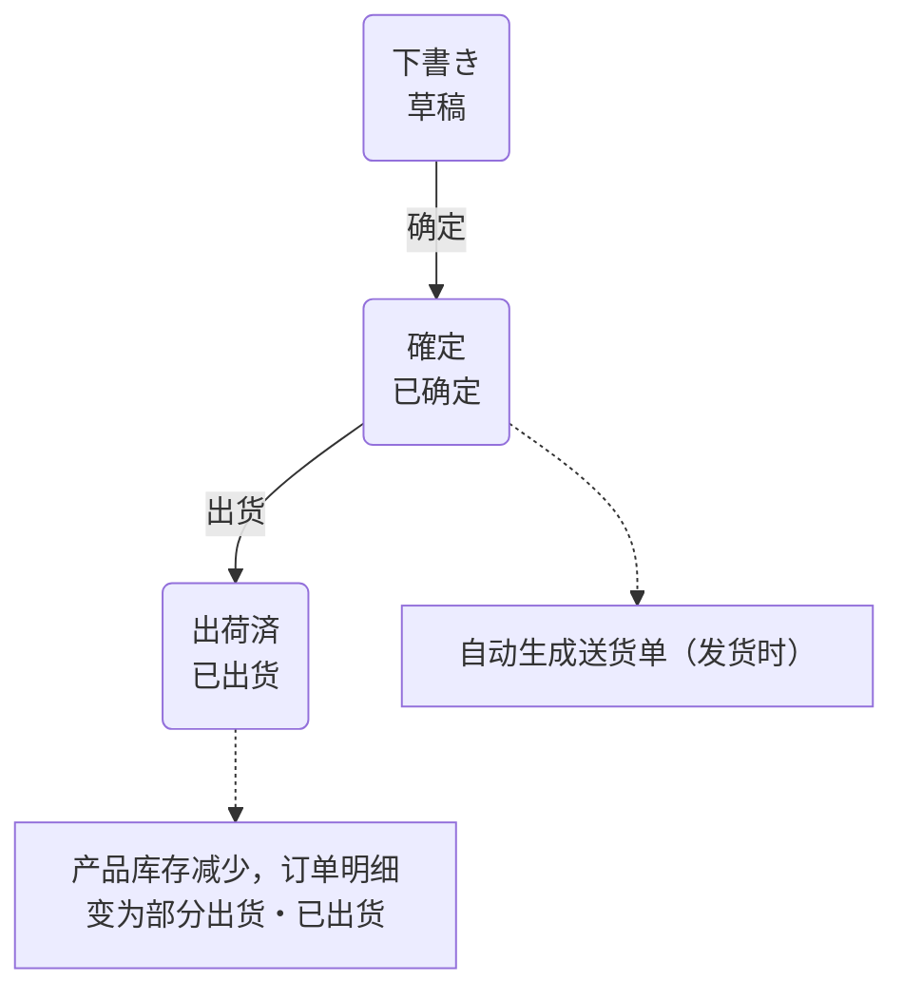
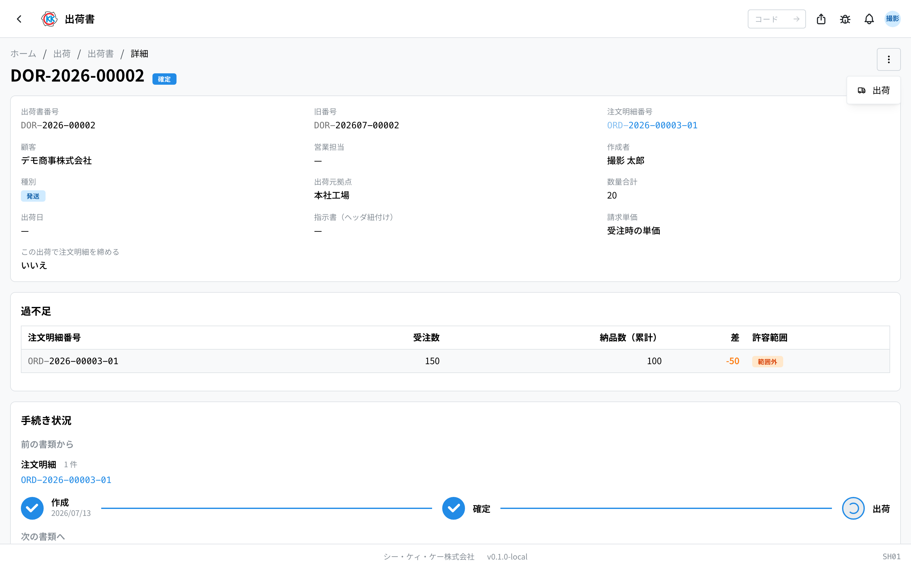
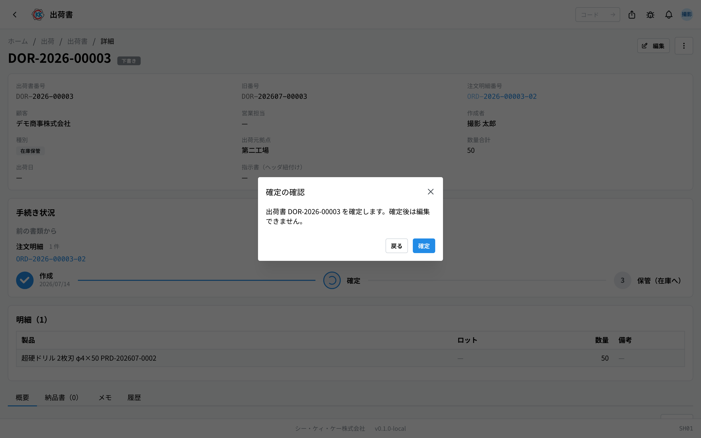
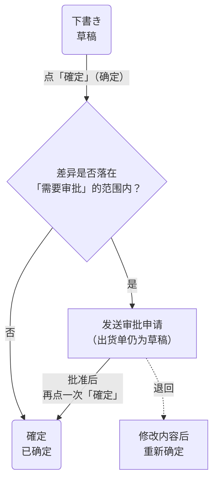
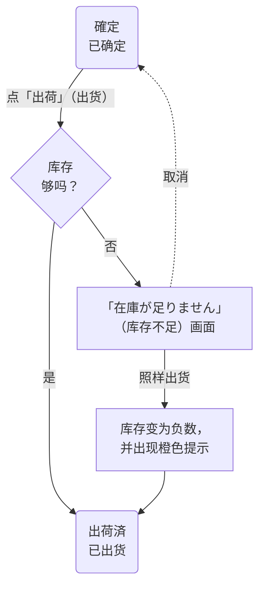
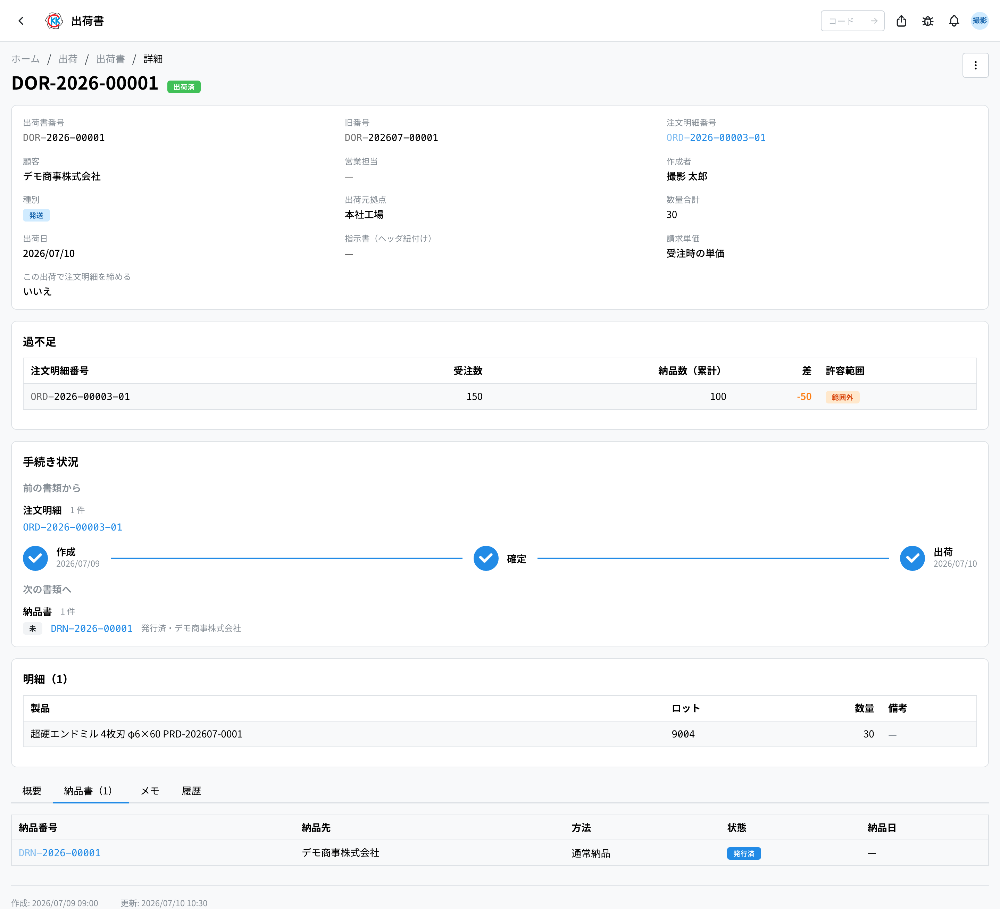

把做好的产品发给客户时，用来记录 **发了什么、发了多少** 的 **出货单**（出荷書）。操作代码是 `SH01`。

> ⚠️ 本应用还在准备中。正式启用之前，界面和步骤可能会有变化。

> 本应用所属的流程……[出货流程](/manual/zh/process/shipping)

## 本应用能做什么

- 可以做一张出货单，写清要发的产品和数量。
- 只要选一张订单确认书，**还没发货的数量会自动填进明细里**（不用重新手打）。
- 记录发货以后，**库存会自动减少**。
- **确定**出货单后会**自动生成**[送货单](/manual/zh/operations/shipping/delivery-note/user)，无需手动创建。
- 不发出去、留在公司里保管的部分（比如多做的备品）也可以记录。
- 出货后收到退货时，可以把这部分放回库存。
- 库存不足时也可以出货（会有提示，但不会被拦住）。

出货单是很重要的单据，以后做[请款单](/manual/zh/operations/billing/invoice/user)时就以它为依据。

## 本页出现的词

- **订单确认书（注文請書）** … 记录「接了哪个客户、什么产品、多少支、什么时候交」的单据。做出货单时先选它。
- **订单明细** … 订单确认书里的一行受订。出货单的明细按它分组。
- **指示書（工单）** … 发给工厂的单据，写着「请做这么多这个产品」。做完的工单的量才可以发货。
- **批次（ロット）** … 一次做出来的一批产品的编号。工单的编号就是批次号。
- **発送 / 在庫保管（发送 / 留库保管）** … 「発送」是发给客户的部分，「在庫保管」是不发出去、留在公司保管的部分。
- **明細（明细）** … 出货单里的一行，写着「什么产品、多少支」。
- **過不足納品（交货数量差异）** … 以与订货数量不完全一致的数量出货。只有在[工单](/manual/zh/operations/production/work-order/user)的许可与[业务伙伴](/manual/zh/operations/masters/business-partner/user)的允许范围同时满足时才能实现。

## 开始之前

- 要发的那部分，其 **订单确认书** 必须已经确定（已展开成订单明细）。
- 请确认产品已经做好（[指示書](/manual/zh/operations/production/work-order/user)已经完成）。完成的工单的量会自动填进明细。
- 做出货单或发货需要出货权限。如果不能用，请联系管理员。

## 界面怎么看

打开应用后，会看到之前做过的出货单一览。

- **出荷書番号（出货单号）** … 以 `DOR-` 开头的编号，由系统自动编。
- **種別（类别）** … 蓝色的「発送」（发送）是发给客户的部分，灰色的「在庫保管」（留库保管）是留在公司的部分。
- **状態（状态）** … 灰色是「下書き」（草稿），蓝色是「確定」（确定），绿色是「出荷済」（已出货）。
- 上面的搜索框里可以输入出货单号、订单明细号、客户名称来筛选。这个搜索框是用来 **查找已经做好的出货单** 的，和新建时选择订单明细的那个栏位是两回事。
- 一览里显示的是 **从自己所属据点发出的出货单**。
- 点一行就能打开这张出货单的详细界面。

## 做一张出货单

出货单可以从 4 个入口创建。无论从哪里开始，打开的都是同一个表单。

| 开始的位置 | 打开时已填入的内容 |
|---|---|
| 出货单列表的「**新規作成**」（新建） | 空白，需自行选择订单确认书 |
| [订单确认书](/manual/zh/operations/sales/order-acceptance/user)的「**出荷書を作成**」 | 该确认书下所有可发货的明细 |
| [订单明细](/manual/zh/operations/sales/order-line/user)・[未处理出货](/manual/zh/operations/shipping/pending-shipment/user)的「**出荷書を作成**」 | 该条订单明细 |
| [工单](/manual/zh/operations/production/work-order/user)的「**出荷書を作成**」 | 该工单的订单明细。**若同一订单确认书还有其他可发货的明细，会询问是否一并出货** |

**除了从列表创建以外，「注文請書」（订单确认书）栏也会一并填入** —— 填入的是所添加明细的上级确认书。

1. 点一览界面右上角的「**新規作成**」（新建）。
2. 点「**注文請書**」（订单确认书）栏，选要发货的订单确认书。在这个栏位里，是用 **客户名称、产品名称、客户的订单编号** 来查找的。
3. 该订单确认书下每条可发货的订单明细，都会**自动填入尚未发货的支数**。数量的来源是**相关工单的完成数**（为该明细做出的支数），按批次编号顺序、在现货库存范围内分配（只填到需要的支数为止）。
4. 在「**種別**」（类别）里选「**発送**」（发送）或「**在庫保管**」（留库保管）。一般保持「発送」即可。
5. 在「**出荷元拠点**」（发货据点）里选从哪里发出。
6. 「種別」（类别）为「**発送**」（发送）时，还会出现「**過不足納品**」（交货数量差异）区域，用来设定「この出荷で注文明細を締める」（以本次出货结清订单明细）和「請求単価」（请款单价）。通常两项保持默认即可，详情请见下面的「[以交货数量差异出货](#以交货数量差异出货)」。
7. 把明细里的「**数量**」（数量）改成实际要发的支数。通常**不能超过接单余量（接单数 − 已载入出货单的数量）**（超过时会出现红色警告且无法保存）。只有当该明细相关的工单中至少有一个被允许「可以在数量有差异的情况下出货」时，才能在[业务伙伴](/manual/zh/operations/masters/business-partner/user)设定的允许范围内超过接单余量。
8. 想加一行时点「**行を追加**」（添加行），想删一行时点该行右边的垃圾桶图标。
9. 点「**保存**」（保存）。发货数不足接单余量、或完成品不足接单余量时，会出现**「一部出荷の確認」（部分出货确认）**画面。数量超出允许范围时，同一画面还会提示「許容範囲を外れているため、確定のときに承認を求められることがあります」（已超出允许范围，确定时可能需要审批）。确认内容后点「**一部出荷として保存**」（作为部分出货保存）即可保存（余量可以之后另开出货单发出）。

保存后会登记为「**下書き**」（草稿），并打开详细界面。

> 💡 选了订单确认书之后，每条订单明细的分组里会显示这笔受订的内容（编号、客户、产品、发货目的地、是否直送最终用户、**接单支数、已出货支数、完成支数**）。「完成」是相关工单做出的支数中分配给该明细的部分。请确认无误后再继续。

> ⚠️ 订单明细保存之后就不能改了。选错时，请把这张出货单取消，重新做一张。

> ⚠️ **接单余量不是只按「出荷済」（已出货）来算的。** 还放着没动的草稿出货单，
> 以及已确定、等待出货的出货单，从载入的那一刻起就已经占用了相应的支数。同一条订单明细
> 想做第 2 张却提示「超过余量」时，请先确认**是不是有还没发出的出货单占着余量**
> （可以在[未处理出货](/manual/zh/operations/shipping/pending-shipment/user)里查看）。
> 不用的出货单，请趁还是草稿时取消。

## 确认内容

上方会显示出货单号、订单明细号、客户、产品、类别、发货据点、数量、发货日。

- **数量合計（数量合计）** … 像「30 / 受注 50」这样，把要发的支数和订购的支数并排显示。
- 下面的「明細」（明细）里列出产品、批次、数量、备注。
- 有四个标签页：**概要**（概要）是备注，**納品書**（送货单）是从这张出货单做出的送货单一览，**メモ**（备忘）是面向公司内部的共享备忘，**履歴**（历史）是谁在什么时候改了什么的记录。

## 发货前的三个阶段

出货单按「下書き」（草稿）→「確定」（确定）→「出荷済」（已出货）三个阶段推进。操作在界面右上角的「**…**」（三个点的按钮）里进行。

### 1. 把内容定下来（确定）

1. 在出货单界面点右上角的「**…**」。
2. 选「**確定**」（确定）。
3. 会弹出一个叫「確定の確認」（确定确认）的小窗口，看完内容后点「**確定**」（确定）。

确定之后 **就不能再编辑了**。发送类出货单在确定的同时会**自动生成送货单** —— 直送最终用户会生成 **两份**：一份无价格（给最终用户）、一份含价格（给客户）。库存保管不会生成送货单。

确认界面会列出**即将生成的送货单的收件方以及是否含价格**。请在按下之前确认。

### 2. 实际发出之后（发货）

1. 点右上角的「**…**」。
2. 选「**出荷**」（发货）。
3. 弹出「出荷の確認」（发货确认）后，点「**出荷する**」（发货）。

发货后，当天的日期会记为 **出荷日（发货日）**，状态变成「**出荷済**」（已出货）。同时，发出的数量会从[产品库存](/manual/zh/operations/inventory/inventory-management/user)里减掉，订单明细那边也会自动变成「一部出荷」（部分出货）或「出荷済」（已出货）。

### 弄错时（取消）

只有在「下書き」（草稿）期间，才能从右上角的「**…**」里用「**キャンセル**」（取消）删掉。确定之后就不能删了。

> ⚠️ **确定之前，请再确认一遍内容。** 已确定的出货单，在出货之前也不能删除。
> 如果把无法出货的出货单（例如接单余量已被别的出货单发完的）确定了，
> 这张出货单就会既不能出货也不能取消地留在那里。遇到这种情况请联系管理员。

## 以交货数量差异出货

根据实际做出来的数量，有时会想以与订货数量不完全一致的支数出货，这称为**過不足納品（交货数量差异）**。能否以差异数量出货，由以下两点共同决定：

1. **工单一侧的许可** … 生产该批次的[工单](/manual/zh/operations/production/work-order/user)必须被允许「可以在数量有差异的情况下出货」。
2. **业务伙伴一侧的允许范围** … [业务伙伴](/manual/zh/operations/masters/business-partner/user)的「顧客情報」（客户信息）中，必须设定该客户能接受多大的差异。

缺少任何一项都无法以差异数量出货。没有工单的许可时，无论业务伙伴的设置放宽到什么程度，也只能按订货数量原样出货。

### 「この出荷で注文明細を締める」与「請求単価」

在出货单新建・编辑表单中，把「**種別**」（类别）设为「**発送**」（发送）后，会出现「**過不足納品**」（交货数量差异）区域。

- **この出荷で注文明細を締める**（以本次出货结清订单明细）… 声明「交货到此为止」。不勾选时，剩余部分按之后另开出货单发出的部分出货处理。勾选后，即使数量不足，该订单明细也会直接推进到「**出荷済**」（已出货）。**发出的数量超过订货数量时，无论是否勾选此项，都会变为「出荷済」**（已经没有剩余可发了）。
- **請求単価**（请款单价）… 选择「**受注時の単価**」（接单时单价，默认。使用接单时定下的单价不变）或「**実納品数で価格表を引き直す**」（按实际交货数量重新查[价格表](/manual/zh/operations/sales/price-list/user)。若查不到则回退为接单时的单价）。这里选定的单价会在**出货单确定的瞬间固定到[送货单](/manual/zh/operations/shipping/delivery-note/user)和请款单**——之后即便修改价格表，已确定单据的金额也不会改变。

### 确定时可能需要审批

如果差异落在业务伙伴设置中「需要审批」的范围内，按下「**確定**」（确定）**不会立即确定，而是会发送审批申请**。此时确认画面上的按钮会从「確定」（确定）变为「**承認依頼**」（申请审批）。

1. 在出货单界面选「**…**」→「**確定**」（确定）。
2. 弹出的确认画面会显示差异内容。点「**承認依頼**」（申请审批）即可发送审批申请，**出货单仍保持「下書き」（草稿）状态**。
3. 审批通过后，再次点「**…**」→「**確定**」（确定），这次会照常确定。

能审批的人，画面上方会出现绿色的「**承認**」（审批）卡片，可以直接在那里批准或退回。不能审批的人，会看到灰色的「**承認待ち**」（等待审批）卡片。被退回后会变成红色的「**差し戻されました**」（已退回）卡片，请修改内容后重新确定。

> 💡 是否需要审批由业务伙伴的设置决定（可分别针对允许范围的**内侧**和**外侧**设定）。**如果完全没有设置审批流程，就不会要求审批，直接确定。**

### 在详情画面确认

只要有明细以与订货数量不同的支数出货，出货单详情画面就会出现「**過不足**」（数量差异）表格。按订单明细逐行显示订货数量、交货数量（累计至今）、差异，以及是否在允许范围内。

## 不发出去、留在公司保管（留库保管）

多做的备品等不发给客户、留在公司保管时，请在「**種別**」（类别）里选「**在庫保管**」（留库保管）。

- 用「在庫保管」发货时，产品会 **增加** 到保管地的库存里。
- 不会成为请款对象。订单明细的状态也不会变。

在类别里选了「在庫保管」之后，界面上会显示相应的说明。

## 库存不足时

点出货后，会先清点库存。够的话就直接出货。
**不够时不会出货，而是弹出「在庫が足りません」（库存不足）画面。**

画面上有 3 项内容。

- 不足的**品目・批次・不足数量**一览
- 每行的「**在庫を見る**」（查看库存）… 在另一个标签页打开[库存・所要量](/manual/zh/operations/inventory/stock-requirements/user)（ST03），可以确认该品目之后是否有入库预定。
- 「**このまま出荷する**」（照样出货）和「**キャンセル**」（取消）

点「キャンセル」（取消）则**什么都不会发生**（出货单仍是已确定状态）。

### 照样出货时

**出货会通过。** 货已经发出去了，如果只是拒绝记录，就会留下「明明出货了、
台账上却没有」这种事后谁也看不到的差异。

同时会发生 2 件事。

1. 出现**橙色提示**（「在庫が足りないまま出荷しました（品目 …: 不足 N）」——在库存不足的情况下出货了）。
   在自己关掉之前不会消失。
2. 该品目的库存变为**负数**。在[库存一览](/manual/zh/operations/inventory/stock-overview/user)里以红色数字显示。

负数表示「台账与实物对不上」。修正方法有 2 种。

- 重新清点实际支数并对齐 … [棚卸](/manual/zh/operations/inventory/stock-takes/user)
- 补记漏记的入库 … [手动出入库](/manual/zh/operations/inventory/goods-movement/user)

> 💡 创建或修改出货单时，如果所选批次的库存不够，也会出现提示。
> 那时同样不会阻止保存。

单据上也会留下记录。在[出入库单](/manual/zh/operations/inventory/inventory-movements/user)的明细里，不足部分那一行的备注会是「**在庫不足のまま出庫**」（库存不足仍出库）。

> 💡 **明细里没有选批次的行，是从哪个批次出都可以的行。**
> 会从旧批次（按入库顺序）开始分配。选了批次的行，只从该批次分配。

## 收到退货时

出货后客户把货退回来时，从那张出货单进行记录。这是**只在已出货的「発送」（发货）出货单上**才出现的操作。

1. 打开出货单的详情。
2. 从右上角的操作菜单中选「**返品を記録**」（记录退货）。
3. 逐行填入「**返品数**」（退货数量）。不能超过出货的数量。
4. 需要时填写理由。
5. 点「**返品を記録する**」（记录退货）。

退回的部分会回到**发货据点的同一批次**。货架按未定（未分配）处理，决定存放位置后，请用[手动出入库](/manual/zh/operations/inventory/goods-movement/user)移动。

> ⚠️ **即使退货，出货单的状态・请款・订单明细都不会变动。** 因为「已经发出」这一事实不会因退货而消失。需要修改请款时，请按财务的流程另行处理。

记录退货后，明细表里会出现「**返品**」（退货）列，可以看到退回的支数。记录本身保留在[出入库单](/manual/zh/operations/inventory/inventory-movements/user)（事由「返品」——销售退货）中。

## 送货单是怎么生成的

送货单**不需要手动创建**。发送类出货单一经**确定**就会自动生成。

- 常规配送：**一份**含价格的送货单。
- 直送最终用户：**两份** —— 一份无价格（给最终用户）、一份含价格（给客户）。**切勿把含价格的那份交给最终用户**（[送货单](/manual/zh/operations/shipping/delivery-note/user)界面在打开或打印前也会提示警告）。
- 库存保管的出货单不会生成送货单。

出货单界面的「**納品書**」（送货单）标签页会列出从这张出货单生成的送货单（送货单号、送货对象、方式、状态、送货日）。

## 输入项

出货单画面的输入项一览。应用中输入栏旁边的 **?** 也可直接跳转到对应说明。

| 项目 | 必填 | 填什么 |
|------|------|--------|
| [订单确认书](#field-order-line) | 必填 | 针对哪笔受订发货 |
| [类别](#field-type) | 必填 | 发送或库存保管 |
| [发货据点](#field-plant) | 必填 | 从哪个据点发出 |
| [备注](#field-notes) | 选填 | 对整份出货单的补充 |
| [产品](#field-product) | 必填 | 发出的产品 |
| [批次（库存）](#field-lot) | 必填 | 从哪一批制造中发出 |
| [数量](#field-quantity) | 必填 | 发出的数量 |
| [以本次出货结清订单明细](#field-closes-order-lines) | 选填 | 声明不足部分就此结束 |
| [请款单价](#field-billing-price-mode) | 选填 | 使用接单时的单价，还是重新查价格表 |

### 订单确认书 [#field-order-line]

以订单确认书选择针对哪笔受订发货。选择后，该确认书下可发货的明细会自动填入。数量来源于**相关工单的完成数**，且只填到现货库存与接单余量的范围为止。

只有**客户・发货目的地・配送方式（普通配送 / 直送最终用户）都相同**的订单确认书才能合并到同一份出货单。尝试添加不一致的确认书时，会当场显示原因。

该栏会**直接显示明细当前所属的订单确认书**。无论从订单明细、工单还是订单确认书开始创建，明细的上级确认书一开始就已填入，无需再自行选择。

一个栏位只能保存一个值，因此**只有合并了 2 份以上确认书时**，才会在栏位下方以「**対象の注文請書**」（对象订单确认书）列出全部编号。要移除某份确认书时，请用各行右侧的垃圾桶图标删除该确认书的明细行 —— 没有清空该栏位的操作。

### 类别 [#field-type]

发货的种类。**仅发送会进入送货单与请款流程。**

- **发送** … 送交客户。会进入送货单与请款
- **库存保管** … 作为备用制作并存放在公司内。**不进入请款**

### 发货据点 [#field-plant]

从哪个据点发出。这是为了在单据和记录上留下「从哪里发出」的项目，请选择实际发货的据点。类别为「在庫保管」（留库保管）时，**会作为该据点的库存保管**。另外，「発送」（发送）时减少的库存不是据点的库存，而是明细里所选批次的库存。

### 备注 [#field-notes]

对整份出货单的补充。各明细的补充说明请写在对应行的备注中。

### 产品 [#field-product]

发出的产品。选择订单确认书后，会自动填入该受订的产品。点击栏位，也可以从所有产品中搜索并重新选择。

### 批次（库存）[#field-lot]

从哪一批制造（批次）中发出。**批次编号与工单编号相同**，据此可日后追溯「哪一批制造发给了哪位客户」。可选择的，是为该订单明细做出（已完成）的工单批次中还剩有库存的那些。

### 数量 [#field-quantity]

发出的数量。不能超过该批次的库存数，也不能超过**接单余量（接单数 − 已载入出货单的数量）**。以不足接单余量的数量保存时，会出现部分出货确认。需分批发出时，请分别制作出货单。只有当工单一侧允许该批次以差异数量出货时，才能在业务伙伴的允许范围内超过接单余量（详情请见「[以交货数量差异出货](#以交货数量差异出货)」）。

### 以本次出货结清订单明细 [#field-closes-order-lines]

仅在类别为「发送」时出现。声明「交货到此为止」。详情请见「[以交货数量差异出货](#以交货数量差异出货)」。

### 请款单价 [#field-billing-price-mode]

仅在类别为「发送」时出现。使用接单时的单价，还是按实际交货数量重新查价格表。详情请见「[以交货数量差异出货](#以交货数量差异出货)」。

## 常见问题与困扰

**Q. 记录了退货，请款单的金额却没有变。**
A. 就是这样设计的。退货只是把库存放回去，不会动请款。

**Q. 在新建界面的「注文請書」（订单确认书）栏里，搜索不到想发货的订单确认书。**
A. 这个栏位里请输入 **客户名称、产品名称、客户的订单编号**。如果还是找不到，可能那张订单确认书还没有展开（确定），或者它的明细已经全部是「出荷済」（已出货）或已取消。

**Q. 选了订单确认书，数量却几乎没有填进来。**
A. 数量是从相关工单的完成数（现货库存范围内）自动填入的，还没有已完成工单的明细只会加一行仅有数量的行（看分组标题的「完成 0」即可判断）。请等产品做好后重做，或手动选择批次。已出货到接单数量的明细会被跳过。

**Q. 出现「受注数を超えています」（超过接单数量），无法保存。**
A. 同一张订单明细里，您要发的支数超过了订购的支数（分组标题会红色显示「受注残 N を超えています」）。请减少这张出货单的数量，或确认之前已经发过的量。

**Q. 出现了「在庫が足りないまま出荷しました」（在库存不足的情况下出货了）的提示。**
A. 出货**已经通过**。因为发出的支数比台账上的多，该品目的库存变成了负数。要重新清点修正请用[棚卸](/manual/zh/operations/inventory/stock-takes/user)，要补记漏记的入库请用[手动出入库](/manual/zh/operations/inventory/goods-movement/user)。

**Q. 同一条订单明细，可以做第 2 张出货单吗？**
A. 可以（分批发出是很平常的事）。但**合计超过接单数的部分填不进去**。即使第 1 张还是「下書き」（草稿）或「確定」（确定），那部分支数也已经从余量里扣掉了。

**Q. 内容弄错想改，但找不到「編集」（编辑）。**
A. 只有在「下書き」（草稿）期间才能编辑。确定之后就改不了了，请保留那张出货单，用正确的内容重新做一张。

**Q. 已经发货了，订单明细却没变成「出荷済」（已出货）。**
A. 请确认类别是不是「在庫保管」（留库保管）。这个类别是留在公司保管的记录，所以订单明细的状态不会变。另外，只发了订购支数的一部分时，会变成「一部出荷」（部分出货）。

**Q. 想发的数量和订货数量不一致，能以差异数量出货吗？**
A. 只有在[工单](/manual/zh/operations/production/work-order/user)一侧被允许「可以在数量有差异的情况下出货」，且[业务伙伴](/manual/zh/operations/masters/business-partner/user)的设置也允许该幅度的差异时，才能出货。只要缺少其中一项，就只能按订货数量原样出货。

**Q. 点了「確定」（确定），但状态还是「下書き」（草稿）。**
A. 如果差异落在业务伙伴设置中「需要审批」的范围内，会发送审批申请而不是直接确定。请按画面提示等待审批，通过后再次点「確定」（确定）。

**Q. 出货并确定之后，还能修改金额吗？**
A. 不能。确定时所选「請求単価」（请款单价）决定的金额，会原样用于送货单和请款单。如果弄错了，请取消该出货单（仅限草稿状态时可以）或按正确内容重新制作。

<!-- permissions:start -->
## 所需权限

使用本画面需要 **出货单**（`delivery_order`）权限。

| 想做的事 | 所需权限 |
| --- | --- |
| 打开画面、查看列表与明细 | 出货单 — 查看 |
| 新增・变更・删除 | 出货单 — 创建 / 更新 / 删除 |

仅查看有「查看」即可。画面中若有新增、变更或删除的操作，则分别需要对应的权限。

权限通过角色授予。若不足，请与管理员联系。

权限的整体说明请参见「[权限与角色](../../../permissions)」。
<!-- permissions:end -->
