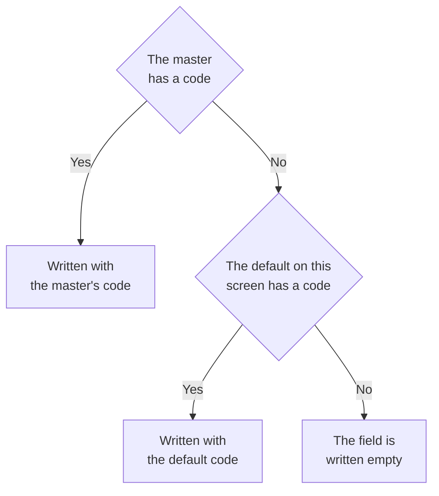

This app decides the **shape of the journal CSV** exported from invoices. Its operation code is `SY0J`.

The column layout and character encoding the accounting software (TKC FX4 Cloud) accepts differ from company to company and from one accounting office to another. Because it is held here as a setting, **if the import format changes you only have to fix this screen**.

> ⚠️ The initial columns are a generic code-based layout, **not the accounting software's official import format**. Once the accounting team gives you the import format sheet, match the columns and default codes here to it.

## What you can do here

- Choose the CSV **character encoding** (Shift_JIS / UTF-8), the **newline** and the **date format**.
- Decide the **column layout** — what is written, in which position, under which heading.
- Set **default account codes**, used when the master has no code.
- Set **tax codes by rate**.
- Check a **preview** of what the settings actually produce.

## Words used on this page

- **Journal entry** … one line handed to the accounting software. One invoice produces a "sales" line and a "tax" line per tax rate.
- **Account code** … the number the accounting software uses to identify an account. It reads the **number**, not the account **name**.
- **Sub-account code** … a finer division under an account. Under accounts receivable it is the number for each business partner.
- **Tax code** … the number the accounting software uses to identify how tax is handled.

## Before you start

- The actual values of the account, sub-account and tax codes **are decided by the accounting team (the tax accountant's office)**. Do not guess — ask.
- **Per-row codes live on the masters.** This screen holds the shape and the defaults used when a master is blank.
  - Tax code, sales account, tax suspense account … [Tax categories](/manual/en/operations/masters/tax-category/user) (`MS0F`)
  - Accounts receivable account and sub-account … the customer section of [Business partners](/manual/en/operations/masters/business-partner/user) (`MS01`)

## Opening it

On the home screen, under "**System**", press **Accounting export**. Or type `SY0J` into the search box at the top of the screen.

## Reading the screen

It opens **read-only**. To change something, press "**Edit**" at the top right. "Cancel" drops the changes; "Save" stores them and returns to the read-only view.

At the bottom there is a **preview** — one made-up invoice mixing 10% and 8%, written with the current settings. It updates as you edit, so you can check before saving.

The CSV itself is exported not on this screen but **per issued [invoice](/manual/en/operations/billing/invoice/user)**, from "**…**" → "**会計連携CSV**" (Accounting CSV). The first export freezes the journal as an accounting document, and that invoice's billing closing becomes "Exported". "**文書履歴**" (Document history) at the top right lists the accounting documents posted and reversed so far.

## Setting it up

### Output format

| Item | What it decides |
| --- | --- |
| Character encoding | The character format the accounting software can read. Leave it at `utf8-bom` unless told otherwise; use `shift_jis` when Shift_JIS is required. |
| Newline | The line separator. Usually `crlf`. |
| Date format | Separated like `2026/07/31`, or run together like `20260731`. |
| Write a header row | Whether to write headings on the first line. Turn it off when the accounting software rejects a heading row. |
| Quoting | Whether each field is wrapped in `"`. Usually `minimal` (only when needed). |
| Amount format | `250000` or `250,000`. |
| Filename suffix | The trailing part of the downloaded file name. |

### Column layout

Top to bottom is the first column, the second column, and so on. Each row sets a **heading** and the **field** to write.

- "**Add a column**" appends one at the end.
- The arrows reorder; the bin deletes.
- "**Fixed text**" writes the same text on every row (used when the accounting software expects a fixed classification value).
- "**Blank**" is always empty (used to line the columns up).

### Default account codes

On screen this is the 「**既定の科目コード**」 (Default account codes) box. Used when the master has no code. **Left blank, the field is written empty.**

| Item | What it is for |
| --- | --- |
| 売掛金 科目コード (Accounts receivable code) | The debit (accounts receivable) account. |
| 売上高 科目コード (Sales account code) | The credit account for sales. |
| 仮受消費税 科目コード (Consumption tax received code) | The credit account for consumption tax. |
| 部門コード (Department code) | The same department code is written on every row. It is not held in any master. |
| 既定の消費税コード (Default tax code) | Used when neither the tax category nor the tax-code-by-rate table below has a tax code. |

Codes are half-width letters and digits, up to 16 characters.

As a diagram, the code is chosen in this order:

The sub-account code has no default — it differs per business partner, so enter it on [Business partners](/manual/en/operations/masters/business-partner/user) (`MS01`).

### Sales account code by order type

Use this when you want to **book sales to a different account per order type**. For example, to book **regrind** sales to a different account from product sales, enter an account code in the "Regrind" field.

- Only the order types you fill in are used **before** the sales account of the [tax category](/manual/en/operations/masters/tax-category/user) (`MS0F`) and the default account above.
- Blank order types are decided as before: tax category, then the default. If every field is blank, nothing in the export changes.
- When one invoice mixes products and regrind, **the sales row is split per account** (the tax row stays one row per tax rate).
- Extra charge rows such as shipping have no order type, so they go to the usual account.

### Tax codes by rate

Looked up by rate when the tax category has no tax code. Press 「**税率を追加**」 (Add tax rate) and add a row for each rate you use, such as 10% and 8%. On each row, enter 「税率(%)」 (Tax rate %), 「借方 消費税コード」 (Debit tax code) and 「貸方 消費税コード」 (Credit tax code).

## Frequently asked questions

**Q. The accounting software will not accept the CSV I exported.**
A. Compare the import format sheet against the **column layout**, **character encoding** and **header row** on this screen, one at a time. The preview lets you check as you go.

**Q. The account code columns come out empty.**
A. Neither the master (tax category, business partner) nor the defaults on this screen have a code. Fill in one of them.

**Q. It refuses to export, saying the account codes are ambiguous.**
A. Two or more tax categories share that rate and carry different account codes, so which account to post to is undecided — it is **deliberately not exported**. On [Tax categories](/manual/en/operations/masters/tax-category/user) (`MS0F`), give the categories on that rate the same codes.

**Q. If I change the settings, do invoices exported earlier change too?**
A. Files already downloaded do not change. Exporting the same invoice again **uses the new settings for the shape (column order, encoding and so on)**, but **the contents — account codes, tax codes, amounts — stay as they were at the first export** (they are frozen when posted). To re-export with new codes, choose "**反対仕訳を作成**" (Create reversal — a reason is required) on the invoice screen, then export again.

**Q. It told me some characters could not be converted.**
A. The description contains characters that do not exist in Shift_JIS. They are written as `?`. If they come from a partner name, review the wording on the master.

<!-- permissions:start -->
## Permissions required

Using this screen requires the **System admin** (`system`) permission.

| What you want to do | Permission needed |
| --- | --- |
| Open the screen, view lists and details | System admin — View |
| Add, change or delete | System admin — Create / Edit / Delete |

Viewing only needs *View*. Where a screen offers adding, changing or deleting, each of those needs its matching permission.

Permissions come through roles. If something is missing, ask an administrator.

For the whole picture see [Permissions and roles](../../../permissions).
<!-- permissions:end -->
