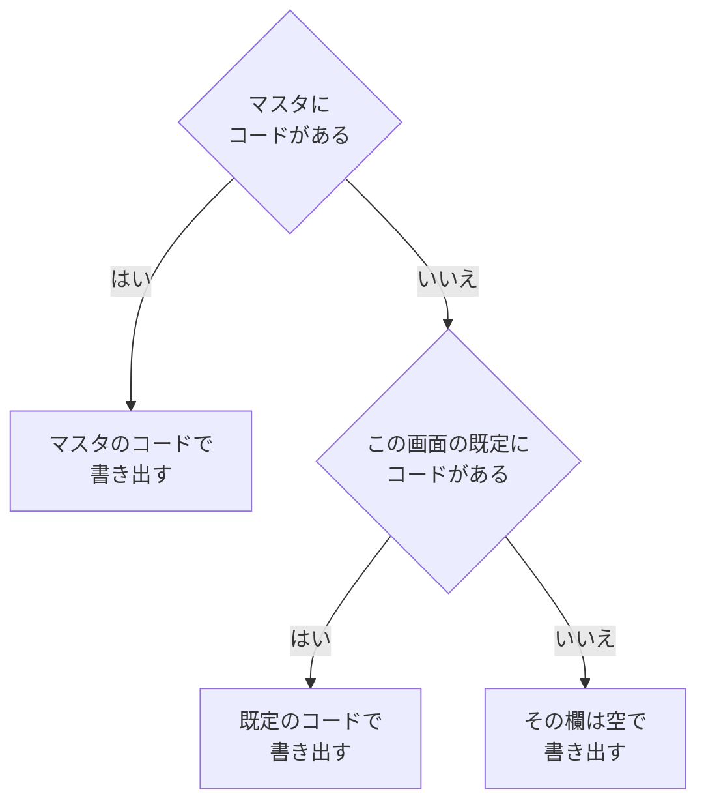

請求書から書き出す**仕訳 CSV の形**を決めるアプリです。操作コードは `SY0J` です。

会計ソフト（TKC FX4クラウド）が受け付ける列の並びや文字コードは、会社ごと・事務所ごとに違います。ここで設定として持っているので、**会計ソフト側の受入フォーマットが変わっても、この画面を直すだけ**で済みます。

> ⚠️ 初期設定の列は「勘定科目コードで出す一般的な形」であって、**会計ソフトの正式な受入フォーマットではありません**。経理から受入フォーマットの表をもらったら、この画面の列と既定コードをそれに合わせてください。

## このアプリでできること

- CSV の **文字コード**（Shift_JIS / UTF-8）・**改行**・**日付の書き方**を選べます。
- **列の並び**を決められます。何を・何番目に・どんな見出しで出すかを 1 列ずつ指定します。
- **既定の勘定科目コード**を設定できます。マスタ側にコードが入っていないときに使われます。
- **税率ごとの消費税コード**を設定できます。
- 設定した内容で実際にどう出るかを **プレビュー**で確認できます。

## 用語（このページで出てくる言葉）

- **仕訳** … 会計ソフトに渡す記録の 1 行です。1 枚の請求書から、税率ごとに「売上」と「消費税」の行ができます。
- **勘定科目コード** … 会計ソフトが科目を識別する番号です。会計ソフトは科目の**名前**ではなくこの**番号**で受け取ります。
- **補助科目コード** … 勘定科目の下にぶら下がる細かい区分です。売掛金の下では取引先ごとの番号になります。
- **消費税コード** … 会計ソフトが税の扱いを識別する番号です。

## はじめる前に

- 勘定科目コード・補助科目コード・消費税コードの**実際の値は経理（税務事務所）が決めます**。分からないまま入れず、必ず確認してください。
- **1 行ごとのコードはマスタ側にあります。** この画面が持っているのは「形」と「マスタが空だったときの既定」です。
  - 消費税コード・売上高の科目・仮受消費税の科目 … [税区分](/manual/ja/operations/masters/tax-category/user)（`MS0F`）
  - 売掛金の科目・補助科目 … [取引先](/manual/ja/operations/masters/business-partner/user)（`MS01`）の顧客の欄

## 開き方

ホーム画面の「**システム**」の中にある **会計連携** を押します。または、画面上の検索欄に `SY0J` と入れます。

## 画面の見かた

開くと、いまの設定が**読むだけの形**で並びます。直すときは右上の「**編集**」を押します。編集をやめるときは「キャンセル」、決めたら「保存」を押すと読むだけの形に戻ります。

一番下には**プレビュー**があります。10% と 8% が混ざった架空の請求書 1 枚を、いまの設定で書き出した結果です。編集中もその場で変わるので、保存する前に確かめられます。

CSV そのものは、この画面ではなく**発行済みの[請求書](/manual/ja/operations/billing/invoice/user)ごと**に、「**…**」→「**会計連携CSV**」から書き出します。初めて書き出したときに仕訳が会計文書として固定され、その請求書の締日処理は「エクスポート済」になります。右上の「**文書履歴**」では、これまでに転記・反対仕訳した会計文書の一覧を見られます。

## 設定のしかた

### 出力形式

| 項目 | 何を決めるか |
| --- | --- |
| 文字コード | 会計ソフトが読める文字の形式です。指定がなければ `utf8-bom` のままにしてください。Shift_JIS 指定のときは `shift_jis` にします。 |
| 改行 | 行の区切りです。ふつうは `crlf` です。 |
| 日付の書式 | `2026/07/31` のような区切り付きか、`20260731` のような続き書きかを選びます。 |
| ヘッダ行を出す | 1 行目に見出しを出すかどうかです。会計ソフトが見出し行を受け付けないときは外します。 |
| 引用符の付け方 | 各項目を `"` で囲むかどうかです。ふつうは `minimal`（必要なときだけ）です。 |
| 金額の書き方 | `250000` と出すか `250,000` と出すかです。 |
| ファイル名の接尾辞 | ダウンロードされるファイル名の後ろの部分です。 |

### 列レイアウト

上から順に 1 列目・2 列目…になります。1 列ごとに **見出し**と、**出力する項目**を選びます。

- 「**列を追加**」で末尾に増やせます。
- 矢印で並べ替え、ごみ箱で削除できます。
- 「**固定文字列**」を選ぶと、どの行にも同じ文字を出す列になります（会計ソフトが決まった区分値を求めるときに使います）。
- 「**空欄**」を選ぶと、いつも空の列になります（列の位置を合わせたいときに使います）。

### 既定の勘定科目コード

画面では「**既定の科目コード**」の枠です。マスタ側にコードが入っていないときに使われます。**空欄のままなら、その欄は空で書き出されます**。

| 項目 | 何に使うか |
| --- | --- |
| 売掛金 科目コード | 借方（売掛金）の科目です。 |
| 売上高 科目コード | 貸方の売上の科目です。 |
| 仮受消費税 科目コード | 貸方の消費税の科目です。 |
| 部門コード | どの行にも同じ部門コードを出します。マスタ側には持ちません。 |
| 既定の消費税コード | 税区分にも、下の税率別の表にも消費税コードが無いときに使います。 |

コードは半角英数字で 16 文字までです。

コードが決まる順番を図にすると次のとおりです。

補助科目コードだけは既定を持ちません。取引先ごとに違う値なので、[取引先](/manual/ja/operations/masters/business-partner/user)（`MS01`）に入れてください。

### 注文種別ごとの売上高 科目コード

注文の**種別ごとに売上高の科目を分けたい**ときに使います。たとえば**再研磨**の売上を、製品の売上とは別の科目で計上したいときに、「再研磨」の欄に科目コードを入れます。

- コードを入れた種別の売上だけが、[税区分](/manual/ja/operations/masters/tax-category/user)（`MS0F`）の売上高科目や、上の既定の科目より**先に**使われます。
- 空欄の種別は、これまでどおり「税区分 → 既定」の順で決まります。全部空欄なら、書き出される内容は何も変わりません。
- 1 枚の請求書に製品と再研磨が混ざっているときは、**売上の行が科目ごとに分かれます**（消費税の行は税率ごとに 1 行のままです）。
- 送料などの追加費用の行は、注文の種別を持たないので、従来の科目に入ります。

### 税率別の消費税コード

税区分マスタに消費税コードが入っていないときに、税率から引きます。「**税率を追加**」を押して、10%・8% のように使う税率のぶんだけ行を足します。1 行ごとに「税率(%)」「借方 消費税コード」「貸方 消費税コード」を入れます。

## よくある質問

**Q. 書き出した CSV を会計ソフトが受け付けてくれません。**
A. 受入フォーマットの表と、この画面の**列の並び**・**文字コード**・**ヘッダ行の有無**を 1 つずつ見比べてください。プレビューを見ながら直せます。

**Q. 科目コードの欄が空のまま出てきます。**
A. マスタ（税区分・取引先）にも、この画面の既定にもコードが入っていません。どちらかに入れてください。

**Q. 「同じ税率の区分が複数あり、科目コードが食い違っています」と出て書き出せません。**
A. 同じ税率を持つ税区分が 2 つ以上あり、それぞれ違う科目コードが入っています。どちらの科目で計上するのかが決まらないため、**あえて書き出していません**。[税区分](/manual/ja/operations/masters/tax-category/user)（`MS0F`）で、その税率の区分に同じコードを入れてください。

**Q. 設定を変えたら、前に書き出した請求書の内容も変わりますか。**
A. すでにダウンロード済みのファイルは変わりません。同じ請求書を書き出し直すと、**列の並び・文字コードなどの形は新しい設定で出ます**が、**勘定科目コード・消費税コード・金額などの中身は最初に書き出したときのまま**です（転記した時点で固定されます）。中身を新しいコードで出し直したいときは、請求書の画面で「**反対仕訳を作成**」（理由が必要）をしてから書き出し直してください。

**Q. 変換できない文字がある、と言われました。**
A. Shift_JIS にない文字（一部の記号や環境依存文字）が摘要に入っています。その文字は `?` に置き換えて書き出されます。取引先名などに含まれている場合は、マスタ側の表記を見直してください。

<!-- permissions:start -->
## 必要な権限

この画面を使うには **システム管理**（`system`）の権限が要ります。

| したいこと | 必要な権限 |
| --- | --- |
| 画面を開く・一覧や詳細を見る | システム管理 の 閲覧 |
| 追加・変更・削除する | システム管理 の 作成 / 更新 / 削除 |

見るだけなら「閲覧」で足ります。追加・変更・削除の操作がある画面では、その操作にあたる権限がそれぞれ必要です。

権限は役割（ロール）を通して付きます。足りないときは管理者に相談してください。

権限の全体像は「[権限とロール](../../../permissions)」を参照してください。
<!-- permissions:end -->
