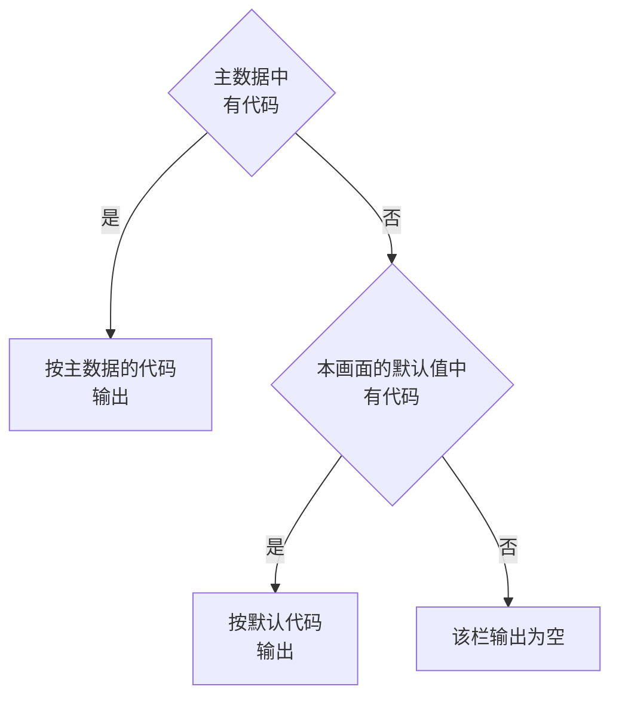

本应用用于设置由请款单导出的**记账凭证 CSV 的格式**。操作代码为 `SY0J`。

会计软件（TKC FX4 Cloud）接受的列顺序与字符编码，因公司、因会计事务所而异。由于在此以设置的形式保存，**即使会计软件的导入格式发生变化，也只需修改本页面**。

> ⚠️ 初始的列是「按科目代码输出」的通用格式，**并非会计软件的正式导入格式**。从财务拿到导入格式表后，请据此调整本页面的列与默认代码。

## 本应用可以做什么

- 选择 CSV 的**字符编码**（Shift_JIS / UTF-8）、**换行**与**日期写法**。
- 决定**列布局**：输出什么、排在第几列、用什么标题。
- 设置**默认科目代码**，在主数据没有填写代码时使用。
- 设置**按税率的税代码**。
- 通过**预览**确认当前设置实际会输出成什么样。

## 本页出现的词

- **记账凭证** … 交给会计软件的一行记录。一张请款单会按税率生成「销售」与「消费税」两种行。
- **科目代码** … 会计软件识别科目的编号。会计软件读取的是这个**编号**，而不是科目的**名称**。
- **辅助科目代码** … 挂在科目之下的细分。在应收账款之下即为各业务伙伴的编号。
- **税代码** … 会计软件识别税务处理方式的编号。

## 开始之前

- 科目代码、辅助科目代码与税代码的**实际取值由财务（税务事务所）决定**。请勿凭猜测填写，务必确认。
- **每一行的代码在主数据一侧。** 本页面保存的是「格式」，以及主数据为空时的「默认值」。
  - 税代码、销售收入科目、暂收消费税科目 … [税种](/manual/zh/operations/masters/tax-category/user)（`MS0F`）
  - 应收账款科目、辅助科目 … [业务伙伴](/manual/zh/operations/masters/business-partner/user)（`MS01`）的客户栏

## 打开方式

在首页的「**系统**」中点击 **会计对接**。或在画面上方的搜索框中输入 `SY0J`。

## 界面说明

打开时为**只读**状态。要修改请点击右上角的「**编辑**」。放弃修改点「取消」，确定后点「保存」即返回只读状态。

最下方是**预览**，展示一张混合 10% 与 8% 的示例请款单按当前设置输出的结果。编辑时会实时变化，保存前即可确认。

CSV 本身不在本画面导出，而是**按每张已发行的[请款单](/manual/zh/operations/billing/invoice/user)**，从「**…**」→「**会計連携CSV**」（会计对接 CSV）导出。首次导出时记账凭证会作为会计文书固定下来，该请款单的结算处理变为「已导出」。右上角的「**文書履歴**」（文书历史）可以查看至今过账、冲销过的会计文书一览。

## 设置方法

### 输出格式

| 项目 | 决定什么 |
| --- | --- |
| 字符编码 | 会计软件能读取的字符格式。若无特别指定，保持 `utf8-bom`；要求 Shift_JIS 时选 `shift_jis`。 |
| 换行 | 行的分隔方式。通常为 `crlf`。 |
| 日期格式 | 带分隔符如 `2026/07/31`，或连写如 `20260731`。 |
| 输出表头行 | 是否在第 1 行输出标题。会计软件不接受标题行时请关闭。 |
| 引号方式 | 各项目是否用 `"` 包裹。通常为 `minimal`（仅在必要时）。 |
| 金额写法 | 输出 `250000` 还是 `250,000`。 |
| 文件名后缀 | 下载文件名末尾的部分。 |

### 列布局

从上到下依次为第 1 列、第 2 列……每行设置**标题**与要输出的**项目**。

- 「**添加列**」在末尾增加一列。
- 箭头用于调整顺序，垃圾桶图标用于删除。
- 选择「**固定文字**」，则该列在每一行都输出相同的文字（会计软件要求固定分类值时使用）。
- 选择「**空白**」，则该列始终为空（用于对齐列的位置）。

### 默认科目代码

在主数据没有代码时使用。**留空则该栏输出为空。**

代码的决定顺序用图表示如下。

只有辅助科目代码没有默认值——它因业务伙伴而异，请在[业务伙伴](/manual/zh/operations/masters/business-partner/user)（`MS01`）中填写。

### 按订单类别的销售收入 科目代码

想要**按订单类别分开销售收入科目**时使用。例如，想把**再研磨**的销售与产品的销售记入不同科目时，在“再研磨”一栏填入科目代码。

- 只有填写了代码的订单类别，才会**优先于**[税种](/manual/zh/operations/masters/tax-category/user)（`MS0F`）的销售收入科目和上面的默认科目。
- 留空的订单类别与以前一样，按“税种 → 默认”的顺序决定。全部留空时，导出的内容不会有任何变化。
- 一张请款单中同时有产品和再研磨时，**销售行会按科目分开**（税额行仍按税率各一行）。
- 运费等附加费用行没有订单类别，因此记入原来的科目。

### 按税率的税代码

税种主数据未填税代码时，按税率查找。请按实际使用的税率（如 10%、8%）逐条添加。

## 常见问题

**Q. 导出的 CSV 会计软件不接受。**
A. 请对照导入格式表，逐项核对本页面的**列布局**、**字符编码**与**是否输出表头行**。可以边看预览边修改。

**Q. 科目代码栏输出为空。**
A. 主数据（税种、业务伙伴）与本页面的默认值都没有填写代码。请在其中之一填写。

**Q. 提示科目代码不明确，无法导出。**
A. 有两个以上税种使用相同税率，且填写了不同的科目代码，无法确定应计入哪个科目，因此**特意不予导出**。请在[税种](/manual/zh/operations/masters/tax-category/user)（`MS0F`）中，为该税率的各区分填入相同的代码。

**Q. 修改设置后，之前导出的请款单内容也会变化吗？**
A. 已下载的文件不会变化。重新导出同一张请款单时，**列的顺序、字符编码等格式按新设置输出**，但**科目编码・税码・金额等内容保持首次导出时的样子**（过账时已固定）。想用新编码重新导出时，请在请款单画面先「**反対仕訳を作成**」（创建冲销分录，必须填写理由），再重新导出。

**Q. 提示有无法转换的字符。**
A. 摘要中含有 Shift_JIS 没有的字符，这些字符会被替换为 `?` 输出。若来自业务伙伴名称，请检查主数据一侧的写法。

<!-- permissions:start -->
## 所需权限

使用本画面需要 **系统管理**（`system`）权限。

| 想做的事 | 所需权限 |
| --- | --- |
| 打开画面、查看列表与明细 | 系统管理 — 查看 |
| 新增・变更・删除 | 系统管理 — 创建 / 更新 / 删除 |

仅查看有「查看」即可。画面中若有新增、变更或删除的操作，则分别需要对应的权限。

权限通过角色授予。若不足，请与管理员联系。

权限的整体说明请参见「[权限与角色](../../../permissions)」。
<!-- permissions:end -->
