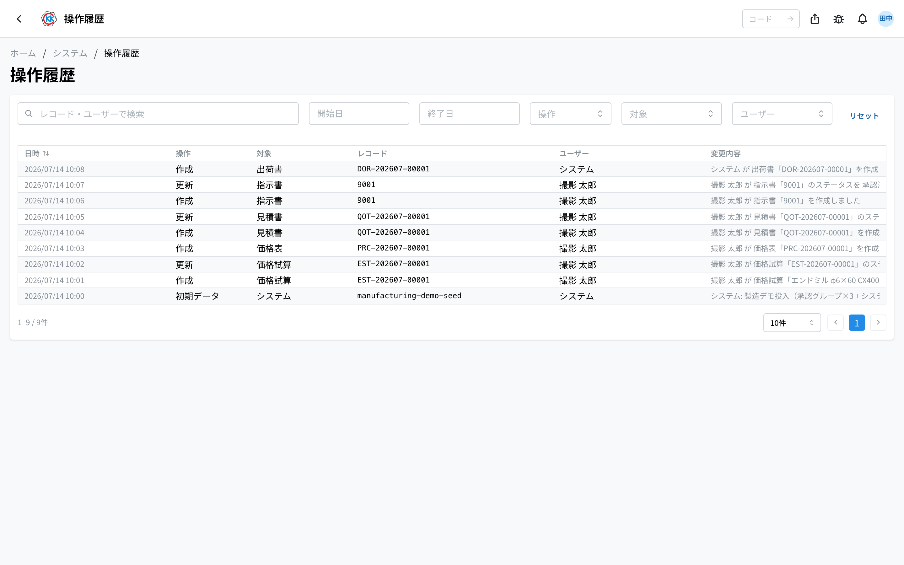
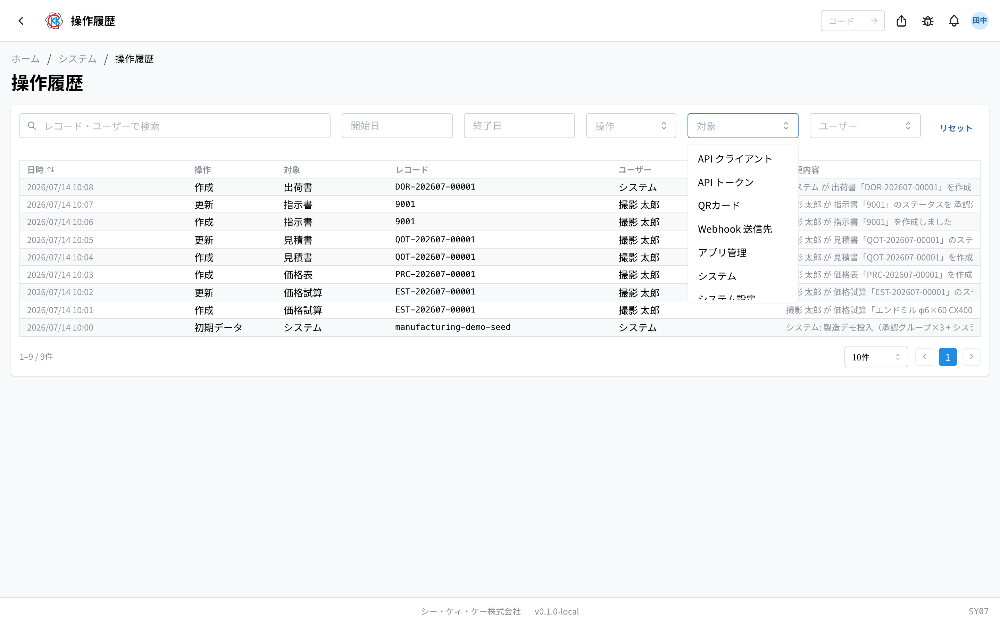
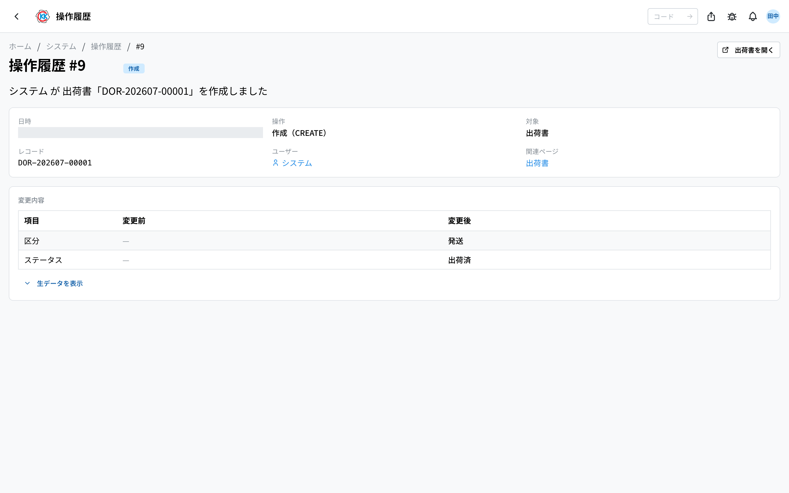
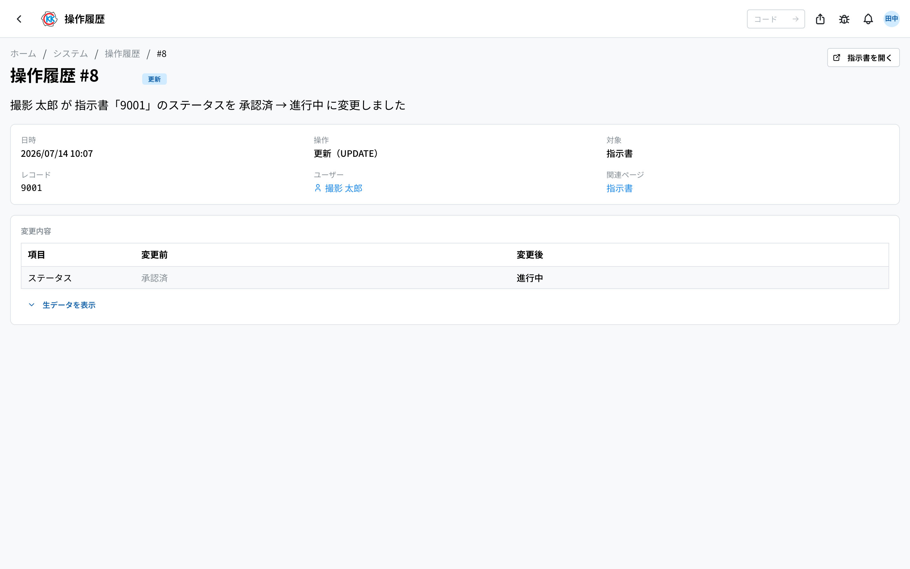

This app lets you look up, across the whole system, **who changed which data, when, and how**. The operation code is `SY07`.

It is a view-only app. You cannot correct or erase any record from this screen.

## What you can do with this app

- See the change records from every app together, in time order.
- Search by a document number or by the name of the person who made the change. You can also narrow down by period, by who did it, by the kind of operation, and by the kind of data.
- Pick one record and see in a table **which fields changed, from what to what**.
- Jump straight from a record to the screen of the document that was changed.
- Use it when you want to find out "who changed this number?" or "when did the amount change?"

## Terms used on this page

- **レコード** (Record) … one item of data. One quote, one product, and so on. On this screen it is shown by that document's number (for example `QOT-…`).
- **対象** (Target) … what kind of data it is. Quote, price estimate, price list, site, and so on.
- **変更内容** (Changes) … a short summary of which fields changed and how.

## Before you start

- You need the **Personal data access** (`personal_data`) permission to open this app. If it will not open, please ask your system administrator.
- Holding the permission is not enough to open the list (the cross-document search) or the details of one record. Request "**Cross-document activity search**" and "**Activity log detail**" in [Privileged access](/manual/en/operations/system/privileged-access/user) (`SY0G`); you can use them only during the period another person approves. After approval, your time starts counting down **from the first time you open this screen**.
- The 「**履歴**」 (History) tab on each document's own screen does not need this approval.
- If you only want the history of one particular document, the **「履歴」 (History) tab on that document's own screen** will find it faster. The contents are the same.

## How to open it

On the home screen, under 「システム」 (System), press **操作履歴** (Activity Log). Or type `SY07` into the search box at the top of the screen.

## What is recorded and what is not

A record is created automatically **when data is saved**.

- **作成** (Create) … when new data was made.
- **更新** (Update) … when existing data was corrected.
- **削除** (Delete) … when data was erased.
- **初期データ** (Seed data) / **マイグレーション** (Migration) … records of the system putting data in at the start, or moving data over in bulk. These are not actions by a person.

**Actions where you only looked at something are not recorded** — opening an ordinary screen, logging in, or downloading a document's PDF will not appear here.

However, some operations that involve secrets or personal information are recorded even when you only look. For example, showing a shared-device PIN, opening the detail of a login record, or an outside person viewing a document in the partner portal is recorded as 「**閲覧**」 (View), and exporting form responses or printing QR cards is recorded as 「**書き出し**」 (Export).

## Reading the screen

When you open the app, the records are listed newest first.

- **日時** (Date/time) … when the action took place. Press the column heading to switch between oldest first and newest first.
- **操作** (Operation) … normally one of 作成 (create) / 更新 (update) / 削除 (delete). It can also show 「**閲覧**」 (view) or 「**書き出し**」 (export), and for work done by the system rather than a person, 「**初期データ**」 (seed data) or 「**マイグレーション**」 (migration).
- **対象** (Target) … what kind of data it is (quote, price estimate, price list, and so on).
- **レコード** (Record) … the number of that document. For data with no number, "—" is shown.
- **ユーザー** (User) … the name of the person who did it. Work done by the system rather than a person is shown as 「**システム**」 (System). Actions performed from a shared shop-floor tablet also carry a **device-name badge** under the name showing which device they came from (actions from a PC have none).
- **変更内容** (Changes) … a summary of what changed and how. It is listed in the form "field name: before → after".

The records are shown one page at a time. Below the table you can move between pages and change how many rows a page shows (10 / 20 / 50 / 100). Older records can be found by turning pages or narrowing down.

## Searching and narrowing down

1. Type a document number or a person's name into the search box at the top, 「**レコード・ユーザーで検索**」 (Search by record or user).
2. Choose the period with 「**開始日**」 (Start date) and 「**終了日**」 (End date).
3. Use 「**操作**」 (Operation) to narrow down to one kind of operation.
4. Use 「**対象**」 (Target) to narrow down to a kind of data, such as quotes or products.
5. Use 「**ユーザー**」 (User) to narrow down to the person who acted.
6. To clear all of the conditions, press 「**リセット**」 (Reset).

When nothing matches, 「**操作履歴がありません**」 (There is no activity log) is shown.

## Looking at one record in detail

Click a row in the list and the screen for that single record opens.

At the very top, one sentence says who did what. Below it you will see the date/time, operation, target, record, user, and related page.

- Click the name under 「**ユーザー**」 (User) and that person's details open in [ユーザー管理](/manual/en/operations/system/user-management/user) (User Management).
- When a document name appears under 「**関連ページ**」 (Related page), you can move to that document's screen.
- A button also appears at the top right of the screen: 「**〈app name〉を開く**」 (Open 〈app name〉). Press it and the document that was changed opens directly. If the document cannot be narrowed down to a single one, the button reads 「**〈app name〉で表示**」 (Show in 〈app name〉) instead, and it opens that app's list already filtered.

## Comparing before and after

Lower down on the detail screen, 「**変更内容**」 (Changes) shows in a table what changed.

- For an update, only the changed fields are listed in three columns: 「**項目**」 (Item), 「**変更前**」 (Before) and 「**変更後**」 (After).
- For something newly made or deleted, the contents at that time are listed in two columns: 「**項目**」 (Item) and 「**値**」 (Value).
- When no field changed, 「**変更点はありません**」 (No changes) is shown.

> 💡 Press 「**生データを表示**」 (Show the raw data) under the table to open 「**変更前（before）**」 and 「**変更後（after）**」 in the form the system stores them in. English field names and symbols are mixed in, but there is nothing wrong. Normally the table above is all you need. Press 「**生データを隠す**」 (Hide the raw data) to close it.

## Input fields

Activity log is a **read-only screen**. There is nothing to type — you only choose filters. The records themselves cannot be edited or deleted.

| Filter | What it changes |
|--------|-----------------|
| [Search](#field-user) | Search by document number or a person's name |
| [Period](#field-date-range) | From when to when the records are shown |
| [Operation](#field-period) | Narrow down by the kind of operation — create, update, delete and so on |
| [Target](#field-target) | Which documents or master data are shown |
| [User](#field-actor) | Whose actions are shown |

### Search [#field-user]

The search box 「**レコード・ユーザーで検索**」 (Search by record or user). You can search by a document number (`QOT-…` and so on) or by the name of the person who acted. Words inside the changes cannot be searched.

### Period [#field-date-range]

Use 「**開始日**」 (Start date) and 「**終了日**」 (End date) to set the period of records to show. You may set just one of them.

### Operation [#field-period]

Narrows down by the kind of operation — create, update, delete, view, export, seed data, or migration.

### Target [#field-target]

Filters by what the record is about, such as quotes or work orders. Clicking a row opens the detail with **before and after** side by side.

### User [#field-actor]

Choose the person who acted to show only their records. You can type a name to find them.

## Frequently asked questions and troubleshooting

**Q. I only want to see the history of one particular quote.**
A. The quickest way is to open that quote's screen and look at the 「**履歴**」 (History) tab. If you want to look here instead, type the quote number into the search box.

**Q. The old record I am looking for does not appear.**
A. Set a period with 「**開始日**」 (Start date) and 「**終了日**」 (End date), or move to later pages below the table. Also check that you have not set too many conditions.

**Q. I want to know who logged in.**
A. You cannot tell from this screen. Sign-in records live in [Login History](/manual/en/operations/system/login-history/user) (`SY0D`).

**Q. 「ユーザー」 says 「システム」. Who did it?**
A. It was not a person — the system did it automatically. Overnight automatic processing and data imports are examples of this.

**Q. What are the records where 「対象」 says 「アプリ管理」 (App Management)?**
A. They are records of apps being switched on or off for display in [アプリ管理](/manual/en/operations/system/app-management/user) (App Management).

**Q. The 「〈app name〉を開く」 button does not appear at the top right.**
A. If the record cannot be narrowed down to a single document, the button does not appear. Note down the number shown under 「レコード」 and look for it on that app's screen.

<!-- permissions:start -->
## Permissions required

Using this screen requires the **Personal data access** (`personal_data`) permission.

| What you want to do | Permission needed |
| --- | --- |
| Open the screen, view lists and details | Personal data access — View |
| Add, change or delete | Personal data access — Create / Edit / Delete |

Viewing only needs *View*. Where a screen offers adding, changing or deleting, each of those needs its matching permission.

### Operations that need approval

Holding the permission is not enough for the operations below. You **request them in Privileged Access (SY0G) and may act only for the window someone else approves**.

| Operation | Permission | What it unlocks |
| --- | --- | --- |
| Cross-document activity search | Personal data access（`personal_data`）— View | Searches what one person did across all documents. Per-document history tabs are not restricted by this. |
| Activity log detail | Personal data access（`personal_data`）— View | Opens one operation down to its before/after payload. |

Permissions come through roles. If something is missing, ask an administrator.

For the whole picture see [Permissions and roles](../../../permissions).
<!-- permissions:end -->
