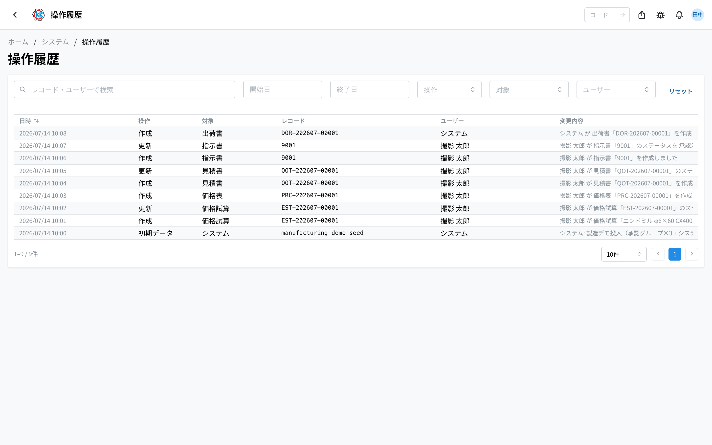
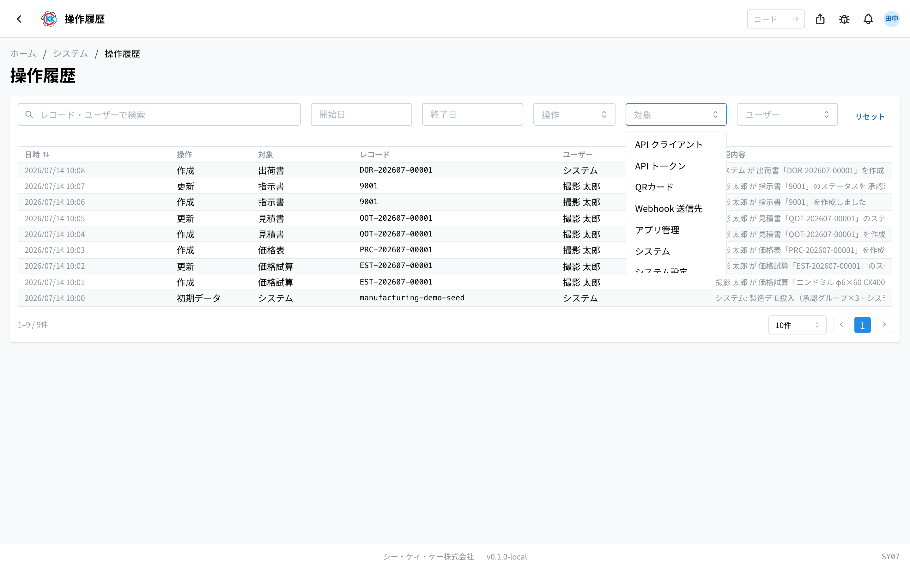
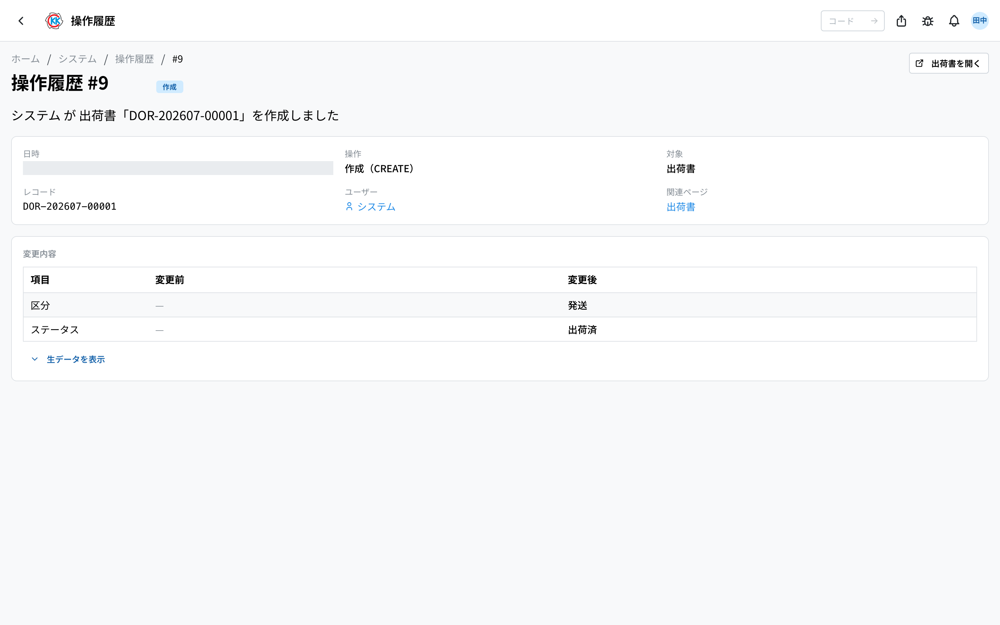
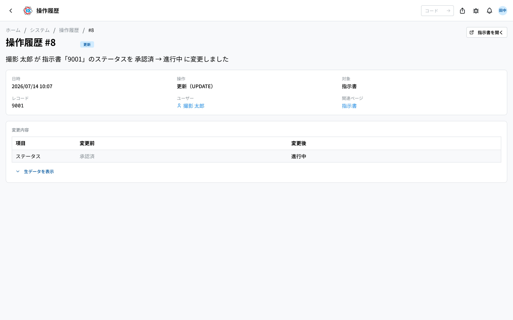

「**誰が・いつ・どのデータを・どう変えたか**」を、システム全体からまとめて調べられるアプリです。操作コードは `SY07` です。

見るだけのアプリです。この画面から記録を直したり消したりすることはできません。

## このアプリでできること

- すべてのアプリの変更記録を、まとめて時間順に見られます。
- 書類の番号や、変更した人の名前で探せます。期間・操作した人・操作の種類・データの種類でも絞り込めます。
- 1 件を選ぶと、**どの項目が、何から何に変わったか** を表で確認できます。
- 記録から、変更されたその書類の画面に直接ジャンプできます。
- 「この数字を変えたのは誰か」「いつから金額が変わったのか」を調べるときに使います。

## 用語（このページで出てくる言葉）

- **レコード** … 1 件のデータのことです。見積書 1 通、製品 1 つ、といった単位です。この画面では、その書類の番号（`QOT-…` など）で表示されます。
- **対象（たいしょう）** … どの種類のデータかを表します。見積書・価格試算・価格表・拠点、といった分類です。
- **変更内容** … どの項目が、どう変わったかの短いまとめです。

## はじめる前に

- このアプリを開くには **個人データの閲覧**（`personal_data`）の権限が必要です。開けない場合は、システム管理者にご相談ください。
- 権限があっても、それだけでは一覧（横断検索）も 1 件の詳細も開けません。[特権アクセス](/manual/ja/operations/system/privileged-access/user)（`SY0G`）で「**操作履歴の横断検索**」「**操作履歴の詳細**」を申請し、別の人の承認を受けた期間だけ使えます。承認されたあと、**はじめてこの画面を開いた時点から**持ち時間が減りはじめます。
- 書類ごとの画面にある「**履歴**」タブは、この承認がなくても見られます。
- 特定の 1 通の書類の履歴だけを見たいときは、この画面よりも、**その書類の画面にある「履歴」タブ** のほうが早く見つかります。中身は同じです。

## 開き方

ホーム画面の「システム」の中にある **操作履歴** を押します。または、画面上の検索欄に `SY07` と入れます。

## 記録されること・されないこと

データを **保存したとき** に、自動で記録されます。

- **作成** … 新しくデータを作ったとき。
- **更新** … すでにあるデータを直したとき。
- **削除** … データを消したとき。
- **初期データ** / **マイグレーション** … システムが最初にデータを入れたときや、まとめて移し替えたときの記録です。人の操作ではありません。

ふつうの画面を開いた、ログインした、書類の PDF をダウンロードした、といった **見ただけの操作は記録されません**。

ただし、秘密や個人の情報にかかわる一部の操作は、見ただけでも記録されます。たとえば共有端末の PIN の表示、ログイン履歴の詳細を開いたとき、取引先ポータルで社外の方が書類を見たときは「**閲覧**」、フォームの回答の書き出しや QRカードの印刷は「**書き出し**」として残ります。

## 画面の見かた

アプリを開くと、新しい順に記録が並びます。

- **日時** … その操作が行われた日時です。列の見出しを押すと、古い順・新しい順を切り替えられます。
- **操作** … ふだんは 作成 / 更新 / 削除 のいずれかです。ほかに「**閲覧**」「**書き出し**」、人ではなくシステムが行った処理では「**初期データ**」「**マイグレーション**」と出ることもあります。
- **対象** … どの種類のデータかです（見積書、価格試算、価格表 など）。
- **レコード** … その書類の番号です。番号が無いデータでは「—」と出ます。
- **ユーザー** … 操作した人の名前です。人ではなくシステムが行った処理は「**システム**」と表示されます。現場の共有タブレットから行われた操作には、名前の下にどの端末からかが**端末名のバッジ**で付きます（パソコンからの操作には付きません）。
- **変更内容** … 何がどう変わったかのまとめです。「項目名: 変わる前 → 変わった後」の形で並びます。

記録は 1 ページずつ表示されます。表の下で、ページを移ったり、1 ページに出す件数（10 / 20 / 50 / 100 件）を変えたりできます。古い記録も、ページをめくるか絞り込めば探せます。

## 探す・絞り込む

1. 上の検索欄「**レコード・ユーザーで検索**」に、書類の番号や人の名前を入れます。
2. 「**開始日**」「**終了日**」で、調べたい期間を選びます。
3. 「**操作**」で、操作の種類に絞り込みます。
4. 「**対象**」で、見積書・製品などデータの種類に絞り込みます。
5. 「**ユーザー**」で、操作した人を選んで絞り込みます。
6. 条件を全部消したいときは「**リセット**」を押します。

該当するものが無いときは「**操作履歴がありません**」と表示されます。

## 1 件を詳しく見る

一覧の行をクリックすると、その 1 件の画面が開きます。

いちばん上に「誰が・何を・どうしたか」が 1 文で出て、その下に日時・操作・対象・レコード・ユーザー・関連ページが並びます。

- 「**ユーザー**」の名前をクリックすると、その人の情報（[ユーザー管理](/manual/ja/operations/system/user-management/user)）が開きます。
- 「**関連ページ**」に書類の名前が出ているときは、その書類の画面へ移動できます。
- 画面の右上にも「**〈アプリ名〉を開く**」というボタンが出ます。押すと、変更されたその書類が直接開きます。書類を 1 つに特定できない場合は「**〈アプリ名〉で表示**」となり、そのアプリの一覧が絞り込まれた状態で開きます。

## 変わる前と後を見くらべる

詳細画面の下のほうの「**変更内容**」に、何が変わったかが表で出ます。

- 更新の記録では、「**項目**」「**変更前**」「**変更後**」の 3 列で、変わった項目だけが並びます。
- 新しく作った記録・削除の記録では、「**項目**」「**値**」の 2 列で、そのときの中身が並びます。
- 変わった項目が無いときは「**変更点はありません**」と出ます。

> 💡 表の下の「**生データを表示**」を押すと、システムが保存している形のままの「**変更前（before）**」「**変更後（after）**」が開きます。英語の項目名や記号が混じりますが、異常ではありません。ふだんは上の表を見れば十分です。閉じるときは「**生データを隠す**」を押します。

## 入力項目

操作履歴は**記録を見るだけの画面**です。入力する項目はなく、絞り込みの条件を選ぶだけです。履歴そのものを直したり消したりはできません。

| 絞り込み | 何が変わるか |
|----------|-------------|
| [検索](#field-user) | 書類の番号・人の名前で探す |
| [期間](#field-date-range) | いつからいつまでの記録を見るか |
| [操作](#field-period) | 作成・更新・削除など、操作の種類で絞り込む |
| [対象](#field-target) | どの書類・マスタの記録を見るか |
| [ユーザー](#field-actor) | 誰が行った操作を見るか |

### 検索 [#field-user]

検索欄「**レコード・ユーザーで検索**」です。書類の番号（`QOT-…` など）か、操作した人の名前で探せます。変更内容に含まれる言葉では探せません。

### 期間 [#field-date-range]

「**開始日**」と「**終了日**」で、記録を見る期間を決めます。片方だけでもかまいません。

### 操作 [#field-period]

作成・更新・削除・閲覧・書き出し・初期データ・マイグレーションといった、操作の種類で絞り込みます。

### 対象 [#field-target]

見積書・指示書といった、記録の対象で絞り込みます。行をクリックすると、**変更前と変更後**が並んだ詳細が開きます。

### ユーザー [#field-actor]

操作した人を選んで、その人の記録だけにします。名前を入れて候補を探せます。

## よくある質問・困ったとき

**Q. ある 1 通の見積書の履歴だけを見たいです。**
A. その見積書の画面を開いて「**履歴**」タブを見るのがいちばん早いです。この画面で調べるときは、検索欄に見積番号を入れてください。

**Q. 探している古い記録が出てきません。**
A. 「**開始日**」「**終了日**」で期間を指定するか、表の下でページを進めてください。条件を付けすぎていないかも確認してください。

**Q. 誰がログインしたかを知りたいです。**
A. この画面では分かりません。ログインの記録は[ログイン履歴](/manual/ja/operations/system/login-history/user)（`SY0D`）で見られます。

**Q.「ユーザー」が「システム」になっています。誰が操作したのですか。**
A. 人ではなく、システムが自動で行った処理です。夜間の自動処理や、データの取り込みなどがこれにあたります。

**Q.「対象」に「アプリ管理」と出ている記録は何ですか。**
A. [アプリ管理](/manual/ja/operations/system/app-management/user)で、アプリを出す・出さないを切り替えた記録です。

**Q. 右上に「〈アプリ名〉を開く」のボタンが出ません。**
A. その記録から書類を 1 つに特定できない場合は、ボタンが出ません。「レコード」に出ている番号を控えて、そのアプリの画面で探してください。

<!-- permissions:start -->
## 必要な権限

この画面を使うには **個人データの閲覧**（`personal_data`）の権限が要ります。

| したいこと | 必要な権限 |
| --- | --- |
| 画面を開く・一覧や詳細を見る | 個人データの閲覧 の 閲覧 |
| 追加・変更・削除する | 個人データの閲覧 の 作成 / 更新 / 削除 |

見るだけなら「閲覧」で足ります。追加・変更・削除の操作がある画面では、その操作にあたる権限がそれぞれ必要です。

### 承認が要る操作

次の操作は権限を持っているだけでは行えません。**特権アクセス（SY0G）で申請し、別の人の承認を受けた期間だけ**行えます。

| 操作 | 必要な権限 | 何ができるようになるか |
| --- | --- | --- |
| 操作履歴の横断検索 | 個人データの閲覧（`personal_data`）— 閲覧 | 書類をまたいで「この人が何をしたか」を検索する。書類ごとの履歴タブはこの権限では制限しない |
| 操作履歴の詳細 | 個人データの閲覧（`personal_data`）— 閲覧 | 1 件の操作の変更前後（before / after）まで開く |

権限は役割（ロール）を通して付きます。足りないときは管理者に相談してください。

権限の全体像は「[権限とロール](../../../permissions)」を参照してください。
<!-- permissions:end -->
