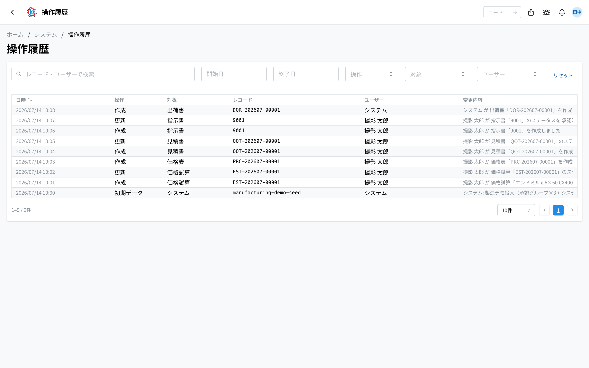
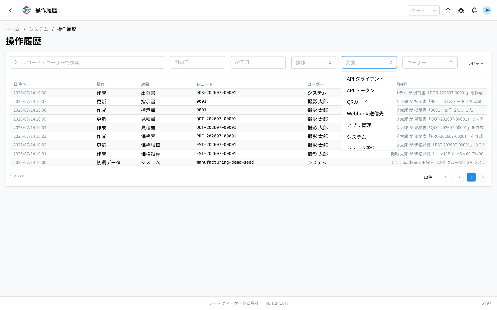
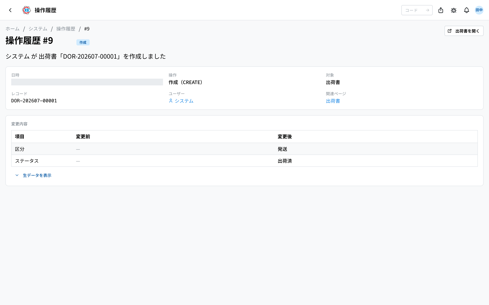
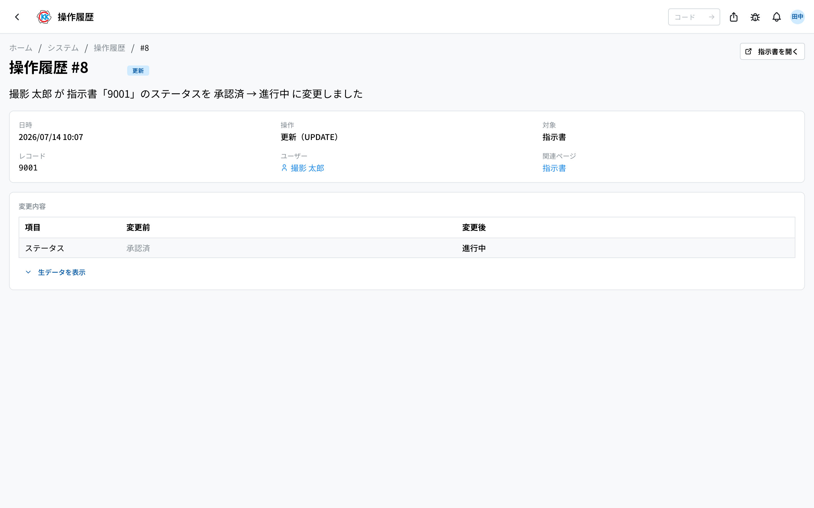

这是一个可以从整个系统中一并查询「**谁・什么时候・把哪条数据・怎样改动了**」的应用。操作代码是 `SY07`。

这是一个只能查看的应用。无法在这个画面上修改或删除记录。

## 本应用能做什么

- 把所有应用的改动记录汇总起来，按时间顺序查看。
- 可以用单据编号，或者改动人的姓名来查找。还可以按期间・操作人・操作种类・数据种类筛选。
- 选中一条，就能用表格确认**哪个项目从什么变成了什么**。
- 可以从记录直接跳转到被改动的那份单据的画面。
- 想查「是谁改了这个数字」「金额是从什么时候变的」时使用。

## 术语（本页出现的词）

- **レコード**（记录）… 指一条数据。一份报价单、一个产品，就是这样的单位。在这个画面上，用该单据的编号（如 `QOT-…`）来显示。
- **対象**（对象）… 表示是哪一类数据。报价单、价格试算、价格表、据点等分类。
- **変更内容**（变更内容）… 关于哪个项目、怎样变化的简短汇总。

## 开始之前

- 打开本应用需要 **个人数据查看**（`personal_data`）权限。如果打不开，请与系统管理员联系。
- 仅有权限还无法打开列表（跨单据搜索）和单条记录的详情。需要在 [特权访问](/manual/zh/operations/system/privileged-access/user)（`SY0G`）中申请「**操作历史的跨单据检索**」「**操作历史明细**」，只有在其他人批准的期间内才能使用。获得批准后，**从第一次打开这个画面的时点起**，可用时间开始减少。
- 各单据画面上的「**履歴**」（历史）标签不需要此批准。
- 如果只想看某一份单据的历史，比起这个画面，**那份单据画面上的「履歴」（历史）标签** 更快找到。内容是一样的。

## 打开方式

按主页画面「システム」（系统）中的 **操作履歴**（操作历史）。或者在画面上方的搜索框里输入 `SY07`。

## 会记录和不会记录的内容

在**保存数据时**会自动记录。

- **作成**（创建）… 新建数据时。
- **更新**（更新）… 修改已有数据时。
- **削除**（删除）… 删除数据时。
- **初期データ**（初始数据）/ **マイグレーション**（迁移）… 系统最初放入数据，或者成批转移数据时的记录。不是人的操作。

打开普通画面、登录、下载单据的 PDF 这类**只是查看的操作不会被记录**。

不过，与机密或个人信息有关的部分操作，即使只是查看也会被记录。例如显示共用终端的 PIN、打开登录记录的详情、社外人员在客户门户中查看单据时，会记为「**閲覧**」（查看）；导出表单回答、打印二维码卡时，会记为「**書き出し**」（导出）。

## 画面的看法

打开应用后，记录按由新到旧排列。

- **日時**（日期时间）… 进行该操作的日期和时间。点击列标题可以切换由旧到新・由新到旧。
- **操作**（操作）… 通常是 作成（创建）/ 更新（更新）/ 削除（删除）中的一种。此外还可能显示「**閲覧**」（查看）「**書き出し**」（导出）；不是人、而是系统进行的处理，有时会显示「**初期データ**」（初始数据）「**マイグレーション**」（迁移）。
- **対象**（对象）… 是哪一类数据（报价单、价格试算、价格表等）。
- **レコード**（记录）… 该单据的编号。没有编号的数据显示为「—」。
- **ユーザー**（用户）… 进行操作的人的姓名。不是人、而是系统进行的处理，显示为「**システム**」（系统）。从现场共享平板进行的操作，姓名下方会带一个**设备名徽章**，标明来自哪台终端（从电脑进行的操作没有）。
- **変更内容**（变更内容）… 关于什么发生了怎样变化的汇总。按「项目名: 改动前 → 改动后」的形式排列。

记录按页显示。在表格下方可以翻页，也可以更改每页显示的条数（10 / 20 / 50 / 100 条）。较早的记录也可以通过翻页或筛选找到。

## 查找・筛选

1. 在上方的搜索框「**レコード・ユーザーで検索**」（按记录・用户搜索）里，输入单据编号或人的姓名。
2. 用「**開始日**」（开始日期）「**終了日**」（结束日期）选择要查的期间。
3. 用「**操作**」（操作）按操作的种类筛选。
4. 用「**対象**」（对象）筛选出报价单、产品等数据的种类。
5. 用「**ユーザー**」（用户）选择操作人进行筛选。
6. 想清除全部条件时，按「**リセット**」（重置）。

没有符合条件的内容时，会显示「**操作履歴がありません**」（没有操作历史）。

## 详细查看一条

点击列表中的行，就会打开该条的画面。

最上方用一句话显示「谁・做了什么」，其下排列着日期时间・操作・对象・记录・用户・相关页面。

- 点击「**ユーザー**」（用户）的姓名，就会打开那个人的信息（[ユーザー管理](/manual/zh/operations/system/user-management/user)，用户管理）。
- 「**関連ページ**」（相关页面）中显示单据名称时，可以移动到那份单据的画面。
- 画面右上角也会出现「**〈应用名〉を開く**」（打开〈应用名〉）的按钮。按下后，被改动的那份单据会直接打开。无法把单据确定为一份时，按钮会变成「**〈应用名〉で表示**」（在〈应用名〉中显示），打开该应用中已经筛选好的列表。

## 对照改动前和改动后

详情画面下方的「**変更内容**」（变更内容）中，会用表格显示改动了什么。

- 更新的记录中，只列出发生变化的项目，分为「**項目**」（项目）「**変更前**」（改动前）「**変更後**」（改动后）3 列。
- 新建或删除的记录中，以「**項目**」（项目）「**値**」（值）2 列列出当时的内容。
- 没有变化的项目时，显示「**変更点はありません**」（没有变更）。

> 💡 点击表格下方的「**生データを表示**」（显示原始数据），会按系统保存时的形式打开「**変更前（before）**」「**変更後（after）**」。里面会混有英文的项目名和符号，但这不是异常。平时看上面的表格就够了。要收起时点击「**生データを隠す**」（隐藏原始数据）。

## 输入项

操作履历是**仅供查看记录的画面**。没有输入项，只需选择筛选条件。履历本身无法修改或删除。

| 筛选 | 会改变什么 |
|------|-----------|
| [搜索](#field-user) | 按单据编号・人的姓名查找 |
| [期间](#field-date-range) | 查看从何时到何时的记录 |
| [操作](#field-period) | 按创建・更新・删除等操作种类筛选 |
| [对象](#field-target) | 查看哪类单据・主数据的记录 |
| [用户](#field-actor) | 查看谁进行的操作 |

### 搜索 [#field-user]

搜索框「**レコード・ユーザーで検索**」（按记录・用户搜索）。可以用单据编号（`QOT-…` 等）或操作者的姓名查找。变更内容中包含的词语无法搜索。

### 期间 [#field-date-range]

用「**開始日**」（开始日期）和「**終了日**」（结束日期）决定查看记录的期间。只填其中一个也可以。

### 操作 [#field-period]

按创建・更新・删除・查看・导出・初始数据・迁移等操作种类筛选。

### 对象 [#field-target]

按记录对象筛选，如报价单、工单等。点击行可打开并列显示**变更前与变更后**的详情。

### 用户 [#field-actor]

选择操作人，只显示此人的记录。可以输入姓名查找候选。

## 常见问题・遇到麻烦时

**Q. 我只想看某一份报价单的历史。**
A. 打开那份报价单的画面，看「**履歴**」（历史）标签最快。想在这个画面上查时，请在搜索框里输入报价单编号。

**Q. 找不到我要找的旧记录。**
A. 请用「**開始日**」（开始日期）「**終了日**」（结束日期）指定期间，或在表格下方往后翻页。也请确认是否设置了过多的条件。

**Q. 我想知道谁登录了。**
A. 这个画面上看不出来。登录记录可以在[登录历史](/manual/zh/operations/system/login-history/user)（`SY0D`）中查看。

**Q. 「ユーザー」变成了「システム」。是谁操作的？**
A. 不是人，而是系统自动进行的处理。夜间的自动处理、数据的导入等就属于这一类。

**Q.「対象」中显示「アプリ管理」（应用管理）的记录是什么？**
A. 是在 [アプリ管理](/manual/zh/operations/system/app-management/user)（应用管理）中，切换应用显示或不显示的记录。

**Q. 右上角不出现「〈应用名〉を開く」的按钮。**
A. 如果无法从该记录把单据确定为一份，按钮就不会出现。请记下「レコード」中显示的编号，到那个应用的画面上去找。

<!-- permissions:start -->
## 所需权限

使用本画面需要 **个人数据查看**（`personal_data`）权限。

| 想做的事 | 所需权限 |
| --- | --- |
| 打开画面、查看列表与明细 | 个人数据查看 — 查看 |
| 新增・变更・删除 | 个人数据查看 — 创建 / 更新 / 删除 |

仅查看有「查看」即可。画面中若有新增、变更或删除的操作，则分别需要对应的权限。

### 需要批准的操作

下列操作仅有权限还不够。需**在特权访问（SY0G）中提出申请，并只在他人批准的时间段内执行**。

| 操作 | 所需权限 | 可以做什么 |
| --- | --- | --- |
| 操作历史的跨单据检索 | 个人数据查看（`personal_data`）— 查看 | 跨单据检索「某人做了什么」。各单据的历史页签不受此权限限制。 |
| 操作历史明细 | 个人数据查看（`personal_data`）— 查看 | 展开单次操作变更前后（before / after）的内容。 |

权限通过角色授予。若不足，请与管理员联系。

权限的整体说明请参见「[权限与角色](../../../permissions)」。
<!-- permissions:end -->
