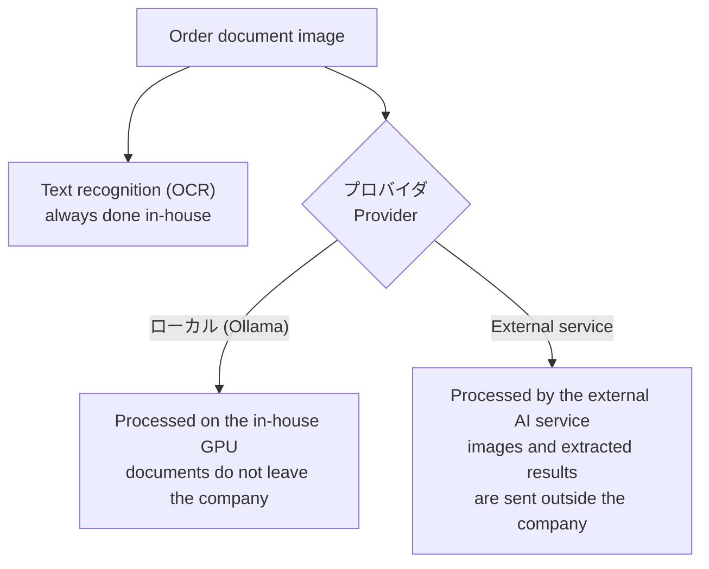

The setting that decides **where the AI connects to** for reading order documents and for suggesting keywords for master data. The operation code is `SY0E`.

> ⚠️ For now this app can be used **in the test environment only**. Screens and steps may change before it becomes available in production.

> ⚠️ This screen is for system administrators. If you choose an external service, **order document images and the extracted results are sent outside the company**.

## What you can do with this app

- Switch where the AI connects to, between the in-house GPU and an external service.
- Specify the models to use (one for reading images, one for assembling the text).
- Register an API token.
- Before saving, use 「接続テスト」 (Test connection) to actually call each of them once and check.

## Terms used on this page

- **Provider** … who supplies the AI. You choose between in-house (Ollama) and an external service.
- **Image-reading model** … the model that reads the image of an order document.
- **Structuring model** … the model that arranges what was read into separate fields.
- **API token** … the password for using an external service.

## By default it runs in-house

If you do not touch the settings, it runs on the **in-house GPU (Ollama)**. In this state documents do not leave the company. The screen shows 「**現在は既定（社内 GPU の Ollama）です**」 (Currently the default — Ollama on the in-house GPU).

> 💡 **Text recognition (OCR) is always done in-house, whatever the setting.** Even if you choose an external service, the OCR part alone never leaves the company.

As a diagram, where a document is processed:

## Reading the screen

When you open the screen, the current settings are shown (provider, base URL, image-reading model, structuring model, maximum output tokens, API token). Blank items are shown as 「(既定)」 (default). Only the last 4 characters of the API token are visible.

## Changing where it connects

1. Press 「**編集**」 (Edit).
2. Choose the 「**プロバイダ**」 (Provider): ローカル (Ollama) (local) / OpenAI 互換 (OpenAI-compatible) / Anthropic (Claude) / Google Gemini.
3. If needed, enter the 「ベース URL」 (Base URL). If left blank, that provider's default is used.
4. Enter a model name in 「**画像読み取りモデル**」 (Image-reading model).
5. Enter the 「**構造化モデル**」 (Structuring model). If left blank, the same model as the image-reading model is used.
6. For an external service, paste the 「**API トークン**」 (API token). To keep a token that is already registered, leave this blank.
7. If needed, change 「**最大出力トークン**」 (Maximum output tokens — the upper limit on the length of one response). Anthropic always uses this value.
8. Press 「**接続テスト**」 (Test connection) and check that both respond.
9. Press 「保存」 (Save).

When you choose an external service, the screen shows 「**外部の AI サービスを使用します。注文書の画像と読み取り結果が社外へ送信されます。**」 (An external AI service will be used. Order document images and extracted results will be sent outside the company.).

> ⚠️ Once saved, only the **last 4 characters** of the token are shown. You cannot see the whole token again.

## Going back to in-house

Press 「**編集**」 (Edit), then 「**既定に戻す**」 (Reset to default) to go back to the in-house Ollama. **When you save, the registered token is deleted as well.**

To delete only the token, press 「**トークンを削除**」 (Delete token) while editing, then save. To change your mind, press 「取り消す」 (Undo) before saving.

## What the connection test tells you

It calls "structuring" and "image reading" once each. You can try it with values you have not saved yet. If it works, 「**構造化・画像読み取りの両方に応答がありました**」 (Both structuring and image reading responded) is shown.

## Frequently asked questions and troubleshooting

**Q. 「AI プロバイダに API トークンを拒否されました」 (The AI provider rejected the API token) appears.**
A. The token is wrong or has expired. Enter it again and press Test connection.

**Q. 「AI プロバイダに指定のモデルがありません」 (The AI provider does not have the specified model) appears.**
A. The model name is wrong. For Anthropic, **do not add a date** (write it like `claude-opus-5`).

**Q. 「指定のモデルは画像を読み取れません」 (The specified model cannot read images) appears.**
A. A model that cannot read images is set as the image-reading model. Change it to the name of a model that supports images.

**Q. 「暗号鍵が更新されています」 (The encryption key has been updated) appears.**
A. The key that protects the token has changed. Save the settings again and they are stored with the new key.

**Q. After I change the settings, when do they take effect?**
A. Right after saving, every AI call uses these settings.

<!-- permissions:start -->
## Permissions required

Using this screen requires the **System admin** (`system`) permission.

| What you want to do | Permission needed |
| --- | --- |
| Open the screen, view lists and details | System admin — View |
| Add, change or delete | System admin — Create / Edit / Delete |

Viewing only needs *View*. Where a screen offers adding, changing or deleting, each of those needs its matching permission.

Permissions come through roles. If something is missing, ask an administrator.

For the whole picture see [Permissions and roles](../../../permissions).
<!-- permissions:end -->
