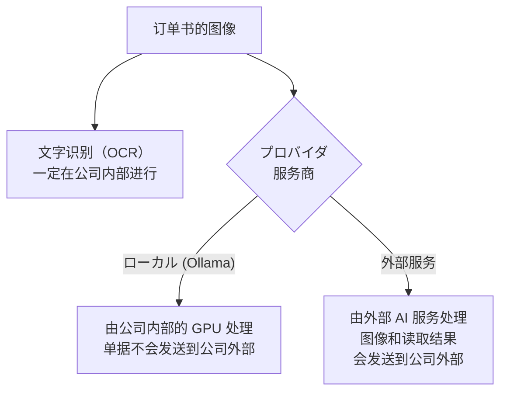

决定读取订单书、生成主数据关键词候选时所用 **AI 的连接对象** 的设置。操作代码为 `SY0E`。

> ⚠️ 本应用目前 **只能在测试用环境** 中使用。在正式环境可用之前，画面和步骤可能会有变化。

> ⚠️ 本画面面向系统管理员。选择外部服务后，**订单书的图像和读取结果会发送到公司外部**。

## 本应用能做什么

- 可以在公司内部的 GPU 和外部服务之间切换 AI 的连接对象。
- 可以指定使用的模型（图像读取用、文字整理用）。
- 可以登记 API 令牌。
- 保存之前，可以用「接続テスト」（连接测试）实际各调用 1 次进行确认。

## 用语（本页出现的词）

- **服务商** … AI 的提供方。选择公司内部（Ollama）还是外部服务。
- **图像读取模型** … 读取订单书图像的模型。
- **结构化模型** … 把读取到的内容按项目整理好的模型。
- **API 令牌** … 使用外部服务所需的口令。

## 默认在公司内部运行

不改动设置的话，会在 **公司内部的 GPU（Ollama）** 上运行。这种状态下单据不会发送到公司外部。画面上会显示「**現在は既定（社内 GPU の Ollama）です**」（当前为默认：公司内部 GPU 的 Ollama）。

> 💡 **文字识别（OCR）无论怎样设置，都一定在公司内部进行。** 即使选择了外部服务，只有 OCR 这一部分不会发送到公司外部。

单据在哪里处理，用图表示如下。

## 画面说明

打开画面后，会显示当前的设置（服务商、基础 URL、图像读取模型、结构化模型、最大输出令牌数、API 令牌）。留空的项目显示为「(既定)」（默认）。API 令牌只显示后 4 位。

## 更改连接对象

1. 点击「**編集**」（编辑）。
2. 选择「**プロバイダ**」（服务商）：ローカル (Ollama)（本地）/ OpenAI 互換（OpenAI 兼容）/ Anthropic (Claude) / Google Gemini。
3. 需要时填写「ベース URL」（基础 URL）。留空则使用该服务商的默认值。
4. 在「**画像読み取りモデル**」（图像读取模型）中填写模型名称。
5. 填写「**構造化モデル**」（结构化模型）。留空则使用与图像读取模型相同的模型。
6. 如果是外部服务，粘贴「**API トークン**」（API 令牌）。不更改已登记的令牌时，保持留空即可。
7. 需要时修改「**最大出力トークン**」（最大输出令牌数，即 1 次响应长度的上限）。Anthropic 一定会使用这个值。
8. 点击「**接続テスト**」（连接测试），确认两者都有响应。
9. 点击「保存」。

选择外部服务后，画面上会显示「**外部の AI サービスを使用します。注文書の画像と読み取り結果が社外へ送信されます。**」（将使用外部 AI 服务。订单书的图像和读取结果会发送到公司外部。）。

> ⚠️ 令牌保存后只显示 **后 4 位**。无法再次查看完整内容。

## 改回公司内部时

点击「**編集**」（编辑）后再点击「**既定に戻す**」（恢复默认），即可改回公司内部的 Ollama。**保存后，已登记的令牌也会被删除。**

只想删除令牌时，在编辑中点击「**トークンを削除**」（删除令牌）后保存。想要撤回时，在保存之前点击「取り消す」（撤回）。

## 连接测试能确认什么

会把「结构化」和「图像读取」各调用 1 次。尚未保存的输入内容也可以测试。顺利的话会显示「**構造化・画像読み取りの両方に応答がありました**」（结构化和图像读取都有响应）。

## 常见问题与故障处理

**Q. 显示「AI プロバイダに API トークンを拒否されました」（API 令牌被 AI 服务商拒绝）。**
A. 令牌不正确，或者已经过期。请重新填写后点击连接测试。

**Q. 显示「AI プロバイダに指定のモデルがありません」（AI 服务商没有指定的模型）。**
A. 模型名称有误。Anthropic 的模型 **不要加日期**（像 `claude-opus-5` 这样）。

**Q. 显示「指定のモデルは画像を読み取れません」（指定的模型无法读取图像）。**
A. 「图像读取模型」中指定了不能读取图像的模型。请改成支持图像的模型名称。

**Q. 显示「暗号鍵が更新されています」（加密密钥已更新）。**
A. 用于保护令牌的密钥已经更换。重新保存设置后，就会用新的密钥保存。

**Q. 更改设置后，从什么时候开始生效？**
A. 保存之后，所有的 AI 调用立即使用该设置。

<!-- permissions:start -->
## 所需权限

使用本画面需要 **系统管理**（`system`）权限。

| 想做的事 | 所需权限 |
| --- | --- |
| 打开画面、查看列表与明细 | 系统管理 — 查看 |
| 新增・变更・删除 | 系统管理 — 创建 / 更新 / 删除 |

仅查看有「查看」即可。画面中若有新增、变更或删除的操作，则分别需要对应的权限。

权限通过角色授予。若不足，请与管理员联系。

权限的整体说明请参见「[权限与角色](../../../permissions)」。
<!-- permissions:end -->
