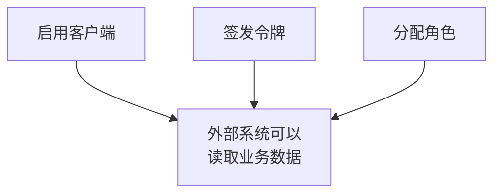
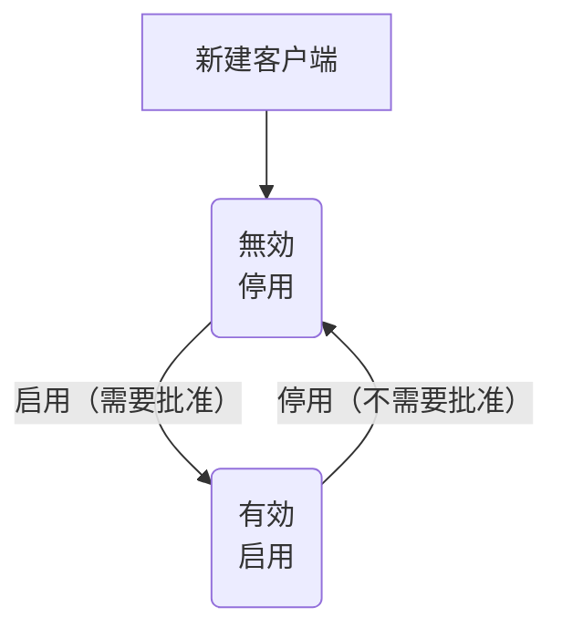

这是一个用来创建和管理 **API 客户端** 的应用 —— 外部系统通过 `/api/v1` **自动读取业务数据** 所需的凭据。操作代码是 `SY0I`。

本应用只能创建「身份」。该客户端 **能读取什么**，由在[用户管理](/manual/zh/operations/system/user-management/user)（`SY01`）中分配角色来决定。创建身份和决定可读范围是两个分开的操作，可以分别确认。

> ⚠️ 该功能目前 **仅在检验环境（dev）中** 可用。要投入正式环境（main），还需要另外的处理。

## 本应用能做什么

- 可以创建 API 客户端（创建时为 **停用** 状态，也没有令牌）。
- 可以为客户端签发 **令牌**（连接时使用的密钥）。原始值只在签发的那一刻显示一次。
- 可以 **启用** 客户端，使其能够实际连接。
- 可以 **撤销** 不再使用的令牌，或直接 **停用** 客户端。
- 可以 **撤销** 不再使用的客户端，使其永远无法再使用。
- 可以通过列表中的「**編集**」（编辑）修改允许的 **IP 范围** 与 **有效期限**。
- 可以查看各客户端的 **最后使用时间**、**有效令牌数量**、**已分配的角色**。

## 术语（本页出现的词）

- **API 客户端** … 外部系统连接到本系统所用的身份。不是给人用的账号，而是给机器（外部系统）用的账号。
- **令牌** … 客户端连接时出示的密钥（一串字符）。这个值本身就是凭据。
- **允许 IP 范围** … 允许该客户端连接的来源 IP 地址范围。留空则不限制。
- **角色** … 决定客户端能读取多大范围业务数据的分配。分配方式与给员工分配角色相同，在用户管理（`SY01`）中进行。

## 开始之前

- 使用本应用需要 **外部 API 客户端管理** 权限（`api_client`）。如果打不开，请咨询系统管理员。
- **启用** 客户端和 **签发令牌** 分别都需要在[特权访问](/manual/zh/operations/system/privileged-access/user)（`SY0G`）中获得批准。仅拥有权限并不能按下这两个按钮。
- 刚创建好的客户端什么也读不到。**启用、签发令牌、分配角色** 这三者都齐备后，外部系统才能通过它读取业务数据。

用图表示如下。

## 如何打开

在主页的「システム」（系统）中点击 **API クライアント**（API 客户端）。或者在画面上方的搜索框中输入 `SY0I`。

## 画面的看法

打开应用后，会列出已登记的客户端。

- **名称** … 客户端的名称，以及其背后系统账号的用户名。下方显示「**許可 IP 範囲**」（允许的 IP 范围）与「**有効期限**」（有效期限）（没有限制时显示「**IP 制限なし**」（无 IP 限制）与「**無期限**」（无期限））。
- **状态** … **已撤销**（红色）/ **启用**（绿色）/ **停用**（灰色）三种。刚创建时显示「停用」。
- **角色** … 已分配的角色。一个也没有时，显示橙色的「**ロール未割当**」（未分配角色），此时该客户端无法读取任何数据。
- **令牌** … 有效令牌的数量，例如显示「**1 / 2**」，表示相对上限（2 个）已用了几个。
- **最后使用** … 该客户端最后一次建立连接的时间。若从未使用过，显示「**未使用**」。

列表右侧，每一行都有「**トークンを発行**」（签发令牌）、「**有効化 / 無効化**」（启用 / 停用）、「**編集**」（编辑）与「**失効**」（撤销）按钮。已撤销的客户端无法按「編集」「失効」。

只要有客户端已签发过令牌，列表下方就会另外显示一份 **令牌列表**。令牌的原始值不会出现在其中，只显示末 4 位，如 `••••••ab3x`。

## 创建客户端

1. 点击画面右上角的「**新規**」（新建）。
2. 输入「**名前**」（名称）— 必填。
3. 在「**説明**」（说明）中写明用途等信息 — 选填。
4. 在「**許可 IP 範囲**」（允许的 IP 范围）中以逗号分隔输入 CIDR（例如 `10.0.0.0/8, 203.0.113.0/24`）。留空则不限制。
5. 点击「**保存**」。

创建时客户端为 **停用** 状态，也没有令牌。启用与签发令牌分别都需要获得批准。

## 修改允许的 IP 范围与有效期限

1. 在列表中按对象客户端的「**編集**」（编辑）。
2. 在「**API クライアントを編集**」（编辑 API 客户端）画面中修改「**説明**」（说明）、「**許可 IP 範囲**」（允许的 IP 范围）、「**有効期限**」（有效期限）。有效期限留空即为无期限。
3. 按「**保存**」。

> ⚠️ 对 **启用中的客户端**，只能 **缩小** 允许的 IP 范围与有效期限（收窄范围、提前期限）。**扩大** 的修改（增加范围、取消限制、延后期限、改为无期限）不会被保存，并显示「**有効なクライアントの許可 IP 範囲・有効期限は広げられません。無効化してから変更し、承認を受けて再有効化してください。**」（启用中的客户端不能扩大允许的 IP 范围与有效期限。请先停用再修改，获得批准后重新启用。）。

需要扩大时，请按以下顺序操作：

1. 在列表中按「**無効化**」（停用）（无需批准）。
2. 通过「**編集**」修改允许的 IP 范围或有效期限并保存。
3. 在[特权访问](/manual/zh/operations/system/privileged-access/user)（`SY0G`）中获得「**API クライアントの有効化**」（启用 API 客户端）的批准后，按「**有効化**」（启用）。

## 撤销客户端

使不再使用的客户端永远无法再使用。

1. 在列表中按对象客户端的「**失効**」（撤销）。
2. 在确认画面中，如有需要可填写「**理由**」（可选）。
3. 按「**失効**」。

> ⚠️ 撤销 **无法撤回**。该客户端的有效令牌也会全部撤销。只是想暂时停止时，请使用「**無効化**」（停用），而不是撤销。

撤销无需批准。已撤销的客户端状态变为「**失効済み**」（已撤销）。

## 启用客户端

客户端只要还处于「停用」状态，即使已经有令牌，外部系统也无法通过它连接。

1. 先在[特权访问](/manual/zh/operations/system/privileged-access/user)（`SY0G`）中申请「**API クライアントの有効化**」（启用 API 客户端）并获得批准。
2. 在列表中点击目标客户端的「**有効化**」（启用）。

在获得批准之前，「有効化」（启用）按钮无法点击（呈灰色）。获批后，在批准的有效期内第一次点击的瞬间，客户端便会在给定的时长内可用（详见[特权访问](/manual/zh/operations/system/privileged-access/user)页面）。

用「**無効化**」（停用）停止一个客户端 **不需要** 批准，任何人都可以立即停用。

状态的变化用图表示如下。

## 签发令牌

令牌是客户端实际连接时出示的密钥。

1. 先在[特权访问](/manual/zh/operations/system/privileged-access/user)（`SY0G`）中申请「**API トークンの発行**」（签发 API 令牌）并获得批准。
2. 在列表中点击目标客户端的「**トークンを発行**」（签发令牌）。

在获得批准之前，「トークンを発行」（签发令牌）按钮无法点击。

> ⚠️ 签发后，原始令牌值只会在画面上显示 **一次**。关闭该画面后就再也看不到了（数据库中也不会保存原始值）。**请务必当场记录下来。**

如果忘记记录，无法再次显示。请按下方「撤销令牌」的步骤撤销该令牌，然后重新签发。

**每个客户端最多同时拥有 2 个有效令牌** —— 这个上限是为了在更换令牌时能够不中断地切换。试图签发第三个时会提示「**有効なトークンは 2 本までです。先にどれかを失効してください。**」（最多只能有两个有效令牌，请先撤销其中一个）。

## 撤销令牌

1. 在画面下方的「**トークン**」（令牌）列表中，找到要撤销的令牌（通过末 4 位辨认）。
2. 点击「**失効**」（撤销）。

撤销不需要批准，任何人都可以立即执行。撤销后的令牌将永远无法再用于连接。

## 分配角色

客户端实际能读取什么，不在本应用中决定，而是在[用户管理](/manual/zh/operations/system/user-management/user)（`SY01`）中决定。

1. 打开用户管理，找到该客户端背后的用户（与客户端列表「名称」栏中显示的名称相同的那个用户）。
2. 用给员工分配角色相同的方式分配角色。

即使已启用并签发了令牌，一个角色也没有分配的客户端仍然无法读取任何业务数据。

## 常见问题

**问：「启用」「签发令牌」按钮点不了。**
答：该操作尚未获得批准。请分别在[特权访问](/manual/zh/operations/system/privileged-access/user)（`SY0G`）中申请「API クライアントの有効化」（启用 API 客户端）或「API トークンの発行」（签发 API 令牌）。

**问：点击的瞬间出现了「この操作には承認が必要です」（此操作需要批准）。**
答：即使打开画面时看起来已获批准，系统在真正执行前还会再检查一次。在这段时间内，批准可能已经过期，或者（如果从未使用过）批准的有效期本身已经结束。请在[特权访问](/manual/zh/operations/system/privileged-access/user)的「自分の申請」（我的申请）中确认状态。

**问：忘记记录令牌值了。**
答：无法再次显示。请撤销该令牌后重新签发。

**问：已有 2 个有效令牌，无法再签发。**
答：上限是每个客户端 2 个有效令牌。请先撤销一个不再使用的旧令牌，再重新签发。

**问：已启用客户端并签发了令牌，外部系统仍然读取不到数据。**
答：请确认是否已分配角色。显示「ロール未割当」（未分配角色）的客户端，即使身份齐全也无法读取任何数据。请在[用户管理](/manual/zh/operations/system/user-management/user)中分配角色。如果设置了允许的 IP 范围，也请确认连接来源的 IP 是否在该范围内。

**问：想之后修改允许的 IP 范围。**
答：可以通过列表中的「**編集**」修改。对启用中的客户端扩大范围时，请先「無効化」（停用）再修改，获得批准后重新「有効化」（启用）（参见上面的「修改允许的 IP 范围与有效期限」）。

## 出站 Webhook

画面下半部分的“**出站 Webhook**”用于管理在业务数据变化时向 n8n 等**发送信号**的接收地址。工作原理与接收方式请参见 [集成（API 与 Webhook）](/manual/zh/integration)。

- **新建**：选择名称、API 客户端、接收地址 URL 和要接收的事件后保存。**签名密钥（`whsec_…`）只显示一次**。
- **测试发送**：发送一条连通性确认信号（`webhook.ping`）。
- **发送记录**：可查看最近发送的结果、尝试次数和下次尝试。因失败而停止的发送可以“**重发**”。
- **重新签发签名密钥**：旧密钥立即失效。
- **停用 / 启用 / 删除**。连续 5 次被放弃发送的接收地址会被自动停用。

添加接收地址、更改 URL、重新签发签名密钥和启用，只能在通过 [特权访问](/manual/zh/operations/system/privileged-access/user)（`SY0G`）获得“**管理出站 Webhook**”批准的期间内进行。停用、删除、测试发送和重发无需批准。

> 💡 接收地址 URL 只能是 https，或内部主机（Docker 服务名、私有 IP、`.loc`）的 http。

<!-- permissions:start -->
## 所需权限

使用本画面需要 **外部 API 客户端管理**（`api_client`）权限。

| 想做的事 | 所需权限 |
| --- | --- |
| 打开画面、查看列表与明细 | 外部 API 客户端管理 — 查看 |
| 新增・变更・删除 | 外部 API 客户端管理 — 创建 / 更新 / 删除 |

仅查看有「查看」即可。画面中若有新增、变更或删除的操作，则分别需要对应的权限。

### 需要批准的操作

下列操作仅有权限还不够。需**在特权访问（SY0G）中提出申请，并只在他人批准的时间段内执行**。

| 操作 | 所需权限 | 可以做什么 |
| --- | --- | --- |
| 签发 API 令牌 | 外部 API 客户端管理（`api_client`）— 新建 | 签发外部系统读取业务数据所用的密钥。签发的值本身即为凭据，可带出所分配角色允许的范围 |
| 启用 API 客户端 | 外部 API 客户端管理（`api_client`）— 更新 | 将新建后尚不能通行的客户端，变为可实际读取业务数据的状态 |
| 管理出站 Webhook | 外部 API 客户端管理（`api_client`）— 更新 | 创建或扩大向外部发送业务数据变化的通道。包括添加接收地址、更改 URL、重新签发签名密钥和启用 |

权限通过角色授予。若不足，请与管理员联系。

权限的整体说明请参见「[权限与角色](../../../permissions)」。
<!-- permissions:end -->
