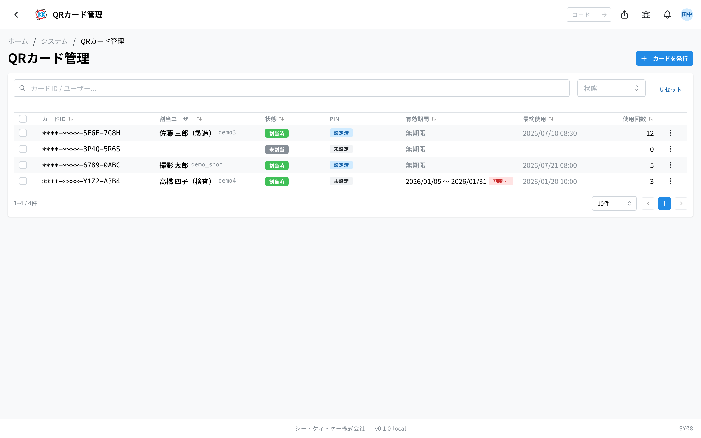
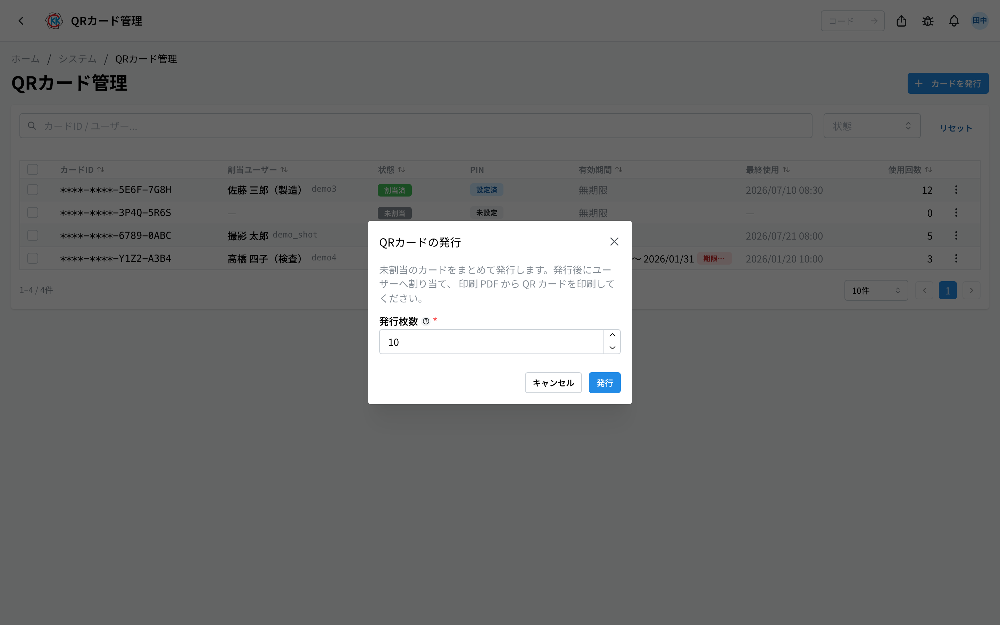
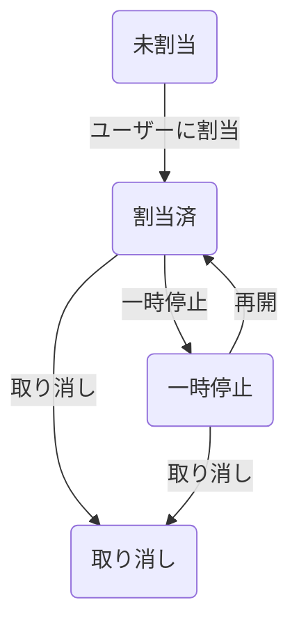
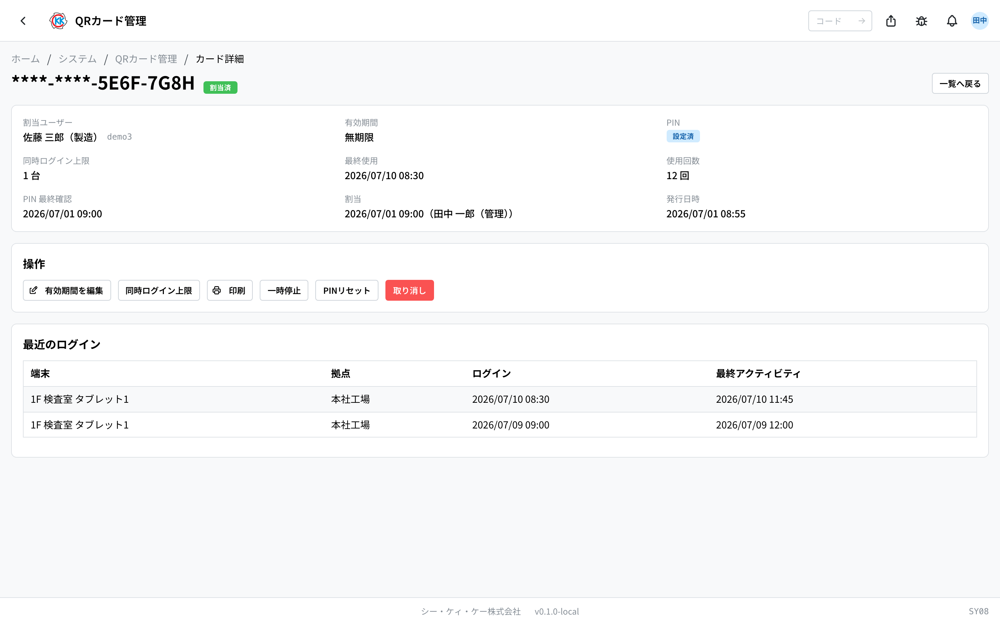

工場に置いてある **共有のタブレット** にログインするための、**QR カード** を発行して社員に渡すためのアプリです。操作コードは `SY08` です。

社員は、このカードをタブレットにかざし、自分で決めた暗証番号を入れてログインします。

## このアプリでできること

- QR カードを、まとめて発行できます（1 回に 1〜100 枚）。
- 発行したカードを、社員ひとりずつに割り当てられます。
- カードを **印刷** できます。A4 の紙 1 枚に、名刺サイズのカードが 10 枚並びます。
- なくしたカードを **使えなくする** ことができます。
- 暗証番号を忘れた人の設定を、**消して入れ直してもらう** ことができます。
- 期間を区切った、一時的なカード（応援の方・実習の方など）も作れます。

## 用語（このページで出てくる言葉）

- **QR カード** … タブレットにかざしてログインするための、QR コードが印刷されたカードです。
- **PIN（ピン）** … 本人だけが知っている暗証番号です。カードを拾われても勝手に使われないようにするためのものです。
- **共有端末** … 工場に置いてある共有のタブレットのことです。
- **テンポラリカード** … 使える期間を区切ったカードのことです。期間の外ではログインできません。

## はじめる前に

- このアプリを開くには **「QRカードの発行・PIN」の権限** が必要です。開けない場合は、システム管理者にご相談ください。
- 権限があっても、**カードの発行・割当・印刷・取り消し、PIN のリセットやロック解除、有効期間と同時ログイン上限の変更** は、そのままでは行えません。先に [特権アクセス](/manual/ja/operations/system/privileged-access/user)（`SY0G`）で申請し、別の人の承認を受けてください（詳しくは下の「承認が要る操作について」）。
- カードを渡す相手は、**このシステムに登録されていて、使える状態の人** に限られます。まだ登録が無い方には割り当てられません。
- タブレット側の準備（[端末管理](/manual/ja/operations/system/kiosk-device/user)での登録）も必要です。

## 開き方

ホーム画面の「システム」の中にある **QRカード管理** を押します。または、画面上の検索欄に `SY08` と入れます。

## 画面の見かた

アプリを開くと、発行済みのカードが一覧で並びます。いちばん上の帯には、承認を受けていまこの画面で使える操作の数と残り時間（承認が無いときは「承認された操作はありません」）が出ます。

- **カードID** … カードを見分けるための番号です。安全のため、**うしろの 8 文字だけ** が表示されます。
- **割当ユーザー** … そのカードを渡した人です。まだ渡していないカードは「—」です。
- **状態** … いまの状況です。**未割当**（まだ誰にも渡していない）/ **割当済**（使える）/ **一時停止**（止めている）/ **取り消し**（使えなくした）の 4 つです。
- **PIN** … 本人が暗証番号を決めていれば「**設定済**」、まだなら「**未設定**」です。間違いが続いて止まっているときは「**ロック中**」と赤く出ます。
- **有効期間** … 期限のないカードは「**無期限**」です。期間を決めたカードは日付が並び、期限が切れると「**期限切れ**」、まだ始まっていないと「**開始前**」の印が付きます。
- **最終使用** … 最後にログインに使われた日時です。
- **使用回数** … これまでにログインした回数です。

上の検索欄「**カードID / ユーザー...**」で探せます。「**状態**」で絞り込み、「**リセット**」で条件を消せます。行をクリックすると、そのカードの詳しい画面が開きます。

## カードを発行する

まず、まだ誰のものでもない「空のカード」をまとめて作ります。

1. 画面右上の「**カードを発行**」を押します。
2. 「**発行枚数**」に、必要な枚数を入れます（1〜100 枚）。
3. 「**発行**」を押します。

「**発行しました**」と出れば完了です。作られたカードは、すべて「**未割当**」の状態で一覧に並びます。

## カードを人に割り当てる

1. 一覧で「未割当」のカードを探します。
2. 行の右端にある「**…**」（点が 3 つのボタン）を押します。
3. 「**ユーザーに割当**」を選びます。
4. 「**割当先ユーザー**」で、渡す相手を選びます。
5. 「**割当**」を押します。

状態が「**割当済**」に変わります。

> ⚠️ **1 人が持てるカードは 1 枚だけ** です。すでにカードを持っている人（**一時停止中のカードを含みます**）には割り当てられません。カードを取り替えるときは、先に古いカードを「取り消し」にしてください。

### 期間を区切ったカードにしたいとき

応援や実習の方など、一定の期間だけ使ってほしいときは、カードの詳しい画面から割り当てます。

1. 一覧で「未割当」のカードの行をクリックし、詳しい画面を開きます。
2. 「**ユーザーに割当**」を押します。
3. 「**割当先ユーザー**」を選びます。
4. 「**有効開始日**」と「**有効終了日**」を入れます。空欄にすると、開始日は今すぐ、終了日は無期限になります。
5. 「**割当**」を押します。

終了日は、**その日いっぱいまで** 使えます。期間の外ではログインできません。

## カードを印刷して渡す

1. 一覧で、印刷したいカードの左のチェック欄に印を付けます。何枚でも選べます。
2. 画面下に出る「**選択したカードを印刷**」を押します。
3. 別のタブに印刷シートが開きます。右上の「**印刷**」を押します。
4. A4 の **名刺用紙（10 面）** に印刷します。ふつうの A4 用紙に刷って、あとから切ってもかまいません。

1 枚の紙に、名刺と同じ大きさ（91×55mm）のカードが **10 枚**（横 2 列 × 縦 5 行）並びます。四隅に付いている小さな十字の印に合わせて切ると、きれいに仕上がります。

カードは **必ず原寸（91×55mm）で刷られます**。印刷の画面で確認するのは **用紙サイズが A4 になっていること** だけで大丈夫です。紙の上のほうに薄く 50mm の目盛りを刷っていますので、心配なときは最初の 1 枚を定規で当ててください（50mm ちょうどなら原寸です）。

> 💡 メールで送りたいときや、あとで刷りたいときは、同じ画面の「**PDFで保存**」から PDF を保存できます。ただし **PDF から刷ると、PDF ビューアの設定によっては少し小さくなる** ことがあります。名刺用紙に刷るときは、この印刷シートから直接「印刷」を押してください。

1 枚だけ印刷したいときは、その行の「**…**」から「**印刷**」を選びます。

> ⚠️ 印刷シートを開くのにも **承認** が要ります（「カード台紙の PDF 出力」の操作）。承認が無いと、印刷シートは開きません。

> 💡 一覧に出ているカード ID は、**うしろの 8 文字だけ** の表示です（前半は「*」で隠れます）。印刷した QR コードには全部の情報が入っていますので、印刷したカードは大切に扱ってください。

## 社員に渡したあと

印刷したカードを本人に渡します。あとは本人がタブレットで手続きをします。

1. タブレットに QR コードをかざします。
2. はじめて使うときは、その場で **自分の暗証番号（PIN）を決めます**。暗証番号は **6 桁の数字** です。「111111」のような同じ数字の続き、「123456」のような順番の並び、「121212」のような繰り返しは使えません。
3. 次からは、カードをかざして暗証番号を入れればログインできます。

> 💡 **同じタブレットを 48 時間以内に使っていれば**、カードをかざすだけでログインでき、暗証番号は聞かれません。ただし、はじめて使うタブレットでは必ず聞かれます。また、続けて使っていても **2 週間に 1 回** は必ず暗証番号を聞かれます。

暗証番号は本人しか知りません。**管理者が暗証番号を見たり、代わりに決めたりすることはできません。**

## 困っている人を助ける

カードの行の「**…**」から、次の操作ができます。

- 「**PINロック解除**」… 暗証番号を続けて間違えて止まってしまった人に使います。押すとすぐ使えるようになります。暗証番号はそのままです。
- 「**PINリセット**」… 暗証番号を忘れてしまった人に使います。いまの暗証番号が消え、次のログインのときに本人が決め直します。
- 「**一時停止**」… そのカードでのログインを一時的に止めます。押した時点で、そのカードでログイン中のタブレットもその場でログアウトされます。「**再開**」で元に戻せます。
- 「**再開**」… 一時停止していたカードを、また使えるようにします。
- 「**取り消し**」… カードを完全に使えなくします。

「PINロック解除」は暗証番号が止まっているカードにだけ、「PINリセット」は暗証番号が決まっているカードにだけ出ます。

> ⚠️ 「**取り消し**」は **元に戻せません**。押した時点で、そのカードでログイン中のタブレットもその場でログアウトされます。カードをなくした・退職された、といったときに使ってください。

カードの状態の移り変わりを図にすると次のとおりです。

## カードの詳しい画面

一覧の行をクリックすると、そのカード 1 枚の画面が開きます。

上のほうに、割当ユーザー・有効期間・PIN・同時ログイン上限・最終使用・使用回数・PIN 最終確認（最後に暗証番号を入れた日時）・割当（割り当てた日時と人）・発行日時が並びます。取り消したカードは、取り消した日時と人も出ます。

有効期間が切れているカードや、まだ始まっていないカードには、上に注意の帯が出ます。

「**操作**」の欄には、次のボタンがあります（取り消したカードには「操作」の欄は出ません）。

- 「**有効期間を編集**」… 使える期間を延ばしたり、縮めたり、無期限に戻したりできます。
- 「**同時ログイン上限**」… 1 枚のカードで、同時に何台のタブレットにログインできるかを決めます（1〜10 台）。上限を超えると、いちばん古い端末から自動でログアウトされます。上限を下げても、いまログインしている端末はすぐにはログアウトされません（次のログインのときに整理されます）。
- そのほか「印刷」「一時停止」「再開」「PINロック解除」「PINリセット」「取り消し」も、ここから操作できます。

いちばん下の「**最近のログイン**」で、そのカードがどのタブレットで、いつ使われたかを確認できます。

## 入力項目

| 項目 | 必須 | 何を入れるか |
|------|------|-------------|
| [発行枚数](#field-count) | 必須 | まとめて作るカードの枚数 |
| [割当先ユーザー](#field-user) | 必須 | そのカードを使う人 |

### 発行枚数 [#field-count]

一度に作るカードの枚数です。作った直後のカードは**まだ誰のものでもありません**。印刷しておき、配るときに人を割り当てます。

### 割当先ユーザー [#field-user]

そのカードを使う人です。割り当てると、その人はカードを現場タブレットにかざしてログインできるようになります。

暗証番号（PIN）はこの画面では入力しません。本人が最初のログインのときに決めます。忘れた場合は、カードの詳細から**リセット**してください。

紛失したカードは「**取り消し**」にします。取り消したカードはかざしても通らなくなるので、新しいカードを発行して割り当て直してください。

## よくある質問・困ったとき

**Q. 社員がカードをなくしました。**
A. そのカードを「**取り消し**」にしてください。そのうえで、新しいカードを発行して割り当て、印刷して渡します。

**Q. 暗証番号を忘れたと言われました。**
A. そのカードの「**PINリセット**」を押してください。次にタブレットでログインするときに、本人が新しい暗証番号を決めます。

**Q. PIN の欄に赤く「ロック中」と出ています。**
A. 暗証番号を **5 回続けて間違える** と、そのカードは **15 分間** 使えなくなります。15 分たてば自動でまた使えるようになりますが、急ぐときは「**PINロック解除**」を押してください。

**Q.「このユーザーには既に割当済のカードがあります。先に既存カードを取り消してください」と出ます。**
A. その方はすでに別のカードを持っています。1 人 1 枚までなので、古いカードを「**取り消し**」にしてから、新しいカードを割り当ててください。

**Q. カードに「期限切れ」と出ていて、社員がログインできません。**
A. そのカードの有効期間が終わっています。詳しい画面の「**有効期間を編集**」で終了日を延ばすか、新しいカードに切り替えてください。

**Q.「この操作には承認が必要です（…）。特権アクセス（SY0G）から申請してください」と出ます。**
A. その操作は承認を受けた期間だけ行えます。画面上の帯の「**特権アクセスを申請する**」から申請し、承認を待ってください。「一時停止」と「再開」だけは承認なしで行えます。

**Q. 割当先のユーザーが選択肢に出てきません。**
A. その方がシステムに登録されていないか、いまは使えない状態になっています。[ユーザー管理](/manual/ja/operations/system/user-management/user)で状態を確認してください。

**Q. カードを別の人に付け替えたいです。**
A. 割り当て先の変更はできません。いまのカードを「**取り消し**」にして、新しいカードをその方に割り当ててください。

## 承認が要る操作について

このアプリの操作の多くは、**権限を持っているだけでは行えません**。[特権アクセス](/manual/ja/operations/system/privileged-access/user)（`SY0G`）で申請し、別の人が承認した期間だけ行えます。

- 承認が要る … カードの発行 / 割当 / 印刷 / 取り消し、PIN のリセット / ロック解除、有効期間の変更、同時ログイン上限の変更
- 承認が要らない … 一時停止 / 再開（「共有端末管理」の更新の権限で行えます）

承認で使える時間は、**承認されたときではなく、最初に操作したときから** 数えはじめます。

<!-- permissions:start -->
## 必要な権限

この画面を使うには **QRカードの発行・PIN**（`kiosk_card`）の権限が要ります。

| したいこと | 必要な権限 |
| --- | --- |
| 画面を開く・一覧や詳細を見る | QRカードの発行・PIN の 閲覧 |
| 追加・変更・削除する | QRカードの発行・PIN の 作成 / 更新 / 削除 |

見るだけなら「閲覧」で足ります。追加・変更・削除の操作がある画面では、その操作にあたる権限がそれぞれ必要です。

### 承認が要る操作

次の操作は権限を持っているだけでは行えません。**特権アクセス（SY0G）で申請し、別の人の承認を受けた期間だけ**行えます。

| 操作 | 必要な権限 | 何ができるようになるか |
| --- | --- | --- |
| カードの発行 | QRカードの発行・PIN（`kiosk_card`）— 作成 | 新しい QR カードを発行する。QR の中身は認証情報そのもので、刷った紙がそのまま鍵になる |
| カードの割当・付け替え | QRカードの発行・PIN（`kiosk_card`）— 更新 | カードを従業員に紐付ける。付け替えると、そのカードで入った操作は新しい人の名前で記録される |
| カードの失効 | QRカードの発行・PIN（`kiosk_card`）— 更新 | カードを使えなくする。紛失時の正しい操作だが、取り消せない |
| PIN のリセット | QRカードの発行・PIN（`kiosk_card`）— 更新 | PIN を未設定に戻し、次のログインで本人に決め直させる。忘れた本人以外が実行すると乗っ取りになりうる |
| PIN ロックの解除 | QRカードの発行・PIN（`kiosk_card`）— 更新 | 5 回失敗して掛かった 15 分のロックを即座に外す |
| 有効期間の変更 | QRカードの発行・PIN（`kiosk_card`）— 更新 | カードが使える期間を変える。伸ばせば期限切れのカードが復活する |
| 同時セッション上限の変更 | QRカードの発行・PIN（`kiosk_card`）— 更新 | 1 枚のカードで同時に開けるセッション数を変える。増やすと貸し借りが見えなくなる |
| カード台紙の PDF 出力 | QRカードの発行・PIN（`kiosk_card`）— 閲覧 | QR を印刷用 PDF に出す。ダウンロードした時点で認証情報がファイルとして手元に残る |

権限は役割（ロール）を通して付きます。足りないときは管理者に相談してください。

権限の全体像は「[権限とロール](../../../permissions)」を参照してください。
<!-- permissions:end -->
