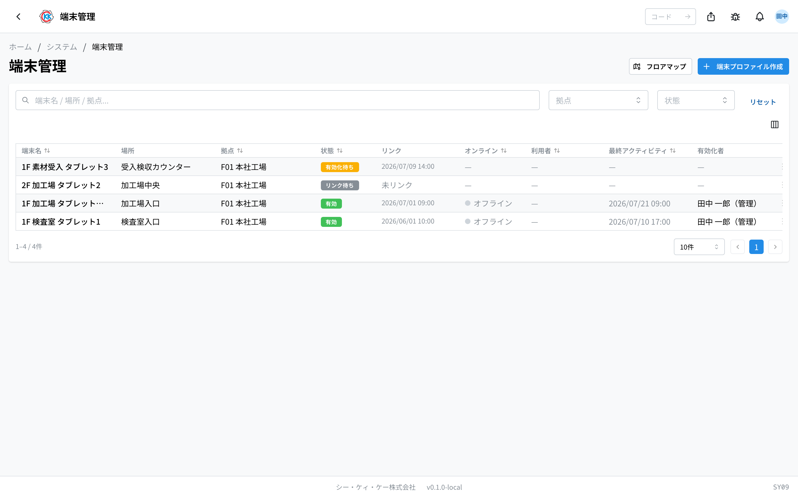
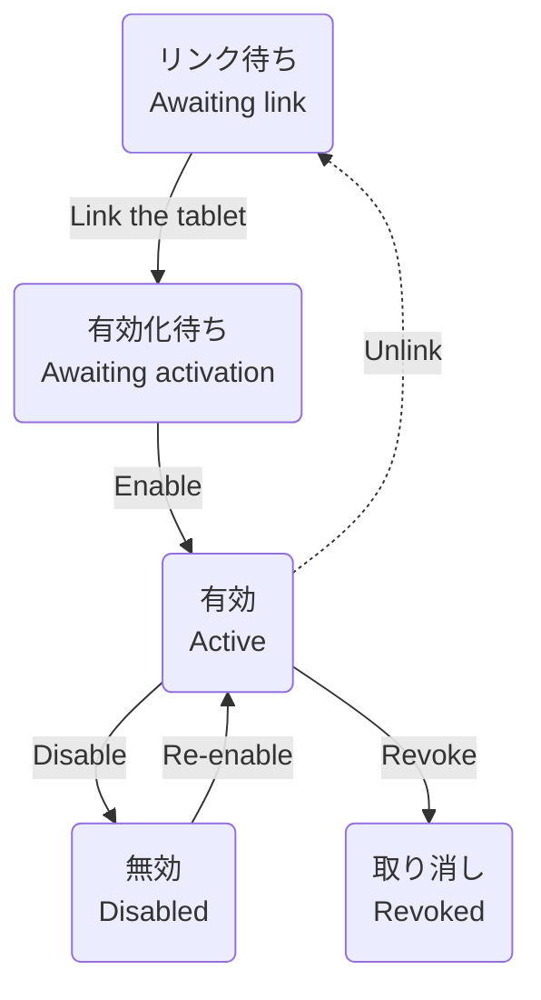
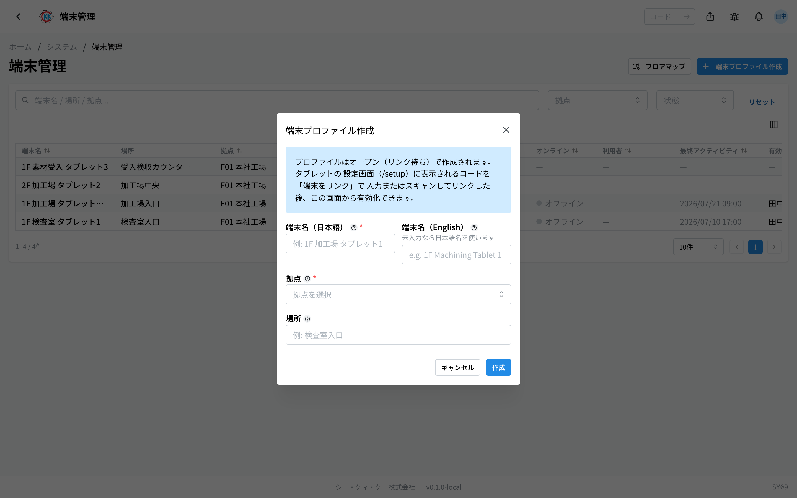
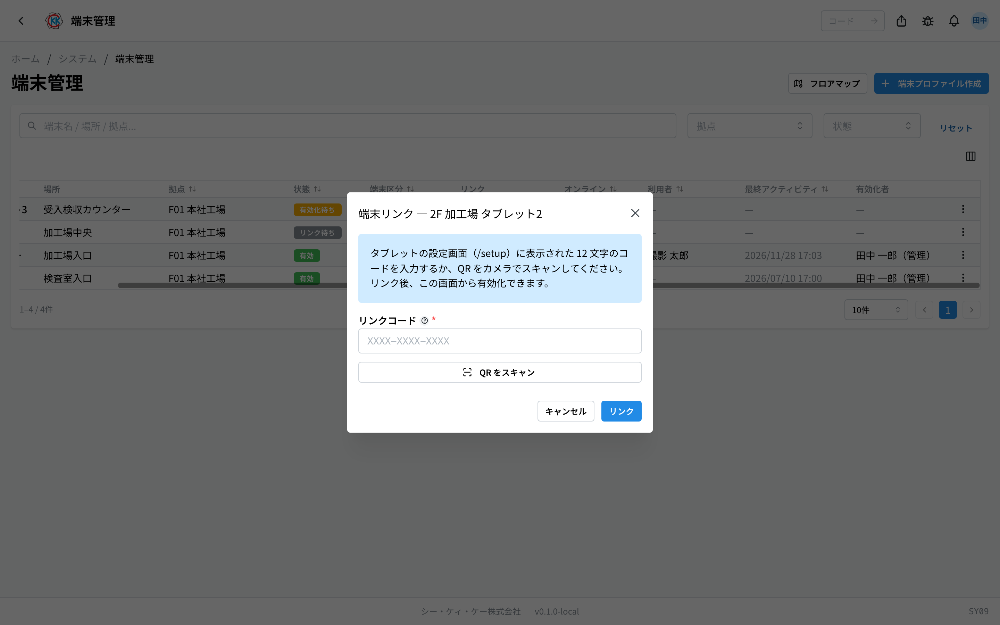
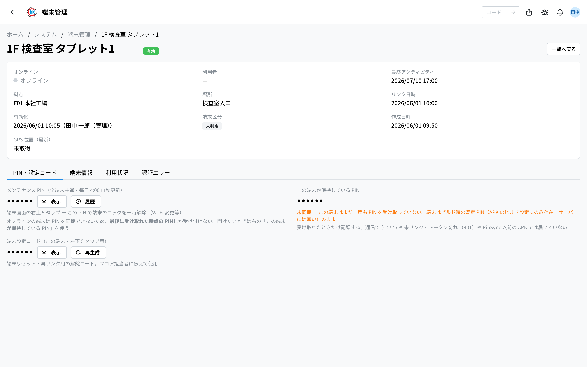
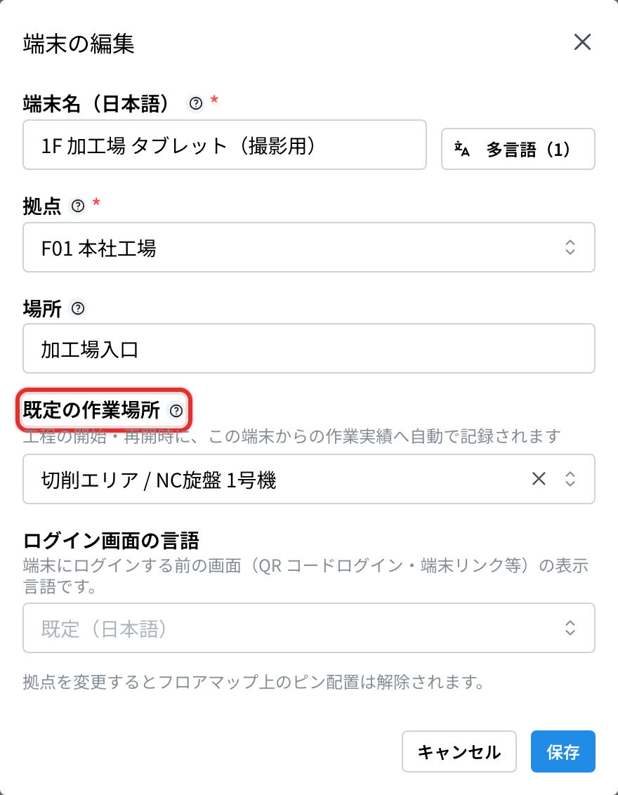
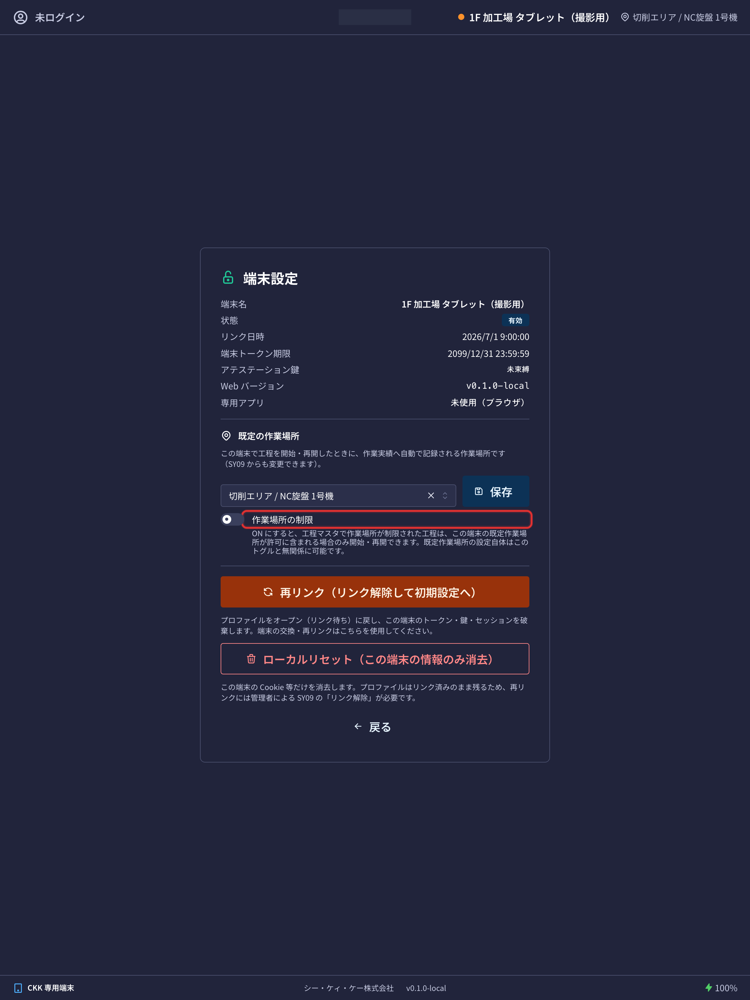

This is an app for registering the **shared tablets** placed in the plant so that they can be used. The operation code is `SY09`.

You can also check on this screen which tablets are running right now and who is using them.

## What you can do with this app

- Register a new tablet and make it ready to use.
- Change a tablet's name, site, and location.
- Check which tablets are online right now, and who is using them.
- Handle broken or replaced tablets.
- Place tablets on a **フロアマップ** (floor map — the layout drawing of the site).
- See a history of who used which tablet, and when.
- Decide what the floor TVs (**displays**) show (currently a test-environment-only feature).

## Terms used on this page

- **Shared device** … the shared tablet placed in the plant. On this screen it is called 「端末」 (device).
- **Device profile** … a **registration slot for one placement**, such as "the tablet in the 1F inspection room". You create this slot first, and connect a real tablet to it afterwards.
- **Linking** … the work of connecting a registration slot with a real tablet.
- **Link code** … a 12-character password shown on the tablet's screen. You use it to link the tablet.
- **Site** … a plant or business location.

## Before you start

- To open this app you need the **Shared device admin** (共有端末管理) permission. If you cannot open it, please ask your system administrator.
- Even with the permission, **creating a slot, linking, activating, re-enabling, unlinking, revoking, key reset, and showing or regenerating PINs and setting codes** cannot be done straight away. First request them in [Privileged Access](/manual/en/operations/system/privileged-access/user) (`SY0G`) and have someone else approve. At the very top of the screen, two bands — 「共有端末の秘密」 (Shared device secrets) and 「端末アクセスの付与」 (Device access) — show which operations you can use on this screen right now under an approval.
- This app is not yet published in the production environment (it is currently available in the test environment). If it does not appear on the home screen, please ask your system administrator.
- Preparing the tablet itself (installing the dedicated app, connecting it to the network) cannot be done from this screen. Please see your company's internal procedure document.
- For employees to log in, a card must first be issued in [QR Card Management](/manual/en/operations/system/kiosk-card/user).

## How to open it

On the home screen, press **端末管理** (Device Management) under 「システム」 (System). Or type `SY09` into the search box at the top of the screen.

## Reading the screen

When you open the app, the registered tablets are listed. In the test environment, two tabs appear at the top: 「**共有端末**」 (Shared device) and 「**ディスプレイ**」 (Display) — for displays see "[Displays (test environment only)](#display)" below. In the production environment there are no tabs; only the tablet list is shown.

- **端末名** (Device name) … the name you gave the tablet.
- **場所** (Location) … a note about where it is placed.
- **拠点** (Site) … which site the tablet belongs to.
- **状態** (Status) … the current situation. There are five of them.
  - **リンク待ち** (Awaiting link) … you have only created the registration slot; it is not yet connected to a real tablet.
  - **有効化待ち** (Awaiting activation) … it is connected to a tablet. All that is left is to switch it on.
  - **有効** (Active) … ready to use.
  - **無効** (Disabled) … temporarily stopped. This can be undone.
  - **取り消し** (Revoked) … made completely unusable. This cannot be undone.
- **端末区分** (Device type) … whether it is a company device, as judged automatically by the system. One of 「**会社（管理端末）**」 (Company (managed device)), 「**会社（社内NW）**」 (Company (in-house network)), 「**未管理**」 (Unmanaged), or 「**未判定**」 (Undetermined) is shown. Hover over the badge to see the basis of the judgment. 「会社（社内NW）」 only means it connects from the company network — it is not proof that the device belongs to the company.
- **リンク** (Linked) … the date and time it was connected to a tablet. Before that, it shows 「**未リンク**」 (Not linked).
- **オンライン** (Online) … if it is connected right now, a green dot with 「**オンライン**」 (Online); if it is not, a gray dot with 「**オフライン**」 (Offline).
- **利用者** (User) … the person currently logged in on that tablet.
- **最終アクティビティ** (Last activity) … the date and time it was last used.
- **有効化者** (Activated by) … the person who made that tablet ready to use.

You can search with the box at the top, 「**端末名 / 場所 / 拠点...**」 (Device name / Location / Site...). Narrow the list down with 「**拠点**」 and 「**状態**」, and clear your conditions with 「**リセット**」 (Reset). Click a row to open the detail screen for that tablet.

## Registering a tablet

Registration has 3 stages. **First create the slot, then connect the tablet, and finally make it ready to use.**

### Step 1 — Create the registration slot

1. Press 「**端末プロファイル作成**」 (Create device profile) at the top right of the screen.
2. Enter an easy-to-understand name in 「**端末名**」 (Device name) — for example, 1F Machining Tablet 1. Names in languages other than Japanese go in through the 「**多言語**」 (Translations) button next to it (optional).
3. Choose the 「**拠点**」 (Site).
4. Enter a note about where it is placed in 「**場所**」 (Location). This is optional — for example, Inspection room entrance.
5. Press 「**作成**」 (Create).

A row with the status 「**リンク待ち**」 (Awaiting link) is created.

> 💡 Steps 1–3 (create, link, activate) are all **operations that need approval**. Request them in Privileged Access in advance so you do not have to wait on site.

### Step 2 — Connect the tablet

1. The tablet's own settings screen shows a **12-character code** and a QR code.
2. In the list, press the 「**…**」 button (the three dots) on that slot's row.
3. Choose 「**端末をリンク**」 (Link device).
4. Enter the 12 characters shown on the tablet into 「**リンクコード**」 (Link code).
5. Or press 「**タブレットのQRをスキャン**」 (Scan the tablet's QR) and read the tablet's QR code with the camera.
6. Press 「**リンク**」 (Link).

The status changes to 「**有効化待ち**」 (Awaiting activation).

> ⚠️ The code is valid for **only 10 minutes**. If the time has passed, have the tablet display it again.

### Step 3 — Make it ready to use

1. From 「**…**」 on that row, choose 「**有効化**」 (Activate).
2. A confirmation screen appears — read it, then press 「**有効化**」.

The status changes to 「**有効**」 (Active), and **the tablet's screen automatically switches to the login screen**. Employees can now use it.

## Changing the name or location

1. From 「**…**」 on that row, choose 「**編集**」 (Edit).
2. Correct 「**端末名**」 (Device name), 「**拠点**」 (Site), 「**場所**」 (Location), 「**既定の作業場所**」 (Default work location), and 「**ログイン画面の言語**」 (Login screen language).
3. Press 「**保存**」 (Save).

「**ログイン画面の言語**」 (Login screen language) is the language of the screens before login (QR code login, device linking). When left blank, it is Japanese. After login, the person's own display-settings language is used.

> ⚠️ **If you change the site, the pin placed on the floor map is removed.** This is because the layout drawings are separated by site. After changing the site, please place the pin again on the new site's floor map.

## Replacing or stopping a tablet

From 「**…**」 on the row, you can do the following, depending on your situation.

- 「**利用履歴**」 (Usage history) … opens the record of who logged in to that tablet, and when.
- 「**無効化**」 (Disable) … temporarily makes it unusable. You can undo this with 「**再有効化**」 (Re-enable). Use it while the tablet is out for repair, for example. Disabling works immediately without approval (so a suspicious tablet can be stopped right away).
- 「**再有効化**」 (Re-enable) … makes a stopped tablet usable again. This one needs approval.
- 「**リンク解除**」 (Unlink) … removes the connection between the tablet and the registration slot, and returns it to "Awaiting link". The name, site, location, and floor-map pin all stay as they are. **Use this when you replace a tablet with a new machine.** You can connect the new tablet to the same slot again.
- 「**鍵リセット**」 (Key reset) … use this when you have factory-reset or replaced a tablet. After you press it, the tablet's app is registered afresh the next time it connects. It appears only when the tablet's key has been registered.
- 「**削除**」 (Delete) … you can only delete registration slots that have not been connected yet (Awaiting link).
- 「**取り消し**」 (Revoke) … makes the tablet completely unusable.

> ⚠️ 「**取り消し**」 **cannot be undone**. Any open logins are cut off on the spot. To use it again, you have to start over from a new registration slot.

## The tablet's detail screen

Click a row in the list to open the screen for that one tablet.

Near the top you will see online, user, last activity, site, location, link date and time, activation (date and time, and who activated it), device type, created at, and GPS position (latest).

- 「**GPS 位置（最新）**」 (GPS position (latest)) … the newest position received from the tablet. Press it to open a map. When nothing has been received, it shows 「**未取得**」 (Not received).

Below that are four tabs: 「**PIN・設定コード**」 (PIN and settings code), 「**端末情報**」 (Device information), 「**利用状況**」 (Usage), and 「**認証エラー**」 (Authentication errors).

### PIN and setting codes

There are 2 numbers for operating the tablet on the floor. Both are normally hidden as "••••••"; to see one, press 「**表示**」 (Show), then press 「**表示**」 again on the confirmation screen. They hide again after 60 seconds. Seeing them needs approval.

- 「**メンテナンス PIN（全端末共通・毎日 4:00 自動更新）**」 (Maintenance PIN (same for all devices, updated automatically at 4:00 every day)) … a number that temporarily removes the tablet's screen lock so it can be used freely. Use it when changing Wi-Fi settings, for example. Tap the **top right** of the device screen 5 times in a row and an input box appears.
- 「**端末設定コード（この端末・左下 5 タップ用）**」 (Device setting code (this device only, for 5 taps at the bottom left)) … a number for that one tablet only. Tap the **bottom left** of the device screen 5 times in a row and the device settings screen opens; unlock it with this number. Use it when resetting a device or connecting it again. Press 「**再生成**」 (Regenerate) to get a new number — **the previous number then stops working**.

> ⚠️ Pressing 「**表示**」 is recorded. Tell the numbers only to the staff on the floor, and do not post them on a wall or similar.

#### The maintenance PIN for a tablet that has lost its connection

The maintenance PIN changes at 4:00 every day, but **a tablet keeps the number it had the last time it could talk to the server**. A tablet with no Wi-Fi cannot receive the new number, so the number shown on this screen right now will not open it.

In that case press 「**表示**」 (Show) under 「**この端末が保持している PIN**」 (The PIN this device is holding). It shows the number **last handed to that tablet**. This is the delivery record, not a guess, so it is the number to enter.

Below it is 「**最終同期**」 (Last sync). A tablet showing 「**未同期**」 (Never synced) has not once received a number. The server then has no number for it — it is still on the one built into the app, so check the app's build settings. Reasons a tablet shows 未同期 include:

- The tablet is not linked, or its device period (30 days) has expired
- The installed app is old and has no PIN fetch (before v0.5.3)

Pressing 「**履歴**」 (History) still lists the past numbers with the period each was valid for. Use it for older tablets that have no per-device record.

- 400 days are kept. A tablet that has been off longer than that cannot be opened with a PIN — connect it to a PC over USB to release it, or set it up again from scratch.
- Pressing 「**表示**」 and 「**履歴**」 is also recorded.

### Device information

The tablet's identity is listed here.

- 「**端末区分**」 (Device type) and 「**判定根拠**」 (Basis for the decision) … the automatic judgment of whether it is a company device, and its basis.
- 「**鍵フィンガープリント**」 (Key fingerprint) … the mark of the per-device key used to confirm that the tablet is the genuine one. When it has not been decided yet, it shows 「**未束縛**」 (Not bound).
- 「**最終 IP（最後に観測）**」 (Last IP (most recently seen)) and 「**リンク時 IP**」 (IP when linked) … the address (IP address) the tablet connected from.
- 「**プロファイル取得**」 (Fetch the profile) … information sent by the dedicated app (v0.6.0 or later), such as manufacturer, model, app version, and USB debugging state. If a setting needs attention, 「**この端末で気をつける点**」 (Things to watch for on this device) appears. On tablets with an older app it stays blank.

### Usage

- 「**最近の利用者**」 (Recent users) … the people who use that tablet often, and how many times.
- 「**利用履歴**」 (Usage history) … a list of who logged in and when, and when they logged out. When it has not been used yet, it shows 「**利用履歴はまだありません**」 (No usage history yet).

### Authentication errors

A list of **logins that were rejected** on that tablet (wrong PIN, unusable card, and so on). Successful logins appear under 「利用状況」 (Usage), failed ones here. When there are none, 「**この端末で弾かれた認証はありません**」 (No authentication was rejected on this device) is shown.

## Floor map (placing tablets on the layout drawing)

If you place the tablets' positions on the site's layout drawing, you can see at a glance which machines are running and where.

1. Press 「**フロアマップ**」 (Floor map) at the top right of the list screen.
2. Choose the site you want to see in 「**拠点**」 (Site) at the top.
3. Tabs for each floor are shown — choose the floor you want to see.

Green pins are online and gray pins are offline. If someone is logged in, that person's name is also shown. Double-click a pin to open the detail screen for that tablet. Storage-location pins are also shown alongside, for reference.

### Editing the layout drawing

Turn on the 「**編集モード**」 (Edit mode) switch at the top of the screen, and you can do the following.

- You can **drag pins to move them**. When you let go, that position is saved automatically.
- Click a tablet in 「**未配置の端末**」 (Unplaced devices) on the right and it is placed in the middle of the drawing. After that, drag it into place.
- To remove a tablet you have placed, press the mark on its row under 「**配置済み**」 (Placed) on the right — 「**ピンを解除**」 (Remove pin).
- Add floors with 「**フロアを追加**」 (Add floor). Change a floor's name with 「**名称変更**」 (Rename).
- Put in an image of the layout drawing with 「**図面をアップロード**」 (Upload drawing) or 「**図面を差し替え**」 (Replace drawing) — PNG / JPG / WEBP, up to 10 MB.
- Delete a floor with 「**フロアを削除**」 (Delete floor). However, you cannot delete a floor that has tablets or storage locations placed on it. Remove those pins first.

At a site that does not have a layout drawing yet, 「**この拠点にはフロアマップがありません。**」 (This site has no floor map.) is shown. Turn on edit mode and create one from 「**フロアを追加**」.

## Displays (test environment only) [#display]

**This feature is currently available only in the test environment.** In the production environment the tab itself does not appear.

This registers the TVs hung on the floor walls (**displays**) to show production status, shipping schedules, and so on. The procedure is the same 3 stages as for tablets (create → link → activate).

1. Open the 「**ディスプレイ**」 (Display) tab and press 「**ディスプレイを追加**」 (Add a display).
2. Decide 「**名前**」 (Name), 「**設置場所**」 (Location), 「**拠点**」 (Site), and 「**映す画面**」 (Screen to show), then press 「**作成**」 (Create). The status is 「**リンク待ち**」 (Awaiting link).
3. From 「**…**」 on the row, choose 「**ディスプレイをリンク**」 (Link the display). Read the QR shown on the TV with 「**ディスプレイのQRをスキャン**」 (Scan the display's QR code), or enter the 12-character 「**リンクコード**」 (Link code), then press 「**リンク**」 (Link).
4. From 「**…**」 on the row, choose 「**有効化**」 (Activate). The TV starts showing.

Click a row to open the display's detail screen. It has three tabs: 「**表示内容**」 (What to show), 「**設定**」 (Settings), and 「**履歴**」 (History). 「表示内容」 and 「設定」 are changed after pressing 「**編集**」 (Edit).

- 「**表示内容**」 (What to show) … what is shown. Choose 「**アプリの画面**」 (An app screen — production status, pending / awaiting arrangement, shipping schedule, quality / defects, announcement) or 「**画像**」 (Image). When you save, the TV display switches on the spot.
- 「**設定**」 (Settings) … name, location, site, 「**表示倍率**」 (Zoom, 50–200%), and 「**この画面の表示言語**」 (Display language for this screen).

With the buttons at the top right of the screen you can, depending on the status, 「**一時停止**」 (Pause), 「**再開**」 (Resume), 「**リンク解除**」 (Unlink), 「**失効**」 (Revoke), or 「**削除**」 (Delete). A paused TV shows 「この画面は一時停止されています。」 (This screen has been paused). Link, activate, unlink, revoke, and delete need approval.

For preparing the TV side (Raspberry Pi), see your company's internal procedure document.

## Input fields

| Field | Required | What to enter |
|-------|----------|---------------|
| [Device name (Japanese / English)](#field-name) | Required | The name shown in lists and logs |
| [Site](#field-plant) | Required | Where the device lives |
| [Location](#field-location) | Optional | Where within that site |
| [Default work location](#field-default-work-location) | Optional | Work location auto-recorded on actuals from this device |
| [Link code](#field-link-code) | Required | The code shown on the tablet |

### Device name (Japanese / English) [#field-name]

The name shown in the list, on the floor map, and on activity-log badges. Use a name that **lets someone find the physical device**, such as "Plant 1 entrance". Only the Japanese name is needed. Names in English and other languages can be entered through the 「**多言語**」 (Translations) button (optional).

### Site [#field-plant]

The site where the device is placed. Devices are listed per site.

### Location [#field-location]

Where it sits inside the site. Placing a pin on the floor map also shows its position on screen.

### Default work location [#field-default-work-location]

The work location (machine / area) automatically recorded on work actuals when a step is **started or resumed** on this tablet. Set it to where the tablet is physically placed. Only work locations belonging to the device's site (or groups with no site) can be selected.

- Changing the site clears the default work location
- It can also be changed from the tablet's **device settings screen** (tap the bottom left 5 times → settings code). The "restrict work location" toggle on the same screen, when ON, only lets the device start/resume steps whose allowed work locations include the device's default
- If work actually happened elsewhere, scanning a work-location QR code on the step execution screen overrides the location on that actual record

The device settings screen on the tablet looks like this (it opens after entering the settings code):

### Link code [#field-link-code]

The code shown on the tablet's own screen. **Create the device entry here first**, then scan (or type) the code from the tablet to tie that entry to the physical device.

- An entry that is not tied to a device **cannot be activated**
- To swap a device, **unlink** it. The name, site and pin stay, so a new device can be tied to the same entry

## FAQ and troubleshooting

**Q. I get 「コードが無効か期限切れです。タブレット側で再表示してください」 (The code is invalid or expired. Please display it again on the tablet).**
A. The link code is 12 characters and is valid for only 10 minutes. Have the tablet show the code again, and try once more.

**Q. I get 「オープンな（未リンクの）プロファイルにのみリンクできます」 (You can only link to an open (unlinked) profile).**
A. Another tablet is already connected to that registration slot. If you want to swap in a new tablet, press 「**リンク解除**」 (Unlink) first, then link again.

**Q. I activated it, but it stays offline forever.**
A. Please check that the tablet's power is on and that it is connected to the network. The display can take a little while to catch up.

**Q. A tablet broke, so I am replacing it with a new machine.**
A. Press 「**リンク解除**」 (Unlink) on that device. The name, site, location, and floor-map pin all stay as they are, so you can link the new tablet to the same slot.

**Q. The camera cannot read the QR code.**
A. If 「**カメラを起動できません。カメラ権限と HTTPS 接続を確認してください。**」 (The camera cannot be started. Please check the camera permission and the HTTPS connection.) is shown, allow the browser to use the camera. If that does not work, you can also register by typing the 12-character code by hand.

**Q. I get 「この操作には承認が必要です（…）。特権アクセス（SY0G）から申請してください」 ("This operation needs approval (…). Please request it from Privileged Access (SY0G)").**
A. That operation can only be done during an approved period. Request it with 「**特権アクセスを申請する**」 (Request privileged access) in the band at the top of the screen, and wait for approval. Editing the name and other details, disabling, and placing pins on the floor map can be done without approval.

**Q. I changed the site, and the tablet disappeared from the floor map.**
A. That is normal behavior. The layout drawings are separated by site, so changing the site removes the pin. Please place it again on the new site's floor map.

**Q. I get 「リンク済み・有効化済みの端末は削除できません（取り消しを使用してください）」 (Linked or activated devices cannot be deleted — please use Revoke).**
A. 「削除」 (Delete) can only remove registration slots that are not yet connected to a tablet. For tablets you no longer use, please use 「**取り消し**」 (Revoke).

<!-- permissions:start -->
## Permissions required

Using this screen requires the **Shared device admin** (`kiosk`) permission.

| What you want to do | Permission needed |
| --- | --- |
| Open the screen, view lists and details | Shared device admin — View |
| Add, change or delete | Shared device admin — Create / Edit / Delete |

Viewing only needs *View*. Where a screen offers adding, changing or deleting, each of those needs its matching permission.

### Operations that need approval

Holding the permission is not enough for the operations below. You **request them in Privileged Access (SY0G) and may act only for the window someone else approves**.

| Operation | Permission | What it unlocks |
| --- | --- | --- |
| Reveal maintenance PIN | Shared device secrets（`kiosk_secret`）— View | Shows the shared maintenance-exit PIN in clear text. It exits kiosk mode on every device. |
| Reveal PIN history | Shared device secrets（`kiosk_secret`）— View | Lists up to 400 days of past exit PINs — needed for offline devices, but broader than the current value. |
| Reveal the PIN a device holds | Shared device secrets（`kiosk_secret`）— View | Shows the exit PIN last delivered to that device — used to open an offline tablet. |
| Reveal device settings code | Shared device secrets（`kiosk_secret`）— View | Shows the code that unlocks that device's hidden settings screen. |
| Regenerate device settings code | Shared device secrets（`kiosk_secret`）— Update | Issues a new settings code; anyone holding the old one loses access. |
| Reset device attestation key | Shared device secrets（`kiosk_secret`）— Update | Clears the attestation binding so the next device to connect is trusted (TOFU). Only for hardware replacement. |
| Create device profile | Shared device enrolment（`kiosk_device`）— Create | Creates the slot a new tablet can be linked into. |
| Link a device | Shared device enrolment（`kiosk_device`）— Update | Binds real hardware to a profile and issues its device token. |
| Activate a device | Shared device enrolment（`kiosk_device`）— Update | Brings a linked device into service so employees can log in on it. |
| Disable / enable a device | Shared device enrolment（`kiosk_device`）— Update | Suspends a device or brings a suspended one back. |
| Unlink | Shared device enrolment（`kiosk_device`）— Update | Destroys the device token, sessions and attestation key, reopening the profile. |
| Revoke a device | Shared device enrolment（`kiosk_device`）— Update | Locks the device out immediately, cutting live shop-floor sessions. |
| Pair a display | Shared device enrolment（`kiosk_device`）— Create | Adds a shop-floor screen. A paired display shows business data where anyone can see it. |
| Revoke a display | Shared device enrolment（`kiosk_device`）— Update | Locks the display out immediately; it returns to the pairing screen on next reload. |

Permissions come through roles. If something is missing, ask an administrator.

For the whole picture see [Permissions and roles](../../../permissions).
<!-- permissions:end -->
