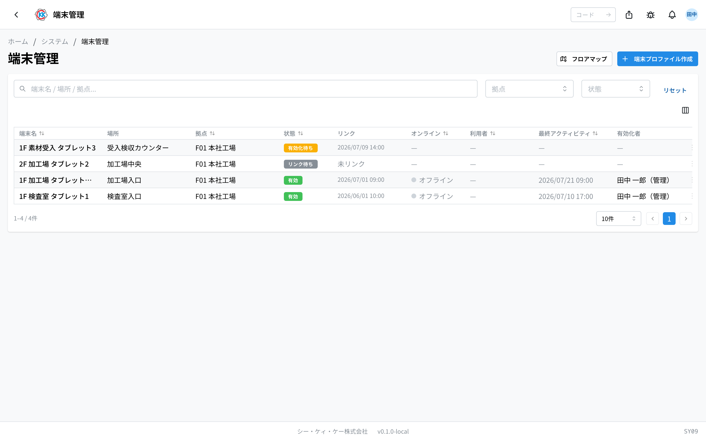
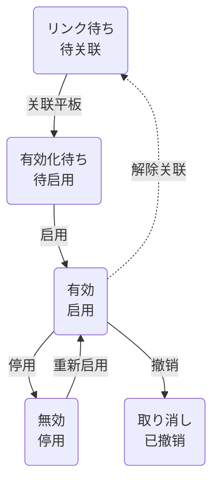
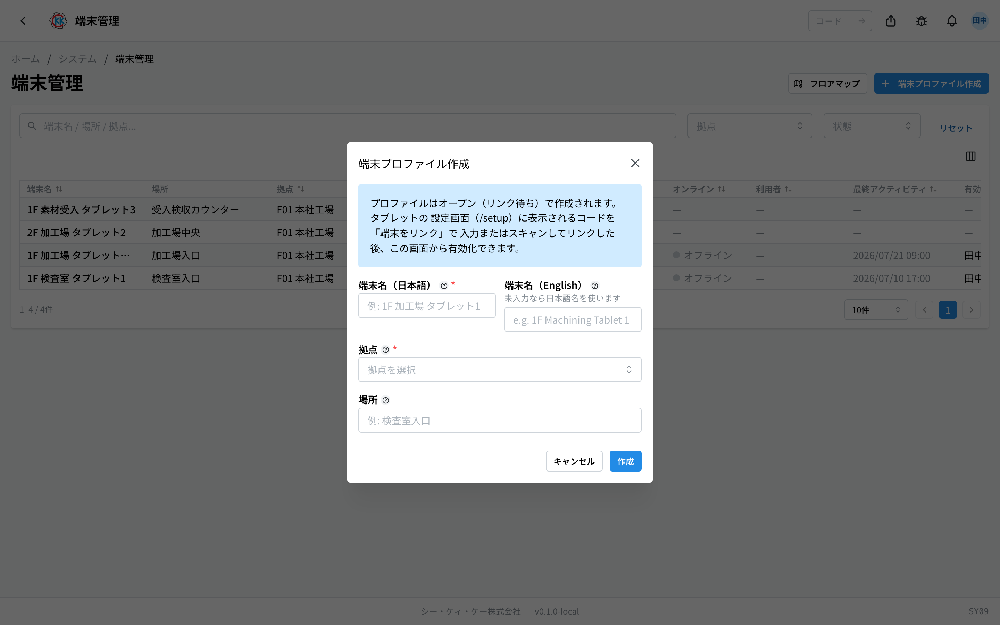
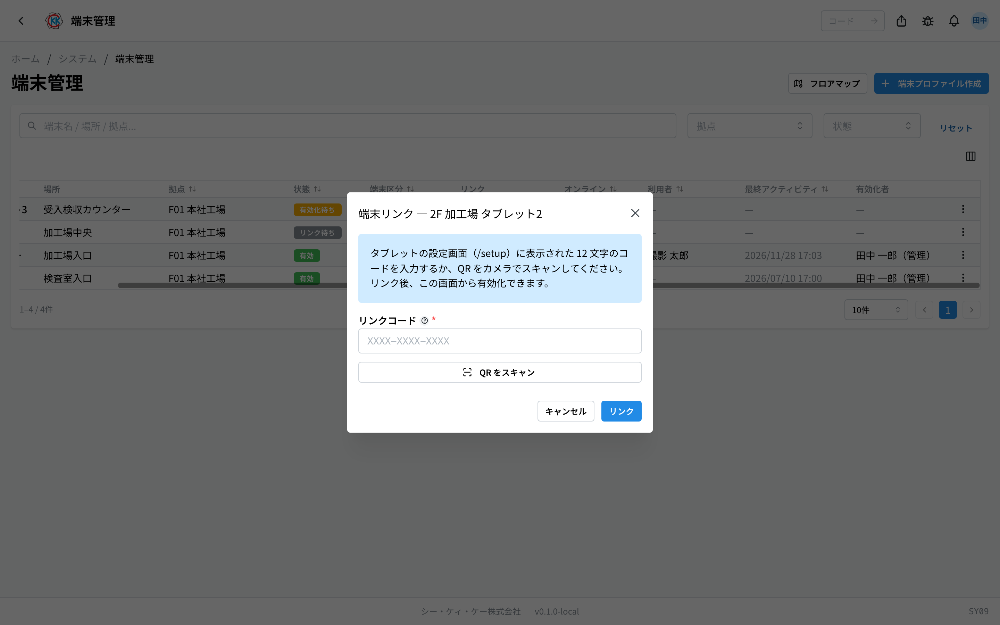
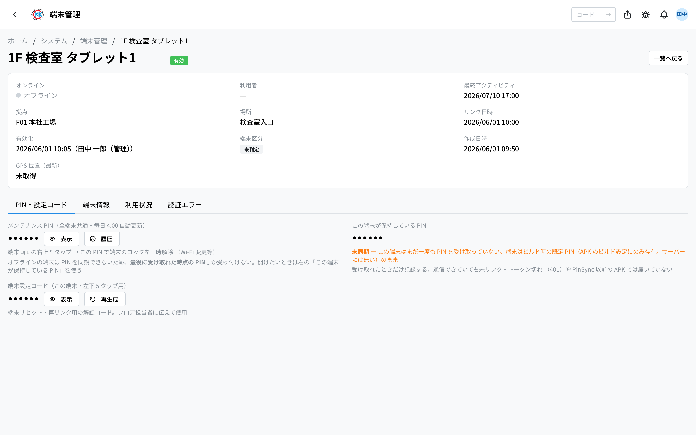
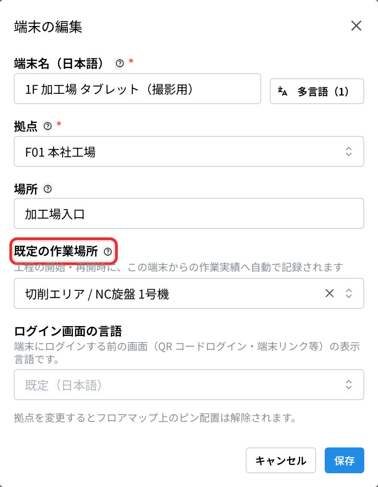
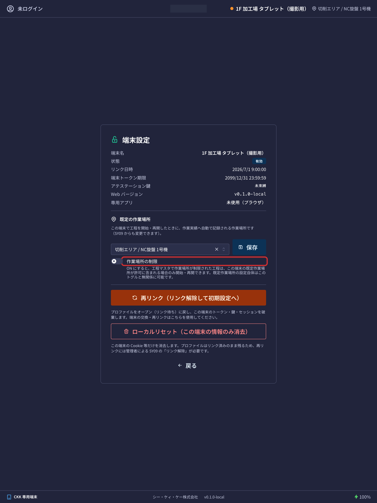

这是一个用来注册放在工厂里的 **共享平板**、让它可以使用的应用。操作代码是 `SY09`。

现在哪台平板正在运行、谁在使用，也可以在这个画面上确认。

## 本应用能做什么

- 注册新的平板，让它变成可以使用的状态。
- 修改平板的名称、据点、放置位置。
- 确认现在处于在线状态的平板，以及正在使用的人。
- 应对平板的故障与更换。
- 在 **フロアマップ**（楼层地图，即据点的平面示意图）上放置平板的位置。
- 查看哪台平板由谁、在什么时候使用过的记录。
- 决定现场的电视（**显示屏**）显示什么内容（目前是仅限测试环境的功能）。

## 术语（本页出现的词）

- **共有端末（共用终端）** … 指放在工厂里的共享平板。在这个画面上称为「端末」（终端）。
- **端末プロファイル（终端档案）** … 指「放在 1 楼检查室的平板」这样 **按放置位置准备的注册位**。先创建这个位，之后再把真正的平板与它绑定。
- **リンク（链接）** … 把注册位和真正的平板绑定起来的操作。
- **リンクコード（链接代码）** … 显示在平板画面上的 12 位暗号。用它来完成链接。
- **拠点（据点）** … 指工厂或营业所。

## 开始之前

- 打开本应用需要 **「共用终端管理」**（共有端末管理）权限。如果打不开，请联系系统管理员。
- 即使有权限，**创建注册位、链接、启用、重新启用、解除链接、作废、密钥重置，以及 PIN 和设置代码的显示与重新生成**，也不能直接进行。请先在[特权访问](/manual/zh/operations/system/privileged-access/user)（`SY0G`）中申请，并取得他人的批准。画面最上方会用「共有端末の秘密」（共用终端的秘密）和「端末アクセスの付与」（终端访问授权）两条横条，显示当前凭批准可在本画面使用的操作。
- 本应用在正式环境中尚未公开（目前可在测试环境中使用）。主页上没有显示时，请咨询系统管理员。
- 平板本身的准备（安装专用应用、连接网络）在这个画面上无法进行。请参见公司内部的操作手册。
- 员工要登录，需要先在 [QR卡管理](/manual/zh/operations/system/kiosk-card/user) 中发行卡片。

## 打开方式

按主页画面「システム」（系统）中的 **端末管理**（终端管理）。或者在画面上方的搜索框中输入 `SY09`。

## 画面说明

打开应用后，已注册的平板会以列表形式排列。在测试环境中，上方会出现「**共有端末**」（共用终端）和「**ディスプレイ**」（显示屏）两个标签页（显示屏请参见下方的「[显示屏（仅限测试环境）](#display)」）。在正式环境中不显示标签页，只显示平板列表。

- **端末名**（终端名） … 给平板起的名称。
- **場所**（位置） … 关于放置地点的备注。
- **拠点**（据点） … 这台平板属于哪个据点。
- **状態**（状态） … 目前的情况。共有以下 5 种。
  - **リンク待ち**（待链接） … 只创建了注册位，还没有和真正的平板绑定。
  - **有効化待ち**（待启用） … 已经和平板绑定。剩下只要启用即可。
  - **有効**（有效） … 可以使用的状态。
  - **無効**（无效） … 暂时停用中。可以恢复。
  - **取り消し**（作废） … 已完全停止使用。无法恢复。
- **端末区分**（终端类别） … 系统自动判定的是否为公司终端的结果。会显示「**会社（管理端末）**」（公司（管理终端））、「**会社（社内NW）**」（公司（公司内网））、「**未管理**」（未管理）、「**未判定**」（未判定）之一。把鼠标移到标记上会显示判定依据。「会社（社内NW）」只表示是从公司网络连接的，并不能证明是公司的终端。
- **リンク**（链接） … 与平板绑定的日期时间。还没有绑定时显示「**未リンク**」（未链接）。
- **オンライン**（在线） … 现在已连接时显示绿色圆点和「**オンライン**」（在线）；未连接时显示灰色圆点和「**オフライン**」（离线）。
- **利用者**（使用者） … 当前登录在该平板上的人。
- **最終アクティビティ**（最后活动） … 最后一次被操作的日期时间。
- **有効化者**（启用者） … 把这台平板设为可用状态的人。

可以用上方的搜索框「**端末名 / 場所 / 拠点...**」（终端名 / 位置 / 据点...）查找。用「**拠点**」「**状態**」筛选，用「**リセット**」（重置）清除条件。点击行即可打开该平板的详情画面。

## 注册平板

注册分 3 个阶段。**先创建注册位，再与平板绑定，最后设为可以使用的状态。**

### 步骤 1 — 创建注册位

1. 按画面右上角的「**端末プロファイル作成**」（创建终端档案）。
2. 在「**端末名**」（终端名）中输入易懂的名称（例：1F 加工 平板1）。日语以外的名称，从旁边的「**多言語**」（多语言）按钮输入（可选）。
3. 选择「**拠点**」（据点）。
4. 在「**場所**」（位置）中输入放置地点的备注（可选。例：检查室入口）。
5. 按「**作成**」（创建）。

会生成一行状态为「**リンク待ち**」（待链接）的记录。

> 💡 步骤 1〜3（创建、链接、启用）都是 **需要批准的操作**。事先在特权访问中申请，就不必在现场等待。

### 步骤 2 — 与平板绑定

1. 平板一侧的设置画面上会显示 **12 位代码** 和 QR 码。
2. 在列表中，按该注册位所在行的「**…**」（三个点的按钮）。
3. 选择「**端末をリンク**」（链接终端）。
4. 在「**リンクコード**」（链接代码）中输入平板上显示的 12 位字符。
5. 或者按「**タブレットのQRをスキャン**」（扫描平板的 QR），用摄像头读取平板上的 QR 码。
6. 按「**リンク**」（链接）。

状态会变为「**有効化待ち**」（待启用）。

> ⚠️ 代码 **只有 10 分钟** 有效。超过时间时，请在平板一侧重新显示。

### 步骤 3 — 设为可以使用的状态

1. 从该行的「**…**」中选择「**有効化**」（启用）。
2. 会出现确认画面，请阅读内容后按「**有効化**」。

状态会变为「**有効**」（有效），并且 **平板一侧的画面会自动切换到登录画面**。这样员工就可以使用了。

## 修改名称或放置位置

1. 从该行的「**…**」中选择「**編集**」（编辑）。
2. 修改「**端末名**」（终端名）、「**拠点**」（据点）、「**場所**」（位置）、「**既定の作業場所**」（默认作业场所）、「**ログイン画面の言語**」（登录画面的语言）。
3. 按「**保存**」（保存）。

「**ログイン画面の言語**」（登录画面的语言）是登录前的画面（用 QR 码登录、链接终端的画面）使用的语言。留空时为日语。登录后，使用该人员显示设置中的语言。

> ⚠️ **修改据点后，之前放在楼层地图上的图钉会被取下。** 这是因为平面示意图是按据点分开管理的。修改据点之后，请在新据点的楼层地图上重新放置。

## 更换或停用平板

从行的「**…**」中，可以根据情况进行下列操作。

- 「**利用履歴**」（使用记录） … 打开该平板由谁、在什么时候登录的记录。
- 「**無効化**」（停用） … 暂时使其无法使用。可以用「**再有効化**」（重新启用）恢复。适用于送修期间等情况。停用无需批准即可立即进行（为了能马上停掉可疑的平板）。
- 「**再有効化**」（重新启用） … 让停用中的平板重新可以使用。这个操作需要批准。
- 「**リンク解除**」（解除链接） … 解除平板与注册位的绑定，回到「待链接」状态。名称、据点、位置、楼层地图的图钉都会原样保留。**在把平板换成新机器时使用。** 可以把新平板重新绑定到同一个注册位。
- 「**鍵リセット**」（密钥重置） … 在把平板初始化或更换之后使用。按下之后，该平板的应用下次连接时会重新登记。只在平板的密钥已登记时出现。
- 「**削除**」（删除） … 只能删除还没有绑定过（待链接）的注册位。
- 「**取り消し**」（作废） … 使平板完全无法使用。

> ⚠️ 「**取り消し**」 **无法恢复**。已经打开的登录也会当场断开。要再次使用，需要从新的注册位重新创建。

## 平板的详情画面

点击列表中的行，会打开该台平板的画面。

上方会排列在线、使用者、最后活动、据点、位置、链接日期时间、启用（日期时间和启用人）、终端类别、创建日期时间、GPS 位置（最新）。

- 「**GPS 位置（最新）**」（GPS 位置（最新）） … 从平板发来的最新位置。点击会打开地图。没有收到时显示「**未取得**」（未获取）。

其下有「**PIN・設定コード**」（PIN・设置代码）、「**端末情報**」（终端信息）、「**利用状況**」（使用情况）、「**認証エラー**」（认证错误）4 个标签页。

### PIN・设置代码

有 2 个用于在现场操作平板的号码。两者平时都以「••••••」隐藏，按「**表示**」（显示），再在确认画面中按一次「**表示**」即可查看（经过 60 秒后会再次隐藏）。查看需要批准。

- 「**メンテナンス PIN（全端末共通・毎日 4:00 自動更新）**」（维护 PIN（全终端通用・每天 4:00 自动更新）） … 用来临时解除平板的画面锁定、使其可以自由操作的号码。例如修改 Wi-Fi 设置时使用。连续点击终端画面**右上角** 5 次，就会出现输入框。
- 「**端末設定コード（この端末・左下 5 タップ用）**」（终端设置代码（本终端・用于左下角点击 5 次）） … 只属于这一台平板的号码。连续点击终端画面**左下角** 5 次会打开终端设置画面，用这个号码解锁。在重置终端或重新绑定时使用。按「**再生成**」（重新生成）会变成新的号码，**之前的号码将无法使用**。

> ⚠️ 按下「**表示**」的操作会被记录下来。号码请只告知现场负责人，不要张贴公示。

#### 已断网平板的维护 PIN

维护 PIN 每天 4:00 更换，但**平板保存的是它最后一次能够通信时的号码**。断开 Wi-Fi 的平板收不到新号码，所以输入本画面当前显示的号码是打不开的。

这时请按「**この端末が保持している PIN**」（本终端持有的 PIN）下的「**表示**」（显示）。会显示**最后一次发给该平板的号码**。这是发放记录而非推测，直接输入即可。

下方会显示「**最終同期**」（最后同步）时间。显示为「**未同期**」（未同步）的平板，表示它一次都没有收到过号码。此时服务器端没有该号码，平板仍在使用制作应用时内置的号码，请确认应用的构建设置。出现「未同期」的原因例如：

- 平板尚未完成登记，或终端有效期（30 天）已过期
- 安装的应用较旧，没有获取号码的功能（早于 v0.5.3）

另外，按「**履歴**」（历史）仍会列出过去的号码及各自的有效期间。用于打开没有按终端记录的旧平板。

- 记录保留 400 天。停用时间超过这个期限的平板无法用 PIN 打开，请用 USB 连接电脑解除，或重新进行登记。
- 按下「**表示**」「**履歴**」的操作同样会被记录。

### 终端信息

列出平板的基本信息。

- 「**端末区分**」（终端类别）和「**判定根拠**」（判定依据） … 是否为公司终端的自动判定及其依据。
- 「**鍵フィンガープリント**」（密钥指纹） … 用来确认这台平板是真机的、每台终端各自密钥的标识。还没有确定时显示「**未束縛**」（未绑定）。
- 「**最終 IP（最後に観測）**」（最后 IP（最近观测））、「**リンク時 IP**」（链接时 IP） … 平板连接时使用的地址（IP 地址）。
- 「**プロファイル取得**」（获取档案） … 专用应用（v0.6.0 以上）发送的制造商、机型、应用版本、USB 调试状态等信息。有需要注意的设置时，会显示「**この端末で気をつける点**」（本终端需注意的事项）。旧版应用的平板保持空白。

### 使用情况

- 「**最近の利用者**」（最近的使用者） … 经常使用该平板的人，以及使用次数。
- 「**利用履歴**」（使用记录） … 谁在什么时候登录、什么时候退出的一览。还没有被使用时会显示「**利用履歴はまだありません**」（还没有使用记录）。

### 认证错误

在该平板上 **被拒绝的登录**（密码错误、无法使用的卡片等）的一览。成功的登录显示在「利用状況」（使用情况）中，失败的登录显示在这里。没有时显示「**この端末で弾かれた認証はありません**」（本终端没有被拒绝的认证）。

## 楼层地图（放置到平面示意图上）

如果把平板的位置放在据点的平面示意图上，就能一眼看出哪里的机器正在运转。

1. 按列表画面右上角的「**フロアマップ**」（楼层地图）。
2. 在上方的「**拠点**」（据点）中选择想查看的据点。
3. 会按楼层排列标签页，请选择想查看的楼层。

图钉的颜色，绿色表示在线，灰色表示离线。如果有人登录，还会显示该人的姓名。双击图钉，会打开该平板的详情画面。保管场所的图钉也会一并显示，供参考。

### 编辑平面示意图

打开画面上方的「**編集モード**」（编辑模式）开关后，可以进行下列操作。

- 可以 **拖动图钉移动位置**。松手后，该位置会自动保存。
- 点击右侧「**未配置の端末**」（未布置的终端）中的平板，它会被放到平面示意图的中央。之后再用拖动调整位置。
- 想取下已放置的平板时，按右侧「**配置済み**」（已布置）一行中的标记（「**ピンを解除**」，解除图钉）。
- 用「**フロアを追加**」（添加楼层）增加楼层。用「**名称変更**」（重命名）修改楼层名称。
- 用「**図面をアップロード**」（上传图纸）「**図面を差し替え**」（替换图纸）放入平面示意图的图片（PNG / JPG / WEBP，最大 10MB）。
- 用「**フロアを削除**」（删除楼层）删除楼层。但是，放有平板或保管场所的楼层无法删除。请先取下图钉。

在还没有平面示意图的据点，会显示「**この拠点にはフロアマップがありません。**」（该据点没有楼层地图。）。请打开编辑模式，从「**フロアを追加**」创建。

## 显示屏（仅限测试环境） [#display]

**该功能目前只能在测试环境中使用。** 在正式环境中不显示该标签页。

这是用来登记挂在现场墙上的电视（**显示屏**），以显示生产状况、出货预定等内容。步骤与平板相同，共 3 步（创建 → 链接 → 启用）。

1. 打开「**ディスプレイ**」（显示屏）标签页，按「**ディスプレイを追加**」（添加显示屏）。
2. 决定「**名前**」（名称）、「**設置場所**」（设置位置）、「**拠点**」（据点）、「**映す画面**」（显示的画面），按「**作成**」（创建）。状态为「**リンク待ち**」（待链接）。
3. 从行的「**…**」中选择「**ディスプレイをリンク**」（链接显示屏），用「**ディスプレイのQRをスキャン**」（扫描显示屏的 QR）读取电视上显示的 QR，或输入 12 位「**リンクコード**」（链接代码），然后按「**リンク**」（链接）。
4. 从行的「**…**」中选择「**有効化**」（启用）。电视开始显示。

点击行会打开显示屏的详情画面。有「**表示内容**」（显示内容）、「**設定**」（设置）、「**履歴**」（历史）3 个标签页。「表示内容」和「設定」需按「**編集**」（编辑）后再修改。

- 「**表示内容**」（显示内容） … 显示什么。选择「**アプリの画面**」（应用画面：生产状况・未处理・待安排・出货预定・品质・不良・通知）或「**画像**」（图片）。保存后，电视的显示会当场切换。
- 「**設定**」（设置） … 名称、设置位置、据点、「**表示倍率**」（显示倍率，50〜200%）、「**この画面の表示言語**」（本画面的显示语言）。

用画面右上角的按钮，可以根据状态进行「**一時停止**」（暂停）、「**再開**」（恢复）、「**リンク解除**」（解除链接）、「**失効**」（撤销）、「**削除**」（删除）。暂停中的电视会显示「この画面は一時停止されています。」（本画面已暂停）。链接、启用、解除链接、撤销、删除需要批准。

电视一侧（Raspberry Pi）的准备，请参见公司内部的操作手册。

## 输入项

| 项目 | 必填 | 填什么 |
|------|------|--------|
| [终端名（日语 / English）](#field-name) | 必填 | 列表与日志中显示的终端名称 |
| [据点](#field-plant) | 必填 | 放置该终端的据点 |
| [位置](#field-location) | 选填 | 在据点内的放置位置 |
| [默认作业场所](#field-default-work-location) | 选填 | 自动记录到该终端作业实绩的作业场所 |
| [链接代码](#field-link-code) | 必填 | 平板端显示的确认用代码 |

### 终端名称 [#field-name]

显示在列表、楼层地图与操作历史徽章中的名称。请使用「第一工厂 入口」这类**能找到实物的名称**。只需填写日语名称。英语等其他语言的名称可以从「**多言語**」（多语言）按钮输入（可选）。

### 据点 [#field-plant]

放置该终端的据点。终端按据点分列。

### 位置 [#field-location]

在据点内的放置位置。在楼层地图上放置图钉后，画面上也可看到位置。

### 默认作业场所 [#field-default-work-location]

在该终端上**开始・恢复**工序时，自动记录到作业实绩的作业场所（机械／区域）。请设置为平板实际放置的位置。只能选择属于该终端据点的作业场所（或未指定据点的分组）。

- 更改据点后，默认作业场所会被清除
- 也可以在平板端的**终端设置画面**（点按画面左下角 5 次 → 设置码）中更改。同一画面的「作业场所限制」开关开启后，工序主档中限制了作业场所的工序，只有该终端的默认作业场所在允许范围内时才能开始・恢复
- 如果实际在其他场所作业，可在工序执行画面扫描作业场所的二维码，覆盖该实绩的作业场所

平板端的终端设置画面如下（输入设置码后打开）:

### 链接代码 [#field-link-code]

平板端画面上显示的确认用代码。**请先在本画面创建终端注册位**，再读取（或输入）平板显示的代码，将该注册位与实机绑定。

- 未绑定的注册位**无法启用**
- 更换终端时请执行**解除链接**。名称、据点与图钉将保留，可重新绑定新的实机

## 常见问题・遇到困难时

**Q. 出现「コードが無効か期限切れです。タブレット側で再表示してください」（代码无效或已过期。请在平板一侧重新显示）。**
A. 链接代码为 12 位，只有 10 分钟有效。请在平板一侧重新显示代码后再试一次。

**Q. 出现「オープンな（未リンクの）プロファイルにのみリンクできます」（只能链接到开放的（未链接的）档案）。**
A. 该注册位上已经绑定了别的平板。想换成新平板时，请先按「**リンク解除**」（解除链接），然后重新链接。

**Q. 已经启用了，却一直显示离线。**
A. 请确认平板是否已开机、是否已连接网络。显示有时会稍有延迟才反映出来。

**Q. 平板坏了，要换成新机器。**
A. 请按该终端的「**リンク解除**」（解除链接）。名称、据点、位置、楼层地图的图钉都会原样保留，因此可以把新平板重新链接到同一个注册位。

**Q. 用摄像头读不出 QR 码。**
A. 如果显示「**カメラを起動できません。カメラ権限と HTTPS 接続を確認してください。**」（无法启动摄像头。请确认摄像头权限和 HTTPS 连接。），请允许浏览器使用摄像头。如果仍不顺利，也可以手动输入 12 位代码来完成注册。

**Q. 出现「この操作には承認が必要です（…）。特権アクセス（SY0G）から申請してください」（此操作需要批准（…）。请从特权访问（SY0G）申请）。**
A. 该操作只能在获得批准的期间进行。请从画面上方横条的「**特権アクセスを申請する**」（申请特权访问）提出申请，并等待批准。名称等的编辑、停用、在楼层地图上布置，无需批准即可进行。

**Q. 修改据点后，平板从楼层地图上消失了。**
A. 这是正常现象。平面示意图按据点分开管理，因此修改据点后图钉会被取下。请在新据点的楼层地图上重新放置。

**Q. 出现「リンク済み・有効化済みの端末は削除できません（取り消しを使用してください）」（已链接・已启用的终端无法删除（请使用作废））。**
A. 用「削除」（删除）能清除的，只有还没有和平板绑定的注册位。不再使用的平板请使用「**取り消し**」（作废）。

<!-- permissions:start -->
## 所需权限

使用本画面需要 **共用终端管理**（`kiosk`）权限。

| 想做的事 | 所需权限 |
| --- | --- |
| 打开画面、查看列表与明细 | 共用终端管理 — 查看 |
| 新增・变更・删除 | 共用终端管理 — 创建 / 更新 / 删除 |

仅查看有「查看」即可。画面中若有新增、变更或删除的操作，则分别需要对应的权限。

### 需要批准的操作

下列操作仅有权限还不够。需**在特权访问（SY0G）中提出申请，并只在他人批准的时间段内执行**。

| 操作 | 所需权限 | 可以做什么 |
| --- | --- | --- |
| 查看维护退出 PIN | 共用终端机密（`kiosk_secret`）— 查看 | 以明文显示全终端通用的退出 PIN。知道它的人可以在任何终端退出共用终端应用进入 Android 设置。 |
| 查看 PIN 历史 | 共用终端机密（`kiosk_secret`）— 查看 | 列出过去 400 天的退出 PIN。离线终端持有旧 PIN 时需要，但范围比当前值更广。 |
| 查看终端持有的 PIN | 共用终端机密（`kiosk_secret`）— 查看 | 显示最后一次下发给该终端的退出 PIN，用于打开离线的终端。 |
| 查看终端设置码 | 共用终端机密（`kiosk_secret`）— 查看 | 显示解锁该终端设置画面（左下连点 5 次）的代码。 |
| 重新生成终端设置码 | 共用终端机密（`kiosk_secret`）— 更新 | 重新生成设置码。持有旧代码的现场人员将无法进入。 |
| 重置终端密钥 | 共用终端机密（`kiosk_secret`）— 更新 | 解除认证密钥的绑定，并无条件信任下一台接入的终端（TOFU）。仅在更换机器时使用。 |
| 创建终端配置 | 终端访问授予（`kiosk_device`）— 新建 | 创建新终端的位置。绑定到此处的终端才能在现场显示登录画面。 |
| 绑定终端 | 终端访问授予（`kiosk_device`）— 更新 | 将实机绑定到配置并签发终端令牌，该终端由此进入系统。 |
| 启用终端 | 终端访问授予（`kiosk_device`）— 更新 | 让已绑定的终端投入使用，此后员工可在该终端登录。 |
| 停用 / 恢复终端 | 终端访问授予（`kiosk_device`）— 更新 | 暂时停用终端，或恢复已停用的终端。 |
| 解除关联 | 终端访问授予（`kiosk_device`）— 更新 | 销毁终端令牌、会话与认证密钥，并将配置清空。名称与据点保留。 |
| 注销终端 | 终端访问授予（`kiosk_device`）— 更新 | 立即封锁该终端，现场进行中的会话也会中断。 |
| 登记显示屏 | 终端访问授予（`kiosk_device`）— 新建 | 新增一块现场屏幕。登记后的屏幕会在任何人都能看到的位置持续显示业务数据。 |
| 注销显示屏 | 终端访问授予（`kiosk_device`）— 更新 | 立即封锁该屏幕。下次重新加载后回到登记画面，此后不再显示内容。 |

权限通过角色授予。若不足，请与管理员联系。

权限的整体说明请参见「[权限与角色](../../../permissions)」。
<!-- permissions:end -->
