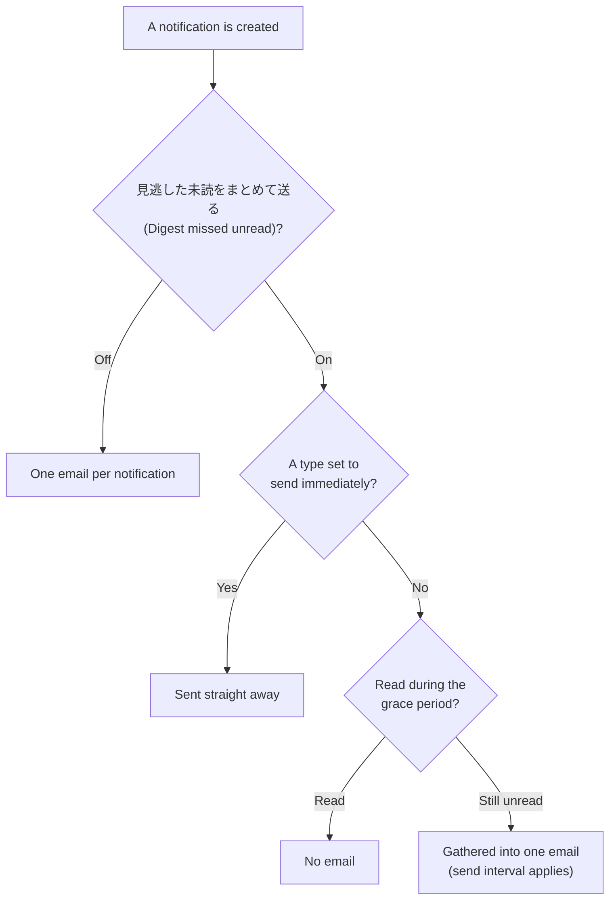

Settings that decide **how notifications are bundled when they are sent by email**. The operation code is `SY0F`.

> ⚠️ For now this app is available **in the test environment only**. Screens and steps may change before it becomes available in production.

> ⚠️ This screen is for system administrators. The settings apply to everyone.

## What you can do with this app

- Decide whether notifications are sent one by one or gathered into a single email.
- Decide how long to wait before a notification counts as "missed".
- Decide the shortest interval between two emails to the same person.
- Decide the maximum number of items listed in one email.
- Send certain notification types straight away, without waiting for the digest.

## Words used on this page

- **Digest** (まとめて送る) … instead of sending notifications one by one, the ones that have piled up are gathered into a single email.
- **Grace period** (猶予) … the time to wait, after a notification is created, before it counts as "missed".
- **Send interval** (送信間隔) … the shortest time before the next digest is sent to the same person.

## How it works

**Email is sent only for notifications that are still unread — the ones you missed.** A notification you have already read in the app, or through a push notification on your phone, is not emailed.

If you turn this setting off, **one email per notification** is sent, as before.

As a diagram:

## How to set it up

1. Turn on 「**見逃した未読をまとめて送る**」 (Digest missed unread notifications). When it is off, notifications arrive one by one.
2. In 「**猶予（分）**」 (Grace period (min)), enter how long to wait before a notification counts as missed (0–1440 minutes). Notifications read within this time are not emailed.
3. In 「**送信間隔（分）**」 (Send interval (min)), enter the time during which no further email is sent to the same person (5–1440 minutes).
4. In 「**最大件数**」 (Max items), enter the maximum number of items listed in one email.
5. If needed, choose 「**即時に送る通知の種別**」 (Notification types to send immediately).
6. Press 「保存」 (Save).

> 💡 The default for "types to send immediately" is **none**. Add one only when something comes up that should not be kept waiting.

> ⚠️ Notifications over the limit are folded into "and N more". **Folded notifications are also treated as sent and will not appear next time.** If the limit is too small, more notifications end up never appearing in the body of an email.

## Questions and problems

**Q. No email arrives.**
A. Nothing is sent for notifications you have already read. The person may also have turned email off in their own [notification settings](/manual/en/user-settings).

**Q. Nothing arrives even after the send interval has passed.**
A. The send interval is a lower limit — "never send more often than this". If there are no unread notifications, nothing is sent.

**Q. When do changed settings take effect?**
A. From the next send. The app does not need to be restarted.

**Q. I want to go back to the original settings.**
A. Press 「**元に戻す**」 (Reset to default) to return to the initial settings.

<!-- permissions:start -->
## Permissions required

Using this screen requires the **System admin** (`system`) permission.

| What you want to do | Permission needed |
| --- | --- |
| Open the screen, view lists and details | System admin — View |
| Add, change or delete | System admin — Create / Edit / Delete |

Viewing only needs *View*. Where a screen offers adding, changing or deleting, each of those needs its matching permission.

Permissions come through roles. If something is missing, ask an administrator.

For the whole picture see [Permissions and roles](../../../permissions).
<!-- permissions:end -->
