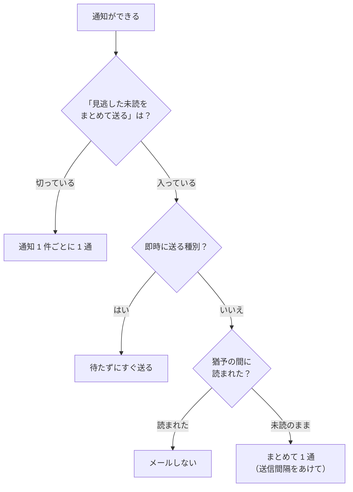

アプリの通知を **メールで送るときのまとめ方** を決める設定です。操作コードは `SY0F` です。

> ⚠️ このアプリはまだ準備中のため、本番の画面には出ていないことがあります。見当たらないときは、社内の担当者にご確認ください。本番の画面に出ていないあいだも、通知メールは下の「はじめの設定」で、まとめて送られています。

> ⚠️ この画面はシステム管理者向けです。設定は全員に効きます。

## このアプリでできること

- 通知を 1 件ずつ送るか、まとめて 1 通にするかを決められます。
- 「見逃した」とみなすまでの待ち時間を決められます。
- 同じ人へ続けて送るときの最短の間隔を決められます。
- 1 通に並べる件数の上限を決められます。
- 特定の種別だけ、まとめを待たずにすぐ送れます。

## 用語（このページで出てくる言葉）

- **まとめて送る（ダイジェスト）** … 通知を 1 件ずつ送らず、たまったものを 1 通にまとめて送るやり方です。
- **猶予（ゆうよ）** … 通知ができてから「見逃した」とみなすまでの待ち時間です。
- **送信間隔** … 同じ人へ次のまとめを送るまでの、最短の間隔です。

## 考えかた

**メールが届くのは「見逃したまま残っている通知」だけです。** アプリの中やスマートフォンのプッシュ通知で先に読んだ通知は、メールされません。

この設定を切ると、以前と同じように **通知 1 件ごとに 1 通** 届きます。

流れを図にすると次のとおりです。

## 設定のしかた

画面を開くと、いまの設定が表示されます。変えるときは次のようにします。

1. 「**編集**」を押します。
2. 「**見逃した未読をまとめて送る**」を入れます（切ると 1 件ずつ届きます。切っているあいだは、ほかの欄は変えられません）。
3. 「**送信間隔（分）**」に、同じ人へ続けて送らない時間を入れます（5〜1440 分）。
4. 「**猶予（分）**」に、見逃しとみなすまでの待ち時間を入れます（0〜1440 分）。この間に読まれた通知はメールされません。
5. 必要なら「**即時に送る通知の種別**」を選びます。
6. 「**最大件数**」に、1 通に並べる件数の上限を入れます（1〜100 件）。
7. 「**保存**」を押します。

> 💡 「即時に送る種別」の既定は **なし** です。待たせたくないものが出てきたときだけ足してください。

> ⚠️ 上限を超えた通知は「ほか N 件」に畳まれます。**畳まれた通知も送信済みとして扱われ、次の回には載りません。** 上限を小さくしすぎると、本文に出ないまま終わる通知が増えます。

## よくある質問・困ったとき

**Q. メールが届きません。**
A. 通知をすでに読んでいると届きません。また、本人の[通知設定](/manual/ja/user-settings)でメールを切っていることもあります。

**Q. 送信間隔を過ぎても届きません。**
A. 送信間隔は「これより短く送らない」という下限です。未読の通知がなければ何も送りません。

**Q. 設定を変えたら、いつから効きますか。**
A. 次の送信のときから効きます。アプリを再起動する必要はありません。

**Q. はじめの設定に戻したいです。**
A. 「**元に戻す**」のボタンはありません。「**編集**」を押して、次の値を入れ直してください。「見逃した未読をまとめて送る」は入れる、「送信間隔（分）」は 60、「猶予（分）」は 15、「即時に送る通知の種別」はなし、「最大件数」は 20 です。

<!-- permissions:start -->
## 必要な権限

この画面を使うには **システム管理**（`system`）の権限が要ります。

| したいこと | 必要な権限 |
| --- | --- |
| 画面を開く・一覧や詳細を見る | システム管理 の 閲覧 |
| 追加・変更・削除する | システム管理 の 作成 / 更新 / 削除 |

見るだけなら「閲覧」で足ります。追加・変更・削除の操作がある画面では、その操作にあたる権限がそれぞれ必要です。

権限は役割（ロール）を通して付きます。足りないときは管理者に相談してください。

権限の全体像は「[権限とロール](../../../permissions)」を参照してください。
<!-- permissions:end -->
