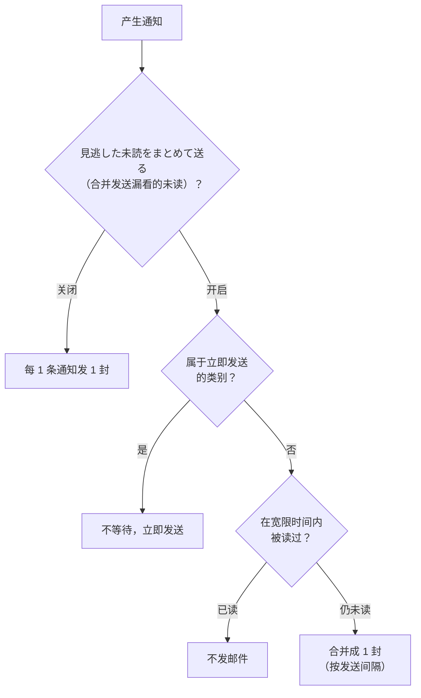

决定 **通过邮件发送通知时如何合并** 的设置。操作代码为 `SY0F`。

> ⚠️ 本应用仍在准备中，正式环境上可能还看不到。找不到时请咨询公司内的负责人。 在看不到本应用期间，通知邮件也会按下面的「初始设置」合并发送。

> ⚠️ 本画面面向系统管理员。设置对所有人生效。

## 本应用能做什么

- 可以决定通知是逐条发送，还是合并成 1 封。
- 可以决定经过多长时间后视为「漏看」。
- 可以决定向同一个人连续发送时的最短间隔。
- 可以决定 1 封邮件中列出的件数上限。
- 可以让特定类别的通知不等待合并、立即发送。

## 用语（本页出现的词）

- **合并发送（まとめて送る）** … 不逐条发送通知，而是把积累的通知合并成 1 封发送的方式。
- **宽限（猶予）** … 从通知产生到视为「漏看」为止的等待时间。
- **发送间隔（送信間隔）** … 向同一个人发送下一封合并邮件之前的最短间隔。

## 基本思路

**只有「漏看后仍未读的通知」才会发邮件。** 已经在应用内或手机的推送通知中读过的通知，不会再发邮件。

关闭此设置后，会和以前一样 **每 1 条通知发 1 封**。

用图表示如下。

## 设置方法

打开画面后，会显示当前的设置。要修改时，按以下步骤操作。

1. 点击「**編集**」（编辑）。
2. 打开「**見逃した未読をまとめて送る**」（合并发送漏看的未读通知）。关闭时会逐条发送，关闭期间其他栏无法修改。
3. 在「**送信間隔（分）**」（发送间隔（分钟））中输入不向同一个人连续发送的时间（5～1440 分钟）。
4. 在「**猶予（分）**」（宽限（分钟））中输入视为漏看之前的等待时间（0～1440 分钟）。在此期间被读过的通知不会发邮件。
5. 如有需要，选择「**即時に送る通知の種別**」（立即发送的通知类别）。
6. 在「**最大件数**」（最多件数）中输入 1 封邮件中列出的件数上限（1～100 件）。
7. 点击「**保存**」。

> 💡 「立即发送的类别」默认为 **无**。只有出现不想让人等待的通知时再添加。

> ⚠️ 超过上限的通知会折叠为「另有 N 件」。**被折叠的通知也视为已发送，下次不会再出现。** 上限设得太小，会有更多通知始终不出现在正文中。

## 常见问题・遇到困难时

**Q. 收不到邮件。**
A. 通知已经读过就不会发送。另外，本人也可能在[通知设置](/manual/zh/user-settings)中关闭了邮件。

**Q. 过了发送间隔也收不到。**
A. 发送间隔是「不会比这更频繁地发送」的下限。没有未读通知时什么都不会发送。

**Q. 修改设置后，从什么时候开始生效？**
A. 从下一次发送时开始生效。不需要重新启动应用。

**Q. 想恢复初始设置。**
A. 没有「**元に戻す**」（恢复默认）按钮。请点击「**編集**」（编辑），重新输入以下值：「見逃した未読をまとめて送る」打开，「送信間隔（分）」60，「猶予（分）」15，「即時に送る通知の種別」无，「最大件数」20。

<!-- permissions:start -->
## 所需权限

使用本画面需要 **系统管理**（`system`）权限。

| 想做的事 | 所需权限 |
| --- | --- |
| 打开画面、查看列表与明细 | 系统管理 — 查看 |
| 新增・变更・删除 | 系统管理 — 创建 / 更新 / 删除 |

仅查看有「查看」即可。画面中若有新增、变更或删除的操作，则分别需要对应的权限。

权限通过角色授予。若不足，请与管理员联系。

权限的整体说明请参见「[权限与角色](../../../permissions)」。
<!-- permissions:end -->
