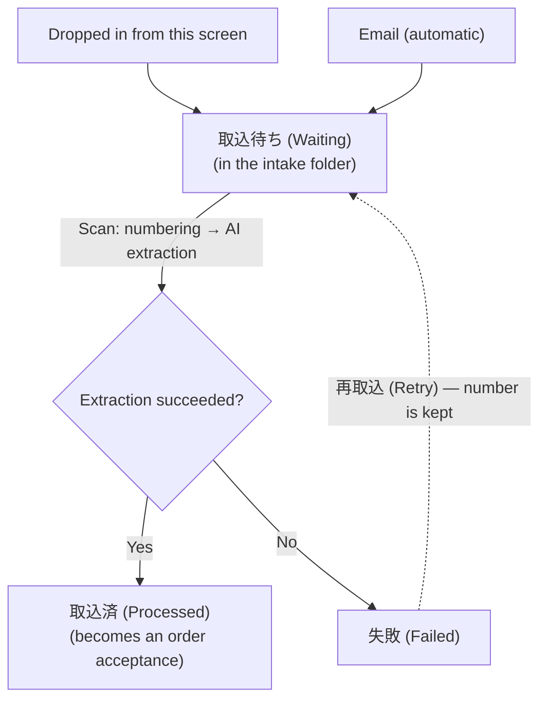

An app for dropping received **order documents (PDFs / scanned images)** into the intake folder in bulk. The operation code is `SY0C`.

> This app works in **both the test environment (dev) and production (main)** — the production intake folder was set up on 2026-08-30.
>
> ⚠️ However, **email arrives in production (main) only.** There is a single intake address, so there is a single thing receiving it. To try intake on dev, drop files in from this screen or use "priority intake" on order acceptances — the only difference is that email is not involved; everything after that is the same.

## What you can do with this app

- Select multiple received order-document files at once and drop them into the intake folder.
- Check files that are waiting, failed, or processed, **linked to the order acceptance they became**.
- Start a scan right away without waiting for the automatic poller.
- Send a file that failed extraction back to the waiting queue for another try.

## Words used on this page

- **Intake folder** … a watched folder on the server; anything placed there is automatically brought in as an order acceptance (environment variable `INTAKE_DIR`).
- **Drop in** … placing a file into the folder from this screen. It **only places the file** — numbering and AI extraction happen automatically afterward.
- **Scan** … the process that checks the folder's contents and brings in waiting files in order. It runs automatically at a set interval, and can also be triggered right away from this screen.
- **Numbering** … assigning an order-acceptance number (such as `ORD-2026-00001`) to a file once it has been brought in.

## Before you start

You need **system administration permission** to open this app. If you cannot open it, please ask your system administrator.

## How to open it

Press **注文書取込** (Order Document Intake) inside 「システム」 (System) on the home screen. Or type `SY0C` into the search box at the top of the screen.

## How to read the screen

At the very top is the 「**取込口の自社法人**」 (own company of the intake channel) box ([Own company of the intake channel](#intake-company)), and below it four blocks: "Drop into folder", "Waiting", "Failed", and "Processed".

- **フォルダへ投入** (Drop into folder) … a button to choose files, a button to scan right away, and the intake folder's path and auto-scan interval.
- **取込待ち** (Waiting) … files not yet brought in. The one file currently being extracted also stays here.
- **失敗** (Failed) … files whose extraction failed. Each has a retry button.
- **取込済** (Processed) … files that have finished being brought in and became an order acceptance.

A file moves through them like this:

Each row shows:

- **注文請書** (Order acceptance) … if numbered, the number, a status badge, the customer name, and the item count. If not yet numbered, it shows 「**未採番**」 (Not yet numbered).
- **ファイル** (File) … the original file name (the number portion is stripped from the display).
- **サイズ / 更新** (Size / Updated) … the file's size and last-modified time.
- **「抽出中」** (Extracting) … shown on the file the AI is reading right now. It stays in "awaiting import" until it finishes (about 1–3 minutes).
- **「再試行中」** (Retrying, orange) … extraction failed, so it is being retried automatically after a pause. Just wait. A file that still cannot be read after the retries becomes 「**抽出失敗**」 (Extraction failed, red). Hover the badge to see the reason and a hint on what to do.

When there are many files, only the newest ones are shown and 「新しい ○ 件を表示（全 ○ 件）」 (Showing the newest ○ of ○) appears. The 「**注文請書へ**」 / 「**注文請書一覧へ**」 (To order acceptances) buttons take you to the [order acceptance](/manual/en/operations/sales/order-acceptance/user) list.

While at least one file is waiting, the screen refreshes itself automatically every 30 seconds.

## The three ways an order arrives

Besides dropping files in from this screen, orders also arrive by the routes
below. Files dropped in from this screen and email **land in the intake folder**
and are picked up by the automatic scan. "Priority intake" on the order acceptance
app **bypasses the intake folder**: it numbers the file on the spot and queues it
for AI extraction. The entry point differs, but numbering and AI extraction work
the same way from there.

| Route | How it gets in |
|---|---|
| **Upload** | This screen (via the intake folder), or "Priority intake" on the order acceptance app (does not use the intake folder) |
| **Email** | Orders sent to **order-intake@ckk-tool.co.jp** are picked up automatically (`intake-gateway`) and appear under "Waiting" within a few minutes |
| **Fax** | Currently a manual step — someone scans the paper on the MFP and uploads it via "Priority intake". There is no automatic fax receiver |

### The intake address

It is **order-intake@ckk-tool.co.jp**. Ask customers to send order forms there.
It is an **automated intake address that nobody reads** — do not use it for
enquiries or correspondence, which would sit there unnoticed.

### Spotting a file that came from email

Files that arrived by email are named `mail_sender_originalname`. For example
`mail_tanaka-at-example.co.jp_order.pdf` came from `tanaka@example.co.jp`.

> ⚠️ **The sender and subject are not recorded on the order acceptance itself.**
> That filename is the only trace — the order acceptance detail page does not
> show it. To see the subject or body, open the mailbox directly. Messages that
> were taken in have been moved to its "Processed" folder (failures go to "Failed").

### Emails with several attachments

If one email carries three order documents, you get **three order acceptances**
(one document = one record). Images embedded in the signature — company logos
and the like — are not taken in.

## Own company of the intake channel [#intake-company]

When two or more companies issue documents ([own companies](/manual/en/operations/masters/own-company/user)), this setting decides **which company's order acceptance an imported order becomes**. If you have only one company, leave it at 「既定の法人」 (default company).

1. In the 「**取込口の自社法人**」 (own company of the intake channel) box at the very top of the screen, press 「**編集**」 (Edit).
2. Choose 「**自社法人**」 (own company).
3. Press 「**保存**」 (Save).

- Files that enter the intake folder (including those dropped in from this screen, and those from email and external integrations) become order acceptances of **the company chosen here**. Their numbers are also taken from that company's sequence.
- **Files uploaded with 「優先取込」 (priority import) on the [order acceptance](/manual/en/operations/sales/order-acceptance/user) screen** become order acceptances of the uploader's company, if the uploader's assigned sites resolve to exactly one company. When they do not (the assigned sites span two or more companies, or there are none), the company chosen here is used.
- The company of an order acceptance cannot be changed after it is created, so **changing the setting only affects files imported from now on**. Order acceptances already imported keep their company.

> 💡 There is one intake channel, so only one company can be chosen. For orders addressed to the other company, have someone who belongs to that company upload them with 「優先取込」 (priority import), or create the [order acceptance](/manual/en/operations/sales/order-acceptance/user) by hand.

## Dropping in files

1. Press 「**ファイルを選ぶ**」 (Choose files).
2. Select the received order documents (PDF / PNG / JPG / WEBP, up to 20 MB each) — you can select several at once.
3. As soon as you select them, they are automatically dropped into the folder. Progress is shown in a notification at the bottom right of the screen.

Files dropped in this way are handled through exactly the same path as if they had been copied directly into the shared folder. After a short while the automatic scan picks them up and they appear under "Waiting".

## Scanning right away

If you want to bring files in without waiting for the automatic scan, press 「**今すぐスキャン**」 (Scan now). Extraction takes about 1–3 minutes per file, so a large batch will take a while. The screen only reports that the scan has started — check the result by refreshing this screen or looking at the order-acceptance list.

## Retrying a failed file

In the "Failed" list, press 「**再取込**」 (Retry) on the row for the file you want to fix. It goes back to the waiting queue, and only extraction is redone on the next scan. The order-acceptance number already assigned to it is kept, so the same order document is never registered twice.

## Questions and problems

**Q. It says "folder not configured."**
A. The intake folder exists in both the test and production environments. If you still see this, the `INTAKE_DIR` setting or the folder assignment has come loose — ask a system administrator. ("Priority intake" on order acceptances does not use the intake folder, so it keeps working meanwhile.)

**Q. I dropped in a file, but it stays "not yet numbered" forever.**
A. The automatic scan runs every 60 seconds by default. Please wait a little and refresh the screen. If it still doesn't change, try 「今すぐスキャン」 (Scan now).

**Q. Extraction keeps failing, over and over.**
A. This can be caused by the file's image quality or layout. Hover over the failed row to see the reason for the failure and a hint for fixing it. If it still won't resolve, bring the document in manually through "priority intake" on order acceptances while checking the content yourself.

**Q. I accidentally dropped in a duplicate of a file that was already processed.**
A. The dropped file is saved under a unique name, so it won't overwrite anything, but you may end up with two order acceptances for the same order document. Please check the order acceptances that were created and cancel whichever one is not needed.

**Q. Is it safe to place a file directly into the intake folder's path?**
A. Yes. Dropping a file in from this screen and placing one directly into the shared folder are handled through exactly the same path.

**Q. An order sent by email was not taken in.**
A. Check, in order: (1) whether that sender is on the allow list (ask a system administrator); (2) whether the attachment is PDF, PNG, JPG, WEBP or TIFF (TIFF is converted to PDF before it is taken in) — anything else is skipped; (3) whether the message is marked read in the mailbox. Read but not taken in means it was attempted and failed. **Failed messages are not retried automatically**, to avoid registering the same order twice. Ask the sender to resend, or save the attachment and use "Priority intake".

**Q. Can faxes be taken in automatically?**
A. Not today. Scan the received fax on the MFP and upload it via "Priority intake". If you later subscribe to a fax-to-email service, those messages will ride the email route with no further change.

<!-- permissions:start -->
## Permissions required

Using this screen requires the **System admin** (`system`) permission.

| What you want to do | Permission needed |
| --- | --- |
| Open the screen, view lists and details | System admin — View |
| Add, change or delete | System admin — Create / Edit / Delete |

Viewing only needs *View*. Where a screen offers adding, changing or deleting, each of those needs its matching permission.

Permissions come through roles. If something is missing, ask an administrator.

For the whole picture see [Permissions and roles](../../../permissions).
<!-- permissions:end -->
