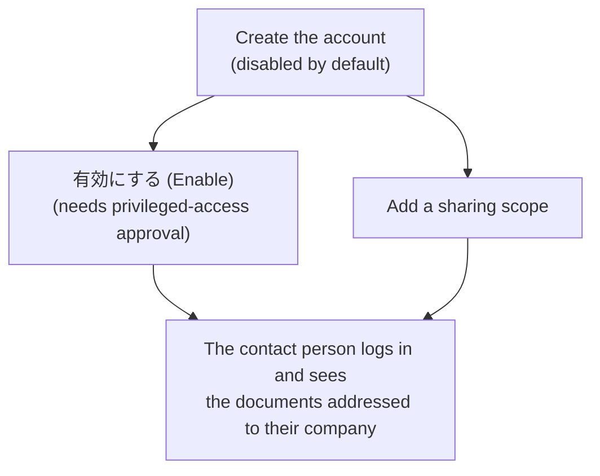

Manage the entrance through which a business partner's contact person can **view the documents addressed to their own company by themselves**. The operation code is `SY0H`.

> ⚠️ For now this app is available **in the test environment only**. Screens and steps may change before it becomes available in production.

> ⚠️ These settings show documents to people outside the company. If the sharing scope is wrong, **another partner's prices become visible**. Take your time and check each item one by one.

## What you can do with this app

- Issue a portal account to a business partner's contact person.
- Decide the range of documents shown to that person (the sharing scope).
- Issue a link that shows a single document only.
- Check the record of who opened what, and when.

## Words used on this page

- **Portal account** (ポータルアカウント) … the login for a business partner's contact person. It is **separate from employee accounts**.
- **Sharing scope** (共有範囲) … the range of documents shown to that person. It is decided per business partner.
- **Document link** (書類リンク) … a URL that shows a single document only. It can be opened without an account.
- **Identity verification** (本人確認) … a verification code is sent to the registered email address so that only that person can open the document.
- **Backup code** (バックアップコード) … a one-time code used when the person cannot receive email.

## Creating an account

1. Press 「**ポータルアカウントの作成**」 (Create portal account).
2. Enter the business partner and the contact person's email address.
3. Save. 「**アカウントを作成しました（既定は無効です）**」 (Account created — disabled by default) is shown.

> ⚠️ **Creating the account alone shows nothing.** The person can log in only after you press 「有効にする」 (Enable). **Enabling requires approval through [Privileged access](/manual/en/operations/system/privileged-access/user) (SY0G).**

As a diagram, this is what it takes before the other party can see documents. **Both** enabling and a sharing scope are needed.

## Deciding the sharing scope

When there is no sharing scope at all, 「**共有範囲はまだありません（この人には何も見えません）**」 (No sharing scope yet — this person sees nothing) is shown.

When you add a scope, there are two options.

- **支店宛の書類も含める** (Include documents addressed to branches) … when you share at the parent business partner, documents addressed to its branches are visible too (**it never goes up from a branch to the parent**).
- **需要家・出荷先としての書類も含める** (Include documents where it is the end user or ship-to) … also shows documents in which that company is the end user or the ship-to.

> ⚠️ With the second option, "**a distributor's prices may become visible to the end user**". Turn it on only when needed.

When you revoke a sharing scope, the documents in that scope are no longer visible to that person.

## Showing a single document only (document link)

Use this when you want to show just one document without creating an account. Issue it from 「**ポータル共有**」 (Portal sharing) on the document's screen.

1. Choose 「**本人確認あり（推奨）**」 (Verified — recommended) or 「**リンクのみ**」 (Link-only).
2. For a verified link, enter the email address the verification code is sent to.
3. Enter 「有効期間（日）」 (Valid period (days)).
4. Press 「**発行する**」 (Issue) and give the URL that appears to the other party.

| Kind | What happens |
|---|---|
| **本人確認あり** (Verified) | A verification code is sent to the registered address. Even if the link is forwarded, nobody but that person can open it. |
| **リンクのみ** (Link-only) | **Anyone who knows the URL can open it.** Be careful about forwarding. Issuing it requires privileged-access approval. |

When you revoke a link, **any session opened through that link ends too**.

## Backup codes

For a contact person who cannot receive email, you can issue one-time codes (issuing them requires approval).

> ⚠️ **Once you close this screen, they can never be shown again.** Print them or write them down, and hand them directly to the contact person. **Do not send them by email** (they are the fallback for when email cannot be used).

## View log

You can check who opened what, when, and from which IP address. If nobody has opened anything yet, 「まだ何も閲覧されていません。」 (Nothing has been viewed yet.) is shown.

## Questions and problems

**Q. The other party says "nothing is displayed".**
A. Either there is no sharing scope, or the account is still disabled. Both can be checked from the admin screen.

**Q. I pressed the enable button and was asked for approval.**
A. That is how it is designed. Because the operation lets someone outside the company see documents, it goes through another person's approval.

**Q. I want a branch's contact person to see the documents addressed to the parent company too.**
A. That is not possible. It only works in the parent → branch direction. Create the sharing scope on the parent company's side.

**Q. I handed over the wrong link.**
A. Revoke it immediately. Any session that is open at that moment ends too.

<!-- permissions:start -->
## Permissions required

Using this screen requires the **Partner portal administration** (`portal_admin`) permission.

| What you want to do | Permission needed |
| --- | --- |
| Open the screen, view lists and details | Partner portal administration — View |
| Add, change or delete | Partner portal administration — Create / Edit / Delete |

Viewing only needs *View*. Where a screen offers adding, changing or deleting, each of those needs its matching permission.

### Operations that need approval

Holding the permission is not enough for the operations below. You **request them in Privileged Access (SY0G) and may act only for the window someone else approves**.

| Operation | Permission | What it unlocks |
| --- | --- | --- |
| Activate a portal account | Partner portal administration（`portal_admin`）— Edit | Gives an external person a standing login to their own documents. |
| Issue backup codes | Partner portal administration（`portal_admin`）— Edit | Prints one-time codes that bypass e-mail possession. The paper is the key. |
| Mint a link-only URL | Partner portal administration（`portal_admin`）— Create | Creates a document URL anyone holding it can open. Verified links are not gated. |

Permissions come through roles. If something is missing, ask an administrator.

For the whole picture see [Permissions and roles](../../../permissions).
<!-- permissions:end -->
