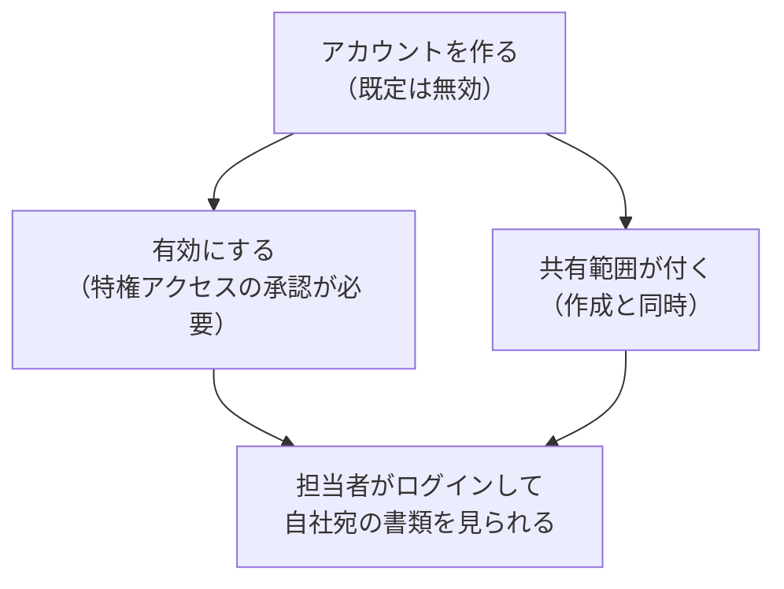

取引先の担当者が **自社宛の書類を自分で見る** ための入口を管理します。操作コードは `SY0H` です。

> ⚠️ このアプリは今のところ **テスト用の環境だけ** で使えます。本番で使えるようになるまでに、画面や手順が変わることがあります。

> ⚠️ 社外の人に書類を見せる設定です。共有範囲を間違えると、**別の取引先の金額が見えてしまいます**。落ち着いて 1 件ずつ確認してください。

## このアプリでできること

- 取引先の担当者にポータルのアカウントを発行できます。
- その人に見せる書類の範囲（共有範囲）を決められます。
- 担当者に渡す「ご利用案内」の PDF を出せます。
- 書類 1 件だけを見せるリンク（書類リンク）を確認・失効できます。
- 誰がいつ何を開いたかの記録を確認できます。

## 用語（このページで出てくる言葉）

- **ポータルアカウント** … 取引先の担当者のログインです。**社員のアカウントとは別のもの** です。
- **共有範囲** … その人に見せる書類の範囲です。取引先の単位で決めます。
- **書類リンク** … 書類 1 件だけを見せる URL です。アカウントがなくても開けます。
- **本人確認** … 登録したメールアドレスに確認コードを送り、本人だけが開けるようにするしくみです。
- **バックアップコード** … メールが受け取れないときに使う、使い捨てのコードです。

## 画面の見かた

一覧には、アカウントごとに「取引先」「担当者」「メール」「状態」「最終ログイン」「操作」が並びます。

- **メール** … 社外の人の個人情報なので、一部を伏せて表示します。
- **状態** … 「有効」か「無効」です。
- **操作** … 「有効にする」「無効にする」「案内」「バックアップコード」のボタンがあります。

担当者の名前を押すと、その人の詳細画面が開きます。詳細画面では「**共有範囲**」「**発行済みのリンク**」「**閲覧記録**」の 3 つを確認できます。

## アカウントを作る

1. 「**新規作成**」を押します。「**ポータルアカウントの作成**」の画面が開きます。
2. 「**取引先**」を選びます。
3. 「**担当者名**」を入れます。
4. 「**メールアドレス**」を入れます。確認コードはこのアドレスに届きます。
5. 必要なら、共有範囲の 2 つの選択肢にチェックを入れます（下の「共有範囲を決める」を参照）。
6. 「**作成**」を押します。「**アカウントを作成しました（既定は無効です）**」と出ます。

取引先・担当者名・メールアドレスはどれも必須です。作成すると、選んだ取引先の共有範囲が 1 つ自動で付きます。

> ⚠️ **作成しただけでは何も見えません。** 「有効にする」を押してはじめてログインできます。**有効化には[特権アクセス](/manual/ja/operations/system/privileged-access/user)（SY0G）の承認が必要です。**

相手に書類が見えるようになるまでを図にすると、次のとおりです。有効化と共有範囲の **両方** が要ります。

## 共有範囲を決める

共有範囲は、アカウントを作るときに選んだ取引先で 1 つ付きます。そのとき、2 つの選択肢があります。

- **支店宛の書類も含める** … 親の取引先で共有すると、その支店宛の書類も見えます（**支店から親へは遡りません**）。
- **需要家・出荷先としての書類も含める** … その会社が需要家や出荷先になっている書類も見せます。

> ⚠️ 2 つめは「**卸し先の価格が需要家に見えることがあります**」。必要なときだけ入れてください。

詳細画面の「**共有範囲**」で、いま付いている範囲を確認できます。範囲を止めたいときは、その行の「**失効**」を押します。失効させると、その範囲の書類はその人に見えなくなります。共有範囲が 1 つも無いと「**共有範囲はまだありません（この人には何も見えません）**」と出ます。

> 💡 あとから共有範囲を足すボタンはありません。範囲を変えたいときは、アカウントを作り直してください。

## ご利用案内の PDF を渡す

担当者にポータルの入り方を伝える紙です。ログイン画面を開く QR コードが付いています。案内は取引先の言語で作られます。

1. 一覧のその人の行で「**案内**」を押します。PDF が新しいタブで開きます。
2. 印刷して、担当者ご本人へ渡します。

詳細画面からも出せます。「**この方の案内 PDF**」はその人 1 名ぶん、「**取引先ぶんをまとめて**」は同じ取引先の有効なアカウント全員ぶん（1 名 1 ページ）です。

- 案内は **有効なアカウントにだけ** 出せます。無効のままでは「案内」ボタンが出ません。
- 案内には確認コードやバックアップコードは載りません。

## 書類 1 件だけを見せる（書類リンク）

アカウントを作らずに、書類 1 件だけを見せるしくみです。いまは、[見積書](/manual/ja/operations/sales/quote/user)を発行するときに「**発行後に顧客へメール送付する**」にチェックを入れると、書類リンクが作られてお客様へメールで届きます。このリンクは本人確認ありです。

| 種類 | 何が起きるか |
|---|---|
| **本人確認あり** | 登録アドレスに確認コードを送ります。転送されても本人以外は開けません。 |
| **リンクのみ** | **URL を知っていれば誰でも開けます。** 転送に注意してください。発行には特権アクセスの承認が要ります。 |

ポータルアカウントにひも付いたリンクは、その人の詳細画面の「**発行済みのリンク**」に並びます。止めたいときは、その行の「**失効**」を押します。リンクを失効させると、**そのリンクで開いているセッションも終わります**。

## バックアップコード

メールが受け取れない担当者のために、使い捨てのコードを発行できます（発行には承認が要ります）。

> ⚠️ **この画面を閉じると二度と表示できません。** 印刷するか書き写して、担当者ご本人へ直接お渡しください。**メールで送らないでください**（メールが使えないときのための手段です）。

## 閲覧記録

詳細画面の「**閲覧記録**」で、誰がいつ何を開いたか、どの IP アドレスからかを確認できます。まだ誰も開いていなければ「まだ何も閲覧されていません。」と出ます。

## よくある質問・困ったとき

**Q. 相手が「何も表示されない」と言っています。**
A. 共有範囲が無いか、アカウントがまだ無効です。どちらも管理画面から確認できます。

**Q. 有効にするボタンを押したら承認を求められました。**
A. そういう作りです。社外の人が見られるようになる操作なので、別の人の承認を通します。

**Q. 支店の担当者に、親会社宛の書類も見せたいです。**
A. できません。親 → 支店の向きだけです。親会社を「取引先」に選んでアカウントを作り、「支店宛の書類も含める」にチェックを入れてください。

**Q. 間違ったリンクを渡しました。**
A. すぐに失効させてください。開いている途中のセッションも終わります。

**Q. 「案内」ボタンが見当たりません。**
A. 案内は有効なアカウントにだけ出せます。先に「有効にする」で有効にしてください。

<!-- permissions:start -->
## 必要な権限

この画面を使うには **取引先ポータルの管理**（`portal_admin`）の権限が要ります。

| したいこと | 必要な権限 |
| --- | --- |
| 画面を開く・一覧や詳細を見る | 取引先ポータルの管理 の 閲覧 |
| 追加・変更・削除する | 取引先ポータルの管理 の 作成 / 更新 / 削除 |

見るだけなら「閲覧」で足ります。追加・変更・削除の操作がある画面では、その操作にあたる権限がそれぞれ必要です。

### 承認が要る操作

次の操作は権限を持っているだけでは行えません。**特権アクセス（SY0G）で申請し、別の人の承認を受けた期間だけ**行えます。

| 操作 | 必要な権限 | 何ができるようになるか |
| --- | --- | --- |
| ポータルアカウントの有効化 | 取引先ポータルの管理（`portal_admin`）— 更新 | 社外の人に、自社宛の書類を見続けられるログインを与える。kiosk_card.issue の社外版 |
| バックアップコードの発行 | 取引先ポータルの管理（`portal_admin`）— 更新 | メールの受信を迂回して入れる使い捨てコードを刷る。刷った紙がそのまま鍵になる |
| 本人確認なしリンクの発行 | 取引先ポータルの管理（`portal_admin`）— 作成 | URL を持っていれば誰でも開ける書類リンクを作る。転送されればその相手も開ける（本人確認ありのリンクは対象外） |

権限は役割（ロール）を通して付きます。足りないときは管理者に相談してください。

権限の全体像は「[権限とロール](../../../permissions)」を参照してください。
<!-- permissions:end -->
