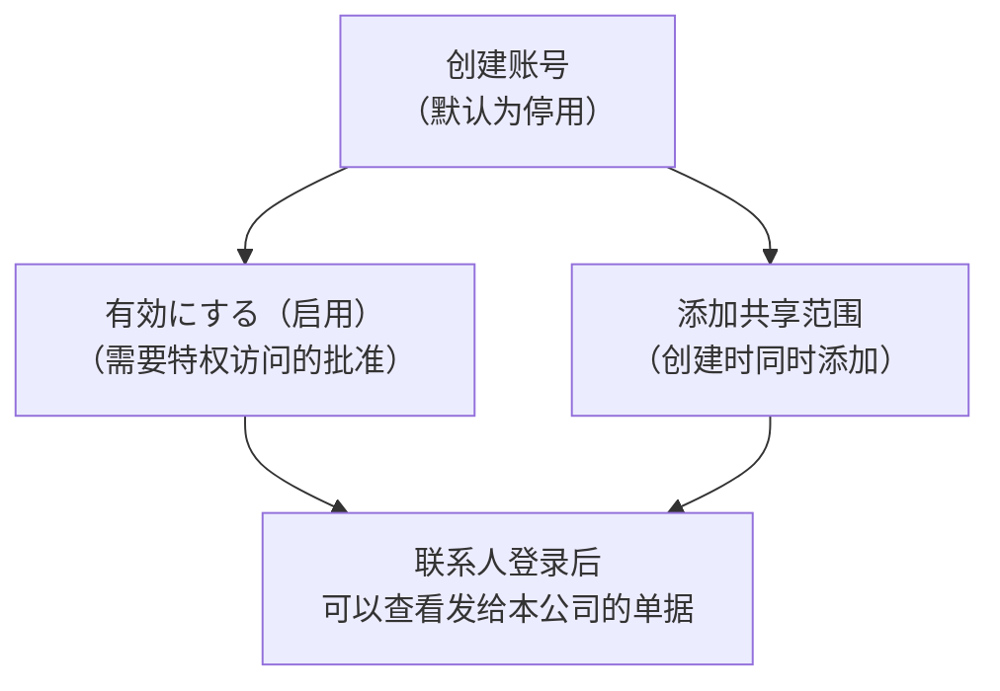

管理业务伙伴的联系人 **自行查看发给本公司的单据** 的入口。操作代码为 `SY0H`。

> ⚠️ 本应用目前 **仅在测试环境** 中可用。在正式环境可用之前，画面和步骤可能会有变化。

> ⚠️ 这是向公司外部人员展示单据的设置。共享范围设错的话，**会让别的业务伙伴的金额被看到**。请沉着地逐条确认。

## 本应用能做什么

- 可以向业务伙伴的联系人发放门户账号。
- 可以决定向该联系人展示的单据范围（共享范围）。
- 可以生成交给联系人的「使用说明」PDF。
- 可以确认并作废只展示 1 份单据的链接（单据链接）。
- 可以确认谁在什么时候打开了什么的记录。

## 用语（本页出现的词）

- **门户账号（ポータルアカウント）** … 业务伙伴联系人的登录账号。**与员工账号是不同的东西**。
- **共享范围（共有範囲）** … 向该联系人展示的单据范围。以业务伙伴为单位决定。
- **单据链接（書類リンク）** … 只展示 1 份单据的 URL。没有账号也能打开。
- **本人验证（本人確認）** … 向登记的邮箱地址发送验证码，使只有本人才能打开的机制。
- **备用码（バックアップコード）** … 收不到邮件时使用的一次性代码。

## 画面说明

列表中按账号排列「取引先」（业务伙伴）「担当者」（负责人）「メール」（邮件）「状態」（状态）「最終ログイン」（最后登录）「操作」。

- **邮件** … 属于公司外部人员的个人信息，因此会隐藏一部分显示。
- **状态** … 「有効」（启用）或「無効」（停用）。
- **操作** … 有「有効にする」（启用）「無効にする」（停用）「案内」（说明）「バックアップコード」（备用码）按钮。

列表下方显示「**書類リンク**」（单据链接）。包括不与账号关联的链接（通过单据的「ポータル共有」（门户共享）或报价单邮件发送发放的链接）在内，按从新到旧最多显示 100 条已发放的单据链接。

点击联系人的姓名，会打开该人的明细画面。在明细画面可以确认「**共有範囲**」（共享范围）「**発行済みのリンク**」（已发放的链接）「**閲覧記録**」（查看记录）这 3 项。

## 创建账号

1. 点击「**新規作成**」（新建）。会打开「**ポータルアカウントの作成**」（创建门户账号）画面。
2. 选择「**取引先**」（业务伙伴）。
3. 输入「**担当者名**」（联系人姓名）。
4. 输入「**メールアドレス**」（邮箱地址）。验证码会发送到这个地址。
5. 需要时，勾选共享范围的 2 个选项（参见下面的「决定共享范围」）。
6. 点击「**作成**」（创建）。会显示「**アカウントを作成しました（既定は無効です）**」（已创建账号（默认为停用））。

业务伙伴、联系人姓名、邮箱地址都是必填项。创建后，会自动为所选的业务伙伴添加 1 个共享范围。

> ⚠️ **仅仅创建，对方什么都看不到。** 点击「有効にする」（启用）之后才能登录。**启用需要[特权访问](/manual/zh/operations/system/privileged-access/user)（SY0G）的批准。**

到对方能看到单据为止的过程，用图表示如下。启用和共享范围 **两者都** 需要。

## 决定共享范围

创建账号时，会以所选的业务伙伴添加 1 个共享范围。此时有 2 个选项。

- **支店宛の書類も含める**（也包含发给分公司的单据）… 以上级业务伙伴共享时，发给其分公司的单据也能看到（**不会从分公司追溯到上级**）。
- **需要家・出荷先としての書類も含める**（也包含作为最终用户・送货对象的单据）… 该公司作为最终用户或送货对象的单据也会展示。

> ⚠️ 第 2 个选项「**可能会让最终用户看到经销对象的价格**」。只在需要时开启。

可以在明细画面的「**共有範囲**」（共享范围）中确认当前的范围。想停止某个范围时，点击该行的「**失効**」（作废）。将共享范围作废后，该范围内的单据对该联系人不再可见。共享范围一个都没有时，会显示「**共有範囲はまだありません（この人には何も見えません）**」（尚无共享范围（此人什么都看不到））。

> 💡 没有事后添加共享范围的按钮。想更改范围时，请重新创建账号。

## 交付使用说明 PDF

这是告诉联系人如何进入门户的纸质说明。上面附有打开登录画面的二维码。说明会以业务伙伴的语言生成。

1. 在列表中该人的行上点击「**案内**」（说明）。PDF 会在新标签页中打开。
2. 打印后直接交给联系人本人。

也可以从明细画面生成。「**この方の案内 PDF**」（此人的说明 PDF）是该 1 人份，「**取引先ぶんをまとめて**」（该业务伙伴的全部）是同一业务伙伴所有已启用账号的份（每人 1 页）。

- 说明 **只能为已启用的账号** 生成。停用状态下不会显示「案内」按钮。
- 说明上不会印有验证码或备用码。

## 只展示 1 份单据（单据链接）

这是不创建账号、只展示 1 份单据的机制。单据链接在以下 2 处生成：

- **单据明细画面的「ポータル共有」（门户共享）标签页** … 位于报价单、订单确认书、送货单、请款单的明细画面（参见下面的「从单据明细画面发放链接」）。
- **报价单的邮件发送** … 发行[报价单](/manual/zh/operations/sales/quote/user)时勾选「**発行後に顧客へメール送付する**」（发行后通过邮件发送给客户），就会生成需验证的单据链接并通过邮件发送给客户。

| 种类 | 会发生什么 |
|---|---|
| **本人確認あり**（需验证） | 向登记的地址发送验证码。即使被转发，本人以外也无法打开。 |
| **リンクのみ**（仅链接） | **只要知道 URL，任何人都能打开。** 请注意转发。发放需要特权访问的批准。 |

### 从单据明细画面发放链接

「**ポータル共有**」（门户共享）标签页只在以下 3 项都满足时显示：

- 该环境可以使用客户门户（目前仅测试用环境）
- 打开画面的人拥有「客户门户管理」的 **新建** 权限
- 单据处于可以向公司外部展示的状态 — 报价单为「**発行済**」（已发行）（已过期的除外），订单确认书为「**承認済**」（已批准）「**確定**」（已确定）「**アーカイブ**」（已归档），送货单为「**発行済**」（已发行）「**納品済**」（已交货），请款单为「**発行済**」（已发行）「**送付済**」（已寄送）「**支払済**」（已付款）。草稿等状态下不显示。

1. 在单据明细画面打开「**ポータル共有**」标签页。
2. 选择「**本人確認あり（推奨）**」（含身份确认（推荐））或「**リンクのみ**」（仅链接）。「リンクのみ」只有在获得特权访问（SY0G）批准期间才能选择。
3. 需验证时，填写「**送信先メールアドレス**」（收件邮箱）。验证码只发送到这个地址。
4. 填写「**有効期間（日）**」（有效期（天））。
5. 点击「**リンクを発行**」（发行链接）。
6. 复制随「**発行しました。この URL をお渡しください。**」（已发行。请将此 URL 交给对方。）显示的 URL，交给对方。

发放的链接会列在同一标签页的「**発行済みのリンク**」（已发放的链接）中。

### 作废链接

想停止的链接，可以在以下任一处「**失効**」（作废）：

- SY0H 列表下方的「**書類リンク**」（单据链接）（包括不与账号关联的链接在内，所有链接都在这里）
- 单据明细画面「**ポータル共有**」标签页中的「**発行済みのリンク**」
- 门户账号明细画面中的「**発行済みのリンク**」（仅与该人关联的链接）

将链接作废后，**通过该链接打开的会话也会结束**。已作废的链接带有「**失効済み**」（已作废）标记。

## 备用码

可以为收不到邮件的联系人发放一次性代码（发放需要批准）。

> ⚠️ **关闭此画面后就无法再次显示。** 请打印或抄写下来，直接交给联系人本人。**请勿通过邮件发送**（这是邮件无法使用时的手段）。

## 查看记录

在明细画面的「**閲覧記録**」（查看记录）中，可以确认谁在什么时候打开了什么、来自哪个 IP 地址。还没有人打开过时，会显示「まだ何も閲覧されていません。」（尚未有任何查看。）。

## 常见问题・遇到困难时

**Q. 对方说「什么都不显示」。**
A. 可能是没有共享范围，或者账号仍为停用。两者都可以在管理画面中确认。

**Q. 点击启用按钮后被要求批准。**
A. 就是这样设计的。因为这是让公司外部人员能够查看的操作，所以要经过另一个人的批准。

**Q. 想让分公司的联系人也能看到发给总公司的单据。**
A. 做不到。只有 上级 → 分公司 这一个方向。请把总公司选为「取引先」（业务伙伴）来创建账号，并勾选「支店宛の書類も含める」（也包含发给分公司的单据）。

**Q. 把错误的链接交给了对方。**
A. 请立即作废。正在打开中的会话也会结束。

**Q. 找不到「案内」（说明）按钮。**
A. 说明只能为已启用的账号生成。请先用「有効にする」（启用）启用账号。

<!-- permissions:start -->
## 所需权限

使用本画面需要 **客户门户管理**（`portal_admin`）权限。

| 想做的事 | 所需权限 |
| --- | --- |
| 打开画面、查看列表与明细 | 客户门户管理 — 查看 |
| 新增・变更・删除 | 客户门户管理 — 创建 / 更新 / 删除 |

仅查看有「查看」即可。画面中若有新增、变更或删除的操作，则分别需要对应的权限。

### 需要批准的操作

下列操作仅有权限还不够。需**在特权访问（SY0G）中提出申请，并只在他人批准的时间段内执行**。

| 操作 | 所需权限 | 可以做什么 |
| --- | --- | --- |
| 启用门户账号 | 客户门户管理（`portal_admin`）— 更新 | 授予外部人员持续查看自身单据的登录权限。 |
| 发放备用码 | 客户门户管理（`portal_admin`）— 更新 | 打印可绕过邮箱验证的一次性代码。印出的纸即为钥匙。 |
| 发放免验证链接 | 客户门户管理（`portal_admin`）— 新建 | 创建任何持有链接者均可打开的单据链接。需验证的链接不在此列。 |

权限通过角色授予。若不足，请与管理员联系。

权限的整体说明请参见「[权限与角色](../../../permissions)」。
<!-- permissions:end -->
