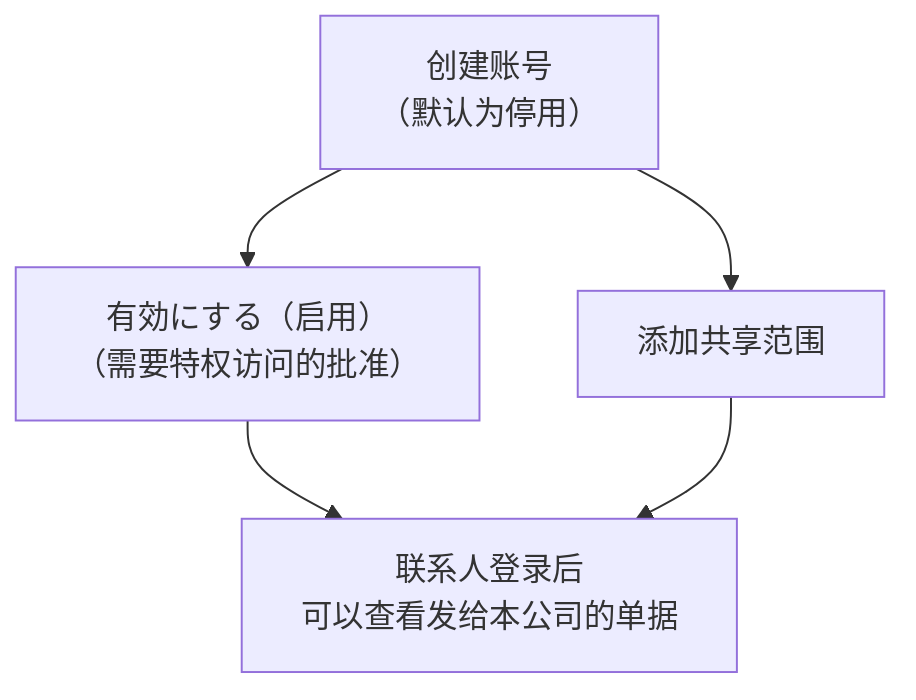

管理业务伙伴的联系人 **自行查看发给本公司的单据** 的入口。操作代码为 `SY0H`。

> ⚠️ 本应用目前 **仅在测试环境** 中可用。在正式环境可用之前，画面和步骤可能会有变化。

> ⚠️ 这是向公司外部人员展示单据的设置。共享范围设错的话，**会让别的业务伙伴的金额被看到**。请沉着地逐条确认。

## 本应用能做什么

- 可以向业务伙伴的联系人发放门户账号。
- 可以决定向该联系人展示的单据范围（共享范围）。
- 可以发放只展示 1 份单据的链接。
- 可以确认谁在什么时候打开了什么的记录。

## 用语（本页出现的词）

- **门户账号（ポータルアカウント）** … 业务伙伴联系人的登录账号。**与员工账号是不同的东西**。
- **共享范围（共有範囲）** … 向该联系人展示的单据范围。以业务伙伴为单位决定。
- **单据链接（書類リンク）** … 只展示 1 份单据的 URL。没有账号也能打开。
- **本人验证（本人確認）** … 向登记的邮箱地址发送验证码，使只有本人才能打开的机制。
- **备用码（バックアップコード）** … 收不到邮件时使用的一次性代码。

## 创建账号

1. 点击「**ポータルアカウントの作成**」（创建门户账号）。
2. 输入业务伙伴和联系人的邮箱地址。
3. 保存。会显示「**アカウントを作成しました（既定は無効です）**」（已创建账号（默认为停用））。

> ⚠️ **仅仅创建，对方什么都看不到。** 点击「有効にする」（启用）之后才能登录。**启用需要[特权访问](/manual/zh/operations/system/privileged-access/user)（SY0G）的批准。**

到对方能看到单据为止的过程，用图表示如下。启用和共享范围 **两者都** 需要。

## 决定共享范围

共享范围一个都没有时，会显示「**共有範囲はまだありません（この人には何も見えません）**」（尚无共享范围（此人什么都看不到））。

添加范围时，有 2 个选项。

- **支店宛の書類も含める**（也包含发给分公司的单据）… 以上级业务伙伴共享时，发给其分公司的单据也能看到（**不会从分公司追溯到上级**）。
- **需要家・出荷先としての書類も含める**（也包含作为最终用户・送货对象的单据）… 该公司作为最终用户或送货对象的单据也会展示。

> ⚠️ 第 2 个选项「**可能会让最终用户看到经销对象的价格**」。只在需要时开启。

将共享范围作废后，该范围内的单据对该联系人不再可见。

## 只展示 1 份单据（单据链接）

想在不创建账号的情况下只展示 1 份单据时使用。从单据画面的「**ポータル共有**」（门户共享）发放。

1. 选择「**本人確認あり（推奨）**」（需验证（推荐））或「**リンクのみ**」（仅链接）。
2. 选择需验证时，输入接收验证码的邮箱地址。
3. 输入「有効期間（日）」（有效期（天））。
4. 点击「**発行する**」（发放），把出现的 URL 交给对方。

| 种类 | 会发生什么 |
|---|---|
| **本人確認あり**（需验证） | 向登记的地址发送验证码。即使被转发，本人以外也无法打开。 |
| **リンクのみ**（仅链接） | **只要知道 URL，任何人都能打开。** 请注意转发。发放需要特权访问的批准。 |

将链接作废后，**通过该链接打开的会话也会结束**。

## 备用码

可以为收不到邮件的联系人发放一次性代码（发放需要批准）。

> ⚠️ **关闭此画面后就无法再次显示。** 请打印或抄写下来，直接交给联系人本人。**请勿通过邮件发送**（这是邮件无法使用时的手段）。

## 查看记录

可以确认谁在什么时候打开了什么、来自哪个 IP 地址。还没有人打开过时，会显示「まだ何も閲覧されていません。」（尚未有任何查看。）。

## 常见问题・遇到困难时

**Q. 对方说「什么都不显示」。**
A. 可能是没有共享范围，或者账号仍为停用。两者都可以在管理画面中确认。

**Q. 点击启用按钮后被要求批准。**
A. 就是这样设计的。因为这是让公司外部人员能够查看的操作，所以要经过另一个人的批准。

**Q. 想让分公司的联系人也能看到发给总公司的单据。**
A. 做不到。只有 上级 → 分公司 这一个方向。请在总公司一侧创建共享范围。

**Q. 把错误的链接交给了对方。**
A. 请立即作废。正在打开中的会话也会结束。

<!-- permissions:start -->
## 所需权限

使用本画面需要 **客户门户管理**（`portal_admin`）权限。

| 想做的事 | 所需权限 |
| --- | --- |
| 打开画面、查看列表与明细 | 客户门户管理 — 查看 |
| 新增・变更・删除 | 客户门户管理 — 创建 / 更新 / 删除 |

仅查看有「查看」即可。画面中若有新增、变更或删除的操作，则分别需要对应的权限。

### 需要批准的操作

下列操作仅有权限还不够。需**在特权访问（SY0G）中提出申请，并只在他人批准的时间段内执行**。

| 操作 | 所需权限 | 可以做什么 |
| --- | --- | --- |
| 启用门户账号 | 客户门户管理（`portal_admin`）— 更新 | 授予外部人员持续查看自身单据的登录权限。 |
| 发放备用码 | 客户门户管理（`portal_admin`）— 更新 | 打印可绕过邮箱验证的一次性代码。印出的纸即为钥匙。 |
| 发放免验证链接 | 客户门户管理（`portal_admin`）— 创建 | 创建任何持有链接者均可打开的单据链接。需验证的链接不在此列。 |

权限通过角色授予。若不足，请与管理员联系。

权限的整体说明请参见「[权限与角色](../../../permissions)」。
<!-- permissions:end -->
