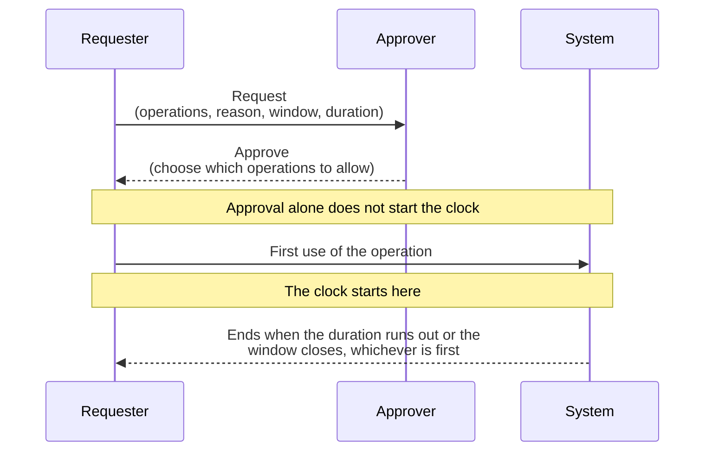

Some operations are heavy: revealing a device PIN, issuing a QR card, opening the details of a login record. This app (`SY0G`) is where you **request** them, someone else **approves** them, and you then have a **limited window** in which to act.

Holding the permission no longer means you can perform the operation. It means you may ask.

## Why it works this way

A PIN or a card is itself a key. The more people who can see the keys, the harder it is to know who looked, and why. Making everyone an administrator is worse — that grants every other operation too.

So these operations are off by default. You turn one on for a short time, with a reason, and someone else agrees. **An approver can authorise an operation but cannot perform it.**

## What you can request

A request is made for one of the following six "permissions". Within it, you choose the operations you want one by one.

- **共有端末の秘密** (Shared-device secrets) … showing or regenerating the maintenance exit PIN, PIN history and device settings code, resetting a device key, and so on ([Device Management](/manual/en/operations/system/kiosk-device/user)).
- **端末アクセスの付与** (Granting device access) … creating, linking, enabling, stopping and revoking shared devices and displays, and so on ([Device Management](/manual/en/operations/system/kiosk-device/user)).
- **QRカードの発行・PIN** (QR card issue and PIN) … issuing, assigning and revoking QR cards, resetting PINs, printing card sheets, and so on ([QR Card Management](/manual/en/operations/system/kiosk-card/user)).
- **個人データの閲覧** (Personal data access) … the detail of a login record, and the cross-document search and detail of the activity log ([Login History](/manual/en/operations/system/login-history/user), [Activity Log](/manual/en/operations/system/activity-log/user)).
- **取引先ポータルの管理** (Partner portal administration) … activating a portal account, issuing backup codes, issuing a link without identity check ([Partner portal](/manual/en/operations/system/portal/user)).
- **外部 API クライアントの管理** (External API client administration) … issuing an API token, activating an API client, managing outbound webhooks ([External API](/manual/en/operations/system/external-api/user)).

The request screen lists only the permissions you can request. If there are none, 「**申請できる特権操作がありません。**」 (There are no privileged operations you can request) is shown.

## Reading the screen

A blue band at the top explains how it works. Below it are the tabs.

- 「**自分の申請**」 (My requests) … the requests you have made.
- 「**承認する**」 (Approve) … the requests waiting for your decision. Only shown to people who can approve. The number waiting is shown in brackets.
- 「**履歴**」 (History) … requests that have been decided. Only shown to people who can approve.

Each request shows its current state as a badge.

- **承認依頼中** (Pending approval) … not yet decided.
- **承認済み** (Approved) … approved. A second badge next to it shows whether it can be used.
  - **開始前** (Not started) … the window has not started yet.
  - **利用可能** (Available) … inside the window. It has not been used yet, so no time has been spent.
  - **利用中** (In use) … it has been used, so the time is running down. The remaining time is shown.
  - **期限切れ** (Expired) … the window or the duration has ended.
- **差し戻し** (Sent back) / **取り消し** (Revoked) / **取り下げ** (Withdrawn) … not approved, cut off after approval, or withdrawn by you.
- **期限切れ** (Expired) … approved, but the window or the duration has ended. After a short while, 「承認済み」 changes to this.

## Requesting

1. Open **Privileged Access** (`SY0G`) and press 「**申請する**」 (Request) at the top right. People with nothing they can request do not see this button.
2. Under 「**対象**」 (Target), choose what to request in 「**権限**」 (Permission).
3. Under 「**操作**」 (Operations), tick the operations you want. You can choose more than one. Leave out what you will not use — the approver reads each one.
4. Write 「**申請理由**」 (Reason for the request). Make it clear why this is needed now.
5. Set the window with 「**開始日時**」 (Starts at) and 「**終了日時**」 (Ends at). It starts filled in as "from now until 7 days later". It may not extend more than **14 days** from the request.
6. Set 「**1 回あたりの有効時間（分）**」 (Valid time per use, in minutes). The default is 60, and the maximum is 1440 (one day).
7. Press 「**申請する**」 (Request) at the bottom of the screen.

「**申請しました**」 (Requested) appears and the request shows as **Pending approval**. You cannot perform the operation until it is approved. Before it is decided, you can cancel it with 「**取り下げ**」 (Withdraw) in 「自分の申請」.

### When does the clock start?

This is the part people get wrong, so plainly:

- **Approval does not start the clock.** It only arms the grant.
- The clock starts **the first time you actually perform the operation**. Where "opening the screen" is the operation — such as the activity log or a login-record detail — it starts the moment you open it.
- It ends at whichever comes **first**: your duration running out, or the window's end.

If you were granted 30 minutes but first use it 5 minutes before the window closes, **you get 5 minutes** — not 30.

Reserving a long window costs nothing while unused, but the window's end never moves.

As a diagram, the flow looks like this.

## Approving

Approvers see the 「**承認する**」 (Approve) tab. Your own requests never appear there — the requester and the approver must be different people.

A **notification is sent** to everyone who can decide the request. Requests waiting for your decision also appear on the "Privileged access" tab of [Pending list](/manual/en/operations/general/my-tasks/user) (`CM01`), so nothing is lost if a notification is missed (the decision is still made here).

When you decide, the outcome (approved / sent back / revoked) is **notified to the requester**.

1. Read what is being asked: who, what, why, for how long.
2. Press 「**承認**」 (Approve). The 「**申請を承認**」 (Approve the request) screen opens.
3. Under 「**許可する操作**」 (Operations to allow), everything is ticked by default. **Untick anything you do not want to grant.** Unticked operations stay unusable after approval.
4. If needed, write 「**コメント（任意）**」 (Comment, optional).
5. Press 「**承認する**」 (Approve).

To grant nothing, use 「**差し戻し**」 (Send back) instead of approving. Write 「**差し戻しの理由**」 (Reason for sending back) and press 「**差し戻す**」 (Send back). The requester sees the reason.

### Stopping a live grant

On the 「**履歴**」 (History) tab, press 「**取り消し**」 (Revoke) on that request. Write 「**取り消しの理由**」 (Reason for revoking) and press 「**取り消す**」 (Revoke) to end an active grant immediately. You do not have to wait for it to expire.

## Suspending users and changing their sites or roles

These work differently. Instead of reserving time, you submit **the change itself**.

1. Open the person in **User Management** (`SY01`).
2. Fill in the suspension, restoration, site change, or role change as usual.
3. Add a reason and press **Request approval** (for suspension and restoration, 「**停止の承認を依頼**」 / 「**復帰の承認を依頼**」). Nothing changes yet.
4. The approver presses 「**承認**」 (Approve) on the 「**承認する**」 tab, then 「**承認して適用**」 (Approve and apply) on the 「**変更を承認**」 (Approve the change) screen. At this point **the change is applied**.

If circumstances moved in the meantime (already suspended, a site was deleted, the change would remove the administrator role from the last administrator), it is not applied: 「**承認しましたが適用できませんでした**」 (Approved, but it could not be applied) appears, and the request keeps the reason it could not be applied — rather than forcing a stale change through.

## Questions

**I pressed a button and was told "this operation requires approval".**
You have no approved grant for that operation. Request one from Privileged Access. On [QR Card Management](/manual/en/operations/system/kiosk-card/user) and [Device Management](/manual/en/operations/system/kiosk-device/user), the band at the top of the screen shows which operations you can use now and which are 「（承認依頼中）」 (pending approval).

**It was approved but still does not work.**
One of: the window has not started; the window ended; your duration ran out after first use; or the approver unticked that operation. Check 「**自分の申請**」 (My requests) — removed operations are listed as 「**許可されなかった操作:**」 (Operations not granted).

**I cannot submit two requests for the same permission.**
Only one open request per permission. Withdraw it or wait for a decision.

**Administrators do not need to request.**
Correct. They act directly, and the activity log records that it was done with administrator rights.

<!-- permissions:start -->
## Permissions required

This screen needs no special permission — being signed in is enough.

Permissions come through roles. If something is missing, ask an administrator.

For the whole picture see [Permissions and roles](../../../permissions).
<!-- permissions:end -->
