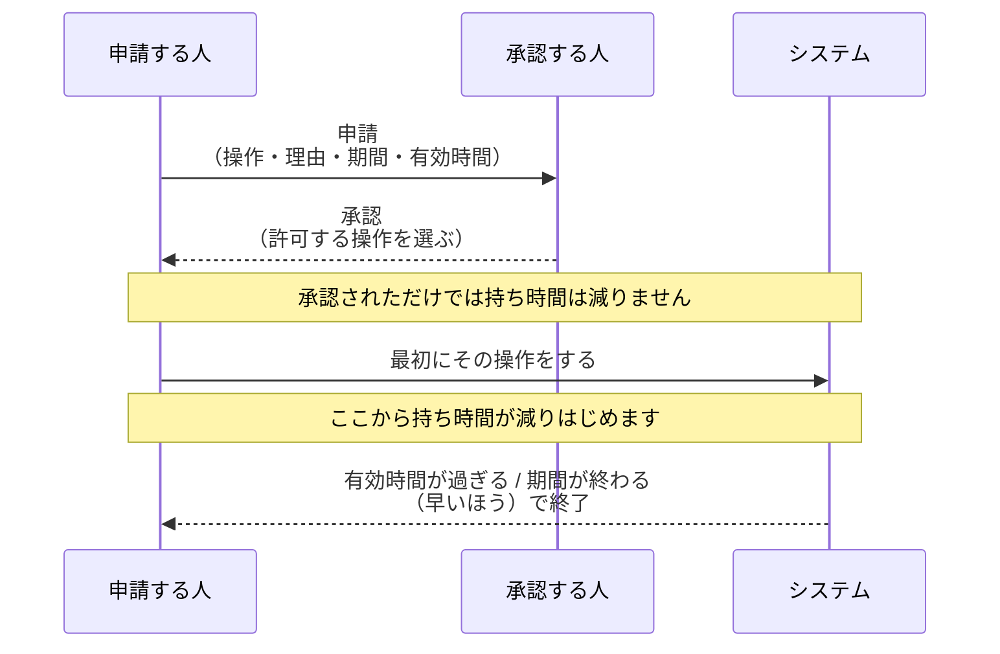

端末の PIN を見る、QR カードを発行する、ログイン履歴の中身を開く——こうした**重たい操作**を、**申請して、別の人に承認してもらってから、決められた時間だけ**行うためのアプリです。操作コードは `SY0G` です。

これまでは、権限を持っている人はいつでもこれらの操作ができました。今は「権限を持っている」＝「申請できる」で、実際に行うにはもう一人の承認が要ります。

## なぜこうなっているのか

PIN やカードは、それ自体が鍵です。鍵を見られる人を増やすほど、いつ・誰が・なぜ見たのかが分からなくなります。かといって管理者を増やすと、その人は他のすべての操作もできてしまいます。

そこで「ふだんは使えない。必要なときに、理由を書いて、承認をもらって、短い時間だけ使う」という形にしました。承認する人は許可はできますが、**自分では実行できません**。

## 申請できるもの

申請は、次の 6 つの「権限」ごとに出します。その中から、行いたい操作を 1 つずつ選びます。

- **共有端末の秘密** … メンテナンス退出 PIN・PIN 履歴・端末設定コードの表示や作り直し、端末の鍵のリセットなど（[端末管理](/manual/ja/operations/system/kiosk-device/user)）。
- **端末アクセスの付与** … 共有端末やディスプレイの登録・リンク・有効化・停止・取り消しなど（[端末管理](/manual/ja/operations/system/kiosk-device/user)）。
- **QRカードの発行・PIN** … QRカードの発行・割り当て・失効・PIN のリセット・台紙の印刷など（[QRカード管理](/manual/ja/operations/system/kiosk-card/user)）。
- **個人データの閲覧** … ログイン履歴の詳細、操作履歴の横断検索と詳細（[ログイン履歴](/manual/ja/operations/system/login-history/user)・[操作履歴](/manual/ja/operations/system/activity-log/user)）。
- **取引先ポータルの管理** … ポータルアカウントの有効化、バックアップコードの発行、本人確認なしリンクの発行（[取引先ポータル](/manual/ja/operations/system/portal/user)）。
- **外部 API クライアントの管理** … API トークンの発行、API クライアントの有効化、外向き Webhook の管理（[外部 API](/manual/ja/operations/system/external-api/user)）。

申請の画面に出るのは、あなたが申請できる権限だけです。1 つも無いときは「**申請できる特権操作がありません。**」と出ます。

## 画面の見かた

画面の上に、しくみの説明が青い帯で出ます。その下にタブが並びます。

- 「**自分の申請**」… 自分が出した申請の一覧です。
- 「**承認する**」… 自分が決裁する申請の一覧です。承認できる人にだけ出ます。待っている件数がかっこ書きで付きます。
- 「**履歴**」… 決裁が済んだ申請の一覧です。承認できる人にだけ出ます。

それぞれの申請には、いまの状態がバッジで出ます。

- **承認依頼中** … まだ決裁されていません。
- **承認済み** … 承認されました。横にもう 1 つバッジが付き、使える状態かどうかが分かります。
  - **開始前** … 利用できる期間がまだ始まっていません。
  - **利用可能** … 期間に入っています。まだ一度も使っていないので、持ち時間は減っていません。
  - **利用中** … 一度使ったので、持ち時間が減っています。残り時間が出ます。
  - **期限切れ** … 期間か持ち時間が終わりました。
- **差し戻し** / **取り消し** / **取り下げ** … 承認されなかった、承認後に打ち切られた、自分で取り下げた、のどれかです。
- **期限切れ** … 承認されたあと、期間か持ち時間が終わったものです。少し時間がたつと「承認済み」からこの表示に変わります。

## 申請する

1. **特権アクセス**（`SY0G`）を開き、画面右上の「**申請する**」を押します。申請できる権限が無い人には、このボタンは出ません。
2. 「**対象**」の「**権限**」で、申請するものを選びます。
3. 「**操作**」で、行いたい操作に印を付けます。複数選べます。使わないものは外してください — 承認する人は、ここで選んだものを 1 つずつ見て判断します。
4. 「**申請理由**」を書きます。「なぜ今これが必要なのか」が伝わるように書いてください。
5. 「**開始日時**」と「**終了日時**」で、利用できる期間を決めます。はじめは「今から 7 日後まで」が入っています。**申請した時点から最長 14 日**までです。
6. 「**1 回あたりの有効時間（分）**」を決めます。既定は 60 分で、最長 1440 分（1 日）です。
7. 画面下の「**申請する**」を押します。

「**申請しました**」と出て、申請は **承認依頼中** になります。承認されるまで、その操作はできません。決裁される前なら、「自分の申請」の「**取り下げ**」で取り消せます。

### 持ち時間はいつから減るのか

ここが分かりにくいところなので、はっきり書きます。

- **承認されただけでは、持ち時間は減りません。** 承認は「使ってよい」という許可で、時計はまだ止まっています。
- **最初にその操作をした瞬間から**、持ち時間が減りはじめます。操作履歴やログイン履歴の詳細のように「画面を開くこと」がその操作のときは、開いた瞬間から減ります。
- 終わるのは、**「最初に使ってから有効時間が過ぎたとき」か「期間の終了日時が来たとき」の早いほう**です。

たとえば有効時間 30 分で申請し、期間の終わりまであと 5 分という時点で最初に使うと、**使えるのは 5 分間**です。30 分は残りません。

期間を長めに取っておいても、使わなければ持ち時間は減りません。ですが期間の終わりは動かせないので、余裕をもって使ってください。

流れを図にすると次のとおりです。

## 承認する

承認できる人には「**承認する**」タブが出ます。自分が出した申請はここに出ません（申請した人と承認する人は別でなければならないためです）。

申請が出ると、決裁できる人へ**通知が届きます**。決裁待ちの申請は [未処理一覧](/manual/ja/operations/general/my-tasks/user)（`CM01`）の「特権アクセス」タブにも並ぶので、通知を見落としても残っているものが分かります（決裁はこの画面で行います）。

決裁すると、その結果（承認 / 差し戻し / 取り消し）が**申請した人へ**通知されます。

1. 申請の内容 — 誰が、何を、なぜ、どのくらいの期間 — を読みます。
2. 「**承認**」を押すと、「**申請を承認**」の画面が出ます。
3. 「**許可する操作**」は、既定ではすべてに印が付いています。**渡したくない操作は印を外してください。** 外した操作は、承認後も使えません。
4. 必要なら「**コメント（任意）**」を書きます。
5. 「**承認する**」を押します。

すべて外したいときは、承認ではなく「**差し戻し**」を使ってください。「**差し戻しの理由**」を書いて「**差し戻す**」を押します。申請した人はその理由を見ます。

### 承認したあとに止めたいとき

「**履歴**」タブで、その申請の「**取り消し**」を押します。「**取り消しの理由**」を書いて「**取り消す**」を押すと、有効な付与をその場で打ち切れます。期限を待つ必要はありません。

## ユーザーの利用停止・所属拠点・ロールの変更

これらは少し違う形です。時間を先に確保するのではなく、**変更したい内容そのものを申請します**。

1. **ユーザー管理**（`SY01`）で対象の人を開きます。
2. 利用停止・復帰・所属拠点の変更・ロール割当の変更を、いつもどおり入力します。
3. 理由を書いて **承認を依頼**（利用停止・復帰では「**停止の承認を依頼**」「**復帰の承認を依頼**」）を押します。この時点ではまだ何も変わりません。
4. 承認する人は「**承認する**」タブで「**承認**」を押し、「**変更を承認**」の画面で「**承認して適用**」を押します。この時点で、**その変更が適用されます**。

承認するまでの間に状況が変わっていることがあります（すでに停止されていた、拠点が消えていた、最後の管理者から管理者ロールを外すことになった、など）。そのときは適用されず、「**承認しましたが適用できませんでした**」と出て、申請には「適用できませんでした」と理由が残ります。古いままの内容を無理に当てないためです。

## よくある質問

**押したら「この操作には承認が必要です」と出ました。**
その操作の承認をまだ受けていません。特権アクセスから申請してください。[QRカード管理](/manual/ja/operations/system/kiosk-card/user)や[端末管理](/manual/ja/operations/system/kiosk-device/user)では、画面の上の帯に、いま使える操作と「（承認依頼中）」のものが出ます。

**承認されたのに使えません。**
次のどれかです。期間の開始前 / 期間が終わった / 最初に使ってから有効時間が過ぎた / 承認する人がその操作の印を外した。特権アクセスの「**自分の申請**」で状態を確認してください。外された操作は「**許可されなかった操作:**」として出ます。

**同じ権限の申請を 2 つ出せません。**
決裁されるまでは 1 つだけです。取り下げてから出し直すか、決裁を待ってください。

**管理者は申請が要りません。**
はい。管理者はこれまでどおり直接実行できます。ただし「管理者権限で実行した」ことは操作履歴に残ります。

<!-- permissions:start -->
## 必要な権限

この画面に特別な権限は要りません。ログインしていれば使えます。

権限は役割（ロール）を通して付きます。足りないときは管理者に相談してください。

権限の全体像は「[権限とロール](../../../permissions)」を参照してください。
<!-- permissions:end -->
