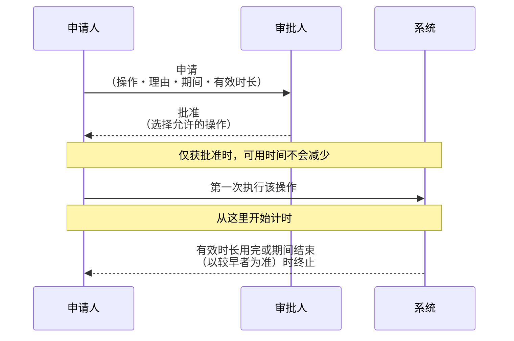

查看终端 PIN、发放二维码卡、打开登录记录的明细——这类**重要操作**，需要**先申请、由另一个人批准，然后只在限定的时间内执行**。操作代码为 `SY0G`。

以前只要拥有权限就可以随时执行。现在「拥有权限」＝「可以申请」，实际执行还需要另一个人的批准。

## 为什么这样设计

PIN 和卡片本身就是钥匙。能看到钥匙的人越多，就越难弄清谁在什么时候、为什么看过。而增加管理员更糟——那会连同其他所有操作一起放开。

因此这些操作默认关闭。需要时写明理由、取得批准，只使用很短的一段时间。**批准的人可以授权，但自己不能执行。**

## 可以申请的内容

申请按以下 6 种「权限」分别提出，再从中逐项选择要进行的操作。

- **共有端末の秘密**（共用终端的机密）… 显示或重新生成维护退出 PIN・PIN 历史・终端设置代码，重置终端密钥等（[终端管理](/manual/zh/operations/system/kiosk-device/user)）。
- **端末アクセスの付与**（授予终端访问）… 共用终端和显示屏的创建・关联・启用・停止・撤销等（[终端管理](/manual/zh/operations/system/kiosk-device/user)）。
- **QRカードの発行・PIN**（二维码卡发放・PIN）… 二维码卡的发放・分配・失效、PIN 重置、台纸打印等（[二维码卡管理](/manual/zh/operations/system/kiosk-card/user)）。
- **個人データの閲覧**（个人数据查看）… 登录历史的明细，操作历史的跨单据检索与明细（[登录历史](/manual/zh/operations/system/login-history/user)・[操作历史](/manual/zh/operations/system/activity-log/user)）。
- **取引先ポータルの管理**（客户门户管理）… 启用门户账号、发放备用码、发放无需验证的链接（[客户门户](/manual/zh/operations/system/portal/user)）。
- **外部 API クライアントの管理**（外部 API 客户端管理）… 签发 API 令牌、启用 API 客户端、管理外发 Webhook（[外部 API](/manual/zh/operations/system/external-api/user)）。

申请画面只列出你可以申请的权限。一项都没有时，会显示「**申請できる特権操作がありません。**」（没有可以申请的特权操作）。

## 画面的看法

画面上方有一条蓝色提示条说明机制。其下排列着页签。

- 「**自分の申請**」（我的申请）… 自己提出的申请列表。
- 「**承認する**」（批准）… 等待自己裁决的申请列表。仅对有批准权限的人显示。括号中显示等待的件数。
- 「**履歴**」（历史）… 已裁决的申请列表。仅对有批准权限的人显示。

每条申请都会用徽章显示当前状态。

- **承認依頼中**（审批中）… 尚未裁决。
- **承認済み**（已批准）… 已获批准。旁边还有一个徽章，表示能否使用。
  - **開始前**（未开始）… 可用期间尚未开始。
  - **利用可能**（可用）… 已进入期间。尚未使用过，所以时间没有减少。
  - **利用中**（使用中）… 已经使用过，时间正在减少。会显示剩余时间。
  - **期限切れ**（已过期）… 期间或有效时长已结束。
- **差し戻し**（已退回）/ **取り消し**（已撤销）/ **取り下げ**（已撤回）… 未获批准、批准后被中止，或自己撤回。
- **期限切れ**（已过期）… 获批后期间或有效时长已结束。过一小段时间后，「承認済み」会变为此显示。

## 提出申请

1. 打开**特权访问**（`SY0G`），点击画面右上方的「**申請する**」（申请）。没有可申请权限的人不会看到此按钮。
2. 在「**対象**」（对象）的「**権限**」（权限）中选择要申请的内容。
3. 在「**操作**」（操作）中勾选要进行的操作。可以多选。用不到的请去掉——批准的人会逐项查看。
4. 填写「**申請理由**」（申请理由），说明为什么现在需要。
5. 用「**開始日時**」（开始时间）和「**終了日時**」（结束时间）设定可用期间。初始值为「从现在到 7 天后」。从申请时点起**最长 14 天**。
6. 设定「**1 回あたりの有効時間（分）**」（每次的有效时长（分钟））。默认 60 分钟，最长 1440 分钟（1 天）。
7. 点击画面下方的「**申請する**」（申请）。

显示「**申請しました**」（已申请）后，申请状态变为**审批中**。在获得批准之前，无法执行该操作。裁决之前，可以在「自分の申請」中点击「**取り下げ**」（撤回）取消。

### 时间从什么时候开始计算

这一点容易误解，所以明确说明：

- **仅仅获得批准，时间不会减少。** 批准只是「允许使用」，时钟还没有走。
- **从第一次实际执行该操作的那一刻起**，时间开始减少。像操作历史、登录历史明细这样「打开画面」本身就是该操作时，从打开的那一刻起开始减少。
- 结束时间取「第一次使用后有效时长用尽」与「期间结束时刻」中**较早的一个**。

例如批准了 30 分钟，但在期间结束前 5 分钟才第一次使用，那么**只能用 5 分钟**。

期间留长一些并不会消耗时间，但期间的结束时刻无法改变。

用图表示，流程如下。

## 批准

有批准权限的人会看到「**承認する**」（批准）页签。自己提出的申请不会出现在这里（申请人与批准人必须不同）。

提交申请时会向能够裁决的人**发送通知**。待裁决的申请也会显示在[未处理列表](/manual/zh/operations/general/my-tasks/user)（`CM01`）的「特权访问」标签中，即使漏看通知也不会遗漏（裁决仍在本画面进行）。

完成裁决后，其结果（批准 / 退回 / 撤销）会**通知给申请人**。

1. 阅读申请内容：谁、要做什么、为什么、多长时间。
2. 点击「**承認**」（批准），会打开「**申請を承認**」（批准申请）画面。
3. 「**許可する操作**」（允许的操作）默认全部勾选。**不想授予的请取消勾选**，取消后即使批准也无法使用。
4. 如有需要，填写「**コメント（任意）**」（备注（可选））。
5. 点击「**承認する**」（批准）。

若一项都不想授予，请使用「**差し戻し**」（退回）而不是批准。填写「**差し戻しの理由**」（退回理由）后点击「**差し戻す**」（退回）。申请人可以看到该理由。

### 批准后想中止

在「**履歴**」（历史）页签中，点击该申请的「**取り消し**」（撤销）。填写「**取り消しの理由**」（撤销理由）后点击「**取り消す**」（撤销），即可立即终止仍然有效的授权，无需等待到期。

## 停用用户、变更所属据点或角色

这类操作形式不同：不是先预留时间，而是**直接申请这项变更本身**。

1. 在**用户管理**（`SY01`）中打开对象人员。
2. 照常填写停用、恢复、所属据点的变更或角色分配的变更。
3. 填写理由并点击**申请批准**（停用・恢复时为「**停止の承認を依頼**」「**復帰の承認を依頼**」）。此时尚未发生任何变化。
4. 批准人在「**承認する**」页签中点击「**承認**」（批准），再在「**変更を承認**」（批准变更）画面中点击「**承認して適用**」（批准并应用）。此时**该变更才被应用**。

如果在批准之前情况已经改变（已被停用、据点已删除、会从最后一位管理员身上去掉管理员角色等），则不会应用，会显示「**承認しましたが適用できませんでした**」（已批准但无法应用），申请中会留下无法应用的原因——以免把过时的内容强行写入。

## 常见问题

**点击后提示「需要批准」。**
你尚未获得该操作的批准。请从特权访问提出申请。在[二维码卡管理](/manual/zh/operations/system/kiosk-card/user)和[终端管理](/manual/zh/operations/system/kiosk-device/user)中，画面上方的提示条会显示现在可用的操作以及「（承認依頼中）」（审批中）的操作。

**已获批准却仍无法使用。**
可能是：期间尚未开始／期间已结束／第一次使用后有效时长已用尽／批准的人取消勾选了该操作。请在「**自分の申請**」（我的申请）中确认，被取消的操作会以「**許可されなかった操作:**」（未获允许的操作）列出。

**同一权限无法提交两个申请。**
在裁决之前只能有一个。请先撤回，或等待裁决。

**管理员无需申请。**
是的。管理员可以直接执行，但「以管理员权限执行」会记录在操作历史中。

<!-- permissions:start -->
## 所需权限

本画面不需要特别权限，登录后即可使用。

权限通过角色授予。若不足，请与管理员联系。

权限的整体说明请参见「[权限与角色](../../../permissions)」。
<!-- permissions:end -->
