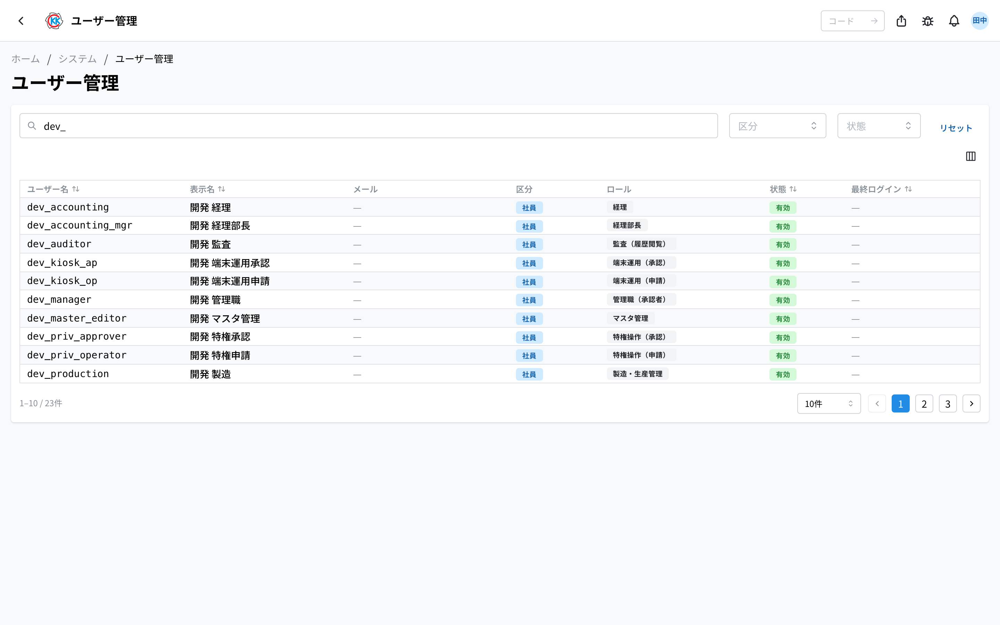
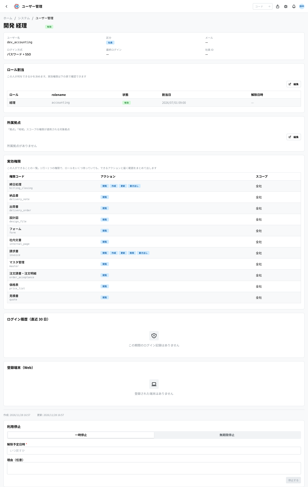
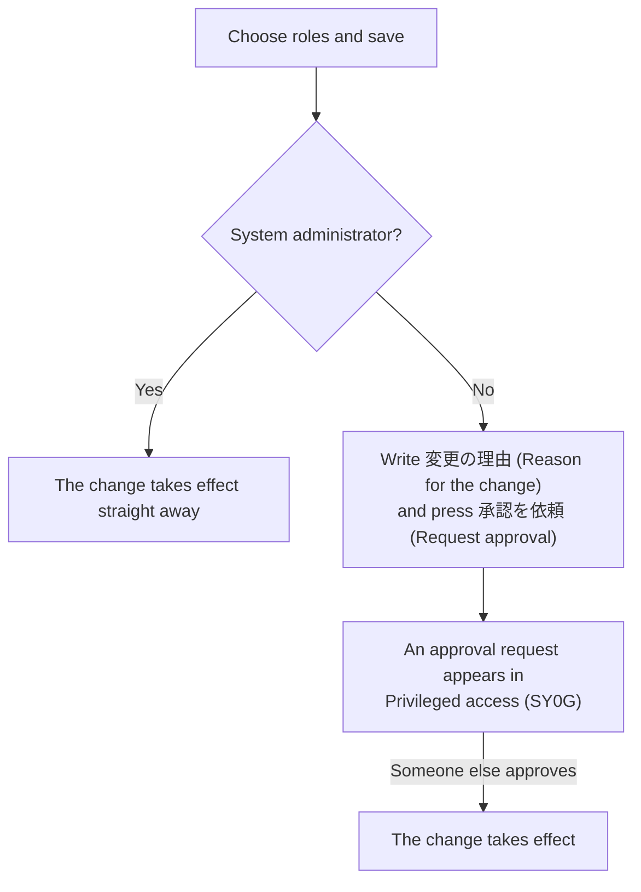

An app for seeing the list of people who use the system and checking **what each person is allowed to do**. The operation code is `SY01`.

You cannot add a person or change a name or email here (those are brought in from the company's shared login system). The only things this screen changes are **roles**, **assigned sites** and **suspension (and restoring)**.

## What you can do with this app

- You can see everyone registered in the system in one list.
- You can narrow the list down by name or email address to find the person you are looking for.
- When you choose one person, you can check the **roles** they have been given and the list of **things they can do**.
- You can change a person's **roles** and **assigned sites** (permission required).
- You can **suspend** a person or **restore** them (permission required).
- You can use it when you want to find out why a person cannot open a certain screen.

## Words used on this page

- **ロール (role)** … the person's job role. Roles are registered as a set, such as 「営業」 (sales) or 「工場担当」 (plant staff), and each role decides which screens the person can use.
- **権限 (permission)** … permission to do something, such as "you may look at this screen" or "you may save". It comes together with the role.
- **拠点 (site)** … a factory or an office. Some people have a rule that they can only see the data for their own site.
- **区分 (group)** … the kind of person. There are three: **社員** (employee) / **ゲスト** (guest) / **システム** (system — not a person, but work the system itself carries out).

## Before you start

- You need the **User administration** (`user_admin`) permission to open this app. If you cannot open it, the screen says you lack the permission (`user_admin:READ`). Please ask your system administrator.
- Changes to roles and assigned sites, and suspending or restoring a person, take effect immediately for a system administrator. Anyone else writes a reason and submits a request, and the change **takes effect when another person approves it** ([Privileged access](/manual/en/operations/system/privileged-access/user) (SY0G)).
- You cannot add people, delete people, or change their names in this app. People are managed by the company's shared login system.

## How to open it

Press **ユーザー管理** (User Management) inside 「システム」 (System) on the home screen. Or type `SY01` into the search box at the top of the screen.

## How to read the screen

When you open the app, the list of registered people is shown.

- **ユーザー名** (Username) … the ID used to log in.
- **表示名** (Display name) … the name shown on the screen.
- **メール** (Email) … the registered email address. When there is none, 「—」 is shown.
- **区分** (Group) … one of **システム** (system) / **社員** (employee) / **ゲスト** (guest).
- **ロール** (Roles) … the roles the person has been given. There may be more than one.
- **状態** (Status) … people who can log in now are 「**有効**」 (active); people who have been stopped are 「**無効**」 (inactive).
- **最終ログイン** (Last login) … the date and time of the last login. For someone who has never logged in, 「—」 is shown.

When you type into the search box at the top, 「**ユーザー名 / 表示名 / メール / ロール...**」 (Username / Display name / Email / Role...), only the people whose details contain those characters stay in the list. You can also narrow the list with 「**区分**」 and 「**状態**」. To clear all of the conditions, press 「**リセット**」 (Reset).

Click a row to open that person's detail screen.

## Checking one person

Click a row in the list to open that person's screen. The basic information is lined up near the top.

- **ユーザー名** / **区分** / **メール** / **最終ログイン** / **社員 ID** (Employee ID) … the same as in the list.
- **ログイン方式** (Login method) … 「**パスワード + SSO**」 (Password + SSO) means the person can sign in either with a password for this system or with the company's shared login. 「**SSO のみ**」 (SSO only) means the person signs in with the company's shared login only.

Below that come, in this order: 「**ロール割当**」 (Role assignments), 「**所属拠点**」 (Assigned sites), 「**実効権限**」 (Effective permissions), 「**ログイン履歴（直近 30 日）**」 (Login history, last 30 days), 「**登録端末（Web）**」 (Registered devices, web) and 「**利用停止**」 (Suspend).

### ロール割当 (Role assignments) — which roles the person has

- 「**ロール**」 shows the name of the role, and 「**状態**」 shows whether it is in effect now.
- Roles that were taken away in the past stay on record. A row with a date in 「**解除日時**」 (Removed on) is not in effect now.
- When there is nothing, 「**ロールが割り当てられていません**」 (No roles are assigned) is shown. This person cannot do anything yet.
- People with permission see an 「**編集**」 (Edit) button (it does not appear on your own screen). See "[Changing ロール (roles)](#changing-ロール-roles)" for how.

### 所属拠点 (Assigned sites) — which site the person belongs to

- These are the factories and offices the person belongs to.
- If a permission has the rule "can only see their own site" and this is empty, **the person can see no data at all**. When someone has been given a permission but still sees nothing, please check here.
- When there is nothing, 「**所属拠点がありません**」 (No assigned sites) is shown.

### 実効権限 (Effective permissions) — what the person can actually do

This is the list of what the person can actually do right now. However many roles the person has, there is **one row per permission**, listing what it lets them do (the actions) and the **widest scope** it reaches.

Here is how to read the table.

- 「**権限コード**」 (Permission code) … which permission it is. The permission's name (for example 見積書 (quotes) or システム管理 (system administration)) is shown on top, with its short code (`quote`, `system` and so on) in small letters below. When you ask about it, either one is fine.
- 「**アクション**」 (Action) … what the person may do: 閲覧 (look only), 作成 (create), 更新 (change), 削除 (remove), 書き出し (export), and 管理 (operations for administrators). Note that whether someone can **approve** documents is not decided here — who can approve is decided by the approval groups in [承認設定](/manual/en/operations/masters/approval-setting/user) (Approval Settings, MS0B).
- 「**スコープ**」 (Scope) … how far the permission reaches: 全社 (the whole company), 拠点 (their own site only), 地域 (their own region only), 自分の担当 (only the data they are responsible for), and so on. For site and region, the targets follow in brackets.

When there is nothing, 「**権限がありません**」 (No permissions) is shown.

### ログイン履歴（直近 30 日） (Login history, last 30 days)

The person's login records. Both successful and failed logins from the last 30 days are listed, newest first.

> 💡 This block and 「登録端末（Web）」 below are shown only to people with the "Personal data access" permission. Others see the notice "Viewing login history and registered devices requires the "Personal data access" permission (personal_data)." and a link to [Login history](/manual/en/operations/system/login-history/user) (`SY0D`).

- Each line shows 「**成功**」 (Success, green) or 「**失敗**」 (Failure, red) and how they logged in. For a failure, the reason is shown too.
- The date and time are on the right. Details such as where they connected from (IP address) are checked in [Login history](/manual/en/operations/system/login-history/user) (`SY0D`) after approval.
- If failures keep happening, it is a cue to check whether the person is mistyping or whether someone else is trying. To look at everyone at once, use [Login history](/manual/en/operations/system/login-history/user) (`SY0D`).
- When there are no records, 「**この期間のログイン記録はありません**」 (There are no login records in this period) is shown.

### 登録端末（Web） (Registered devices, web)

The devices the person used when logging in from a browser, such as on a PC. It is a guide to "is this the device they usually use"; it does not identify a device for certain.

- Each device shows a label (such as "Chrome / Windows 11"), how many times they logged in, and when it was last used.
- A badge shows the automatic check of whether it is a company device (device type). For what it means, see "Device type" in [Login history](/manual/en/operations/system/login-history/user).
- When there is nothing, 「**登録された端末はありません**」 (There are no registered devices) is shown.

## Changing ロール (roles)

Give a person a role, or take one away. **Changing roles changes what that person can do, directly.**

The 「**編集**」 (Edit) button appears at the top right of 「**ロール割当**」 only for people who have the "User administration" permission.

1. Open the detail screen of the person you want to change.
2. Press 「**編集**」 on 「**ロール割当**」.
3. Click the selection box and choose roles from the list. You can choose more than one.
4. To take a role away, click it once more to deselect it.
5. Press 「**保存**」 (Save), or 「**承認を依頼**」 (Request approval) when approval is needed.

For a system administrator the change takes effect straight away. **For everyone else nothing changes yet** — write 「**変更の理由**」 (Reason for the change) and submit, and an approval request appears in [Privileged access](/manual/en/operations/system/privileged-access/user) (SY0G). **The change takes effect when someone else approves it.** You cannot approve your own request.

As a diagram:

> ⚠️ If you remove every role, the person can do nothing at all. Check which screens they use before removing.

> ⚠️ When there is only one administrator, you cannot take the admin role away from them — nobody could make anyone an administrator again. 「**最後の管理者から管理者ロールを外すことはできません**」 (The admin role cannot be removed from the last admin) is shown.

> 💡 You cannot change your own roles (the 「**編集**」 (Edit) button does not appear on your own screen). Please ask someone else.

Removed roles stay on record. A date appears in 「**解除日時**」 (Removed on) in the table, so you can read later when it was taken away.

## Changing 所属拠点 (assigned sites)

The 「**編集**」 (Edit) button appears at the top right of 「**所属拠点**」 only for people who have the "User administration" permission.

1. Open the detail screen of the person you want to change.
2. Press 「**編集**」 on 「**所属拠点**」.
3. Choose a site from the list. You can choose more than one.
4. To take a site away, click it once more to deselect it.
5. Press 「**保存**」 (Save), or 「**承認を依頼**」 (Request approval) when approval is needed.

When 「**保存しました**」 (Saved) and 「**所属拠点を更新しました**」 (Assigned sites updated) are shown, you are finished. As with roles, anyone who is not a system administrator writes a reason and submits, and the change takes effect once it is approved.

> ⚠️ When you take a site away, the person will see less data. Screens with the rule "only their own site" may become empty.

> 💡 A site with 「（無効）」 (inactive) next to it may appear in the selection box. It is a site that is no longer in use, but it is still assigned to this person, so it is shown.

## Suspending and restoring

Use this to stop a person from logging in, for example when they leave or go on leave. Work in the 「**利用停止**」 (Suspend) section of the detail screen. Only people with the "User administration" permission can do this.

1. Open the detail screen of the person you want to suspend.
2. In 「**利用停止**」, choose 「**一時停止**」 (Temporary suspension) or 「**無期限停止**」 (Suspended indefinitely). For a temporary suspension, also enter 「**解除予定日時**」 (Scheduled to be released at).
3. Write the reason. A system administrator sees 「**理由（任意）**」 (Reason (optional)) and may leave it empty. When approval is needed, 「**停止の理由**」 (Reason for suspension) is required.
4. Press 「**停止する**」 (Suspend) — or 「**停止の承認を依頼**」 (Request suspension approval) when approval is needed.
5. A confirmation screen appears. Press 「**停止**」 (Suspend) — or 「**依頼する**」 (Submit request) when approval is needed. To stop, press 「**戻る**」 (Back).

A suspended person's section shows 「**停止中（一時）**」 (Suspended (temporary)) or 「**停止中（無期限）**」 (Suspended (indefinite)), together with the scheduled release time and the reason. A temporary suspension ends by itself once the scheduled time has passed (it can take up to 1 minute). To restore the person without waiting, press 「**いま復帰させる**」 (Restore now) — or, when approval is needed, write 「**復帰の理由**」 (Reason for restoring) and press 「**復帰の承認を依頼**」 (Request restoration approval).

> ⚠️ You cannot suspend yourself or the last remaining administrator. In that case the section shows 「**自分自身は停止できません。別の管理者に依頼してください。**」 (You cannot suspend yourself. Ask another admin to do it.) or 「**最後の管理者は停止できません。先に他のユーザーへ管理者権限を割り当ててください。**」 (The last admin cannot be suspended. Assign admin rights to another user first.), and the controls are disabled.

As with roles and sites, anyone who is not a system administrator submits a request, and the suspension or restoration **takes effect when another person approves it**. Until then, the person can still log in.

## Input fields

A user's name and email are **imported from Active Directory** and cannot be changed here. The only inputs on this screen are the roles and the assigned sites.

| Field | Required | What to enter |
|-------|----------|---------------|
| [Roles](#field-roles) | Optional | The roles given to this user |
| [Assigned sites](#field-plants) | Optional | The sites this user works with |

### Roles [#field-roles]

The roles given to the user. Several can be selected.

**What the person can do is all the selected roles put together.** The result is shown in 「実効権限」 (Effective permissions) on the same screen. If every role is removed, the person can do nothing.

Only people with the "User administration" permission can edit it, and anyone who is not a system administrator needs approval. You cannot change your own roles.

### Assigned sites [#field-plants]

The sites the user is responsible for. Several can be selected.

The "plant" range of a permission is **decided by the overlap with what is selected here**. Someone whose permission is "view within their plant" sees only data for the plants listed here. If this is empty, plant-ranged permissions show nothing.

Only people with the "User administration" permission can edit it, and anyone who is not a system administrator needs approval. Everyone else sees the current assignment as badges.

## Questions and problems

**Q. I want to add someone who has just joined, but there is no add button.**
A. You cannot add people from this app. Information about people is brought in from the company's shared login system. Please ask your system administrator.

**Q. I want to change someone's role.**
A. Press 「**編集**」 (Edit) on 「**ロール割当**」 on the detail screen (see "[Changing ロール (roles)](#changing-ロール-roles)"). If the button does not appear, you do not have permission. Please ask your system administrator.

**Q. I saved the roles, but the person's permissions have not changed.**
A. A change made by anyone who is not a system administrator **does not take effect until it is approved**. Check in [Privileged access](/manual/en/operations/system/privileged-access/user) (SY0G) whether your request is still pending approval.

**Q. The 「編集」 (Edit) button does not appear.**
A. Changing roles and assigned sites needs the "User administration" permission. Everyone else can only look. Please ask your system administrator.

**Q. Someone was given a role, but they say they still cannot open the screen.**
A. Open that person's detail screen and look for the matching row in 「**実効権限**」 (Effective permissions). If the row is there but the data is empty, please also check whether 「**所属拠点**」 is empty.

**Q. Someone has two roles, but 「実効権限」 shows only one row for the same permission code.**
A. That is normal. The same permission is kept to **one row even when the actions differ**. If every action reaches the same scope it is shown once; only when they differ is the scope written per action. When the same permission comes from both roles, the **wider scope** is shown ("own data only" + "everything" → "everything").

**Q. I want to know who changed this person's roles or assigned sites, and when.**
A. You can check in the [Activity Log](/manual/en/operations/system/activity-log/user). Every change is recorded.

<!-- permissions:start -->
## Permissions required

Using this screen requires the **User administration** (`user_admin`) permission.

| What you want to do | Permission needed |
| --- | --- |
| Open the screen, view lists and details | User administration — View |
| Add, change or delete | User administration — Create / Edit / Delete |

Viewing only needs *View*. Where a screen offers adding, changing or deleting, each of those needs its matching permission.

Permissions come through roles. If something is missing, ask an administrator.

For the whole picture see [Permissions and roles](../../../permissions).
<!-- permissions:end -->
