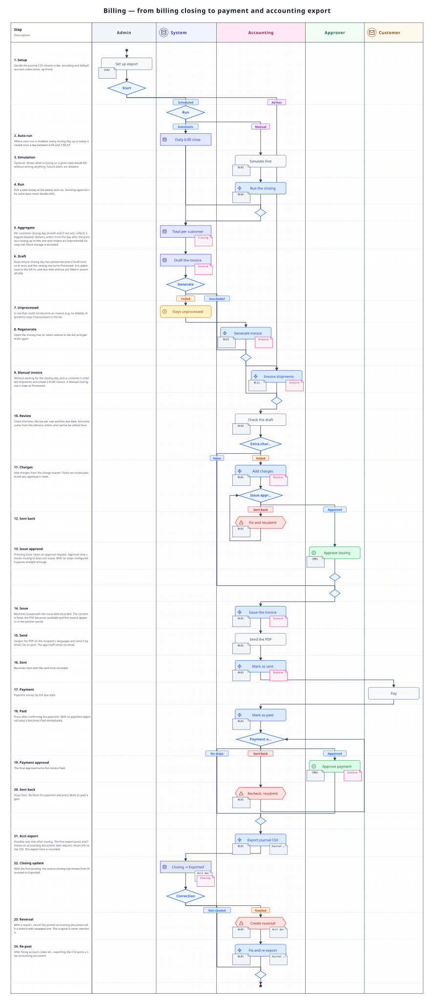
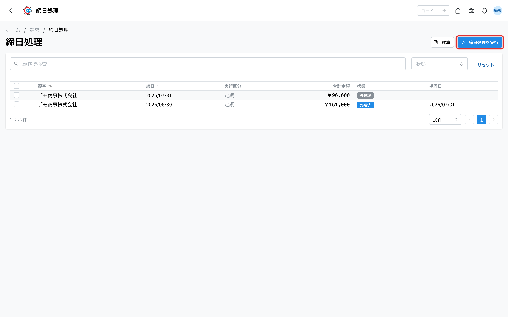
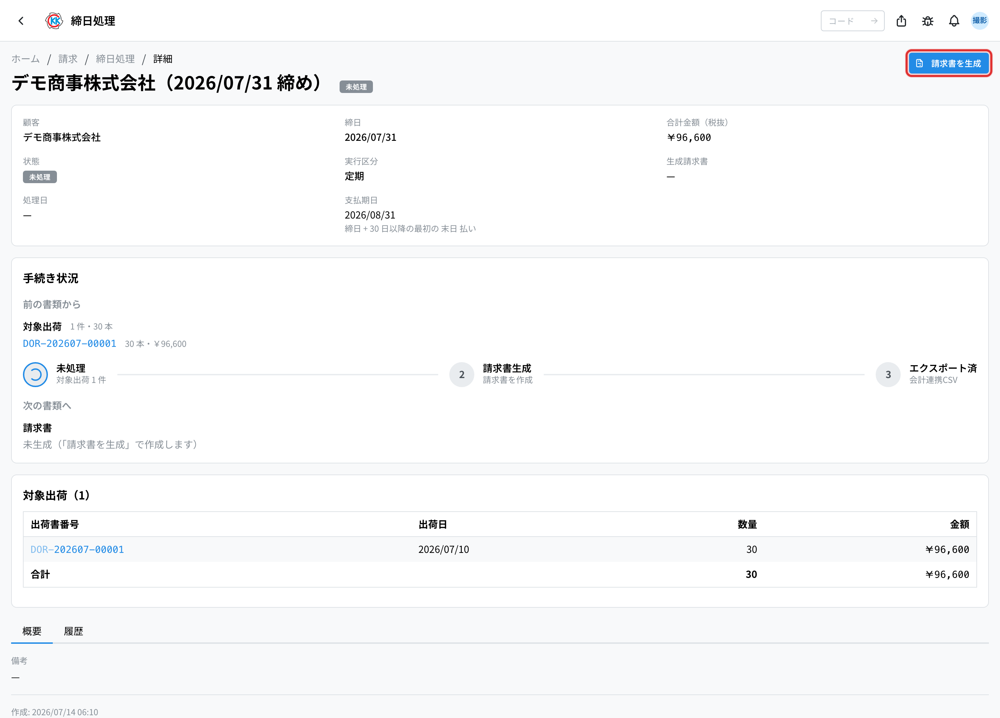
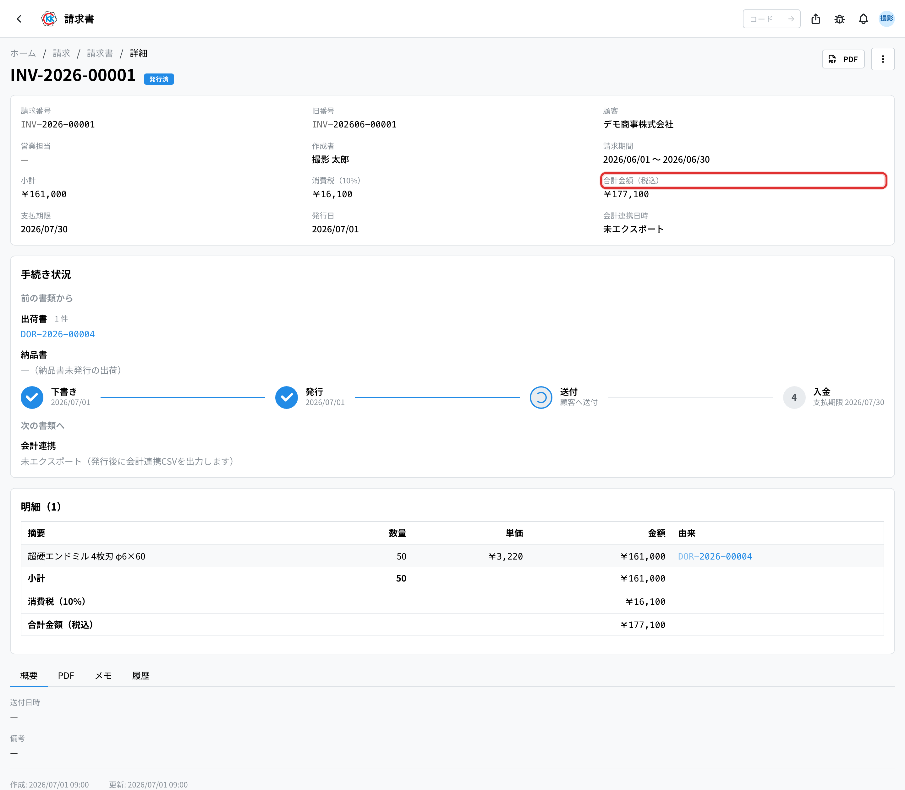
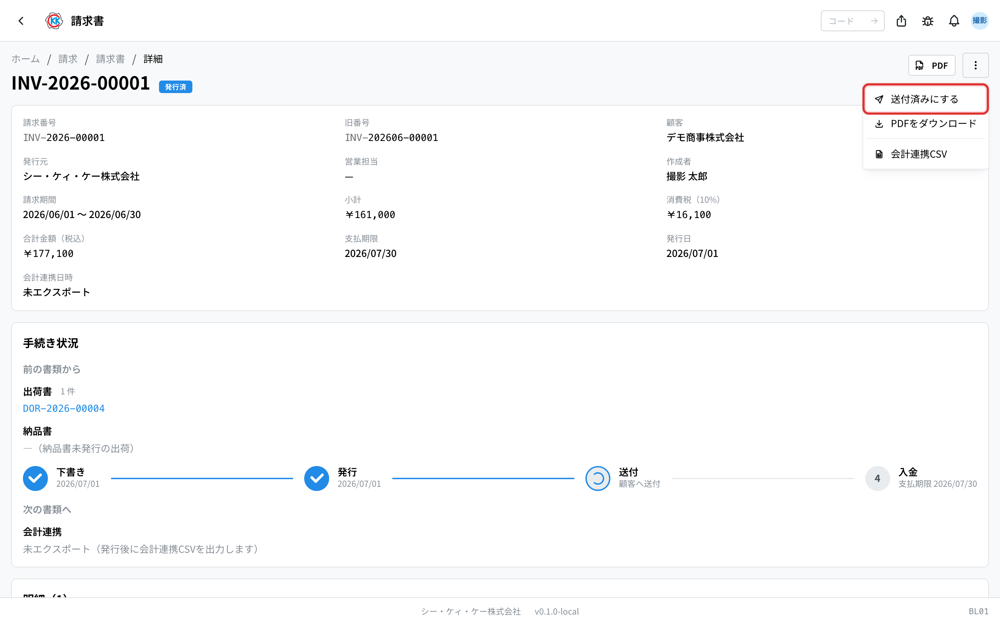
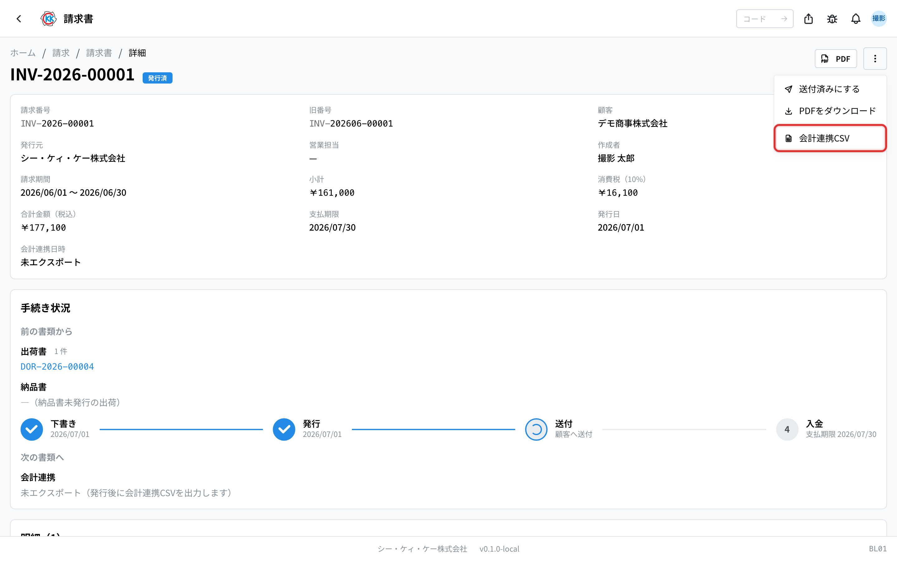

A page covering the flow from closing what has been delivered and making the invoice, through sending it, until payment is recorded. It is where you check "what stage things are at now, and who does what next", and each **document's states**. The basic steps to operate belong to [Standard flow](/manual/en/process/default-flow).

## Overall flow

The full list of each step's branches and the app to use is in [Business Flow](/manual/en/business-flow#billing).

## Stage-by-stage roles and apps

| Stage | What happens | Role | App used |
|-------|--------------|------|----------|
| 1. Close | Total up the shipments of every customer whose closing day has come by the chosen date, and create draft invoices | Accounting | [Billing closing](/manual/en/operations/billing/billing-closing/user) (`BL02`) |
| 2. Check the content | Check the line items and amounts | Accounting | [Invoice](/manual/en/operations/billing/invoice/user) (`BL01`) |
| 3. Issue | Issue the PDF (approve first if extra charges were added) | Accounting | [Invoice](/manual/en/operations/billing/invoice/user) (`BL01`) |
| 4. Send | Send it to the customer and record that it was sent | Accounting | [Invoice](/manual/en/operations/billing/invoice/user) (`BL01`) |
| 5. Record payment | Set it to paid once payment arrives (through payment approval if a flow is set up) | Accounting | [Invoice](/manual/en/operations/billing/invoice/user) (`BL01`) |
| 6. Hand over to accounting | Export the journal CSV for the accounting software, per invoice | Accounting | [Invoice](/manual/en/operations/billing/invoice/user) (`BL01`) |

## What happens at each stage

### 1. Closing (billing closing)

At the **closing day** set for each customer, total up what was shipped in that period (delivery orders that are「出荷済」(shipped) with type「発送」(dispatch)). The closing day, payment terms and payment day registered in the [Customer master](/manual/en/operations/masters/business-partner/user) are used.

The billing closing is run **for a date you choose** (up to today). One run closes every customer whose closing day has come by that date, and **where the closing day has already passed, a draft invoice is created right away**. A close whose closing day is exactly that date stays「未処理」(unprocessed) and can be invoiced from the next day, one at a time or in bulk from the list. To see in advance how much a later closing day will bill, use「**試算**」(Simulate) — it saves nothing and accepts future dates. Depending on settings, it also runs automatically every morning between 6 and 7 (steps … [Standard flow §11](/manual/en/process/default-flow#stage-11)).

To bill without waiting for the closing, use「**手動請求**」(Manual invoice) in the invoice list to pick a customer's unbilled shipments and create a draft invoice.

### 2–5. Invoice

Check the line items and amounts (subtotal, tax, total) of the invoice that was created, and issue it. Issuing saves the PDF. Only invoices with manually added extra charges need approval before they are issued. Set it to「送付済」(sent) once it has been sent to the customer — **the app sends no email**; it only records that and when it was sent. Set it to「支払済」(paid) once payment is confirmed; if a payment approval flow is set up, the final approval makes it paid. Both approvals pass straight through when no steps are configured in the approval settings. **These states are money management itself**, so change them only after confirming the actual payment.

### 6. Handing over to accounting

An issued invoice can be exported **per invoice** as a journal CSV for the accounting software (TKC FX4 Cloud) (the invoice's「…」→「会計連携CSV」(Accounting CSV); not from the billing closing screen). The first export posts an accounting document that freezes its content, and the billing closing that created that invoice moves from「処理済」(processed) to「**エクスポート済**」(exported). Later downloads return the same CSV. Draft invoices cannot be exported. To correct a mistake, cancel it with「反対仕訳を作成」(Create reversal — a reason is required) and export again.

## Document states

| Document | How the state moves |
|----------|----------------------|
| Billing closing | Unprocessed → Processed → Exported |
| Invoice | Draft → Issued → Sent → Paid |

## Where things tend to get stuck

**A shipment is missing from the invoice**
Check whether the delivery order is「出荷済」(shipped). Also, a delivery order of type「在庫保管」(stock storage) is not subject to billing.

**The closing day is wrong**
Check the customer master's closing day, payment terms and payment day settings. Billing follows those settings.

**The amount differs from what was expected**
The line items come from delivery orders. Check the delivery order's quantity and billing unit price.

## Related pages

- Following a single order from start to finish … [Standard flow](/manual/en/process/default-flow)
- How to operate each app and what each field means … **Operations › Billing** on the left
- Previous flow … [Shipping flow](/manual/en/process/shipping)
- Closing day settings per customer … [Customer master](/manual/en/operations/masters/business-partner/user)
