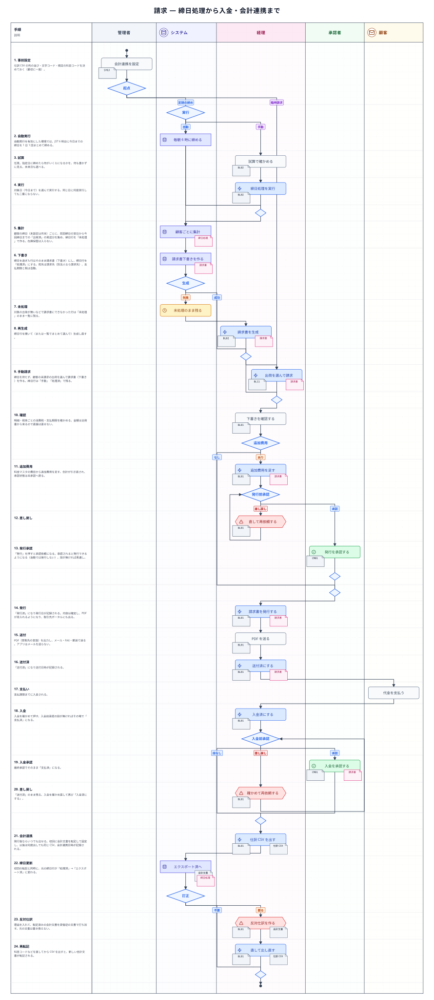
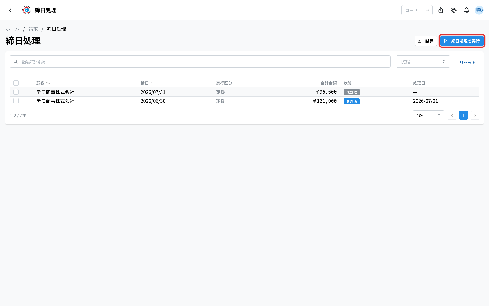
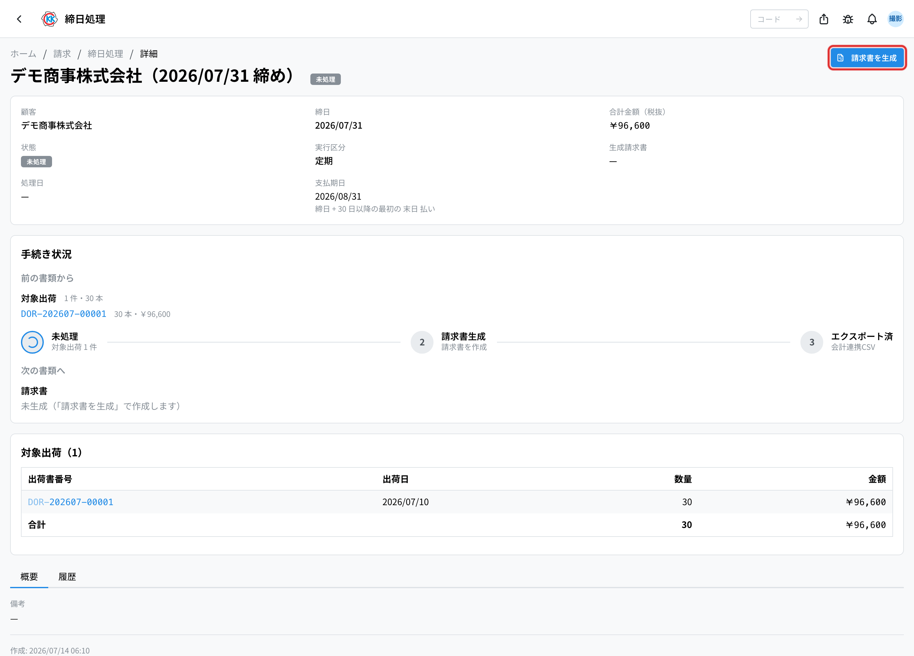
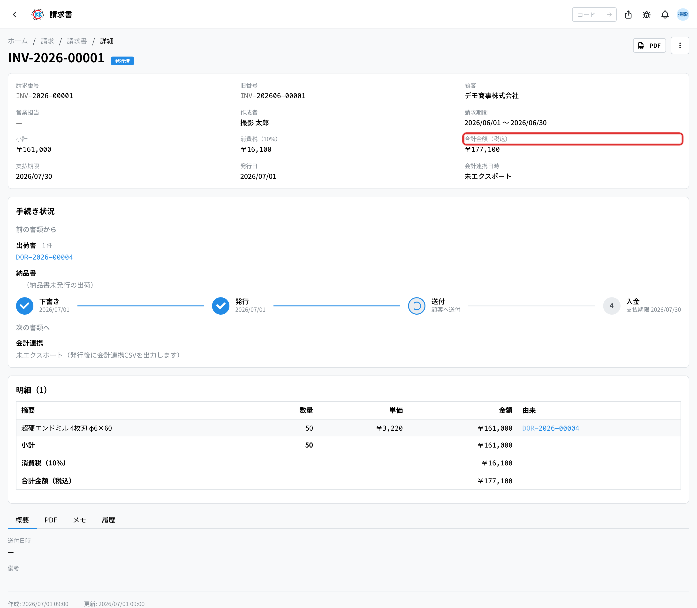
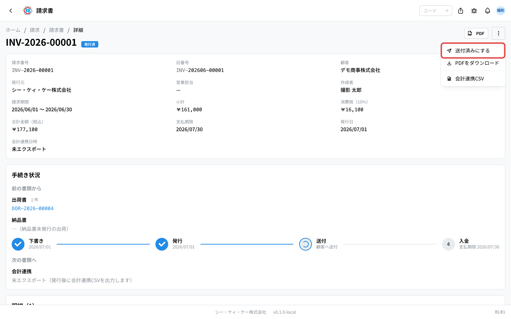
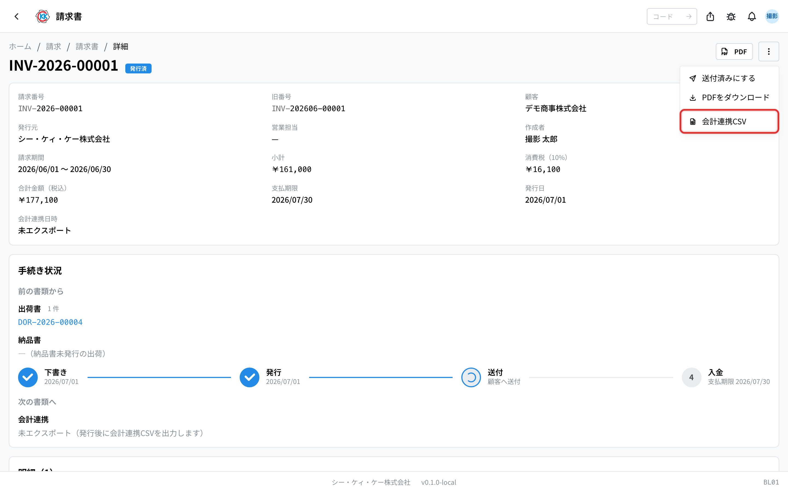

納品した分を締めて請求書を作り、送付して入金を記録するまでの流れをまとめたページである。「いまどの段階で、次に誰が何をするのか」と、各**書類の状態**をここで確認する。基本の操作手順は[標準フロー](/manual/ja/process/default-flow)が持つ。

```video
process-billing
```

## 全体の流れ



各手順の分かれ道と使うアプリの一覧は [業務フロー](/manual/ja/business-flow#billing) にある。

## 段階ごとの担当とアプリ

| 段階 | 何をするか | 担当 | 使うアプリ |
|------|-----------|------|-----------|
| 1. 締める | 指定日までに締日が来た顧客の出荷分をまとめ、請求書（下書き）を作る | 経理 | [締日処理](/manual/ja/operations/billing/billing-closing/user)（`BL02`） |
| 2. 内容を確認する | 明細と金額を確認する | 経理 | [請求書](/manual/ja/operations/billing/invoice/user)（`BL01`） |
| 3. 発行する | PDF を発行する（追加費用があれば先に承認） | 経理 | [請求書](/manual/ja/operations/billing/invoice/user)（`BL01`） |
| 4. 送付する | 顧客へ送り、送付した記録を付ける | 経理 | [請求書](/manual/ja/operations/billing/invoice/user)（`BL01`） |
| 5. 入金を記録する | 入金があったら支払済にする（入金の承認フローがあれば承認を経る） | 経理 | [請求書](/manual/ja/operations/billing/invoice/user)（`BL01`） |
| 6. 会計へ渡す | 請求書ごとに会計ソフト向けの仕訳 CSV を書き出す | 経理 | [請求書](/manual/ja/operations/billing/invoice/user)（`BL01`） |

## それぞれの段階でおきること

### 1. 締める（締日処理）

顧客ごとに決めた**締日**で、その期間に出荷した分（「出荷済」かつ種別「発送」の出荷書）をまとめる。締日・支払サイト・支払日は[顧客マスタ](/manual/ja/operations/masters/business-partner/user)に登録されているものが使われる。

締日処理は**日付を指定して**実行する（指定できるのは今日まで）。1 回の実行で、指定日までに締日が来た顧客がすべて締められ、**締日を過ぎている分はそのまま請求書（下書き）まで作られる**。締日が指定日ちょうどの分は「未処理」で残り、翌日から 1 件ずつ、または一覧でまとめて請求書にできる。先の締日でいくらになるかは「**試算**」で確かめられる（何も保存しない・先の日付も選べる）。設定によっては毎朝 6 時台に自動で実行される（操作手順 … [標準フロー §11](/manual/ja/process/default-flow#stage-11)）。

締日処理を待たずに請求したいときは、請求書の一覧から「**手動請求**」で、顧客の未請求の出荷を選んで請求書（下書き）を作れる。





### 2〜5. 請求書

作られた請求書の明細と金額（小計・消費税・合計）を確認し、発行する。発行すると PDF が保存される。手動で追加費用を足した請求書だけは、発行の前に承認が要る。顧客へ送ったら「送付済」にする — **アプリはメールを送らない**。送ったことと日時を記録するだけである。入金を確認したら「支払済」にする。入金の承認フローを組んでいれば、最終承認で「支払済」になる。どちらの承認も、承認設定に段が無ければ素通しになる。**この状態はお金の管理そのもの**であるため、実際の入金を確認してから変える。

請求書は**自社法人ごと**に作られる。同じ顧客・同じ締めでも、出荷が複数の[自社法人](/manual/ja/operations/masters/own-company/user)にまたがるときは会社ごとに 1 通ずつに分かれ、番号もその会社の連番から付く。PDF の発行元欄（名称・住所・登録番号）と社印は、その請求書の発行元の会社のものが印字される。





### 6. 会計へ渡す

発行済みの請求書は、**請求書ごとに**会計ソフト（TKC FX4クラウド）向けの仕訳 CSV として書き出せる（請求書の「…」→「会計連携CSV」。締日処理の画面からは書き出さない）。初めて書き出した時点で会計文書が転記されて中身が固定され、その請求書を作った締日処理は「処理済」から「**エクスポート済**」になる。2 回目以降のダウンロードは同じ CSV を返す。下書きの請求書は書き出せない。誤りを直すときは「反対仕訳を作成」（理由が必須）で打ち消してから、もう一度書き出す。

売上高の科目は、ふつうは税区分（無ければ既定）の科目になる。**再研磨の売上を製品の売上と別の科目で計上したいとき**は、[会計連携](/manual/ja/operations/system/accounting/user)（`SY0J`）の「注文種別ごとの売上高 科目コード」に再研磨の科目を入れておく。1 枚の請求書に製品と再研磨が混ざっていると、売上の行が科目ごとに分かれて書き出される。



## 書類の状態

| 書類 | 状態の移り変わり |
|------|-----------------|
| 締日処理 | 未処理 → 処理済 → エクスポート済 |
| 請求書 | 下書き → 発行済 → 送付済 → 支払済 |

## 止まりやすいところ

**請求書に出てこない出荷がある**
出荷書が「出荷済」になっているかを確認する。また、出荷書の種別が「在庫保管」のものは請求の対象にならない。

**締日が合わない**
顧客マスタの締日・支払サイト・支払日の設定を確認する。請求はその設定に従う。

**金額が想定と違う**
明細のもとは出荷書である。出荷書の数量・請求単価を確認する。

## 関連ページ

- 一つの注文を通しで追う … [標準フロー](/manual/ja/process/default-flow)
- 各アプリの操作と入力欄の意味 … 左の **操作方法 › 請求**
- 前の流れ … [出荷の流れ](/manual/ja/process/shipping)
- 顧客ごとの締日設定 … [顧客マスタ](/manual/ja/operations/masters/business-partner/user)
