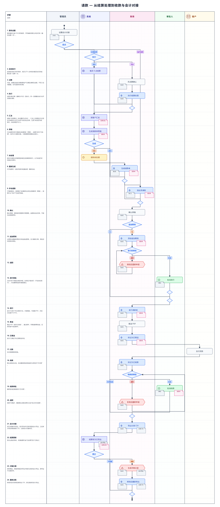
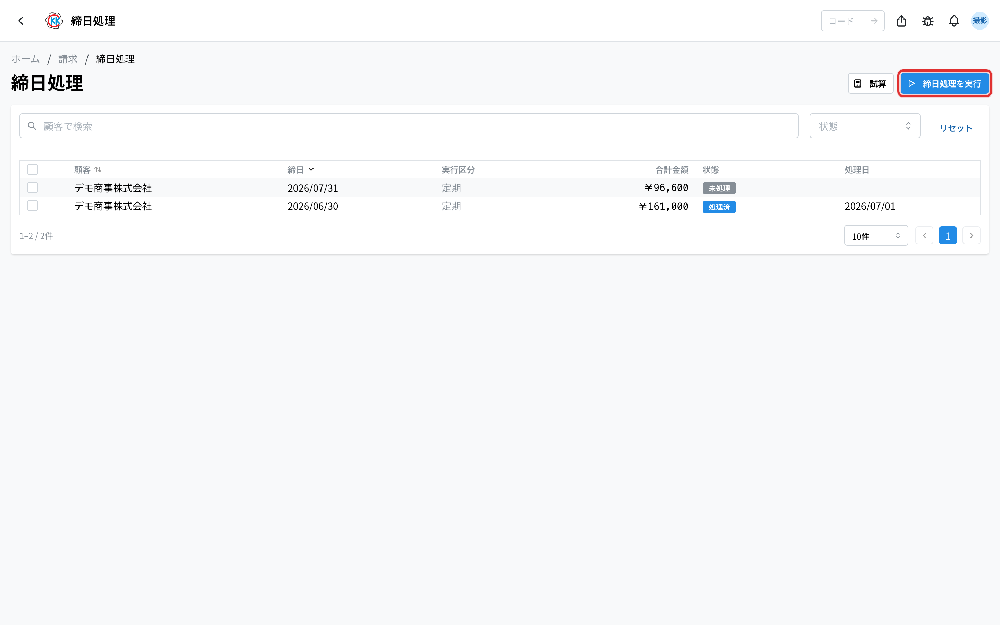
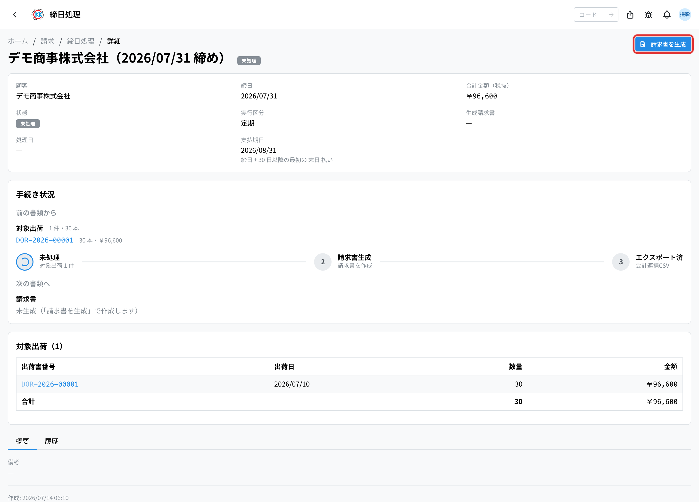
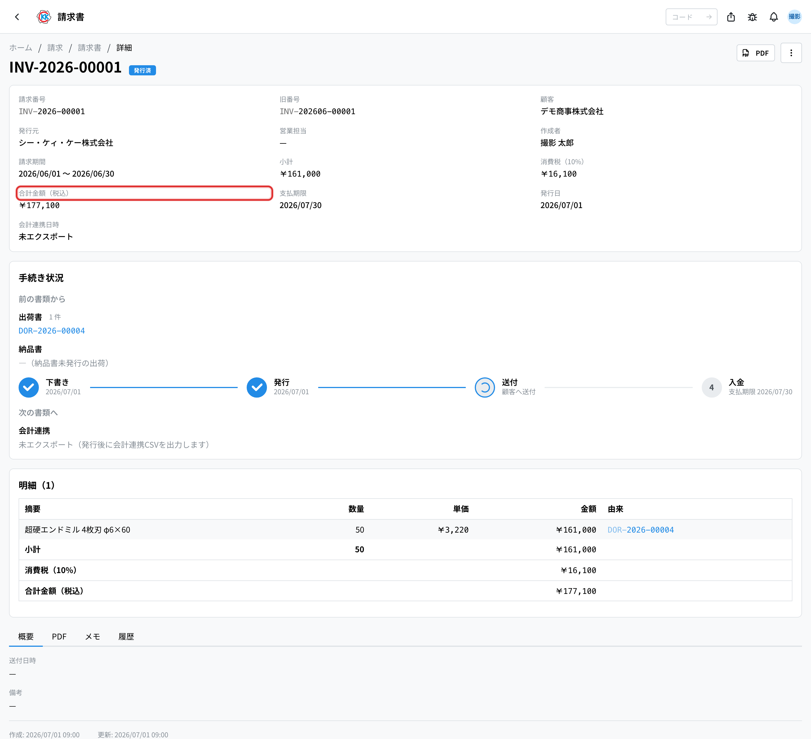
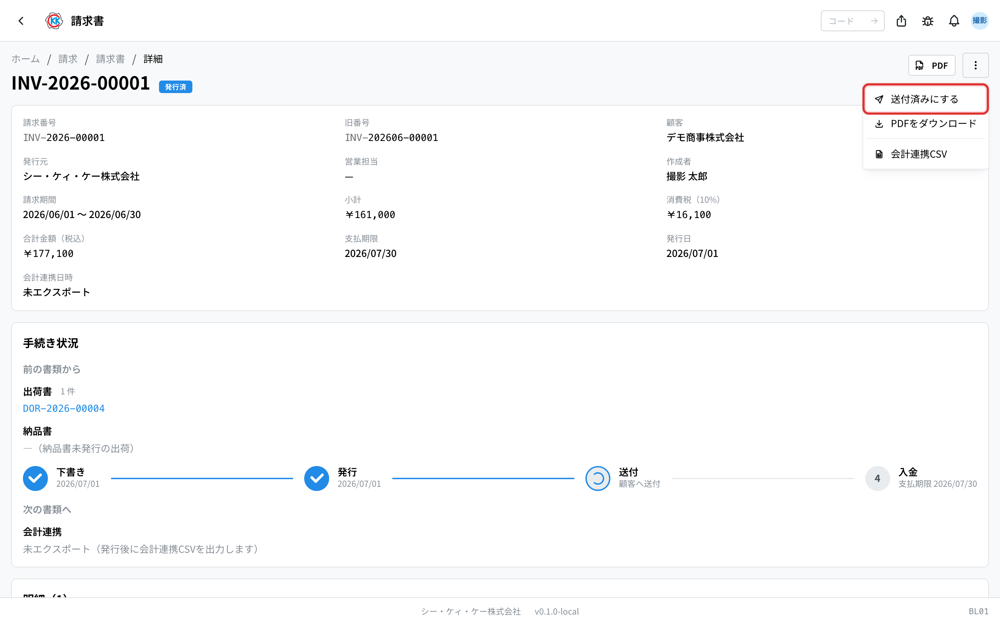
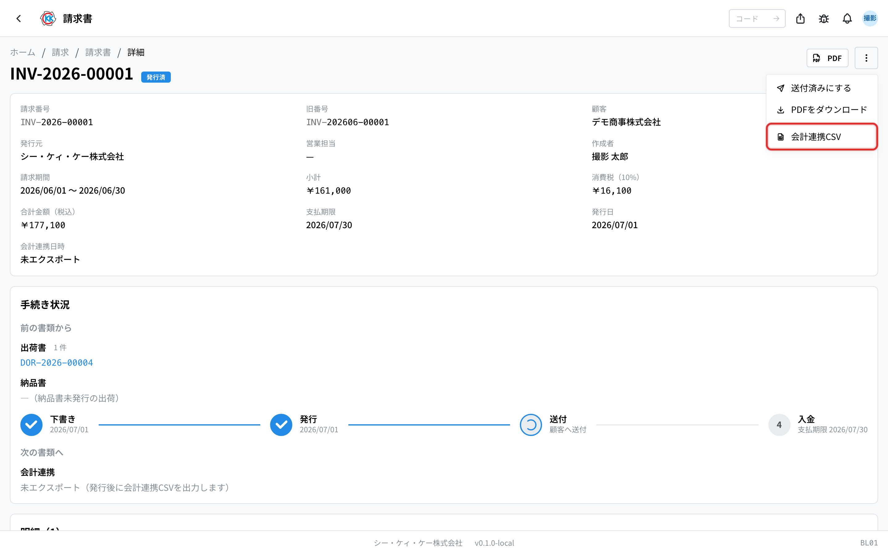

本页整理了结算已交货的部分并制作请款单，寄送后直到记录收款为止的流程。在这里确认「现在处于哪个阶段、接下来该谁做什么」，以及各**单据状态**。基本操作步骤由[标准流程](/manual/zh/process/default-flow)负责。

```video
process-billing
```

## 整体流程



各步骤的分支与使用的应用一览，请参见[业务流程](/manual/zh/business-flow#billing)。

## 各阶段的负责人与应用

| 阶段 | 做什么 | 负责人 | 使用的应用 |
|------|--------|--------|------------|
| 1. 结算 | 汇总到指定日期为止已到结算日的客户的出货部分，并做出请款单（草稿） | 财务 | [结算处理](/manual/zh/operations/billing/billing-closing/user)（`BL02`） |
| 2. 确认内容 | 确认明细与金额 | 财务 | [请款单](/manual/zh/operations/billing/invoice/user)（`BL01`） |
| 3. 发行 | 发行 PDF（有追加费用时先审批） | 财务 | [请款单](/manual/zh/operations/billing/invoice/user)（`BL01`） |
| 4. 寄送 | 发给客户，记录已寄送 | 财务 | [请款单](/manual/zh/operations/billing/invoice/user)（`BL01`） |
| 5. 记录收款 | 收到款项后设为已付款（设有收款审批流程时经过审批） | 财务 | [请款单](/manual/zh/operations/billing/invoice/user)（`BL01`） |
| 6. 交给会计 | 按每张请款单导出会计软件用的记账凭证 CSV | 财务 | [请款单](/manual/zh/operations/billing/invoice/user)（`BL01`） |

## 各阶段发生的事

### 1. 结算（结算处理）

按各客户设定的**结算日**，汇总该期间内出货的部分（「出荷済」（已出货）且类别为「発送」（发货）的出货单）。结算日・账期・付款日使用[客户主数据](/manual/zh/operations/masters/business-partner/user)中登记的内容。

结算处理**指定日期**执行（只能指定到今天为止）。执行 1 次，会结算到指定日期为止已到结算日的所有客户，**已过结算日的部分会直接做出请款单（草稿）**。结算日正好是指定日期的部分以「未処理」（未处理）留下，从第二天起可以逐件、或在一览中批量做成请款单。将来的结算日会请款多少，可以用「**試算**」（试算）确认（什么都不保存，也可以选将来的日期）。根据设置，每天早上 6 点多也会自动执行（操作步骤……[标准流程 §11](/manual/zh/process/default-flow#stage-11)）。

不等结算处理就要请款时，可以在请款单一览用「**手動請求**」（手动请款）选择客户未请款的出货，做出请款单（草稿）。





### 2～5. 请款单

确认生成的请款单的明细与金额（小计・税额・合计）后发行。发行后会保存 PDF。只有手动追加了费用的请款单，发行前需要审批。发给客户后设为「送付済」（已寄送）——**应用不会发送邮件**，只记录已寄送及其时间。确认收款后设为「支払済」（已付款）；如果设有收款审批流程，最终批准后变为「支払済」。两种审批在审批设置中没有任何一级时都直接通过。**这个状态就是资金管理本身**，因此要在确认实际收款后再更改。

请款单**按本公司法人**分别生成。即使是同一客户・同一次结算，出货跨多个[本公司法人](/manual/zh/operations/masters/own-company/user)时也会按公司各分成 1 张，编号也取自该公司的流水号。PDF 的开具方栏（名称・地址・登记号）和公司印章，印的是该请款单开具方公司的内容。





### 6. 交给会计

已发行的请款单可以**按每张请款单**导出为会计软件（TKC FX4 Cloud）用的记账凭证 CSV（请款单的「…」→「会計連携CSV」（会计对接 CSV）；不在结算处理画面导出）。首次导出时会过账一份会计文书并固定其内容，做出该请款单的结算处理从「処理済」（已处理）变为「**エクスポート済**」（已导出）。第 2 次以后下载返回同一份 CSV。草稿请款单不能导出。要更正错误时，先用「反対仕訳を作成」（创建冲销分录，必须填写理由）冲销，再重新导出。

销售收入的科目通常使用税种（没有时为默认）的科目。**想把再研磨的销售与产品的销售记入不同科目时**，请在[会计对接](/manual/zh/operations/system/accounting/user)（`SY0J`）的「按订单类别的销售收入科目代码」中填入再研磨的科目。1 张请款单中同时有产品和再研磨时，销售行会按科目分开导出。



## 单据状态

| 单据 | 状态变化 |
|------|----------|
| 结算处理 | 未处理 → 已处理 → 已导出 |
| 请款单 | 草稿 → 已发行 → 已寄送 → 已付款 |

## 容易卡住的地方

**有出货没有出现在请款单中**
确认出货单是否已为「出荷済」（已出货）。另外，出货单类别为「在庫保管」（库存保管）的不属于请款对象。

**结算日不对**
确认客户主数据中的结算日・账期・付款日设置。请款按该设置执行。

**金额与预期不符**
明细的来源是出货单。请确认出货单的数量・请款单价。

## 相关页面

- 追踪一笔订单的完整流程 … [标准流程](/manual/zh/process/default-flow)
- 各应用的操作与输入栏含义 … 左侧的 **操作方法 › 请款**
- 上一个流程 … [出货流程](/manual/zh/process/shipping)
- 按客户的结算日设置 … [客户主数据](/manual/zh/operations/masters/business-partner/user)
