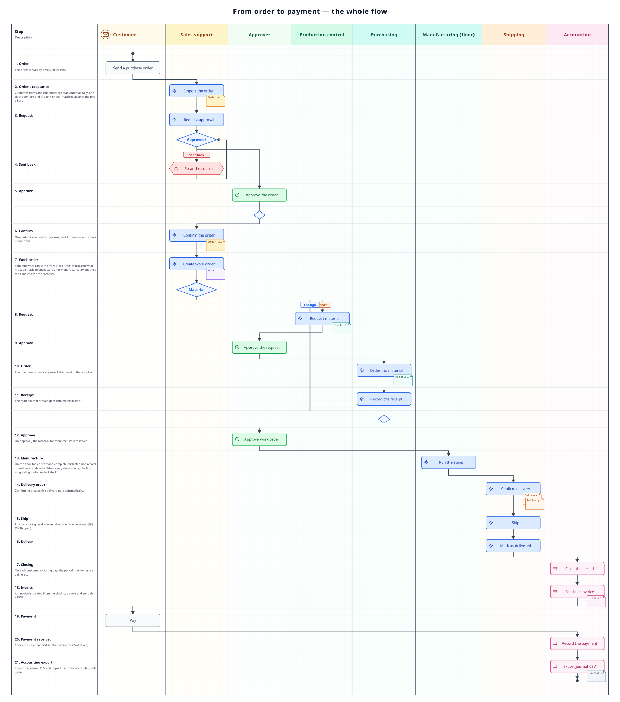

This page follows one order across every department on a single diagram — from the moment the customer's purchase order arrives **until the payment is recorded and handed to the accounting software**. Use it first to see who does what, in which order, and in which app.

The [Standard Flow](/manual/en/process/default-flow) follows the screens one by one "from price estimate to sending the invoice". This page instead **starts when the order arrives and also covers buying material, recording the payment and the accounting export**. Detailed branches, exceptions and document statuses are on the flow pages for each area ([Sales](/manual/en/process/sales), [Purchasing](/manual/en/process/purchasing), [Production](/manual/en/process/production), [Shipping](/manual/en/process/shipping), [Billing](/manual/en/process/billing)).

## The whole flow

## Who does each stage, in which app

| Stage | Who | App |
|------|------|-----------|
| 1. The purchase order arrives | Customer | (email, fax, PDF) |
| 2–3. Import the order and request approval | Sales support | [Order acceptance](/manual/en/operations/sales/order-acceptance/user) (`SA04`) |
| 4–5. Approve (if sent back, fix and request again) | Approver | [Pending list](/manual/en/operations/general/my-tasks/user) (`CM01`) |
| 6. Confirm the order | Sales support | [Order acceptance](/manual/en/operations/sales/order-acceptance/user) (`SA04`) → [Order line](/manual/en/operations/sales/order-line/user) (`SA05`) |
| 7. Create the work order | Sales support | [Work order](/manual/en/operations/production/work-order/user) (`PD02`) |
| 8–9. If material is short, raise a purchase request and approve it | Production control / Approver | [Purchase request](/manual/en/operations/purchasing/purchase-request/user) (`PU01`) |
| 10. Order the material | Purchasing | [Material purchase order](/manual/en/operations/purchasing/purchase-order/user) (`PU02`) |
| 11. Record the receipt | Purchasing | [Material receipt](/manual/en/operations/purchasing/material-receipt/user) (`PU03`) |
| 12. Approve the work order | Approver | [Pending list](/manual/en/operations/general/my-tasks/user) (`CM01`) |
| 13. Run the steps | Manufacturing (floor) | [Shop-floor Tablet — Recording Work](/manual/en/operations/kiosk/steps/user) |
| 14–15. Confirm the delivery order and ship | Shipping | [Delivery order](/manual/en/operations/shipping/delivery-order/user) (`SH01`) |
| 16. Mark as delivered | Shipping | [Delivery note](/manual/en/operations/shipping/delivery-note/user) (`SH02`) |
| 17. Close the period | Accounting | [Billing closing](/manual/en/operations/billing/billing-closing/user) (`BL02`) |
| 18. Send the invoice | Accounting | [Invoice](/manual/en/operations/billing/invoice/user) (`BL01`) |
| 19–20. Record the payment | Customer → Accounting | [Invoice](/manual/en/operations/billing/invoice/user) (`BL01`) |
| 21. Hand over to the accounting software | Accounting | [Billing closing](/manual/en/operations/billing/billing-closing/user) (`BL02`) |

## How to read the diagram

- The **left column** is the stage number and description; the **top row** is who does it (the department). Boxes are actions; diamonds are decisions.
- The small tag at the bottom right of a box is the document that stage produces (order acceptance, order lines, work order, delivery order, delivery note, invoice, and so on).
- A **send-back** (stage 4) goes back to the approver once it has been fixed and approval is requested again.
- **When there is enough material**, stages 8–11 (purchasing) are skipped and the flow goes straight to work-order approval. An order that can be filled entirely from stock (from stock) uses no material, so it does not pass through here either.
- **What the system does automatically** is written in the description column. The main ones: reading the purchase order (stage 2), creating the order lines and their numbers (stage 6), reserving the material (stage 12), putting finished goods into stock (stage 13), creating the delivery note (stage 14), and reducing stock and updating the order line's status on shipment (stage 15).

## Related pages

- Follow the screens step by step … [Standard Flow](/manual/en/process/default-flow)
- How documents connect (splitting and merging) … [Document Creation, Splitting, Merging and Relations](/manual/en/process/document-relations)
- Branches, exceptions and **the list of document statuses** … [Sales flow](/manual/en/process/sales) / [Purchasing flow](/manual/en/process/purchasing) / [Production flow](/manual/en/process/production) / [Shipping flow](/manual/en/process/shipping) / [Billing flow](/manual/en/process/billing)
