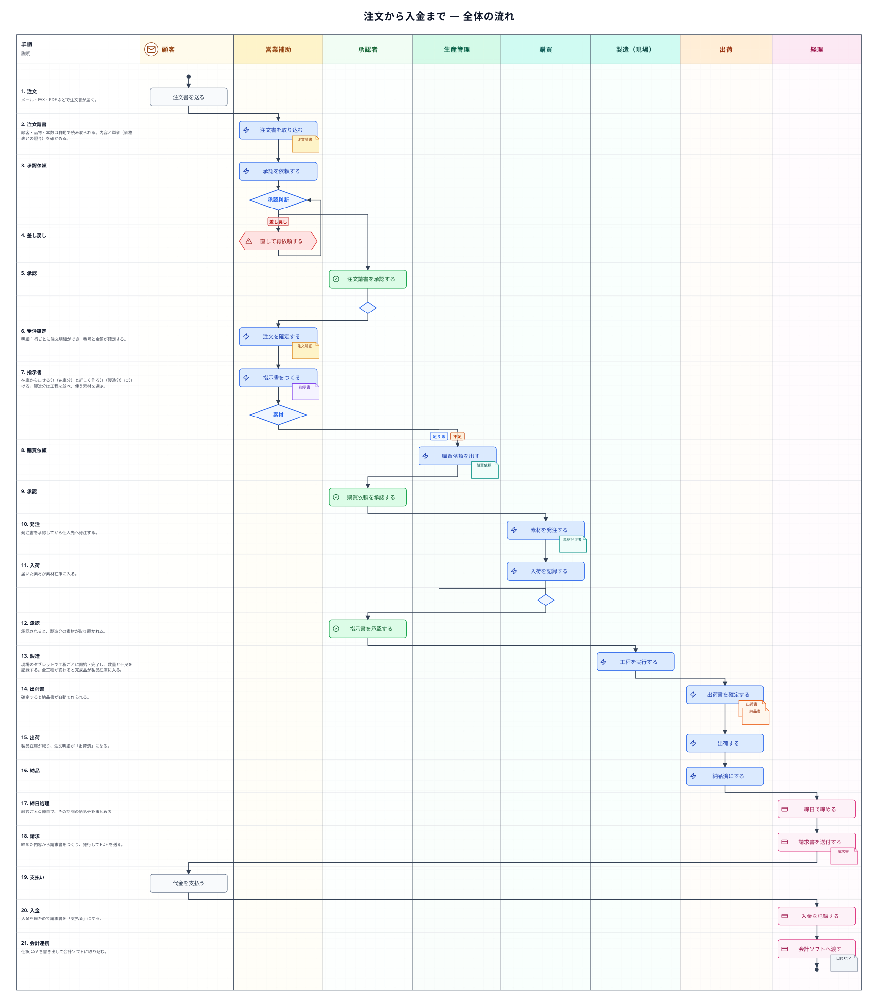

お客様の注文書が届いてから、**入金を記録して会計ソフトへ渡すまで**を、部署をまたいで 1 枚の図で追うページである。誰がどの順番で、どのアプリを使うのかを最初に見渡すために使う。

[標準フロー](/manual/ja/process/default-flow)が「価格試算から請求書の送付まで」を画面の操作ごとに追うのに対して、このページは**注文を受けたところから始まり、素材の購買と入金・会計連携まで**を含める。細かな分岐・例外と書類の状態は、分野ごとの流れのページ（[販売](/manual/ja/process/sales)・[購買](/manual/ja/process/purchasing)・[生産](/manual/ja/process/production)・[出荷](/manual/ja/process/shipping)・[請求](/manual/ja/process/billing)）が持つ。

## 全体の流れ

## 段階ごとの担当とアプリ

| 段階 | 担当 | 使うアプリ |
|------|------|-----------|
| 1. 注文書が届く | 顧客 | （メール・FAX・PDF） |
| 2〜3. 注文書を取り込み、承認を依頼する | 営業補助 | [注文請書](/manual/ja/operations/sales/order-acceptance/user)（`SA04`） |
| 4〜5. 承認する（差し戻されたら直して再依頼） | 承認者 | [未処理一覧](/manual/ja/operations/general/my-tasks/user)（`CM01`） |
| 6. 注文を確定する | 営業補助 | [注文請書](/manual/ja/operations/sales/order-acceptance/user)（`SA04`）→ [注文明細](/manual/ja/operations/sales/order-line/user)（`SA05`） |
| 7. 指示書をつくる | 営業補助 | [指示書](/manual/ja/operations/production/work-order/user)（`PD02`） |
| 8〜9. 素材が足りなければ購買依頼を出し、承認する | 生産管理 / 承認者 | [購買依頼](/manual/ja/operations/purchasing/purchase-request/user)（`PU01`） |
| 10. 素材を発注する | 購買 | [素材発注書](/manual/ja/operations/purchasing/purchase-order/user)（`PU02`） |
| 11. 入荷を記録する | 購買 | [素材入荷](/manual/ja/operations/purchasing/material-receipt/user)（`PU03`） |
| 12. 指示書を承認する | 承認者 | [未処理一覧](/manual/ja/operations/general/my-tasks/user)（`CM01`） |
| 13. 工程を実行する | 製造（現場） | [現場タブレット — 工程の記録](/manual/ja/operations/kiosk/steps/user) |
| 14〜15. 出荷書を確定し、出荷する | 出荷 | [出荷書](/manual/ja/operations/shipping/delivery-order/user)（`SH01`） |
| 16. 納品済にする | 出荷 | [納品書](/manual/ja/operations/shipping/delivery-note/user)（`SH02`） |
| 17. 締日で締める | 経理 | [締日処理](/manual/ja/operations/billing/billing-closing/user)（`BL02`） |
| 18. 請求書を送付する | 経理 | [請求書](/manual/ja/operations/billing/invoice/user)（`BL01`） |
| 19〜20. 入金を記録する | 顧客 → 経理 | [請求書](/manual/ja/operations/billing/invoice/user)（`BL01`） |
| 21. 会計ソフトへ渡す | 経理 | [締日処理](/manual/ja/operations/billing/billing-closing/user)（`BL02`） |

## 図の読みかた

- **左の列**が段階の番号と説明、**上の列**が担当（部署）である。四角は操作、ひし形は分かれ道を表す。
- 四角の右下に付いている小さな札は、その段階でできる書類である（注文請書・注文明細・指示書・出荷書・納品書・請求書 など）。
- **差し戻し**（段階 4）は、直して承認を依頼し直すと、もう一度承認者に回る。
- **素材が足りるとき**は、段階 8〜11（購買）を飛ばして指示書の承認へ進む。在庫から出せる分だけの注文（在庫分）も、素材を使わないのでここを通らない。
- **システムが自動でおこなうこと**は図の説明欄に書いてある。主なもの: 注文書の読み取り（段階 2）、注文明細と番号の作成（段階 6）、素材の取り置き（段階 12）、完成品の入庫（段階 13）、納品書の作成（段階 14）、出荷による在庫の減少と注文明細の状態の更新（段階 15）。

## 関連ページ

- 画面の操作を順に追う … [標準フロー](/manual/ja/process/default-flow)
- 書類どうしのつながり（分割・まとめ） … [書類の作成・分割・統合・関連](/manual/ja/process/document-relations)
- 分岐・例外と**書類の状態の一覧** … [販売の流れ](/manual/ja/process/sales) / [購買の流れ](/manual/ja/process/purchasing) / [生産の流れ](/manual/ja/process/production) / [出荷の流れ](/manual/ja/process/shipping) / [請求の流れ](/manual/ja/process/billing)
