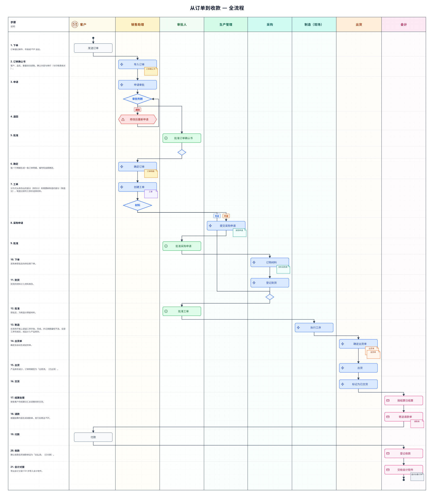

本页用一张图跨部门追踪一笔订单——从客户的订单送达开始，**到登记收款并交给会计软件为止**。可先用它来总览由谁、按什么顺序、使用哪个应用。

[标准流程](/manual/zh/process/default-flow)按画面操作逐一说明“从价格试算到寄送请款单”；本页则**从接到订单开始，并包括材料采购、收款与会计对接**。详细的分支、例外和单据状态，请参见各领域的流程页面（[销售](/manual/zh/process/sales)・[采购](/manual/zh/process/purchasing)・[生产](/manual/zh/process/production)・[出货](/manual/zh/process/shipping)・[请款](/manual/zh/process/billing)）。

## 全流程

## 各阶段的负责人与应用

| 阶段 | 负责人 | 使用的应用 |
|------|------|-----------|
| 1. 订单送达 | 客户 | （邮件・传真・PDF） |
| 2〜3. 导入订单并申请审批 | 销售助理 | [订单确认书](/manual/zh/operations/sales/order-acceptance/user)（`SA04`） |
| 4〜5. 审批（被退回时修改后重新申请） | 审批人 | [未处理列表](/manual/zh/operations/general/my-tasks/user)（`CM01`） |
| 6. 确定订单 | 销售助理 | [订单确认书](/manual/zh/operations/sales/order-acceptance/user)（`SA04`）→ [订单明细](/manual/zh/operations/sales/order-line/user)（`SA05`） |
| 7. 创建工单 | 销售助理 | [工单](/manual/zh/operations/production/work-order/user)（`PD02`） |
| 8〜9. 材料不足时提交采购申请并审批 | 生产管理 / 审批人 | [采购申请](/manual/zh/operations/purchasing/purchase-request/user)（`PU01`） |
| 10. 订购材料 | 采购 | [材料采购单](/manual/zh/operations/purchasing/purchase-order/user)（`PU02`） |
| 11. 登记到货 | 采购 | [材料到货](/manual/zh/operations/purchasing/material-receipt/user)（`PU03`） |
| 12. 批准工单 | 审批人 | [未处理列表](/manual/zh/operations/general/my-tasks/user)（`CM01`） |
| 13. 执行工序 | 制造（现场） | [现场平板 — 工序记录](/manual/zh/operations/kiosk/steps/user) |
| 14〜15. 确定出货单并出货 | 出货 | [出货单](/manual/zh/operations/shipping/delivery-order/user)（`SH01`） |
| 16. 标记为已交货 | 出货 | [送货单](/manual/zh/operations/shipping/delivery-note/user)（`SH02`） |
| 17. 按结算日结算 | 会计 | [结算处理](/manual/zh/operations/billing/billing-closing/user)（`BL02`） |
| 18. 寄送请款单 | 会计 | [请款单](/manual/zh/operations/billing/invoice/user)（`BL01`） |
| 19〜20. 登记收款 | 客户 → 会计 | [请款单](/manual/zh/operations/billing/invoice/user)（`BL01`） |
| 21. 交给会计软件 | 会计 | [结算处理](/manual/zh/operations/billing/billing-closing/user)（`BL02`） |

## 图的看法

- **左列**是阶段编号与说明，**上方一行**是负责人（部门）。方框表示操作，菱形表示分支。
- 方框右下角的小标签，是该阶段产生的单据（订单确认书・订单明细・工单・出货单・送货单・请款单 等）。
- **退回**（阶段 4）修改后重新申请审批，会再次交给审批人。
- **材料充足时**，跳过阶段 8〜11（采购），直接进入工单审批。只从库存出货的订单（库存分）不使用材料，也不经过这里。
- **系统自动进行的处理**写在图的说明栏中。主要有：读取订单（阶段 2）、生成订单明细及编号（阶段 6）、预留材料（阶段 12）、成品入库（阶段 13）、生成送货单（阶段 14）、出货时减少库存并更新订单明细状态（阶段 15）。

## 相关页面

- 按顺序查看画面操作 … [标准流程](/manual/zh/process/default-flow)
- 单据之间的关联（拆分・合并） … [单据的制作・拆分・合并・关联](/manual/zh/process/document-relations)
- 分支・例外与**单据状态一览** … [销售流程](/manual/zh/process/sales) / [采购流程](/manual/zh/process/purchasing) / [生产流程](/manual/zh/process/production) / [出货流程](/manual/zh/process/shipping) / [请款流程](/manual/zh/process/billing)
