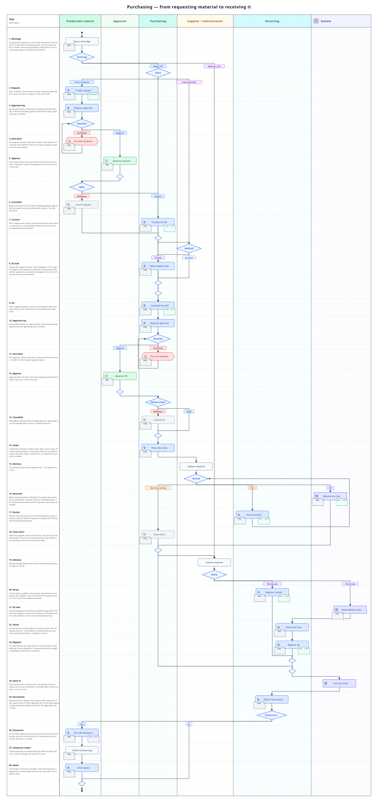
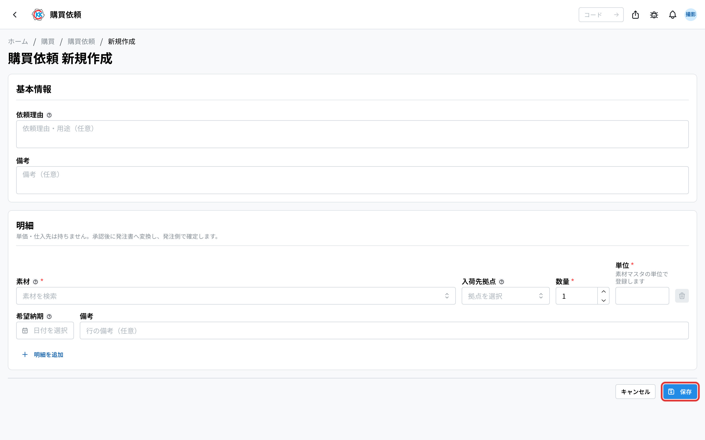
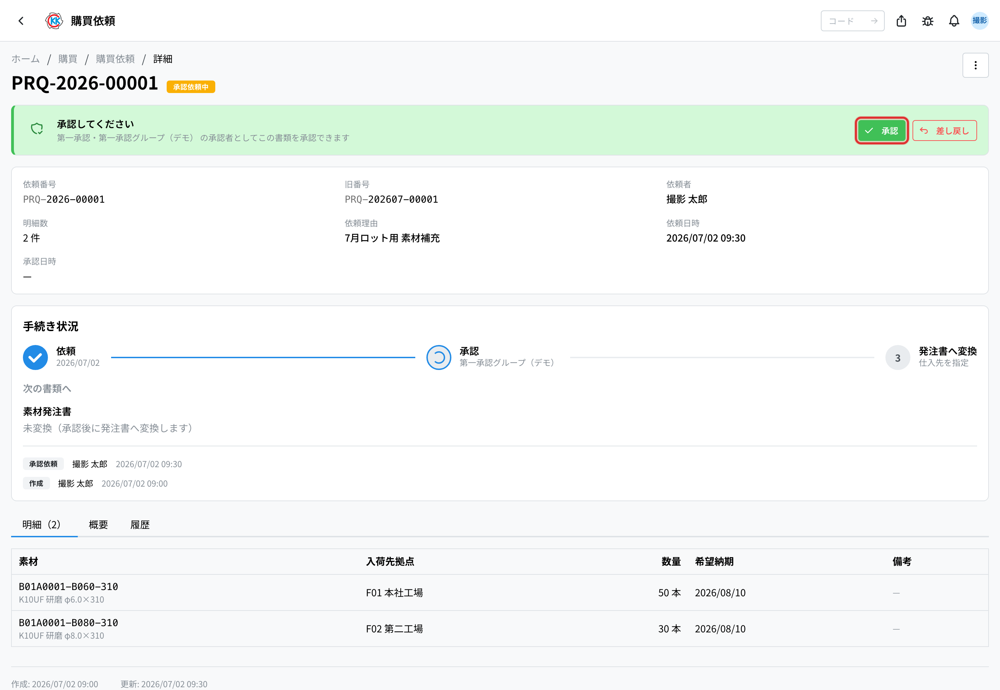
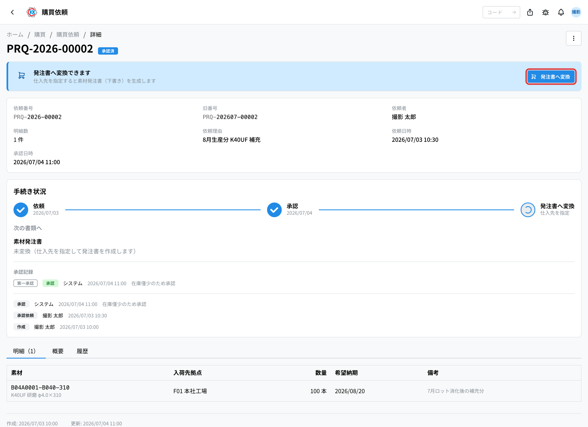
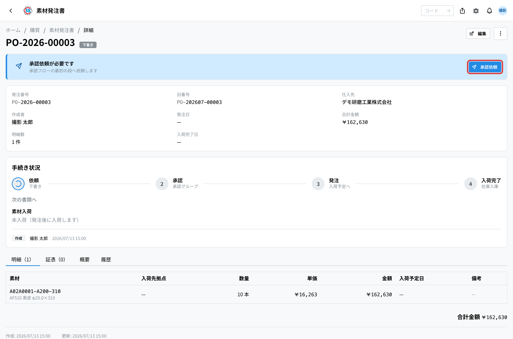
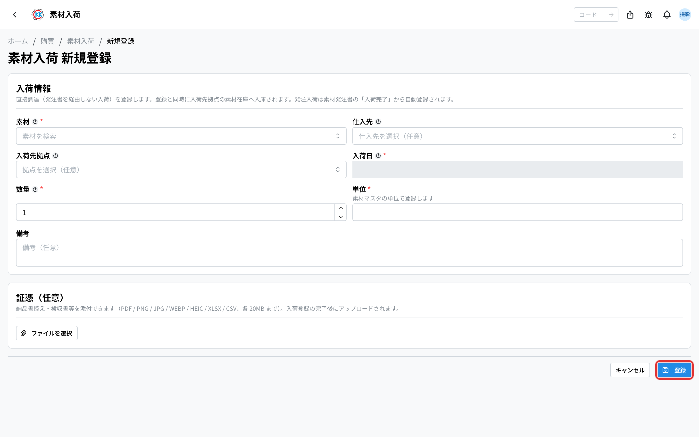
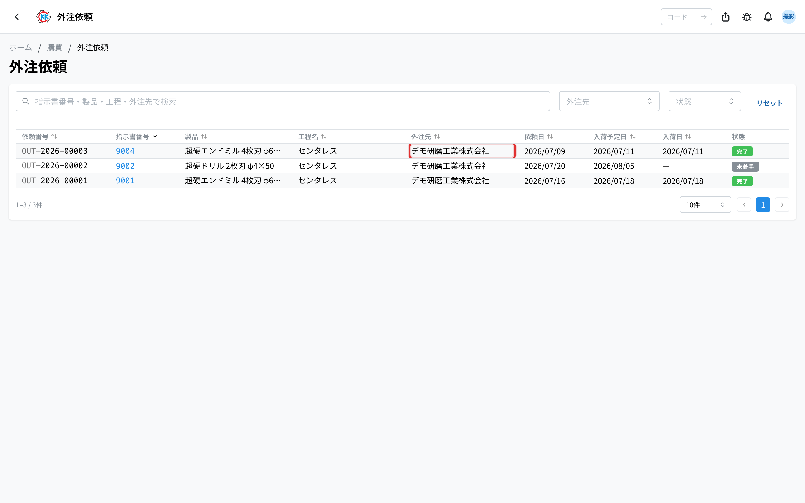

A page covering the flow from finding out that material is short, through ordering and receiving it, until it can be used as stock. It is where you check "what stage things are at now, and who does what next", the **branches** such as approval and split receiving, and each **document's states**.

## Overall flow

The full list of each step's branches and the app to use is in [Business Flow](/manual/en/business-flow#purchasing).

When it is urgent or the amount is small, you can also start **directly from a purchase order** without going through a purchase request. Semi-finished goods procured from outside get no work order — they are simply received as material.

## Stage-by-stage roles and apps

| Stage | What happens | Role | App used |
|-------|--------------|------|----------|
| 1. List the material needed | Write down the material, quantity and requested date wanted, and why it is needed | Production control / shop floor | [Purchase request](/manual/en/operations/purchasing/purchase-request/user) (`PU01`) |
| 2. Approve the request | Judge whether it is really needed, then approve or send back | Approver | [Purchase request](/manual/en/operations/purchasing/purchase-request/user) (`PU01`) |
| 3. Make the purchase order | Decide the supplier, the unit price and the expected date | Purchasing | [Material purchase order](/manual/en/operations/purchasing/purchase-order/user) (`PU02`) |
| 4–5. Approve and place the order | Check the amount and terms, approve, and place the order with the supplier | Approver → purchasing | [Material purchase order](/manual/en/operations/purchasing/purchase-order/user) (`PU02`) |
| 6. Record the receipt | For ordered material, press「入荷完了」(Receiving complete) or「分割入荷」(Partial receipt) on the purchase order. Only material bought without a purchase order is recorded in Material receipt | Receiving | [Material purchase order](/manual/en/operations/purchasing/purchase-order/user) (`PU02`) / direct purchases: [Material receipt](/manual/en/operations/purchasing/material-receipt/user) (`PU03`) |
| (In parallel) Outsource | Send part of the machining to an outside company | Production control | [Outsource order](/manual/en/operations/purchasing/outsource-order/user) (`PU04`) |

## What happens at each stage

### 1. Raising the request (purchase request)

Enter the material, quantity, receiving site and requested date wanted, write **why it is needed**, and request approval. Since the approver decides from that reason, it moves faster when you write down which step of which product it will be used for.

### 2. Approving the request

The approver checks the content and approves. **If it is sent back, fix the content and request again.**

### 3. Making the purchase order (material purchase order)

Make a purchase order from the approved request (it can also be made directly without going through a request). This is where you decide the **supplier, the unit price and the expected date**. Since the unit price is later also used as a reference for material cost in price estimates, enter the actual transaction price.

### 4–5. Approving the purchase order and placing the order

Check the amount and terms, and request approval. Once approved, place the order with the supplier, and the state becomes「発注済」(ordered). What has been ordered is treated as expected receipts.

### 6. Recording the receipt

Record the material that arrived. **The stock at the receiving site increases as of the recorded date.** Ordered material is recorded **on its material purchase order screen**; doing so creates a material receipt record linked to the purchase order automatically.

**The split-receiving branch** — when everything has arrived,「**入荷完了**」(Receiving complete) receives the rest at once. When only part has arrived,「**分割入荷**」(Partial receipt) receives just that part (receiving more than the ordered quantity is refused). When every line reaches its ordered quantity, the purchase order becomes「入荷完了」(received) automatically. When it is decided that the rest will not come,「**未入荷のまま完了**」(Close without receiving) closes the order with a reason, without receiving anything.

> ⚠️ Do not record arrivals of ordered material with「新規作成」(New) or「納品書から登録」(From a delivery note) in [Material receipt](/manual/en/operations/purchasing/material-receipt/user) (`PU03`). Those receipts are not linked to the purchase order, so its remaining quantity does not go down, and pressing「入荷完了」(Receiving complete) later puts the same material into stock a second time. The Material receipt screen is only for material bought without a purchase order (direct purchases).

The screen below is Material receipt, used to record a direct purchase.

### About outsource orders

Outsourcing does not come from a purchase request or a purchase order but from a **work order's step**. Choosing "outsourced" as the step's execution location and specifying the subcontractor makes it appear in the [Outsource order](/manual/en/operations/purchasing/outsource-order/user) list. The outsource order screen is a list for watching status; you cannot create a new outsource job from there.

## Document states

| Document | How the state moves |
|----------|----------------------|
| Purchase request | Draft → Pending approval → Approved → Ordered (can be sent back or cancelled) |
| Material purchase order | Draft → Pending approval → Approved → Ordered → Received (can be cancelled) |

## Where things tend to get stuck

**The request is not approved**
Check whether the reason for the request says nothing more than "because we need it". It can be judged when it states which step of which product it is for, and by when.

**Approval cannot be requested**
If the purchase request or material purchase order approval flow has no steps, approval cannot be requested. An administrator creates the steps in [Approval settings](/manual/en/operations/masters/approval-setting/user) (`MS0B`).

**Stock does not increase**
The receipt may not have been recorded yet. Record the quantity that arrived and the receiving site — with「入荷完了」(Receiving complete) or「分割入荷」(Partial receipt) on the purchase order for ordered material, or in Material receipt for material bought without a purchase order.

**Stock went into a different site**
The wrong receiving site was chosen. Choose the site where the goods actually arrived.

**The purchase order does not become「入荷完了」(received)**
Part of the ordered quantity has not been recorded yet. When it arrives in parts, record each arrival with「分割入荷」(Partial receipt) on the purchase order. Receipts recorded in Material receipt are not counted against the purchase order. If the rest will not come, close it with「未入荷のまま完了」(Close without receiving).

## Related pages

- Following a single order from start to finish … [Standard flow](/manual/en/process/default-flow)
- How to operate each app and what each field means … **Operations › Purchasing** on the left
- The flow to return to … [Production flow](/manual/en/process/production) (material shortages come from there)
- Registering the material itself … [Material master](/manual/en/operations/masters/material/user)
- Checking stock … [Inventory](/manual/en/operations/inventory/inventory-management/user)
