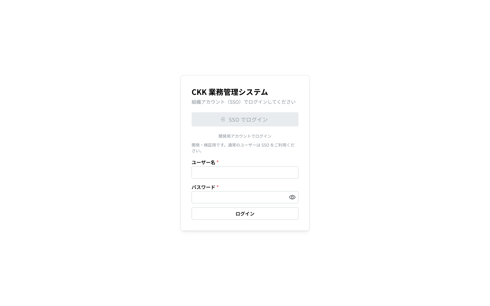
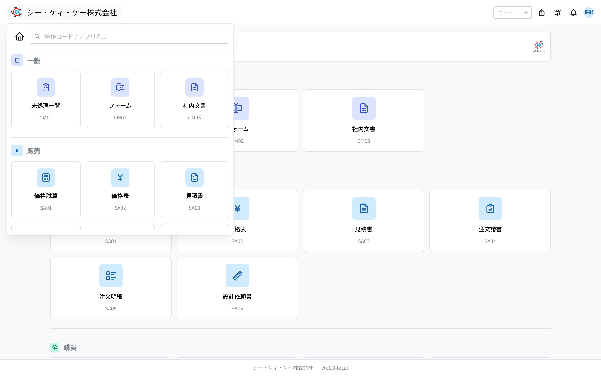
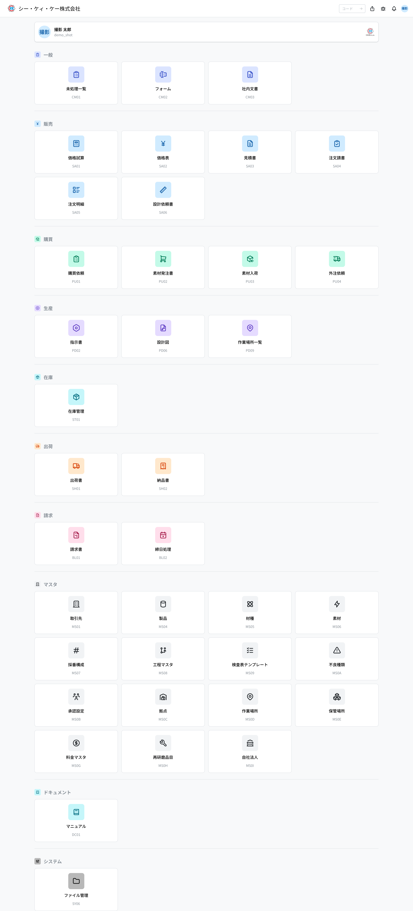

CKK 業務管理システムへようこそ。このページは **初めて使う方** 向けの入門ガイドです。専門用語は最後の「用語集」で説明します。

## このシステムとは

見積・受注・製造・出荷・請求までを 1 つにまとめた社内システムです。まずは営業に関わる 3 つのアプリ（**価格試算・価格表・見積書**）から使い始めます。

- **価格試算** … 「この製品はいくらで作れるか」を原価から計算します。
- **価格表** … 顧客ごとの販売単価を登録しておく台帳です。
- **見積書** … お客様に提出する見積書を作ります。単価は価格表から自動で入ります。

この 3 つは **価格試算 → 価格表 → 見積書** の順につながっています（下の「4. 販売の流れ」参照）。

## 1. ログイン

1. ブラウザで社内ポータルの URL を開きます。
2. **SSO（社内アカウント）** のボタンでサインインします。開発用アカウントは、画面下部の「開発用アカウントでログイン」ボタンを押すと表示される入力欄から使えます。
3. ログインできたら、右上の丸いアイコン（アバター）をクリックして、自分の名前・所属が正しいか確認します。

## 2. 画面の見かた

- **左上のロゴ** をクリック → 使えるアプリの一覧（ランチャー）が開きます。
- **右上の検索ボックス**（パソコンのみ） … アプリ名や「操作コード」（例 `SA01`）を入力して Enter すると、その画面へ直接移動します。スマートフォンなど幅の狭い画面には出ません — 同じ検索が上のアプリ一覧（ランチャー）の中にあります。
- **右上のベル** … お知らせ（通知）。**アバター** … プロフィール・通知設定・ホーム画面設定・表示設定・自分の権限・ログアウト。
- **ホーム画面** … 使えるアプリがカテゴリ別に並びます（ホーム画面設定で「カスタム（グループ別）」を選ぶと、自分で作ったグループごとの並びになります）。権限のないアプリは表示されません。また、環境（本番 / 開発）によって公開されているアプリも異なります。

## 3. 操作コード（画面番号）

各画面には 4 文字の番号があります。覚えておくと、右上の検索ボックス（パソコン）やアプリ一覧の検索からすぐ移動できます。

- `SA01` 価格試算 / `SA02` 価格表 / `SA03` 見積書
- `MS01` 取引先 / `MS0B` 承認設定

## 4. 販売の流れ（まずはこれだけ）

販売は **価格試算 → 価格表 → 見積書 → 注文請書** の順に進みます。
それぞれの業務で誰が何をして、どのアプリを使うのかは
[販売の流れ](/manual/ja/process/sales) にまとめてあります。
受注から請求までの全体を通しで知りたいときは
[標準フロー](/manual/ja/process/default-flow) を読んでください。

- 単価を計算する … [価格試算](/manual/ja/operations/sales/trial-estimate/user)（`SA01`）
- 顧客ごとの価格を決める … [価格表](/manual/ja/operations/sales/price-list/user)（`SA02`）
- 見積書を出す … [見積書](/manual/ja/operations/sales/quote/user)（`SA03`）

各アプリの詳しい操作と入力欄の意味は、左の **操作方法** から開いてください。

## 5. 困ったときは

- **画面が見当たらない** … 権限が足りない可能性があります。管理者に相談してください。
- **通知が来た** … 右上のベルから内容を確認できます。
- **自分の設定を変えたい** … 右上のアバターメニューにまとまっています。「プロフィール」で通知先メール・パスワード、「ホーム画面設定」でお気に入りアプリや表示方法、「表示設定」で画面の言語・日付/時刻の形式・タイムゾーン・文字の大きさ・太さを変更できます。「自分の権限」では、自分が持っている権限を確かめられます（「ユーザー設定マニュアル」参照）。

## 6. 書類番号のルール[#doc-number]

見積書・注文請書・請求書などの書類には、**作成したときにシステムが自動で番号を付けます**。自分で決めたり、あとから変えたりはできません。

- **形** … `QOT-2026-00001` のように「書類の記号 - 会計年度 - 連番 5 桁」です。注文明細は、注文請書の番号に枝番が付きます（`ORD-2026-00001-01`）。
- **会計年度** … 真ん中の 4 桁は会計年度で、**年度が始まる年**を表します。4 月始まりなら、2026 年 4 月〜2027 年 3 月に作った書類が `2026` です。どの年度に入るかは **書類を作成した日（日本時間）** で決まり、出荷日や締日では変わりません。
- **連番** … **発行会社（自社法人）ごと・会計年度ごと** に `00001` から数えます。年度が替わると `00001` に戻ります（月ごとには戻りません）。
- **番号は変わらず、使い回しません。** キャンセルした書類の番号もそのまま残り、ほかの書類に付くことはありません。
- **同じ番号が、別の発行会社にもあり得ます。** 番号に会社のコードは入らないためです。そこで画面の URL は `/sales/quotes/CKK~QOT-2026-00001` のように「会社コード`~`番号」の形になっています。番号だけで開いて複数の会社の書類に当たったときは、「発行会社を選択」の画面が出ます。
- **旧番号** … 以前の形（`QOT-202607-00001` のように年月が入った番号）で作られた書類は、新しい形に振り直しました。もとの番号は詳細画面に「**旧番号**」として表示され、一覧の検索でも探せます。旧番号の URL を開くと、新しい番号の画面へ自動で移ります。

| 記号 | 書類 | 記号 | 書類 |
|---|---|---|---|
| `EST` | 価格試算 | `WOR` | 指示書（書類番号） |
| `PRC` | 価格表 | `DOR` | 出荷書 |
| `QOT` | 見積書 | `DRN` | 納品書 |
| `ORD` | 注文請書（注文明細は `-NN` 付き） | `INV` | 請求書 |
| `DSG` | 設計依頼書 | `MOV` | 入出庫伝票 |
| `PRQ` | 購買依頼 | `STK` | 棚卸 |
| `PO` | 素材発注書 | `ACC` | 会計文書 |
| `OUT` | 外注依頼（依頼日を入れたときに付きます） | | |

> 💡 次の番号はこの決まりの**対象外**で、従来のままです: **ロット番号**（指示書を作ると付く通し番号。`#9001` など）、**印字番号**、**製品コード**（`PRD-202607-0001`）と再研磨品目コード（`RGD-…`）、フォームの回答（`FRM-…`）、社内文書（`DOC-…`）。

## 用語集

- **価格試算（しさん）** … 原価から販売単価を計算すること。見積の下準備。
- **参照単価 / 仕入実績** … 素材をいくらで仕入れたか（過去の購買履歴）。価格試算の材料費はこの実績価格を基に自動計算されます。
- **工具種（こうぐしゅ）** … 製品の種類。標準では 丸棒・円筒・OH付 の 3 種類があり（管理者が追加できます）、種類ごとに入力項目や計算式が変わります。
- **ロット** … まとめて作る本数（数量）のまとまり。数量が多いほど 1 本あたりの単価は下がります。
- **注文種別** … 本番・テスト・サンプル（金額 0）・その他 の区分。同じ製品でも種別ごとに価格を分けられます。
- **段取り / 形状出し** … 加工前の準備費用。数量で割って 1 本あたりに按分します。
- **確定 / 下書き** … 下書き（編集中）→ 確定（内容を固定）の状態。確定した価格試算は価格表作成時に選択できます。
