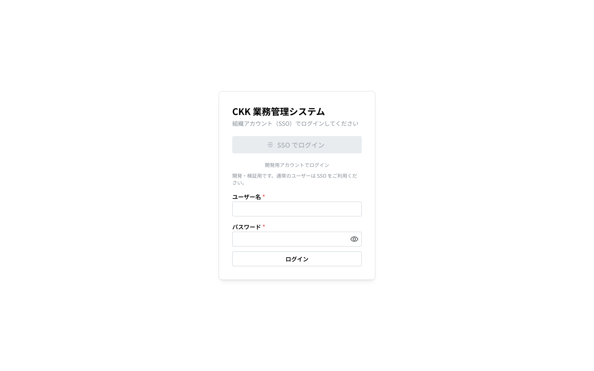
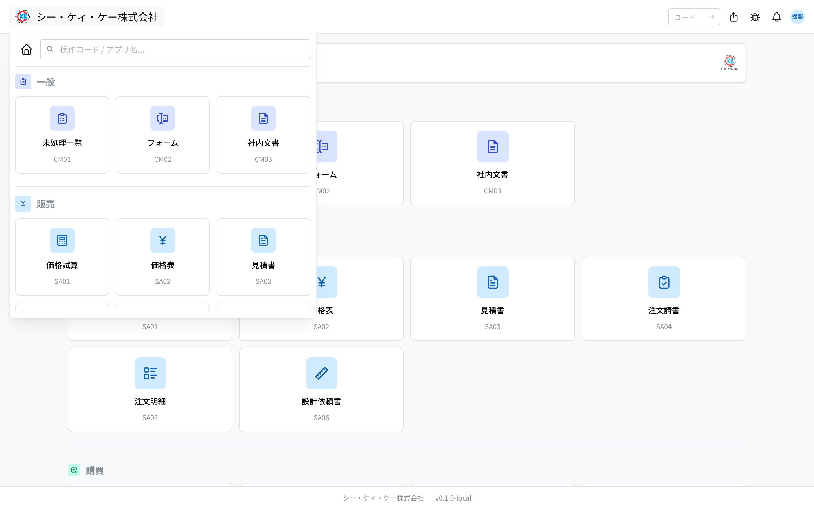
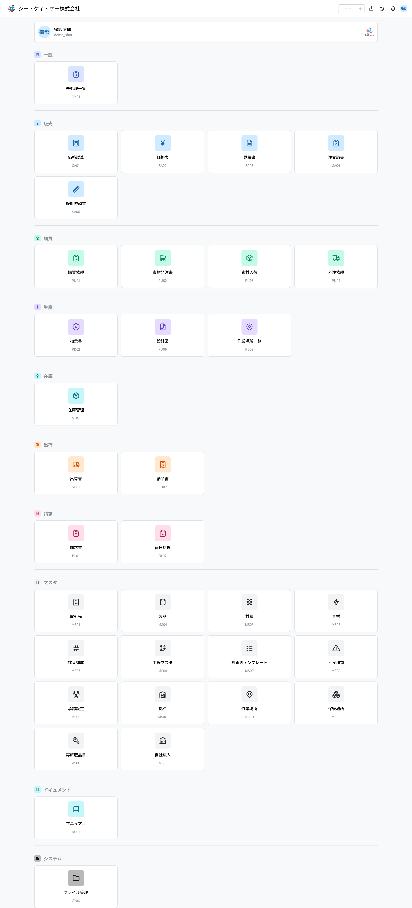

欢迎使用 CKK 业务管理系统。本页面向 **首次使用的用户**。专业术语在末尾的“术语表”中说明。

## 本系统是什么

一个将报价、接单、制造、出货、请款统一起来的公司内部系统。您将从三个销售应用开始使用：**价格试算、价格表、报价单**。

- **价格试算** … 根据成本计算“这个产品制造需要多少钱”。
- **价格表** … 按客户登记销售单价的台账。
- **报价单** … 制作提交给客户的报价单；单价会从价格表自动填入。

三者按顺序连接：**价格试算 → 价格表 → 报价单**（见“4. 销售流程”）。

## 1. 登录

1. 在浏览器中打开公司内部门户网址。
2. 用 **SSO（公司账号）** 按钮登录。开发用账号可点击登录页底部的“用开发账号登录”按钮，在展开的输入栏中使用。
3. 登录后，点击右上角的圆形头像，确认姓名与所属部门是否正确。

## 2. 界面说明

- 点击 **左上角 Logo** → 打开应用启动器（应用列表）。
- **右上角搜索框**（仅电脑） … 输入应用名称或“操作代码”（如 `SA01`）并按回车即可直接跳转。手机等窄屏设备不显示该输入框 — 相同的搜索位于上方的应用列表（启动器）中。
- **右上角铃铛** … 通知。**头像** … 个人资料、通知设置、主页设置、显示设置、我的权限、退出登录。
- **主页** … 按类别显示可用应用（在主页设置中选择“自定义（按分组）”后，会改为按自建分组排列）。无权限的应用不会显示；此外，不同环境（正式 / 开发）公开的应用也不同。

## 3. 操作代码（界面编号）

每个界面都有 4 位编号。记住后可从右上角搜索框（电脑）或应用列表中的搜索快速跳转。

- `SA01` 价格试算 / `SA02` 价格表 / `SA03` 报价单
- `MS01` 业务伙伴 / `MS0B` 审批设置

## 4. 销售流程（先掌握这些）

销售按 **价格试算 → 价格表 → 报价单 → 订单确认书** 的顺序推进。
各环节由谁负责、使用哪个应用，请参见
[销售流程](/manual/zh/process/sales)。
想通盘了解从接单到请款的整体流程，请阅读
[标准流程](/manual/zh/process/default-flow)。

- 计算单价 … [价格试算](/manual/zh/operations/sales/trial-estimate/user)（`SA01`）
- 确定客户价格 … [价格表](/manual/zh/operations/sales/price-list/user)（`SA02`）
- 出具报价单 … [报价单](/manual/zh/operations/sales/quote/user)（`SA03`）

各应用的详细操作与输入栏的含义，请从左侧的 **操作方法** 打开。

## 5. 遇到问题时

- **找不到界面** … 可能是权限不足，请联系管理员。
- **收到通知** … 可从右上角铃铛查看内容。
- **修改自己的设置** … 全部集中在右上角头像菜单中：“个人资料”可更改通知邮箱与密码，“主页设置”可更改收藏应用与显示方式，“显示设置”可更改界面语言、日期/时间格式、时区、文字大小与粗细，“我的权限”可确认自己持有的权限（参见[用户设置手册](/manual/zh/user-settings)）。

## 6. 单据编号规则[#doc-number]

报价单、订单确认书、请款单等单据，**在创建时由系统自动编号**。不能自行指定，之后也不能更改。

- **格式** … 形如 `QOT-2026-00001`，即“单据代号 - 会计年度 - 5 位流水号”。订单明细是在订单确认书编号后加分项号（`ORD-2026-00001-01`）。
- **会计年度** … 中间的 4 位是会计年度，表示**该年度开始的年份**。若从 4 月开始，则 2026 年 4 月至 2027 年 3 月创建的单据为 `2026`。属于哪个年度由**单据的创建日期（日本时间）**决定，不随出货日、结算日变化。
- **流水号** … **按开具公司（本公司法人）、按会计年度**从 `00001` 开始计数。年度更替时回到 `00001`（不再每月重置）。
- **编号不会改变，也不会被复用。** 已取消的单据仍保留其编号，该编号不会再分配给其他单据。
- **另一家开具公司可能有相同的编号。** 因为编号中不含公司代码。所以画面的 URL 采用“公司代码`~`编号”的形式，例如 `/sales/quotes/CKK~QOT-2026-00001`。只用编号打开而匹配到多家公司的单据时，会出现“选择开具公司”画面。
- **旧编号** … 以旧格式（含年月的编号，如 `QOT-202607-00001`）创建的单据已按新格式重新编号。原编号在详情画面以「**旧番号**」（旧编号）显示，在列表的搜索中也能找到。打开旧编号的 URL 会自动跳转到新编号的画面。

| 代号 | 单据 | 代号 | 单据 |
|---|---|---|---|
| `EST` | 价格试算 | `WOR` | 工单（单据编号） |
| `PRC` | 价格表 | `DOR` | 出货单 |
| `QOT` | 报价单 | `DRN` | 送货单 |
| `ORD` | 订单确认书（订单明细加 `-NN`） | `INV` | 请款单 |
| `DSG` | 设计委托单 | `MOV` | 出入库单 |
| `PRQ` | 采购申请 | `STK` | 盘点 |
| `PO` | 材料采购单 | `ACC` | 会计凭证 |
| `OUT` | 外协委托单（填写委托日期时编号） | | |

> 💡 以下编号**不适用**上述规则，保持不变：**批次号**（创建工单时分配的流水号，如 `#9001`）、**打标编号**、**产品编号**（`PRD-202607-0001`）与再研磨品目编号（`RGD-…`）、表单回答（`FRM-…`）、内部文档（`DOC-…`）。

## 术语表

- **价格试算** … 根据成本计算销售单价；报价的前期准备。
- **参考单价 / 采购实绩** … 材料的采购价格（过去的采购记录）。价格试算的材料费根据该实绩价格自动计算。
- **工具种类** … 产品类型。默认有 圆棒、圆筒、带OH 三种（管理员可以添加），不同类型的输入项与计算式不同。
- **批量（Lot）** … 一起制造的数量批次。数量越大，单件单价越低。
- **订单类型** … 正式、测试、样品（金额为 0）、其他。同一产品可按类型区分价格。
- **备料 / 成型** … 加工前的准备费用，按数量分摊到单件。
- **确定 / 草稿** … 草稿（编辑中）→ 确定（内容固定）。确定后的价格试算可在创建价格表时选择。
